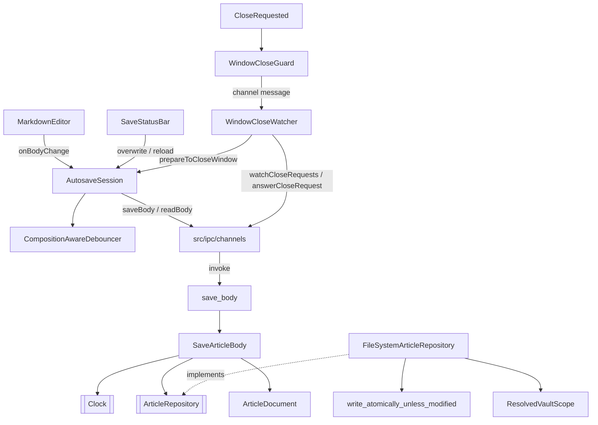

# Autosave, Atomic Write & Outside-Change Detection — Architecture Design

**Status:** Confirmed (decided autonomously; the user was away — every judgement call is listed in §8)
**Source PRD:** `.sdd/2026-08-20-autosave-and-atomic-write/PRD.md`
**Tech context:** Tauri 2 · Rust Cargo workspace (`rustle-domain` / `rustle-application` / `rustle-infrastructure` / `src-tauri`) · TypeScript strict + React + CodeMirror 6 · see `.sdd/PROJECT.md`

---

## 1. Design Goal & Guiding Principle

- **In one sentence:** turn "the editor's body changed" into a composition-aware, serialized, atomic, outside-change-guarded write of that article, and make every way of leaving the article (switch, close article, close window) pass through one gate that saves first and refuses when the change did not reach the disk.
- **Guiding principle:** *two deep modules, one per side of the channel.*
  - Rust: `ArticleRepository::write` has **no unguarded form** — it always takes the modification time the caller expects, and the infrastructure re-checks it right before the rename. `SaveArticleBody` is the only place that knows "read → splice body + `updated_at` → guarded write".
  - Webview: `AutosaveSession` owns *all* save timing and state (dirty revision, in-flight queue, outside-change warning, failure, "already refused once"). The editor only reports `changeBody`, the title bar only renders the snapshot, the window/listing only call `openArticle` / `closeArticle` / `prepareToCloseWindow`. Nobody else decides when to save.

---

## 2. Change Scope

| Area | Action | What / Why |
| :--- | :--- | :--- |
| `crates/domain` `article_repository.rs` | **Modify** | `ArticleRepository::write(workspace, article, text, expected_modified_at) -> Result<ArticleWrite, _>`; `ArticleWrite::{Written { modified_at }, ModifiedElsewhere}` (an expected business result, not an error); `ArticleRepositoryError::Unwritable` |
| `crates/domain` `clock.rs` | **Add** | `Clock` trait (`now() -> SystemTime`), mockable via `mockall` behind the `mocks` feature |
| `crates/domain` `utc_timestamp.rs` | **Move** (from infrastructure) | `UtcTimestamp` is pure formatting; the use case needs it to write `updated_at`, the repository to format mtimes — one formatter keeps D-2's "string compare" exact |
| `crates/application` `save_article_body.rs` | **Add** | `SaveArticleBody` use case + `SavedBody` payload + `OutsideChanges` |
| `crates/infrastructure` `atomic_file.rs` | **Modify** | add `write_atomically_unless_modified` (check → temp → fsync → permissions → **check again** → rename; temp removed on every failure). `write_atomically` stays for settings |
| `crates/infrastructure` `file_system_article_repository.rs` | **Modify** | implement `write` through `ResolvedVaultScope` (symlinks resolved, so a link writes its target and stays a link) |
| `crates/infrastructure` `system_clock.rs` | **Add** | `SystemClock` |
| `src-tauri` `commands/save_body.rs` | **Modify** | real command: parse names, run `SaveArticleBody` |
| `src-tauri` window close | **Add** | `WindowCloseGuard` state + `on_window_event` hook + two channels `watchCloseRequests` / `answerCloseRequest` |
| `src-tauri/capabilities` | **Not touched** | The webview still gets **no** permissions; window closing goes through Rustle channels instead of `core:window`/`core:event` permissions |
| `src/ipc` | **Modify** | `saveBody(..)`, `watchCloseRequests(onRequest)`, `answerCloseRequest(close)`; `SavedBody` type |
| `src/features/autosave/` | **Add** | `AutosaveSession`, `SaveStatusBar`, `useAutosaveSession`, `WindowCloseWatcher` |
| `src/features/editor/MarkdownEditor.tsx` | **Modify** | optional `onBodyChange(body)` prop (ref-held so the editor is never rebuilt by a new callback) |
| `src/app/App.tsx` | **Modify** | builds one `AutosaveSession`, renders the title bar above the editor, forwards editor changes, watches close requests |
| Article list / workspace list / "click to open" | **Not touched** | Listing slice. It calls `session.openArticle(..)` / `closeArticle()` — today nothing opens an article, so the title bar shows no status (BRIEF §8) |
| `ArticleDocument` | **Not touched** | Already does body replacement, `updated_at`, block creation, broken-block preservation, CRLF and BOM |

---

## 3. New Classes / Modules

### Rust

| Name | Kind | Responsibility | Collaborators | Satisfies |
| :--- | :--- | :--- | :--- | :--- |
| `ArticleWrite` | domain enum | Result of a guarded write: `Written { modified_at }` / `ModifiedElsewhere` | — | TC-18, TC-19, TC-23, TC-44 |
| `Clock` | domain trait | "What time is it" — the only source of `updated_at` | `SystemClock`, `MockClock` | TC-24 |
| `UtcTimestamp` | domain value | ISO 8601 UTC with milliseconds (`…Z`) | — | TC-24, A-5, D-2 |
| `SaveArticleBody` | application use case | read stored article → expected mtime (`OutsideChanges::Refuse` → the caller's last known, `Overwrite` → the file's current) → `ArticleDocument::parse(..).with_body(..).with_metadata(updated_at = clock.now())` → guarded write → `SavedBody` | `ArticleRepository`, `Clock`, `ArticleDocument` | TC-18~TC-28, TC-36 |
| `SavedBody` | application payload | `{ outcome: "saved", updatedAt, lastKnownModifiedAt }` / `{ outcome: "modifiedElsewhere", lastKnownModifiedAt }` (echoes the caller's value) | — | TC-18, TC-19, TC-36 |
| `OutsideChanges` | application enum | `Refuse` / `Overwrite` (the user's explicit authorisation) instead of a bare bool | — | TC-21, TC-23 |
| `write_atomically_unless_modified` | infrastructure fn | guarded atomic replace; temp named `.{file}.{random}.rustle-temporary` in the same folder (A-14) | `tempfile` | TC-12~TC-16, TC-19, TC-23, TC-44 |
| `SystemClock` | infrastructure | `SystemTime::now()` | — | TC-24 |
| `WindowCloseGuard` | src-tauri managed state | Holds the webview's close-request channel; on `CloseRequested`: no watcher → close; already waiting for an answer → close (second attempt / hung webview); otherwise prevent and notify | `tauri::ipc::Channel` | TC-08, TC-41~TC-43 |
| `save_body`, `watch_close_requests`, `answer_close_request` | src-tauri commands | parameter conversion only | use case / guard | TC-36, TC-37, TC-08 |

### TypeScript

| Name | Kind | Responsibility | Satisfies |
| :--- | :--- | :--- | :--- |
| `AutosaveSession` | class | Owns save timing and state: 1 s `CompositionAwareDebouncer`; revision counter (dirty = `revision !== savedRevision`); serialized save queue; waits for composition end before any save or reload; outside-change warning blocks autosave; `openArticle`/`closeArticle` → `AutosaveSwitchOutcome` (`switched` / `blockedByUnansweredWarning` / `blockedByFailedSave`); `overwrite()`, `reload()`, `prepareToCloseWindow()`; snapshot + subscribe for the UI | TC-01~TC-11, TC-20~TC-22, TC-29~TC-35, TC-38~TC-43, TC-45~TC-49 |
| `SaveStatusBar` | React component | Title bar: article title + 「已儲存」/「未儲存的變更」, outside-change warning with 「覆寫」/「重新載入」, failure message; nothing without an open article | TC-29~TC-34 |
| `useAutosaveSession` | hook | `useSyncExternalStore` over the session snapshot | TC-29~TC-34 |
| `WindowCloseWatcher` | function | Registers with `watchCloseRequests`; on a request asks `session.prepareToCloseWindow()` and answers `answerCloseRequest(decision === "close")` | TC-08, TC-41~TC-43 |

---

## 4. Modified Components

| Component | Current role | Change needed |
| :--- | :--- | :--- |
| `ArticleRepository` | read only | + guarded `write` |
| `FileSystemArticleRepository` | reads | + `write`; mtime formatting through `rustle_domain::UtcTimestamp` |
| `CommandError` | failure shape | `Unwritable` → `unexpected` (A-13: no new reason) |
| `Channel` / `channels.rs` / `commands.rs` | channel contract | + `WatchCloseRequests`, `AnswerCloseRequest` |
| `configure` | assembly | manages `WindowCloseGuard`, installs the `CloseRequested` hook |
| `MarkdownEditor` | editor | + optional `onBodyChange` |
| `App` | shell | session + title bar + close watcher; editor remounted (React `key`) when the session hands a new body (reload / open) |

---

## 5. Component Relationships

---

## 6. Extensibility & Handoff Notes

- **Most likely next requirement:** the listing slice opening articles; create-article / metadata editing writing the open article; the interface-language slice translating the title bar.
- **Where it lands:**
  - Opening / closing an article: `await session.openArticle({ article: ArticleBody, title })` / `session.closeArticle()`; act only on `"switched"`. There is no other way to change the open article, so "save before leaving" cannot be bypassed.
  - Any other writer of article files: `ArticleRepository::write` with an expected modification time (A-3 — there is no unguarded form to call).
  - Writing the open article from elsewhere (metadata slice A-9): leave through `closeArticle`, write, re-open with the new `ArticleBody`.
  - Title bar wording: all user-visible strings live in `SaveStatusBar`.
- **Patterns applied & why:** guarded-write (compare-and-swap on mtime) as the repository contract; single owner of save state (`AutosaveSession`) so every new trigger is a call, not a new timer; result enums instead of bools/errors for expected outcomes.
- **Do not hardcode:** the 1 s delay is a constructor argument of `AutosaveSession` (default 1000 ms).
- **Known debt / deferred:** the mtime window between the last `stat` and `rename` is narrowed, not closed (BRIEF §8); no retry on failure; no manual save.

---

## 7. Traceability

| PRD Scenario | Fulfilled by |
| :--- | :--- |
| TC-01, TC-02 save 1 s after typing stops, once | `AutosaveSession.changeBody` + `CompositionAwareDebouncer` |
| TC-03, TC-04, TC-05 composition pauses / resumes | `CompositionAwareDebouncer` used by `AutosaveSession` |
| TC-06, TC-07 save before switching article / workspace | `AutosaveSession.openArticle` / `closeArticle` |
| TC-08 close window only after the save | `WindowCloseGuard` + `WindowCloseWatcher` + `AutosaveSession.prepareToCloseWindow` |
| TC-09 nothing to save → no write, close not cancelled | `AutosaveSession` (dirty check) |
| TC-10 no article → no save | `AutosaveSession.changeBody` |
| TC-11 immediate save waits for composition end | `AutosaveSession` (waits for `CompositionState` end) |
| TC-12, TC-13 content replaced, no temp file left | `write_atomically_unless_modified` |
| TC-14 unwritable folder → original byte-identical, no temp | `write_atomically_unless_modified` |
| TC-15 read-only file keeps 0444 | `write_atomically_unless_modified` (permissions copied before rename) |
| TC-16, TC-17 symlinks inside / outside the vault | `FileSystemArticleRepository::write` + `ResolvedVaultScope` |
| TC-18, TC-19 matching / mismatching mtime | `write_atomically_unless_modified` + `SaveArticleBody` → `SavedBody` |
| TC-20 no autosave while the warning is unanswered | `AutosaveSession.changeBody` |
| TC-21 overwrite | `AutosaveSession.overwrite` → `OutsideChanges::Overwrite` in `SaveArticleBody` |
| TC-22 reload | `AutosaveSession.reload` → `channels.readBody` |
| TC-23 overwrite raced by another write | `FileSystemArticleRepository::write` (re-check at write time) |
| TC-24 `updated_at` = save time | `SaveArticleBody` + `Clock` |
| TC-25~TC-28 front matter untouched / created / broken / CRLF+BOM | `ArticleDocument` called by `SaveArticleBody` |
| TC-29~TC-34 title bar | `SaveStatusBar` over `AutosaveSession` snapshot |
| TC-35 typing in the editor marks unsaved | `MarkdownEditor.onBodyChange` → `AutosaveSession.changeBody` (wired in `App`) |
| TC-36 channel reply | `save_body` command + `SavedBody` |
| TC-37 the registered controller is the saveBody one | `ChannelRegistry` + `channels.rs` |
| TC-38~TC-40 unanswered warning blocks leaving | `AutosaveSession` (`blockedByUnansweredWarning`) |
| TC-41~TC-43 window close with failure / warning, second attempt | `AutosaveSession.prepareToCloseWindow` + `WindowCloseGuard` |
| TC-44 outside write between check and rename | `write_atomically_unless_modified` second check |
| TC-45 reload waits for composition end | `AutosaveSession.reload` |
| TC-46~TC-49 failed save blocks the first leave only | `AutosaveSession` refusal flag, reset by every finished save |

---

## 8. Risks & Decisions (made autonomously)

- **Window close without permissions (A-9).** Tauri's JS `onCloseRequested` needs `core:event` and `core:window:allow-destroy` permissions, but the foundation pins the capability to zero permissions. So the Rust side intercepts `CloseRequested` and notifies the webview over a `tauri::ipc::Channel` registered through the new `watchCloseRequests` channel; the webview answers through `answerCloseRequest(close)`, and Rust destroys the window. If a second close request arrives while Rust is still waiting for an answer, it is let through — a hung webview can never trap the window.
- **"Second attempt" bookkeeping.** `AutosaveSession` keeps two flags: *leaving refused because of a failed save* (switch/close article) and *window close refused* (any reason). Both reset whenever a save finishes (success or failure), so every new failure gets its own first refusal (TC-49). A switch is never let through while the warning is unanswered (TC-38); a second window close always is (TC-43).
- **Second attempt does not save again.** Following PRD 3.3 for the window ("不再儲存"), the informed second attempt to switch also leaves without another write attempt.
- **Title bar = in-app bar.** Setting the OS window title needs a window permission; the title bar is a strip at the top of the app page. The title comes from the caller of `openArticle` (the listing row has it); `ArticleBody` does not carry one.
- **`updatedAt` in the reply** is the value Rustle tried to write; for a broken front matter block it is not in the file (TC-27 keeps the block verbatim).
- **mtime comparison** is an exact string compare of `UtcTimestamp` (ms precision) on both sides (BRIEF D-2).
- **`mockall`** (`=0.15.0`) is added for the `Clock` mock (testing rules: clocks are mocked with `mockall`, exposed across crates through a `mocks` feature).
- **Testing the last-moment check (TC-44)** needs a pause between "temp written" and "rename"; the private implementation takes a `before_replace` step that production passes as a no-op and the unit test uses to write the file from "another program".
