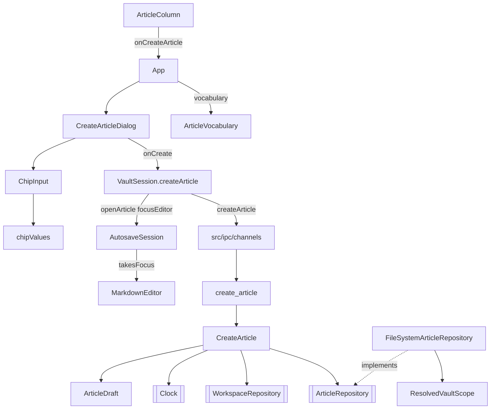

# Create Article Dialog — Architecture Design

**Status:** Confirmed (decided autonomously; the user was away — every judgement call is listed in §8)
**Source PRD:** `.sdd/2026-08-20-create-article-dialog/PRD.md`
**Tech context:** Tauri 2 · Rust Cargo workspace (`rustle-domain` / `rustle-application` / `rustle-infrastructure` / `src-tauri`) · TypeScript strict + React + CodeMirror 6 · see `.sdd/PROJECT.md`

---

## 1. Design Goal & Guiding Principle

- **In one sentence:** turn `{ workspace, title, category, tags }` typed into an IME-safe, form-less dialog into a brand-new `.md` file (slugged, never overwriting, inside the vault), then show it selected in column 2 with the editor focused on line one.
- **Guiding principle:** *one deep module per side, plus one reusable widget.*
  - Rust: `ArticleDraft` (domain) owns every rule about what a new article *is* — normalised title/category/tags, its file name among the folder's names, its front matter text. `CreateArticle` (application) is the only place that knows the sequence "list names → draft → time → create-new". `ArticleRepository::create` is the only way to make a file and it can never replace one.
  - Webview: `VaultSession.createArticle` owns everything after the click (request, both list reloads, opening through the autosave holder, remembering). The dialog only collects input. `ChipInput` knows nothing about articles, so the metadata-editing slice reuses it as is.

---

## 2. Change Scope

| Area | Action | What / Why |
| :--- | :--- | :--- |
| `crates/domain` `article_draft.rs` | **Add** | `ArticleDraft` + `ArticleDraftError::BlankTitle`: normalisation, file name, front matter text |
| `crates/domain` `local_timestamp.rs` | **Add** | `LocalTimestamp`: ISO 8601 with the writer's UTC offset (`2026-08-20T00:30:00+08:00`), per BRIEF R-2 |
| `crates/domain` `utc_timestamp.rs` | **Modify** | share the civil-date arithmetic with `LocalTimestamp` (crate-visible) |
| `crates/domain` `clock.rs` | **Modify** | `Clock::local_offset_seconds(at)`: the offset is a fact about the machine, so it comes from the same mocked boundary as `now()` |
| `crates/domain` `article_repository.rs` | **Modify** | `create(workspace, article, text)`; `ArticleRepositoryError::AlreadyExists { article }` (names the article, no absolute path — R-3) |
| `crates/application` `create_article.rs` | **Add** | `CreateArticle` use case + `CreateArticleError` |
| `crates/application` `list_articles.rs` | **Modify** | `ArticleSummary::new` becomes crate-visible so the reply row is built exactly like a listed row |
| `crates/infrastructure` `file_system_article_repository.rs` | **Modify** | `create`: confine through `ResolvedVaultScope` (parent folder's links resolved), `create_new` + fsync file and folder; a half-written file is removed |
| `crates/infrastructure` `system_clock.rs` | **Modify** | local offset via `chrono` (`clock` feature, already in `Cargo.lock`) |
| `src-tauri` `commands/create_article.rs` | **Modify** | real async command |
| `src-tauri` `command_error.rs` | **Modify** | `From<CreateArticleError>`; `AlreadyExists` → `unexpected` (no new reason, A-12) |
| `src/ipc` | **Modify** | `createArticle(request)` → `ArticleSummary`; `CreateArticleRequest` type |
| `src/features/vault/VaultSession.ts` | **Modify** | `createArticle(draft)`; `#openArticle` can ask the holder to focus the editor |
| `src/features/vault/ArticleColumn.tsx` | **Modify** | 「＋ 新文章」 button; the empty state becomes a 「建立第一篇文章」 button |
| `src/features/autosave/AutosaveSession.ts`, `AutosavedEditor.tsx` | **Modify** | `OpenedArticle.focusEditor`; `EditorDocument.takesFocus` passed through |
| `src/features/editor/MarkdownEditor.tsx` | **Modify** | `focusOnShow`: focus the view when a new document is shown (cursor at 0) |
| `src/features/articleMetadata/` | **Add** | `ChipInput`, `chipValues` (add / candidates), `ArticleVocabulary` |
| `src/features/createArticle/CreateArticleDialog.tsx` | **Add** | the dialog |
| `src/app/App.tsx`, `app.css` | **Modify** | open/close the dialog; styles |
| `docs/ime-regression-checklist.md` | **Modify** | T-9 now runnable on the dialog |
| channel contract / registries / capabilities / CSP | **Not touched** | `createArticle` is already a registered channel; only its file and its line in `channels.ts` change |
| `write_atomically` | **Not touched** | creating must never replace (A-14); rename would |
| `SaveArticleBody` time format | **Not touched** | still UTC `Z`; see §8 |

---

## 3. New Classes / Modules

### Rust

| Name | Kind | Responsibility | Collaborators | Satisfies |
| :--- | :--- | :--- | :--- | :--- |
| `ArticleDraft` | domain value | `new(title, category, tags)` trims the title (blank → `BlankTitle`), trims/drops-empty/dedupes category and tags; `file_name(existing: &[VaultEntry])` (every name in the folder counts); `to_text(created_at)` = front matter only, through `ArticleDocument::with_metadata` | `ArticleFileNameSlug`, `ArticleDocument`, `MetadataUpdate` | TC-25, TC-43~TC-48 |
| `LocalTimestamp` | domain value | `new(time, offset_seconds)`; `Display` → `YYYY-MM-DDTHH:MM:SS±HH:MM` | `UtcTimestamp` date arithmetic | TC-46, TC-63 |
| `CreateArticle` | application use case | `execute(workspace, title, category, tags) -> ArticleSummary`: draft → `workspace_entries` → file name → `LocalTimestamp` from `Clock` → `ArticleRepository::create` → summary parsed back from the written text | `WorkspaceRepository`, `ArticleRepository`, `Clock` | TC-25, TC-43~TC-50, TC-57~TC-59, TC-63, TC-64 |
| `CreateArticleError` | application error | `Draft` / `Workspace` / `Article` | — | TC-25, TC-57, TC-64 |
| `FileSystemArticleRepository::create` | infrastructure | create-new-only write inside the vault | `ResolvedVaultScope` | TC-50, TC-57~TC-60, TC-64 |

### TypeScript

| Name | Kind | Responsibility | Satisfies |
| :--- | :--- | :--- | :--- |
| `ChipInput` | component | chips + text box: Enter/`,` add (never while the IME owns the key), Backspace on empty removes last, × removes one, candidates shown only while typing, click adds; reports composition to the shared state | TC-04~TC-11, TC-15~TC-18, TC-28~TC-32 |
| `chipValues` | module | `withChip(values, typed)` (trim, ignore blank, ignore duplicate) and `candidatesFor(vocabulary, typed, chosen)` (case-insensitive substring, minus chosen) | TC-09, TC-10, TC-12~TC-18 |
| `ArticleVocabulary` | function | the workspace's distinct categories and tags from the listed `ArticleSummary` rows | TC-12~TC-14, TC-18 |
| `CreateArticleDialog` | component | `role="dialog"`, no `<form>`; Title focused on open; 「建立於 …」 text; Create disabled + reason when the title is blank; Enter in Title submits once; Esc/取消 close unless composing; pending chip text collected on submit; failure shown, dialog kept | TC-01~TC-03, TC-19~TC-24, TC-26, TC-27, TC-30, TC-33, TC-38~TC-41 |
| `VaultSession.createArticle` | method | no workspace → no request; call channel; reload workspaces and articles; open with `focusEditor`; remember; returns `{ outcome: "created" } \| { outcome: "failed", message }` | TC-38, TC-39, TC-42, TC-51~TC-54 |

---

## 4. Modified Components

| Component | Current role | Change needed |
| :--- | :--- | :--- |
| `ArticleRepository` | guarded read/write | + `create` (no overwrite form exists) |
| `Clock` / `SystemClock` / `MockClock` | `now()` | + `local_offset_seconds(at)` |
| `CommandError` | failure shape | + `From<CreateArticleError>` |
| `ArticleColumn` | list | entry buttons (`onCreateArticle`) |
| `AutosaveSession` | open article owner | carries `focusEditor` into `EditorDocument.takesFocus` |
| `MarkdownEditor` | one view | `focusOnShow` applied only when a new document key is shown, so list navigation keeps focus (TC-61) |

---

## 5. Component Relationships

---

## 6. Extensibility & Handoff Notes

- **Most likely next requirement:** editing metadata after creation (same form), and filtering by category/tag.
- **Where it lands:** the metadata dialog composes `ChipInput` + `ArticleVocabulary` exactly like `CreateArticleDialog`; its backend builds a `MetadataUpdate` (normalisation can move from `ArticleDraft` to a shared value if a second caller needs it). Filters reuse `ArticleVocabulary`.
- **How to add it:** a new dialog component and a new use case; no change to `ChipInput`.
- **Another file that does not exist yet** (pasted images): `ResolvedVaultScope::image_path` already judges a missing path by its nearest existing ancestor; create it with `create_new` like `FileSystemArticleRepository::create`.
- **Focus hand-off:** any future path that should land the cursor in the editor passes `focusEditor: true` to `openArticle`; nothing else changes.
- **Do not hardcode:** candidate matching lives only in `chipValues.candidatesFor`.
- **Known debt / deferred:** saving still writes `updated_at` in UTC `Z` (autosave slice); paste-splitting on commas (A-16); hard links (S-3).

---

## 7. Traceability

| PRD Scenario | Fulfilled by |
| :--- | :--- |
| TC-01~TC-03 fields, time text, focus | `CreateArticleDialog` |
| TC-04~TC-11 chip operations | `ChipInput` + `chipValues.withChip` |
| TC-12~TC-18 candidates | `ArticleVocabulary` + `chipValues.candidatesFor` + `ChipInput` |
| TC-19~TC-21 required title | `CreateArticleDialog` |
| TC-22~TC-24 Esc / cancel / composing Esc | `CreateArticleDialog` + `CompositionState.ownsKey` |
| TC-25 blank title rejected on disk | `ArticleDraft::new` → `CreateArticle` |
| TC-26~TC-32 IME Enter / composition flag | `CreateArticleDialog`, `ChipInput`, `CompositionState` |
| TC-33 no form element | `CreateArticleDialog` |
| TC-34~TC-37 column-2 entries | `ArticleColumn` + `App` |
| TC-38, TC-39 close / keep with message | `CreateArticleDialog` + `VaultSession.createArticle` |
| TC-40, TC-41 request contents | `CreateArticleDialog` |
| TC-42 no workspace → no request | `VaultSession.createArticle` |
| TC-43~TC-45 file names | `ArticleDraft::file_name` + `CreateArticle` |
| TC-46~TC-48 file contents | `ArticleDraft::to_text` + `LocalTimestamp` |
| TC-49 reply row | `CreateArticle` (`ArticleSummary` from the written text) |
| TC-50 never overwrite | `FileSystemArticleRepository::create` (`create_new`) |
| TC-51~TC-53 after creation | `VaultSession.createArticle` |
| TC-54~TC-56 focus + cursor | `VaultSession` → `AutosaveSession` → `MarkdownEditor.focusOnShow` |
| TC-61, TC-62 list keeps focus, no undo carry-over | `MarkdownEditor` (focus only on request; document key) |
| TC-57~TC-60 vault confinement | `ResolvedVaultScope` + `ArticleFileName::parse` + `create` |
| TC-63 local offset | `Clock::local_offset_seconds` + `LocalTimestamp` |
| TC-64 name taken at creation | `ArticleRepositoryError::AlreadyExists` |

---

## 8. Risks & Decisions (made autonomously)

- **TC-46 vs TC-63 / R-2.** TC-46 shows `…Z`; the later review ruling R-2 and TC-63 require the local offset. R-2 wins: `created_at`/`updated_at` are written as `2026-08-20T14:32:05+08:00` (seconds, no milliseconds, as in R-2's example). TC-46 is verified with the same instant in the machine's offset.
- **TC-12 wording.** It says typing 「技」 offers both 「技術筆記」 and 「桌面開發」, which contradicts TC-14 / BRIEF §5.4 (substring match). Implemented per BRIEF: the vocabulary has both, each once; 「技」 offers 「技術筆記」 only.
- **Local offset source.** Rust std cannot tell the local offset. `chrono` (`clock` feature; version already in `Cargo.lock`) is added to infrastructure only; `time`'s local offset refuses in multi-threaded processes on Unix. The domain stays I/O-free: it only formats a given offset.
- **Candidates come from the listed rows.** `ArticleSummary` already carries category and tags, so no new channel is needed and the vocabulary is exactly the selected workspace's.
- **Dialog is a `div role="dialog"`, not `<dialog>`.** A native modal restores focus to the opener on close, which would pull focus out of the editor (TC-54).
- **Create returns no modification time.** The editor gets it through the normal `readBody` when the article is opened.
- **A failed write after `create_new`** removes the half-written file, so "nothing appears on failure" holds for disk-full too.
- **Blocked switch after creation (A-9)** still reports success; the location is not remembered because the selection stayed where it was.
- **Saving still writes UTC** `updated_at`; aligning autosave to the local offset is outside this slice.
- **Reply row carries `updatedAt` (added during `/contract`).** TC-49 needs the row to say both times; `ArticleSummary` gained `updated_at`/`updatedAt`, so every listed row now carries it too (additive, not rendered).
- **Double submit** is guarded by a ref in `CreateArticleDialog` (state alone is not updated between two key presses in one frame).
- **The creation request takes the selection token before it is sent**, so a workspace clicked while the file is being created wins and the new article is not opened over it.
