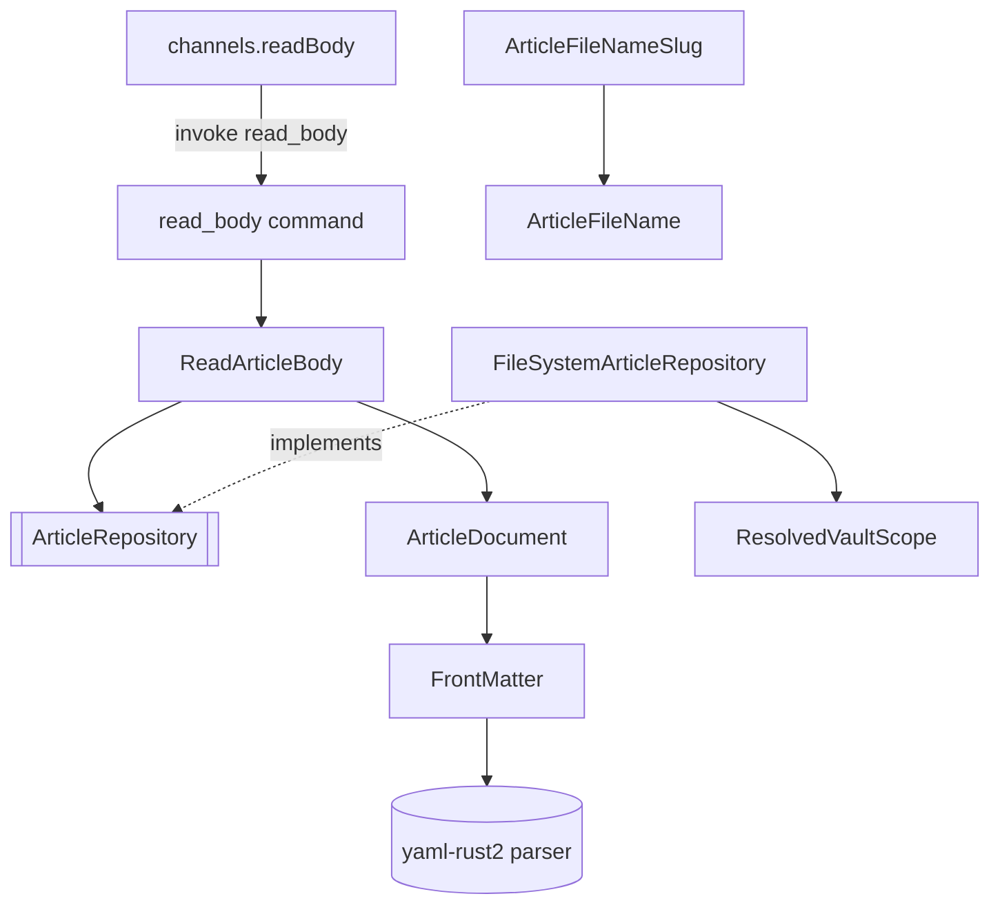

# Front Matter & Body Loading — Architecture Design

**Status:** Confirmed (decided autonomously; the user was away — every judgement call is listed in §8)
**Source PRD:** `.sdd/2026-08-20-front-matter-and-body-loading/PRD.md`
**Tech context:** Tauri 2 · Rust Cargo workspace (`rustle-domain` / `rustle-application` / `rustle-infrastructure` / `src-tauri`) · TypeScript strict + React · see `.sdd/PROJECT.md`

---

## 1. Design Goal & Guiding Principle

- **In one sentence:** turn an article file into "body for the editor + tolerant metadata", and turn "original text + requested changes" back into file text that differs from the original only where a change was requested; expose the read half through the `readBody` channel, confined to the vault.
- **Guiding principle:** *all front matter knowledge lives in one deep domain type, `ArticleDocument`.* Callers (the `readBody` use case today; autosave, article listing, create-article and metadata editing tomorrow) only say `parse(text)`, `body()`, `metadata(file_name)`, `with_body(..)`, `with_metadata(..)`, `to_text()`. Delimiters, BOM, CRLF, YAML, splicing and fallbacks never leak out.

---

## 2. Change Scope

| Area | Action | What / Why |
| :--- | :--- | :--- |
| `crates/domain` | **Add** | `ArticleDocument`, `FrontMatter` (private), `ArticleMetadata`, `MetadataUpdate`, `ArticleFileNameSlug`, `StoredArticle`, `ArticleRepository` trait, `ArticleRepositoryError` |
| `crates/domain/Cargo.toml` | **Modify** | Add `yaml-rust2 = "=0.13.0"` (pure parser, no I/O — allowed in domain) |
| `crates/application` | **Add** | `ReadArticleBody` use case + `ArticleBody` payload (serde camelCase) |
| `crates/infrastructure` | **Add** | `FileSystemArticleRepository` (reads through `ResolvedVaultScope`, formats mtime as ISO 8601 UTC) |
| `src-tauri` | **Modify** | `commands/read_body.rs` becomes real; `configure` receives the `VaultScope` and manages the repository as Tauri state; `From<ArticleRepositoryError> for CommandError` |
| `src/ipc/channels.ts` | **Modify** | `readBody(workspace, fileName)` returns `ChannelResult<ArticleBody>`; `ArticleBody` type in `src/ipc/articleBody.ts` |
| `saveBody`, `listArticles`, `createArticle`, `updateMetadata` channels | **Not touched** | Owned by later slices (BRIEF §4); they reuse `ArticleDocument` / `ArticleFileNameSlug` |
| `App.tsx` / editor UI | **Not touched** | "Click an article to load it" belongs to the layout/listing slice |
| `ResolvedVaultScope` | **Not touched** | Already resolves symlinks of the nearest existing ancestor and checks containment against the canonical root — it closes the read-path symlink gap (A-18) as is |

---

## 3. New Types / Modules

### Rust

| Name | Crate · file | Responsibility | Satisfies |
| :--- | :--- | :--- | :--- |
| `ArticleDocument` | domain · `article_document.rs` | Split text into optional BOM + optional front matter + body (A-1~A-4); give the body; read tolerant metadata; replace the body; apply a `MetadataUpdate`; render back to text byte-for-byte | TC-01~TC-31 |
| `FrontMatter` | domain · `article_document/front_matter.rs` (private) | Holds the raw block (opening line, content, closing line, each with its own line ending and trailing whitespace). Parses the content with yaml-rust2 for reading; edits by **splicing the text of top-level entries** (never re-serializing the whole block); verifies the edited block re-parses, otherwise keeps the original verbatim | TC-09, TC-19~TC-31 |
| `ArticleMetadata` | domain · `article_metadata.rs` | Read result: `title`, `created_at`, `updated_at`, `category`, `tags`, `has_incomplete_metadata` | TC-11~TC-19 |
| `MetadataUpdate` | domain · `metadata_update.rs` | Which known fields to write (each `Option`); builder style `MetadataUpdate::default().updated_at(..)` | TC-21~TC-31 |
| `ArticleFileNameSlug` | domain · `article_file_name_slug.rs` | `from_title` (lowercase, whitespace → `-`, drop illegal characters, collapse/trim `-`, `untitled` fallback) and `available_file_name(existing)` (case-insensitive collision → `-2`, `-3`…) returning an `ArticleFileName` | TC-32~TC-35 |
| `ArticleRepository`, `StoredArticle`, `ArticleRepositoryError` | domain · `article_repository.rs` | Trait for "read the stored text and its modification time of one article"; errors `OutsideVault(VaultPathError)` / `Unreadable(String)` | TC-36~TC-41 |
| `ReadArticleBody` | application · `read_article_body.rs` | Read the article through the repository, parse it into an `ArticleDocument`, return `ArticleBody { workspace, file_name, body, last_known_modified_at }` | TC-42, TC-43 |
| `FileSystemArticleRepository` | infrastructure · `file_system_article_repository.rs` | `ResolvedVaultScope::article_path` (lexical + symlink check) → read UTF-8 text + mtime → `StoredArticle`; I/O errors → `Unreadable` | TC-36~TC-41 |
| `read_body` command | src-tauri · `commands/read_body.rs` | Parse `workspace` / `fileName` into names, run `ReadArticleBody`, map errors | TC-42~TC-44 |

### TypeScript

| Name | File | Responsibility | Satisfies |
| :--- | :--- | :--- | :--- |
| `ArticleBody` | `src/ipc/articleBody.ts` | Payload type of `readBody` (`workspace`, `fileName`, `body`, `lastKnownModifiedAt`) | TC-42 |
| `channels.readBody` | `src/ipc/channels.ts` | `readBody(workspace, fileName)` → `invoke("read_body", { workspace, fileName })` | TC-42~TC-44 |

---

## 4. Modified Components

| Component | Current role | Change needed |
| :--- | :--- | :--- |
| `rustle_lib::configure` | Installs registries | Takes the `VaultScope`, manages a `FileSystemArticleRepository`; `run()` passes `VaultScope::at_default_location(home)` |
| `CommandError` | One failure shape | `From<ArticleRepositoryError>`: `OutsideVault` → `outsideVault`, `Unreadable` → `unexpected` (A-17: no new reason) |
| `src-tauri/tests/channels.rs` | Asserts every channel is not implemented | `readBody` is excluded; new integration tests call it against a temp vault |
| `src/ipc/channels.test.ts` | Checks every wrapper calls its command with no args | `readBody` checked with its arguments |

---

## 5. Component Relationships

---

## 6. Extensibility & Handoff Notes

- **Most likely next requirement:** autosave (`saveBody`) and article listing (`listArticles`).
- **Where it lands:**
  - Autosave: add `write` to `ArticleRepository` (atomic via `write_atomically`), and a `SaveArticleBody` use case: `ArticleDocument::parse(stored.text).with_body(new).with_metadata(&MetadataUpdate::default().updated_at(now)).to_text()`.
  - Listing: `ArticleDocument::parse(text).metadata(&file_name)` already yields the row data and `has_incomplete_metadata`.
  - Create article: `ArticleFileNameSlug::from_title(title).available_file_name(existing)` + `ArticleDocument::parse("").with_metadata(..)`.
- **How to add a new known field:** one `Option` on `MetadataUpdate`, one field on `ArticleMetadata`, one entry in the field table inside `front_matter.rs`. No caller changes.
- **Patterns applied & why:** parse-don't-validate (`ArticleDocument` is always renderable), repository trait in domain (I/O swappable and mockable), surgical text splicing instead of a round-tripping YAML serializer (zero formatting drift — stronger than the A-12 allowance).
- **Do not hardcode:** the vault location stays injected through `configure`.
- **Known debt / deferred:** create-path symlink check (BRIEF D-1), mtime tolerance (D-2), rename channel (D-3).

---

## 7. Traceability

| PRD Scenario | Fulfilled by |
| :--- | :--- |
| TC-01~TC-10 strip front matter | `ArticleDocument::parse` / `body` |
| TC-11~TC-19 tolerant metadata | `ArticleDocument::metadata` → `FrontMatter` read + `ArticleMetadata` |
| TC-20, TC-23 body-only replacement keeps the block | `ArticleDocument::with_body` (block untouched) |
| TC-21, TC-22, TC-24, TC-27 field edits keep unknown keys, order, comments, one-line values | `FrontMatter` entry splicing |
| TC-25, TC-26 lists always block style, empty removes the key | `FrontMatter` list rendering |
| TC-28 create a block when none exists | `ArticleDocument::with_metadata` |
| TC-29, TC-30 CRLF / BOM kept | `FrontMatter` line ending + `ArticleDocument` BOM |
| TC-31 broken block kept verbatim | `FrontMatter` (unparseable → no edit) |
| TC-32~TC-35 slug and collisions | `ArticleFileNameSlug` |
| TC-36~TC-41 vault-confined read | `FileSystemArticleRepository` + `ResolvedVaultScope` |
| TC-42~TC-44 `readBody` channel | `read_body` command + `ReadArticleBody` + `channels.readBody` |

---

## 8. Risks & Decisions (made autonomously)

- **YAML dependency (A-0):** `yaml-rust2 = "=0.13.0"` is added to the domain crate as a **parser only**. It already reports duplicate keys and bad indentation as errors (verified), which is exactly A-5's "broken block". There is no maintained comment-preserving YAML editor for Rust that is as safe, so edits are done by splicing the text of the affected top-level entries; untouched lines are copied byte-for-byte. A-12's three tolerated normalizations therefore never happen.
- **Edit safety net:** an edited block is re-parsed; if it no longer parses or does not read back the requested values, the original block is kept verbatim (same rule as A-5). Blocks whose top level is not a block mapping (e.g. a flow mapping `{title: x}` or a list) are treated as not editable.
- **Comments on list items (TC-27):** when a list is rewritten, an existing item line whose value is kept is reused verbatim, so its trailing comment stays with it. Comments on items that are removed go away with the item.
- **Replaced scalar line:** a trailing comment on a replaced scalar line (`updated_at: x # note`) is kept.
- **New keys** are appended after the last top-level entry and before the block's trailing blank/comment lines (so a closing comment stays last), in the order `title`, `created_at`, `updated_at`, `category`, `tags`.
- **Scalars written** in plain style when yaml-rust2 reads them back as the same string, otherwise double-quoted (e.g. `"2026"`, `"a: b"`). Never folded (TC-24).
- **Modification time (A-19):** ISO 8601 UTC with milliseconds (`2026-08-20T08:04:11.123Z`), formatted in infrastructure without a time crate (only one dependency is added, per A-0).
- **Vault location:** `~/Rustle` via `std::env::home_dir()`; the vault is not created on read. A missing home directory stops the app at start (`expect`), consistent with other assembly failures.
- **Non-UTF-8 files:** reported as `unexpected` (A-17).
