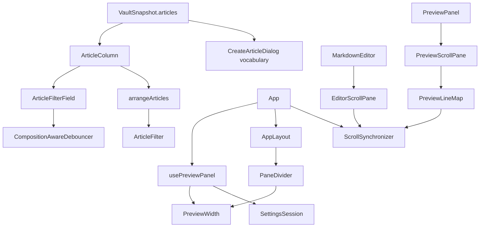

# List Controls and Preview Geometry — Architecture Design

**Status:** Confirmed (decided autonomously; the user was away — every judgement call is listed in §8)
**Source PRD:** `.sdd/2026-08-20-list-controls-and-preview-geometry/PRD.md`
**Tech context:** Tauri 2 · Rust Cargo workspace · TypeScript strict + React + CodeMirror 6 · see `.sdd/PROJECT.md`

---

## 1. Design Goal & Guiding Principle

- **In one sentence:** the article column draws a sorted, filtered *view* of the workspace's articles (never touching the files or the selection), and the editor/preview pair gets a draggable, remembered width and a line-based scroll sync that never chases itself.
- **Guiding principle:** *every decision is a pure value object; components only feed it numbers and events.*
  - `arrangeArticles(articles, arrangement)` is the one door from "the workspace's articles" to "the rows column 2 draws": filter, keep the open article, sort. `VaultSnapshot.articles` stays the whole workspace, so the create dialog's vocabulary is untouched by construction.
  - `PreviewWidth` owns the 20%–80% rule, the drag arithmetic and the keyboard step; the settings file keeps whatever the domain already accepts (0 < ratio < 1) and the webview clamps on the way in and on the way out.
  - `ScrollSynchronizer` knows nothing about DOM or CodeMirror: it talks to two `ScrollPane`s (position, maximum, line at top, position for a line, scroll to). The two adapters (`EditorScrollPane`, `PreviewScrollPane`) are the only places that measure pixels. `PreviewLineMap` is the pure line ↔ pixel interpolation the preview pane uses.

---

## 2. Change Scope

| Area | Action | What / Why |
| :--- | :--- | :--- |
| Rust crates, `src-tauri`, channels | **Not touched** | No new channel. Filtering and sorting are screen decisions; the width ratio already round-trips through `writeSettings`, and `PreviewPanelSettings::normalized` already turns garbage, `0` and `1` into `0.5` (BRIEF 5.4 #7) |
| `src/features/vault/articleArrangement.ts` | **Add** | `ArticleOrder`, `ArticleFilter`, `arrangeArticles` |
| `src/features/vault/ArticleFilterField.tsx` | **Add** | the filter text field: shows typed text at once, applies through the shared `CompositionAwareDebouncer` (150 ms), Enter applies now, Esc clears, both ignored while the input method owns the key |
| `src/features/vault/ArticleColumn.tsx` | **Modify** | holds the applied filter and the order (React state, not persisted), renders the order `<select>`, the filter field, `arrangeArticles` rows, "沒有符合的文章", and a "開著" marker on the open row kept despite the filter |
| `src/features/preview/PreviewWidth.ts` | **Add** | clamp 0.2–0.8, drag arithmetic, keyboard step |
| `src/features/preview/PaneDivider.tsx` | **Add** | `role="separator"` with pointer drag (live, no write) and arrow keys (composition-aware) |
| `src/features/preview/usePreviewPanel.ts` | **Modify** | also returns the clamped width ratio, a live `resize` (screen only) and `commitWidth` (writes settings) |
| `src/app/AppLayout.tsx` | **Modify** | editor + divider + preview live in one `writing-area`; the preview slot carries `width` (`ratio`, `onResize`, `onResizeEnd`); the divider is rendered only when the preview is open |
| `src/features/preview/PreviewLineMap.ts` | **Add** | line ↔ scroll position over measured block anchors (interpolated, clamped) |
| `src/features/preview/ScrollSynchronizer.ts` | **Add** | leader/follower sync between two panes, position-based echo suppression |
| `src/features/preview/PreviewScrollPane.ts` | **Add** | `ScrollPane` over the preview's scrolling element (reads `SOURCE_LINE_ATTRIBUTE`) |
| `src/features/editor/EditorScrollPane.ts` | **Add** | `ScrollPane` over a CodeMirror `EditorView` (line blocks, wrapped lines included) |
| `src/features/editor/MarkdownEditor.tsx` | **Modify** | optional `scrollSynchronizer` prop: attaches its view as the editor pane for its lifetime |
| `src/features/autosave/AutosavedEditor.tsx`, `src/features/vault/EditorColumn.tsx` | **Modify** | pass the synchronizer down |
| `src/features/preview/PreviewPanel.tsx` | **Modify** | owns its own scroller; attaches it as the preview pane while a body is shown |
| `src/app/App.tsx` | **Modify** | one `ScrollSynchronizer`; wires width + sync |
| `src/app/app.css` | **Modify** | filter/sort controls, writing area, divider, preview scroller |
| `docs/ime-regression-checklist.md` | **Modify** | T-8 and T-9 also cover the filter field (still 12 items) |
| `VaultSession`, `SettingsSession`, `CreateArticleDialog`, `renderPreviewHtml` | **Not touched** | the list is a view over the snapshot; the vocabulary keeps reading `snapshot.articles` |

---

## 3. New Classes / Modules

| Name | Kind | Responsibility | Collaborators | Satisfies |
| :--- | :--- | :--- | :--- | :--- |
| `ArticleOrder` | union type + `ARTICLE_ORDERS` labels | the three orders: `createdNewestFirst` (default), `title`, `updatedNewestFirst` | — | TC-01~03 |
| `ArticleFilter` | class (module-private) | `new ArticleFilter(text)`: trims, case-insensitive substring over title / categories / tags; blank matches everything | — | TC-11~18 |
| `arrangeArticles` | pure function | `(articles, { filterText, order, openArticle })` → `{ article, isOutsideFilter }[]`: filter (keeping the open article, flagged), then sort on a copy; times compared as instants (`Date.parse` on an ISO-shaped string, anything else = no time, last); ties by title then file name | `ArticleFilter`, `ArticleOrder` | TC-01~08, TC-20, TC-23, TC-58 |
| `ArticleFilterField` | component | typed text vs applied text, debounced via the shared composition state | `CompositionAwareDebouncer`, `CompositionState` | TC-24~31 |
| `PreviewWidth` | value class | `of(ratio)` clamps to 0.2–0.8; `draggedBy(pixelsToTheRight, areaWidth)`; `steppedBy(steps)` (5 points a step); `percent` | — | TC-32, TC-35~38, TC-40 |
| `PaneDivider` | component | separator semantics (`aria-valuenow/min/max`, focusable); pointer capture drag → `onResize` per move, `onResizeEnd` once on release; ArrowLeft/Right → `onResizeEnd` unless the input method owns the key | `PreviewWidth`, `CompositionState` | TC-32~36, TC-39~42 |
| `PreviewLineMap` | value class | from anchors `{ line, top }`, a line count, scroll height and client height: `positionFor(line)` (piecewise linear, clamped to `[0, scrollHeight − clientHeight]`, 0 with no anchors) and `lineAt(position)`; `measure(scroller, lineCount)` reads `[SOURCE_LINE_ATTRIBUTE]` | `SOURCE_LINE_ATTRIBUTE` | TC-43~48 |
| `ScrollPane` | type | `listen(onScroll)`, `position()`, `maximumPosition()`, `lineAtTop()`, `positionForLine(line)`, `scrollTo(position)` | — | TC-49~55 |
| `ScrollSynchronizer` | class | `attach(side, pane)` → detach (it listens to the pane itself); the scrolled side leads; the other follows unless already there; the follower's next scroll event at the position it was moved to is eaten once (no timer) | `ScrollPane` | TC-49~55, BRIEF 5.5 #4/#5/#9 |
| `EditorScrollPane` | class | line at top = line block index + fraction inside the block; position for a line = that block's top + fraction, in scroller coordinates | `EditorView` subset | TC-56, TC-57 |
| `PreviewScrollPane` | class | `ScrollPane` over the preview scroller, re-measuring a `PreviewLineMap` on every question (blocks move when images load) | `PreviewLineMap` | TC-43~48 in the app |

---

## 4. Modified Components

| Component | Current role | Change needed |
| :--- | :--- | :--- |
| `ArticleColumn` | draws `snapshot.articles` as given | order select + filter field + arranged rows + no-match message |
| `AppLayout` | four regions; preview `flex: 1` | `writing-area` (editor, divider, preview with `flex-basis` = ratio) |
| `usePreviewPanel` | open/close + shortcut | + width (clamped, live during drag, written on release) |
| `MarkdownEditor` | one view for the app's lifetime | optional `scrollSynchronizer` attached on mount, detached on unmount |
| `PreviewPanel` | renders HTML | own scroller; attaches as preview pane while a body is shown |
| `App` | webview composition root | builds the synchronizer, passes width controls |

---

## 5. Component Relationships

---

## 6. Extensibility & Handoff Notes

- **Most likely next requirements:** (1) another order (e.g. by category) or persisting the order; (2) click-to-locate in the preview; (3) more draggable dividers; (4) a toolbar or outline that scrolls the editor to a line.
- **Where they land:**
  1. One more `ArticleOrder` member + its comparator in `arrangeArticles` (the select reads `ARTICLE_ORDERS`). Persisting = one field on `Settings` + `ArticleColumn` reading it through `SettingsSession`.
  2. `PreviewLineMap.lineAt` already answers "which line is here"; `EditorScrollPane.positionForLine` already scrolls the editor to it.
  3. `PaneDivider` is layout-agnostic (`onResize(pixelsToTheRight)` against the measured parent); a second divider gets its own value class like `PreviewWidth`.
  4. Anything that implements `ScrollPane` can join or drive `ScrollSynchronizer`.
- **Patterns applied & why:** value objects for rules (clamp, interpolation, matching) so they are tested without a DOM; a port-like `ScrollPane` type so the synchronizer's tricky echo logic is tested with plain mocks; adapters are thin.
- **Do not hardcode:** the source-line attribute name (imported constant); the 20%/80% bounds and step (`PreviewWidth`); the filter delay is the shared 150 ms (`FILTER_DELAY_MILLISECONDS`, same value as the preview).
- **Known debt / deferred:** no list virtualization (NFR-3 measured, see PR); the preview line map is re-measured on each scroll event (cheap for normal articles; revisit with a cache invalidated on render/resize if very long articles stutter).

---

## 7. Traceability

| PRD Scenario | Fulfilled by |
| :--- | :--- |
| TC-01 ~ TC-08 (sorting) | `arrangeArticles` + `ArticleOrder` |
| TC-09, TC-10 (order change keeps selection, no channel) | `ArticleColumn` local state (never calls `onSelect`, no channel access) |
| TC-11 ~ TC-18 (matching) | `ArticleFilter` |
| TC-19 (no match message) | `ArticleColumn` |
| TC-20 (open article kept) | `arrangeArticles` (`openArticle`, `isOutsideFilter`) + `ArticleColumn` marker |
| TC-21 (no channel) | `ArticleColumn` / `ArticleFilterField` (no channel access) |
| TC-22 (vocabulary is whole workspace) | `App` keeps `vocabularyOf(snapshot.articles)`; column never changes the snapshot |
| TC-23 (filter + order) | `arrangeArticles` |
| TC-24 ~ TC-31 (filter field + IME) | `ArticleFilterField` + `CompositionAwareDebouncer` + `CompositionState.ownsKey` |
| TC-32 ~ TC-36 (drag, write on release, clamp) | `PaneDivider` + `PreviewWidth` + `usePreviewPanel` |
| TC-37, TC-38 (stored ratio) | `usePreviewPanel` (`PreviewWidth.of(settings ratio)`) + `AppLayout` flex-basis |
| TC-39 (no divider when folded) | `AppLayout` |
| TC-40, TC-41 (keyboard) | `PaneDivider` |
| TC-42 (accessible separator) | `PaneDivider` |
| TC-43 ~ TC-47 (line ↔ pixel) | `PreviewLineMap` |
| TC-48 (attribute constant) | `PreviewLineMap.measure` |
| TC-49 ~ TC-55 (sync, echo, detach) | `ScrollSynchronizer` |
| TC-56, TC-57 (editor geometry) | `EditorScrollPane` |
| TC-58 (500 articles) | `arrangeArticles` (timed test, number in PR) |

---

## 8. Risks & Open Decisions (decided)

- **Filter and order across workspaces.** Kept while the app runs (switching workspace keeps the typed filter and the order); reset on restart (A-3).
- **Open-row marker.** The open row is already `aria-pressed`; when it is kept only because it is open, it also shows a small "開著" marker so a non-matching row does not look like a matching one.
- **Time parsing.** Only strings shaped like an ISO 8601 date (optionally with time and offset) are times; `Date.parse` on other strings is implementation-defined, so they are "no time".
- **Tie order.** Same instant (or both missing) → title (`localeCompare`), then file name, so the order is total and stable.
- **Width clamp on write.** Releasing the divider writes the clamped ratio. A stored `0.97` shows as 80% but is only rewritten when the user moves the divider.
- **Line beyond the last block.** `PreviewLineMap` adds an end anchor (`lineCount`, `scrollHeight`) so the lines after the last block interpolate to the bottom; together with the clamp, "scroll to the end" puts both sides at the end (BRIEF 5.5 #4).
- **Edges.** When the leader is at its top or bottom edge, the follower goes to its own top/bottom edge, whatever the line arithmetic says (BRIEF 5.5 #4/#5).
- **Echo tolerance.** Positions within 1 px count as equal (browsers round fractional scroll positions).
- **Divider pointer events in tests.** happy-dom has no layout, so tests give the divider's parent a width through a mocked `getBoundingClientRect`; real dragging is checked by hand (PR "How to verify").
