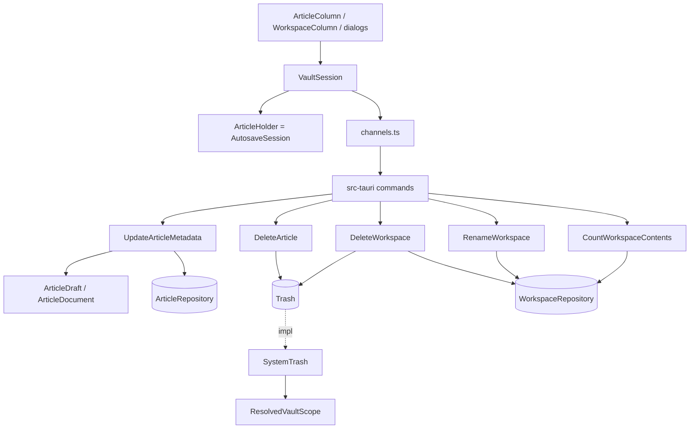

# Metadata Editing and Destructive Operations — Architecture Design

**Status:** Confirmed (decided autonomously; the user was away — every judgement call is listed in §8)
**Source PRD:** `.sdd/2026-08-20-metadata-editing-and-destructive-operations/PRD.md`
**Tech context:** Tauri 2 · Rust Cargo workspace (`rustle-domain` / `rustle-application` / `rustle-infrastructure` / `src-tauri`) · TypeScript strict + React + CodeMirror 6 · see `.sdd/PROJECT.md`

---

## 1. Design Goal & Guiding Principle

- **In one sentence:** let the writer edit an article's title / category / tags through the same chip form used for creation (only four keys change in the file), move an article or a whole workspace to the **system trash** (never a permanent delete, images untouched), rename a workspace in place, show a deletion confirmation whose counts are read from disk at that moment, and report every failure of these operations through one dismissable notice that names the operation.
- **Guiding principle:** *one capability per seam, and one owner per side.*
  - Rust: the system trash is one domain trait, `Trash`, addressed **by vault names, never by paths** (`move_article_to_trash`, `move_workspace_to_trash`). Its one implementation, `SystemTrash`, is the only code that resolves those names through `ResolvedVaultScope` and hands a location to the OS. Every later "delete something" requirement adds one method there; nothing else in the app learns how to delete.
  - Rust: metadata rules stay in the domain types that already own them — `ArticleDraft` (trim / blank title / dedupe, now shared by creation and editing) and `ArticleDocument` (byte-preserving front matter edit). The use case only sequences read → edit → guarded write.
  - Webview: `VaultSession` stays the single owner of selection and lists, and gains one method per operation. Every operation that touches the open article goes through the existing `ArticleHolder` doors (`closeArticle` / `openArticle`) first, and every failure lands in one snapshot field, `operationFailure`, rendered by one component.

---

## 2. Change Scope

| Area | Action | What / Why |
| :--- | :--- | :--- |
| `crates/domain` `trash.rs` | **Add** | `Trash` trait (name-addressed, `mockall` automock behind the `mocks` feature) + `TrashError` |
| `crates/domain` `article_document.rs` | **Modify** | `edit_metadata(update) -> Result<Self, UneditableFrontMatter>`: the strict twin of `with_metadata`; refuses a front matter it cannot edit safely instead of silently keeping it |
| `crates/domain` `article_draft.rs` | **Modify** | doc now covers "typed into the metadata form" (creation and editing); `edit(document, updated_at)` applies title / category / tags / updated_at |
| `crates/domain` `vault_entry.rs` | **Modify** | `as_image()`: a file in `images/` that is not hidden (rule A-6) |
| `crates/domain` `workspace_repository.rs` | **Modify** | `image_entries(workspace)`, `rename(workspace, new_name)` |
| `crates/application` | **Add** | `UpdateArticleMetadata`, `DeleteArticle`, `RenameWorkspace`, `CountWorkspaceContents`, `DeleteWorkspace` (one struct each) + their reply/error types |
| `crates/infrastructure` `system_trash.rs` | **Add** | `SystemTrash` (`trash` crate `=5.2.9`; on macOS the `NsFileManager` method so no Finder automation prompt) |
| `crates/infrastructure` `file_system_workspace_repository.rs` | **Modify** | `image_entries` (missing `images/` lists as empty), `rename` (never onto an existing entry) |
| `src-tauri` | **Modify / Add** | real `update_metadata`; four new channels `deleteArticle`, `renameWorkspace`, `countWorkspaceContents`, `deleteWorkspace`; `SystemTrash` managed state; `From` impls in `command_error.rs` |
| `src/ipc` | **Modify / Add** | typed wrappers + request/payload types for the five channels |
| `src/features/vault/VaultSession.ts` | **Modify** | `updateMetadata`, `deleteArticle`, `renameWorkspace`, `countWorkspaceContents`, `deleteWorkspace`, `dismissOperationFailure`; snapshot `operationFailure`, `renameRejection`; `createArticle` failures also land in `operationFailure` |
| `src/features/vault/operationFailure.ts` | **Add** | the operation names and the refusal sentences; `describeOperationFailure(failure)` |
| `src/features/vault/OperationFailureNotice.tsx` | **Add** | the one dismissable notice |
| `src/features/vault/ArticleColumn.tsx`, `WorkspaceColumn.tsx` | **Modify** | row actions (編輯 metadata / 刪除; 重新命名 / 刪除), inline `RenameWorkspaceField` |
| `src/features/vault/workspaceNameRejection.ts` | **Add** | one rejection-explanation table shared by the create field and the rename field |
| `src/features/editArticleMetadata/EditArticleMetadataDialog.tsx` | **Add** | the edit form (same `ChipInput`, read-only times) |
| `src/features/deletion/ConfirmDeletionDialog.tsx` | **Add** | the two-step confirmation (focus on 取消, `Esc` cancels, no `Enter` binding) |
| `src/app/App.tsx`, `app.css` | **Modify** | wire the dialogs and the notice |
| `docs/ime-regression-checklist.md` | **Modify** | T-9 covers the metadata form and the rename field; release checklist mentions the trash |
| `ArticleRepository` | **Not touched** | the guarded `write` is exactly what metadata editing needs (A-7 / A-16); deleting is the trash's job, not the repository's |
| `AutosaveSession` | **Not touched** | its two refusing doors already implement "save first, refuse, then let go on the second try" (A-9, A-10, TC-53) |
| `WorkspaceNameRequest::judge` | **Not touched** | renaming judges the new name against every vault entry, the renamed one included, which is exactly the case-only rule A-8 |
| Capabilities / CSP | **Not touched** | channels are custom commands; the webview still gets no Tauri permission |

---

## 3. New Classes / Modules

### Rust

| Name | Kind | Responsibility | Collaborators | Satisfies |
| :--- | :--- | :--- | :--- | :--- |
| `Trash` | domain trait | move a named article or a named workspace to the system trash; never a permanent delete | — | TC-25, TC-26, TC-43, TC-48, TC-49 |
| `TrashError` | domain error | `OutsideVault` / `NotMoved { item, reason }` (names the vault item, never an absolute path) | `VaultPathError` | TC-48, TC-49, TC-50 |
| `UneditableFrontMatter` | domain error | the front matter is broken YAML or not a mapping, so a metadata edit is refused rather than silently dropped | — | §8 assumption |
| `UpdateArticleMetadata` | application use case | draft (rejects a blank title) → read → `ArticleDraft::edit` with a `LocalTimestamp` from `Clock` → guarded write against the modification time just read → summary read back from the written text; or `ModifiedElsewhere` | `ArticleRepository`, `Clock` | TC-11~TC-17 |
| `MetadataUpdateOutcome` | application reply | `Updated { article }` / `ModifiedElsewhere` (an expected result, so a value, not an error) | `ArticleSummary` | TC-16, TC-17 |
| `UpdateArticleMetadataError` | application error | `Draft` / `FrontMatter` / `Article` | — | TC-15 |
| `DeleteArticle` | application use case | refuses a file name that is not an article, then `Trash::move_article_to_trash` | `Trash` | TC-25, TC-26 |
| `DeleteArticleError` | application error | `NotAnArticle` / `Trash` | — | — |
| `RenameWorkspace` | application use case | `judge` the new name against the vault's entries → `WorkspaceRepository::rename`; rejection is a value | `WorkspaceRepository` | TC-32, TC-33 |
| `RenameWorkspaceOutcome` | application reply | `Renamed { workspace }` / `Rejected { reason }` | `WorkspaceNameRejection` | TC-32~TC-34 |
| `CountWorkspaceContents` | application use case | counts articles (`as_article` on the workspace's entries) and images (`as_image` on `images/`) | `WorkspaceRepository` | TC-39~TC-42 |
| `WorkspaceContents` | application reply | `{ articleCount, imageCount }` | — | TC-39~TC-41 |
| `DeleteWorkspace` | application use case | counts again, then `Trash::move_workspace_to_trash`; replies with what went | `WorkspaceRepository`, `Trash` | TC-43 |
| `DeleteWorkspaceError` | application error | `Workspace` / `Trash` | — | — |
| `SystemTrash` | infrastructure | resolve the name through `ResolvedVaultScope` (links resolved, confined), refuse a missing item, then `trash` crate | `ResolvedVaultScope` | TC-48, TC-49 |

### TypeScript

| Name | Kind | Responsibility | Satisfies |
| :--- | :--- | :--- | :--- |
| `operationFailure.ts` | module | `Operation` names, `OperationFailure`, `describeOperationFailure`, `refusalMessage(outcome)` for the two `ArticleHolder` refusals | TC-50~TC-53 |
| `OperationFailureNotice` | component | shows `describeOperationFailure(snapshot.operationFailure)` with a 關閉提示 button | TC-54 |
| `ArticleMetadataForm` | component | the form-less, IME-safe title + chip dialog shared by creating and editing (Enter in the title submits, Esc closes, busy while submitting); added during improve-codebase | TC-04~TC-09 |
| `EditArticleMetadataDialog` | component | `ArticleMetadataForm` prefilled from the row; read-only 建立於 / 更新於 as written in the file (its own offset, never converted) | TC-01~TC-09 |
| `ConfirmDeletionDialog` | component | `role="alertdialog"`, initial focus on 取消, `Esc` (not owned by the input method) cancels, no implicit `Enter` confirm | TC-22~TC-24, TC-39, TC-44 |
| `ArticleDeletionDialog` / `WorkspaceDeletionDialog` | components | what each confirmation says (trash, images untouched, the counts) on top of `ConfirmDeletionDialog` | TC-22, TC-39 |
| `RenameWorkspaceField` | component | inline field prefilled with the current name; `Enter` (not composing) submits, `Esc` cancels | TC-10, TC-33, TC-34 |
| `workspaceNameRejection.ts` | module | the one explanation table for a rejected workspace name | TC-34 |

---

## 4. Modified Components

| Component | Current role | Change needed |
| :--- | :--- | :--- |
| `ArticleDraft` | rules of a new article | also the rules of an edited article; `edit(document, updated_at)` |
| `ArticleDocument` | tolerant front matter read / write | `edit_metadata` (strict) next to `with_metadata` (tolerant, used by autosave) |
| `VaultEntry` | listing rules | `as_image` |
| `WorkspaceRepository` / `FileSystemWorkspaceRepository` | list / create workspaces | `image_entries`, `rename` |
| `command_error.rs` | error → `CommandError` | `From` for the new errors; no new `FailureReason` (all `unexpected` / `outsideVault`) |
| `lib.rs` `configure` | manages repositories | also manages `SystemTrash` |
| `VaultSession` | selection, lists, creation | one method per operation; `operationFailure`; `renameRejection` |
| `ArticleColumn` / `WorkspaceColumn` | rows are one button | row = select button + action buttons (no nested buttons) |
| `NewWorkspaceField` | create field | uses the shared rejection table |
| `CreateArticleDialog` | creation form | failure line reads `建立文章失敗：…` (same sentence as the notice) |

---

## 5. Component Relationships

Order inside `VaultSession` for an operation that may touch the open article:

1. `updateMetadata(fileName, draft)`: if it is the open article → `closeArticle()` (refused → `operationFailure`, nothing written) → `updateMetadata` channel → reload lists → if it was open, `readBody` + `openArticle` (fresh modification time, new title) whether or not the update succeeded, so the editor never stays empty.
2. `deleteArticle(fileName)`: if open → `closeArticle()` (refused → stop) → `deleteArticle` → reload both lists → clear the selection if it was open.
3. `renameWorkspace(workspace, typed)`: if it is the selected workspace → `closeArticle()` (refused → stop) → `renameWorkspace` → reload workspaces → re-select it under the new name (editor empty) when it was selected.
4. `countWorkspaceContents(workspace)` before the confirmation (failure → notice, no confirmation); `deleteWorkspace(workspace)`: if selected → `closeArticle()` → `deleteWorkspace` → reload workspaces → clear the selection when it was selected.

Every success clears `operationFailure`; every failure replaces it. Only an operation on what is selected starts a new selection (`#selectionFor`); one on anything else leaves an in-flight click alone (found by `/contract`).

---

## 6. Extensibility & Handoff Notes

- **Most likely next requirement:** cleaning orphan images, deleting settings, or renaming an article file — more "remove / move this vault thing".
- **Where it lands:** `Trash` gets one more name-addressed method (e.g. `move_image_to_trash(workspace, image)`), `SystemTrash` resolves it with the matching `ResolvedVaultScope` method. Counting rules land on `VaultEntry` (`as_image` is already there for an orphan scan).
- **How to add a failure-reporting operation:** add one `Operation` value and its sentence in `operationFailure.ts`; the notice, dismissal and "next success clears it" come for free.
- **Anything that rewrites the open article:** follow `VaultSession.updateMetadata` — `closeArticle`, write, `openArticle` with a fresh `ArticleBody`.
- **Do not hardcode:** the trash method (`SystemTrash` owns the platform choice); explanation sentences (one table each).
- **Known debt / deferred:** case-only rename (A-8); hard links (S-3); a trashed item cannot be restored from inside the app (the OS trash is the undo path).

---

## 7. Traceability

| PRD Scenario | Fulfilled by |
| :--- | :--- |
| TC-01 表單帶著現在的值開啟 | `EditArticleMetadataDialog` (props from the row) |
| TC-02 兩個時間看得到、改不了 | `EditArticleMetadataDialog` (`minuteAsWritten`) |
| TC-03 用檔案自己記的時區 | `EditArticleMetadataDialog` (reads the text, never `Date`) |
| TC-04 標題空白時儲存停用 | `EditArticleMetadataDialog` |
| TC-05 候選來自 workspace | `vocabularyOf(snapshot.articles)` → `ChipInput` |
| TC-06 Esc 關掉表單不寫 | `EditArticleMetadataDialog` |
| TC-07 組字中 Enter 不儲存 | `EditArticleMetadataDialog` (`composition.ownsKey`) |
| TC-08 組字結束 Enter 儲存 | `EditArticleMetadataDialog` → `VaultSession.updateMetadata` |
| TC-09 組字中 Esc 不關 | `EditArticleMetadataDialog` |
| TC-10 組字中重新命名 Enter 不改名 | `RenameWorkspaceField` |
| TC-11 只有四個東西變了 | `UpdateArticleMetadata` + `ArticleDraft::edit` + `ArticleDocument::edit_metadata` |
| TC-12 分類全部移除鍵消失 | `ArticleDraft::edit` (empty list removes the key) |
| TC-13 標題前後空白修掉 | `ArticleDraft::new` |
| TC-14 重複分類只寫一次 | `ArticleDraft::new` |
| TC-15 空白標題硬送也拒絕 | `UpdateArticleMetadata` (`ArticleDraftError::BlankTitle` before any read/write) |
| TC-16 檔案剛被改過就不寫 | `UpdateArticleMetadata` (guarded write) → `ModifiedElsewhere` |
| TC-17 回報的那一列讀回來 | `UpdateArticleMetadata` |
| TC-18 先寫正文再寫 metadata | `VaultSession.updateMetadata` (`closeArticle` first) |
| TC-19 警示未回答什麼都不寫 | `VaultSession.updateMetadata` + `refusalMessage` |
| TC-20 仍開著同一篇、不冒警示 | `VaultSession.updateMetadata` (`readBody` + `openArticle` with the fresh time) |
| TC-21 標題列換新標題 | `VaultSession.updateMetadata` (`openArticle` title from the reloaded list) |
| TC-22 先確認才刪 | `ArticleColumn` → `ConfirmDeletionDialog` |
| TC-23 取消不刪 | `ConfirmDeletionDialog` |
| TC-24 Esc 不刪 | `ConfirmDeletionDialog` |
| TC-25 確認後進垃圾桶 | `DeleteArticle` → `Trash::move_article_to_trash` |
| TC-26 一張圖都不動 | `DeleteArticle` (only the article's name is handed over) |
| TC-27 先儲存再刪 | `VaultSession.deleteArticle` (`closeArticle` first) |
| TC-28 處理不完就不刪 | `VaultSession.deleteArticle` |
| TC-29 刪掉開著的那篇編輯區清空 | `VaultSession.deleteArticle` |
| TC-30 刪別篇不動選取 | `VaultSession.deleteArticle` |
| TC-31 兩個清單都重讀 | `VaultSession.deleteArticle` |
| TC-32 就地改名 | `RenameWorkspace` + `FileSystemWorkspaceRepository::rename` |
| TC-33 名稱被擋下 | `RenameWorkspace` (`WorkspaceNameRequest::judge`) |
| TC-34 原因說給使用者聽 | `RenameWorkspaceField` + `workspaceNameRejection.ts` |
| TC-35 改名前先寫出未存變更 | `VaultSession.renameWorkspace` |
| TC-36 改名後仍選取（新名字） | `VaultSession.renameWorkspace` |
| TC-37 處理不完就不改名 | `VaultSession.renameWorkspace` |
| TC-38 改別的不動選取 | `VaultSession.renameWorkspace` |
| TC-39 數字是這一刻數的 | `CountWorkspaceContents` + `VaultEntry::as_image` + `ConfirmDeletionDialog` text |
| TC-40 沒有 images 時 0 張 | `FileSystemWorkspaceRepository::image_entries` (missing folder → empty) |
| TC-41 子資料夾的 .md 不算 | `VaultEntry::as_article` (first level only) |
| TC-42 數不出來不開確認 | `VaultSession.countWorkspaceContents` → `operationFailure` |
| TC-43 整個資料夾進垃圾桶 | `DeleteWorkspace` → `Trash::move_workspace_to_trash` |
| TC-44 取消／Esc 不刪 | `ConfirmDeletionDialog` |
| TC-45 刪掉使用中的什麼都不選 | `VaultSession.deleteWorkspace` |
| TC-46 處理不完就不刪 | `VaultSession.deleteWorkspace` |
| TC-47 刪別的不動選取 | `VaultSession.deleteWorkspace` |
| TC-48 逃出 vault 的名稱拒絕 | `WorkspaceName::parse` in the command + `SystemTrash` confinement |
| TC-49 符號連結逃出 vault 拒絕 | `SystemTrash` (`ResolvedVaultScope`) |
| TC-50 每個操作說自己的話 | `describeOperationFailure` |
| TC-51 建立失敗不假扮讀取失敗 | `VaultSession.createArticle` → `operationFailure`; `CreateArticleDialog` line |
| TC-52 未存變更擋住時說那件事 | `refusalMessage("blockedByUnansweredWarning")` |
| TC-53 上次儲存失敗說再按一次 | `refusalMessage("blockedByFailedSave")` + `AutosaveSession` second-try rule |
| TC-54 提示可以關掉 | `OperationFailureNotice` + `VaultSession.dismissOperationFailure` |
| TC-55 下一次成功就消失 | `VaultSession` (success clears `operationFailure`) |

---

## 8. Risks & Open Decisions

Assumptions decided here (also listed in the PR description):

1. **Trash method on macOS:** `NsFileManager`, not the `trash` crate's Finder default — Finder needs an Automation permission prompt; the cost is that Finder's "Put Back" is unavailable (the item can still be dragged out of the trash).
2. **Trash is name-addressed** and the location handed to the OS is the *resolved* one (links followed and confined, like every read and write). Automated tests verify the names handed to `Trash` (mocked) and that `SystemTrash` refuses escapes and missing items before touching the OS; moving into the real trash is a manual release-checklist step (PRD §5).
3. **Broken front matter:** editing metadata of an article whose front matter is not an editable mapping fails with a message instead of silently changing nothing (`UneditableFrontMatter`); the body autosave keeps its tolerant behavior.
4. **`updated_at` written by a metadata edit is a `LocalTimestamp`** (like creation), because it is a time a person reads in the file; autosave keeps writing UTC.
5. **Displayed times** are the text the file holds, cut to `YYYY-MM-DD HH:MM`; an empty time shows `（檔案沒有記錄）`.
6. **Re-opening after a metadata edit** goes through `closeArticle` → write → `openArticle`, so the editor's undo history and cursor reset (same as any reload); typing is impossible in between because no article is open.
7. **Deleting only `.md` names:** `DeleteArticle` refuses a file name that is not an article, so the delete channel cannot trash arbitrary files.
8. **Rejection wording** for workspace names is one table for creating and renaming, using the wording the PRD gives (`這個名稱已經有人用了，請換一個。` etc.).
9. **Renaming onto an existing entry** is refused by `FileSystemWorkspaceRepository::rename` too (Unix `rename` would replace an empty folder).
10. **No new `FailureReason`:** trash and rename failures are `unexpected` (the message carries the reason), escapes are `outsideVault`.
11. **Workspace-delete counts the second time** (A-5) are returned by the channel but the UI does not show them again; the confirmation already showed the numbers and the row disappears.
12. **Tauri-level integration tests** do not call `deleteArticle` / `deleteWorkspace` successfully (that would fill the developer's real trash); their rejection paths are tested there, the success paths at the application level with a mocked `Trash`.

- **Risks / trade-offs:** a race between the count and the delete is narrowed (count again inside `DeleteWorkspace`) but not closed; acceptable for a single-user local app.
- **Open decisions:** none.
