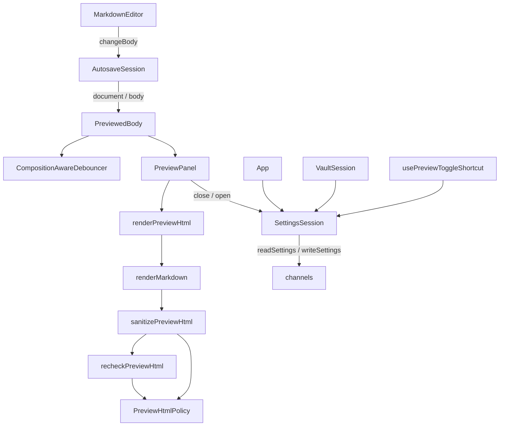

# Preview Panel — Architecture Design

**Status:** Confirmed (decided autonomously; the user was away — every judgement call is listed in §8)
**Source PRD:** `.sdd/2026-08-20-preview-panel/PRD.md`
**Tech context:** Tauri 2 · Rust Cargo workspace (`rustle-domain` / `rustle-application` / `rustle-infrastructure` / `src-tauri`) · TypeScript strict + React + CodeMirror 6 · see `.sdd/PROJECT.md`

---

## 1. Design Goal & Guiding Principle

- **In one sentence:** show the editor's body as sanitized HTML in a fourth column that follows typing 150 ms after it stops (never while composing), shows a newly opened article at once, folds away with a button or a configurable shortcut, and remembers whether it was open.
- **Guiding principle:** *one pure function turns a body into safe HTML, one object decides when the preview sees a new body, one object owns the settings in the webview.*
  - `renderPreviewHtml(body)` is the only door from Markdown to DOM: markdown-it → DOMPurify → an independent re-parse check, all against one `PreviewHtmlPolicy`. Callers never sequence the layers, and the image slice and scroll-sync slice extend it without touching the panel.
  - `PreviewedBody` turns the autosave session's document into "the body the preview shows" (immediate on open, debounced through the existing `CompositionAwareDebouncer` on edits).
  - `SettingsSession` becomes the single webview owner of `Settings`: the vault (`lastOpened`) and the preview (`previewPanel.isOpen`) both change it through it, so two features can never write stale copies over each other.

---

## 2. Change Scope

| Area | Action | What / Why |
| :--- | :--- | :--- |
| `crates/domain` `settings.rs` + `settings/stored_settings.rs` | **Modify** | `PreviewPanelSettings.toggle_shortcut: Option<String>`; a blank string or any non-string reads as `None` ("the file has no opinion"); omitted from the written JSON when `None` |
| `crates/application`, `crates/infrastructure`, `src-tauri` | **Not touched** | `readSettings` / `writeSettings` already carry the whole `Settings`; the repository already keeps unknown keys. CSP already blocks remote images and only allows `'self'`, `data:` and the vault scheme in `img-src` — it stays the third layer unchanged |
| `src/ipc/settings.ts` | **Modify** | `previewPanel.toggleShortcut?: string` |
| `src/features/settings/` | **Add** | `SettingsSession` (+ `useSettings`): single webview owner of the settings |
| `src/features/vault/VaultSession.ts` | **Modify** | reads / remembers through `SettingsSession` instead of its own copy (behaviour unchanged) |
| `src/features/vault/EditorColumn.tsx` | **Modify** | its empty state becomes the shared `NoArticleState` |
| `src/features/autosave/AutosaveSession.ts` | **Modify** | exposes `body` (the latest body the editor reported, `null` with no article) so the preview can follow the editor rather than the disk |
| `src/features/preview/` | **Add** | renderer, policy, re-check, `PreviewedBody`, `KeyboardShortcut`, `PreviewPanel` components, shortcut hook, highlight styles |
| `src/app/AppLayout.tsx` | **Modify** | the preview slot becomes `{ isOpen, content, onOpen, onClose }`: open → titled region with a close button; folded → a handle button at the edge |
| `src/app/App.tsx` | **Modify** | builds one `SettingsSession` and one `PreviewedBody`, wires the panel and the shortcut |
| `src/app/app.css` | **Modify** | preview typography, handle, light/dark highlight tokens |
| `package.json` | **Modify** | `markdown-it 14.3.3` (+ `@types/markdown-it 14.2.0`), `dompurify 3.4.17`, `highlight.js 11.12.0` — exact pins |
| `docs/ime-regression-checklist.md` | **Modify** | the "stay composing > 2 s" item now also checks that the preview does not redraw |
| Divider dragging, `widthRatio`, scroll sync, image display | **Not touched** | other slices (BRIEF §4) |

---

## 3. New Classes / Modules

### Rust

| Name | Kind | Responsibility | Satisfies |
| :--- | :--- | :--- | :--- |
| `PreviewPanelSettings.toggle_shortcut` | domain field | the user's shortcut text, or `None` when the file has no usable opinion | TC-40, TC-41, TC-42 |

### TypeScript

| Name | Kind | Responsibility | Collaborators | Satisfies |
| :--- | :--- | :--- | :--- | :--- |
| `PreviewHtmlPolicy` | module (constants + `allowsUrl`) | the one allowlist: tags, attributes, URL rules per attribute (`a[href]`: relative / http / https / mailto; `img[src]`: relative / `rustle:`), `SOURCE_LINE_ATTRIBUTE` | — | TC-12~TC-22, TC-47~TC-50 |
| `markdownRenderer` (`renderMarkdown`) | module | markdown-it (html on, linkify/typographer off): source line on every block opening token, task-list marker → ``, fenced code → `<pre data-source-line><code class="language-x">` highlighted with highlight.js when the language is known | markdown-it, highlight.js | TC-01~TC-11, TC-47~TC-49 |
| `sanitizePreviewHtml` | module | first net: DOMPurify with the policy's allowlist and a URL hook | DOMPurify, policy | TC-12~TC-21 |
| `recheckPreviewHtml` | module | second net: re-parse in an inert `<template>`, drop every element / attribute / URL the policy does not allow | policy | TC-22, TC-21 |
| `renderPreviewHtml` | module | body → render → sanitize → recheck (the only entry point) | the three above | all rendering scenarios |
| `PreviewedBody` | class | the body the preview shows: immediate when the editor's document is replaced (open / close article, cancelling any pending update), debounced 150 ms and composition-aware when the editor reports a change | `AutosaveSession` (as a source), `CompositionAwareDebouncer` | TC-23~TC-27, TC-45, TC-46, TC-51, TC-52 |
| `KeyboardShortcut` | class | `parse(text) → KeyboardShortcut \| null` (`Mod`, `Shift`, `Alt` + one letter or digit; must contain `Mod`), `matches(event)` (Mod = Cmd or Ctrl, exact Shift/Alt, physical key via `event.code`), `DEFAULT` = `Mod+Shift+P`, `fromSetting(text)` falls back to the default | — | TC-31~TC-34, TC-36 |
| `usePreviewToggleShortcut` | hook | window keydown listener: ignores keys the input method owns, toggles on a match | `CompositionState`, `KeyboardShortcut` | TC-31~TC-35 |
| `PreviewPanel` / `PreviewContent` | components | empty state when there is no article, otherwise the rendered HTML; rendering happens only while the panel is open | `renderPreviewHtml`, `NoArticleState` | TC-28~TC-30, TC-43~TC-46 |
| `NoArticleState` | component | the one "no article selected" guidance, shared by editor and preview | — | TC-43, TC-44 |
| `SettingsSession` | class | load once (failure → defaults, and nothing will be written), `change(update)` always changes memory and writes the whole settings only if they were read; subscribable | `readSettings` / `writeSettings` | TC-37~TC-39 |

---

## 4. Modified Components

| Component | Current role | Change needed |
| :--- | :--- | :--- |
| `Settings` (Rust) | tolerant settings shape | new optional `toggleShortcut` |
| `VaultSession` | owns selection and its own settings copy | takes a `SettingsSession` (default: one over the same channels, so existing callers/tests are unchanged) |
| `AutosaveSession` | save timing | `get body(): string \| null` |
| `AppLayout` | four regions, preview optional | preview slot with open/close; title bar gets an action button |
| `EditorColumn` | editor or empty state | uses `NoArticleState` |
| `App` | composition root of the webview | wires settings, preview, shortcut |

---

## 5. Component Relationships

---

## 6. Extensibility & Handoff Notes

- **Most likely next requirements:** (1) image display — rewrite relative `src` to `rustle:` URLs; (2) scroll sync — map editor lines to preview elements; (3) divider + width ratio; (4) more settings (theme, font size) changed from the webview.
- **Where they land:**
  1. Images: a markdown-it `image` renderer rule inside `markdownRenderer` (or a pass in `renderPreviewHtml` before sanitizing); `PreviewHtmlPolicy` already allows relative and `rustle:` image sources.
  2. Scroll sync: query `[${SOURCE_LINE_ATTRIBUTE}]` in the preview content; never write the attribute name as a string.
  3. Divider: `AppLayout`'s preview slot and `settings.previewPanel.widthRatio` through `SettingsSession.change`.
  4. Settings: `SettingsSession.change(...)`; never keep a second copy of `Settings`.
- **Patterns applied & why:** a single pipeline function hides three layers (deep module); one allowlist shared by both nets so a new allowed tag is one line; `KeyboardShortcut` as a parsed value (parse, don't validate) so a future settings screen can reuse `parse`.
- **Do not hardcode:** the shortcut (comes from settings with a default), the source-line attribute name (exported constant), the debounce delay (constructor option, default 150 ms).
- **Known debt / deferred:** table column alignment is dropped because `style` is not allowed (markdown-it writes alignment as `style`); revisit with a class-based alignment rule if anyone asks.

---

## 7. Traceability

| PRD Scenario | Fulfilled by |
| :--- | :--- |
| TC-01 ~ TC-11 (rendering) | `renderMarkdown` via `renderPreviewHtml` |
| TC-12 ~ TC-21 (sanitizing) | `sanitizePreviewHtml` + `recheckPreviewHtml` + `PreviewHtmlPolicy` |
| TC-22 (second net alone) | `recheckPreviewHtml` |
| TC-23 ~ TC-27 (debounce, composition, open at once) | `PreviewedBody` + `CompositionAwareDebouncer` |
| TC-28 ~ TC-30 (region, close, handle) | `AppLayout` preview slot + `PreviewPanel` |
| TC-31 ~ TC-36 (shortcut) | `KeyboardShortcut` + `usePreviewToggleShortcut` |
| TC-37 ~ TC-39 (persistence) | `SettingsSession` + `App` wiring |
| TC-40 ~ TC-42 (reading the shortcut setting) | Rust `Settings` (`None` / text) + `KeyboardShortcut.fromSetting` (default) |
| TC-43 ~ TC-46 (empty state) | `NoArticleState` + `PreviewPanel` + `PreviewedBody` (null body) |
| TC-47 ~ TC-50 (source lines) | `renderMarkdown` source-line rule + policy keeps `data-source-line` |
| TC-51, TC-52 (preview follows the editor) | `PreviewedBody` over `AutosaveSession` |

---

## 8. Risks & Open Decisions (decided)

- **Settings key name.** The PRD's flow mentions `previewPanel.visible`; the existing settings file already uses `previewPanel.isOpen` (foundation slice). We keep `isOpen` — renaming would forget every existing user's choice.
- **Shortcut grammar.** `Mod`, `Shift`, `Alt` (case-insensitive) joined by `+` with exactly one letter or digit; `Mod` is required so a shortcut can never swallow plain typing. Anything else falls back to `Mod+Shift+P`. Rust only filters blank / non-string values; whether text is a usable shortcut is decided in the webview (keyboard belongs to the screen, PRD note under TC-40).
- **Physical key matching.** Letters/digits match on `event.code` (`KeyP`), because with Alt on macOS `event.key` becomes a symbol (`˚`).
- **Strikethrough element.** markdown-it emits `<s>`; both `s` and `del` are allowed (PRD note under TC-04).
- **Flash on start.** Before settings are read the panel shows its default (open); a user who closed it sees it fold once the settings arrive (a few ms). Accepted rather than hiding the whole layout until settings load.
- **Concurrent settings writes.** Each write sends the whole latest in-memory settings, so the last write always carries every change.
- **Task checkbox.** ``; `input` is not in the allowlist at all (A-4).
- **NFR-2/NFR-3/NFR-6 and the editor actually taking the width** are verified manually (PRD §5); automated tests check the folded state and the handle only.
