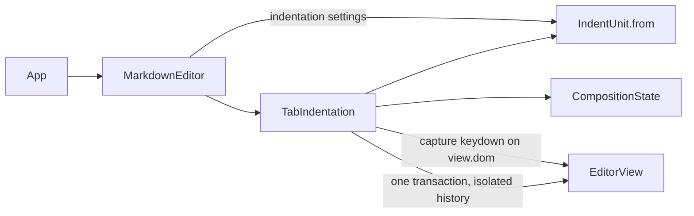

# Tab / Shift+Tab Indentation — Architecture Design

**Status:** Confirmed (decided autonomously; the user was away — every judgement call is listed in §8)
**Source PRD:** `.sdd/2026-08-20-tab-indentation-behavior/PRD.md`
**Tech context:** Tauri 2 · TypeScript strict + React + CodeMirror 6 (`@codemirror/view 6.43.15`, `state 6.7.6`, `commands 6.11.1`) · Vitest + happy-dom. This slice is webview-only.

---

## 1. Design Goal & Guiding Principle

- **In one sentence:** make Tab / Shift+Tab in the editor indent / outdent every covered line by one configured indent unit as one undo step, while an input-method composition and the Esc escape route both keep the key away from indentation, and nothing else in the editor can take Tab.
- **Guiding principle:** *one owner for the Tab key.* A single `TabIndentation` object owns the decision for every Tab press (compose? escaped? read-only? indent or outdent?) and is the only thing that writes indentation. The column arithmetic lives in a separate value object, `IndentUnit`, so the settings slice and any future "indent style" change touch exactly one file.

---

## 2. Change Scope

| Area | Action | What / Why |
| :--- | :--- | :--- |
| `src/features/editor/IndentUnit.ts` | **Add** | Value object: normalised indent style + width; knows how to indent and outdent a run of leading whitespace |
| `src/features/editor/TabIndentation.ts` | **Add** | The Tab key owner: `indent(view)`, `outdent(view)`, and the CodeMirror `extension()` that intercepts Tab before CodeMirror's own key handling |
| `src/features/editor/MarkdownEditor.tsx` | **Modify** | Accepts an optional `indentation` setting (style + width) and installs `TabIndentation` |
| `docs/ime-regression-checklist.md` | **Modify** | Composition-Tab item turns from "baseline" into a real acceptance item |
| `.sdd/PROJECT.md` | **Modify** | Records the new seam: where indentation settings enter the editor |
| Rust crates / `src-tauri` / channels | **Not touched** | Reading the setting from `.rustle/settings.json` belongs to the vault slice (PRD §5). `rustle_domain::Settings` gains its indentation fields there |
| `src/app/App.tsx` | **Not touched** | It renders `MarkdownEditor` without settings, which yields the default 2 spaces — exactly the app-level behaviour required |
| `CompositionState` | **Not touched** | Read only, as the foundation intended |
| Auto-indent on Enter, list continuation, autocomplete | **Not touched** | Out of scope (BRIEF §4) |

---

## 3. New Classes / Modules

| Name | Kind | Responsibility (purpose) | Collaborators | Satisfies |
| :--- | :--- | :--- | :--- | :--- |
| `IndentationSettings` | Type (`{ style: "spaces" \| "tab"; width: number }`) | The shape a caller (later: the settings slice) hands to the editor | — | TC-31~TC-38 |
| `IndentUnit` | Value object | Built with `IndentUnit.from(settings?)`, which normalises: missing → 2 spaces; width not an integer in 1~8 → 2. Exposes `text` (one unit), `width`, `indent(leading)` (append one unit, no realignment) and `outdent(leading)` (measure columns — space = 1, tab = to the next tab stop — and return the leading whitespace for the largest level below it, rendered in the configured style; `null` when the line has 0 columns) | — | TC-07, TC-13, TC-31~TC-36 |
| `TabIndentation` | Domain-ish controller (one per editor) | `indent(view)` / `outdent(view)`: collect every line covered by any selection range (a range ending exactly at a line start does not cover that line; each line once), build one change set, dispatch it as one isolated history event with the selection mapped so that it stays on the same text. Refuses to write while composing or read-only; `outdent` writes nothing when no line can move. `extension()`: a capture-phase `keydown` listener on the editor root (runs before CodeMirror's own key handling and before every keymap) that owns Tab/Shift+Tab and the Esc escape route, plus `EditorState.tabSize` / `indentUnit` set from the unit | `IndentUnit`, `CompositionState`, `EditorView` | TC-01~TC-30, TC-39~TC-41 |

Key-handling decision table inside the listener (`Tab` with or without Shift only; other keys are only observed):

| Situation | Indent? | Key eaten (`preventDefault`) |
| :--- | :--- | :--- |
| Composing (`CompositionState`, `event.isComposing`, or keyCode 229) | no | yes — focus must not leave mid-composition |
| Escape armed (Esc was the last non-modifier key, with no mouse press in the editor or focus loss since) | no | no — default focus move happens; the escape is consumed |
| Read-only | no | yes |
| Otherwise | Tab → `indent`, Shift+Tab → `outdent` | yes |

The listener also calls `stopPropagation` whenever it handles Tab, so no other CodeMirror keymap or DOM handler on the content element ever sees it.

---

## 4. Modified Components

| Component | Current role | Change needed |
| :--- | :--- | :--- |
| `MarkdownEditor` | Mounts CodeMirror with markdown, history, keymaps, composition reporting | New optional prop `indentation?: IndentationSettings`; adds `new TabIndentation(composition, IndentUnit.from(indentation)).extension()` to the extensions; the effect re-creates the view when the setting changes (same lifecycle as `initialBody`) |

---

## 5. Component Relationships

---

## 6. Extensibility & Handoff Notes

- **Most likely next requirement:** the vault/settings slice reads the indent style from `.rustle/settings.json` and changes it live.
- **Where it lands:** `MarkdownEditor`'s `indentation` prop. The settings slice passes `{ style, width }` straight through; normalisation already happens in `IndentUnit.from`, so a hand-edited bad value is harmless.
- **How to add it:** add the fields to `rustle_domain::Settings`, return them from `readSettings`, pass them as the prop. No change to `TabIndentation` or `IndentUnit`.
- **Toolbar / menu "indent" buttons:** today the `TabIndentation` instance is created privately inside `MarkdownEditor` (`editorExtensions`), so nothing outside the editor can reach it. A toolbar slice would lift the instance into the component (one per editor) and expose `indent()` / `outdent()` through a `MarkdownEditor` handle (React `ref`) that calls them with the editor's view. The composition guard is inside these methods, not in the key listener, so every path is protected (FR-8.1).
- **Autocomplete / snippets later:** they must not bind Tab. Even if they do, the capture listener wins — covered by a test that installs a competing Tab binding.
- **Do not hardcode:** the width `2` lives only in `IndentUnit`'s default; every column computation goes through the unit.
- **Known debt / deferred:** the escape route is "the next Tab after Esc", without a timeout. A mouse press inside the editor or the editor losing focus disarms it, so a click elsewhere in the text followed by Tab indents again. A timeout was not asked for; if users still find a stale escape surprising, add a time window inside the listener only.

---

## 7. Traceability

| PRD Scenario | Fulfilled by |
| :--- | :--- |
| TC-01, TC-02, TC-03, TC-04, TC-05, TC-06 | `TabIndentation.indent` (line start insertion, selection mapped forward) |
| TC-07 | `IndentUnit.indent` (append, no realignment) |
| TC-08, TC-09, TC-10, TC-39 | `TabIndentation` covered-line collection |
| TC-11, TC-12, TC-15, TC-16, TC-17 | `TabIndentation.outdent` + `IndentUnit.outdent` |
| TC-13 | `IndentUnit.outdent` (largest level below the current columns) |
| TC-14, TC-20, TC-22 | `TabIndentation.outdent` writes nothing when no line moves; key still eaten |
| TC-18, TC-19 | one transaction with `isolateHistory` |
| TC-21, TC-23, TC-24, TC-25 | capture-phase listener: `preventDefault` + `stopPropagation`; read-only check |
| TC-26, TC-27 | escape route state in the listener |
| TC-28, TC-29, TC-30, TC-40 | composition check in the listener, before CodeMirror's own handling |
| TC-41 | composition guard inside `indent` / `outdent` |
| TC-31~TC-36 | `IndentUnit.from` normalisation and rendering |
| TC-37 | `App` → `MarkdownEditor` default unit |
| TC-38 | `MarkdownEditor` `indentation` prop |

---

## 8. Risks & Open Decisions

- **Decided (user away):**
  - The whole slice is frontend-only. The PRD explicitly leaves reading the setting from disk to the vault slice; adding Rust `Settings` fields now would be unused code.
  - Interception is a native capture-phase `keydown` listener on `view.dom`, not a CodeMirror keymap: CodeMirror ignores key events while composing, so a keymap could never keep focus in place during composition (TC-40), and capture ordering guarantees no later extension can steal Tab (TC-25).
  - "Any ordinary key" disarms the escape route; bare modifier keys (Shift, Control, Alt, Meta) do not, otherwise Esc → Shift+Tab could never escape.
  - Esc while composing does not arm the escape route (the input method uses it to cancel).
  - A mouse press inside the editor or the editor losing focus also disarms the escape route: the user has moved on from the Esc, so the next Tab is ordinary editing again.
  - Tab with Ctrl, Alt or Meta is not indentation and is left to the system (e.g. Ctrl+Tab); only plain Tab and Shift+Tab are owned.
  - A selection position at the line start of an indented line moves forward with the inserted unit (TC-01, TC-08 say the cursor stays glued to the text).
  - Outdent rewrites the whole leading whitespace of a moved line in the configured style (BRIEF A-5); lines that do not move are not touched.
  - Tab-stop measurement: a tab advances to the next multiple of the unit width; the editor's `tabSize` is set to the same width so what is drawn matches what is measured.
- **Risks / trade-offs:** focus actually leaving the editor cannot be observed in happy-dom; tests assert "the key was not prevented" instead (BRIEF §8). Real input methods stay a manual item in the IME checklist.
