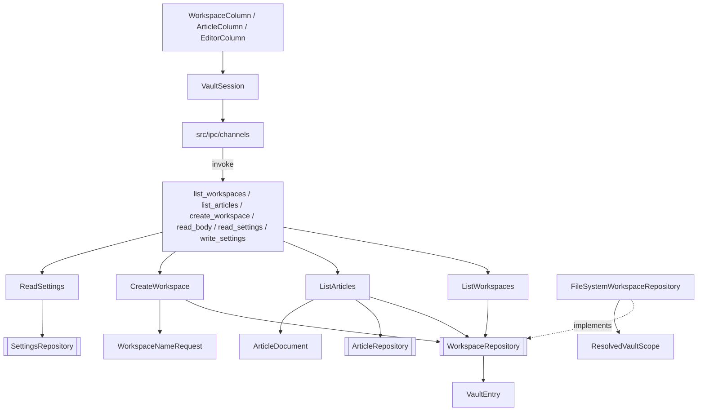

# Vault Workspace & Article Listing — Architecture Design

**Status:** Confirmed (decided autonomously; the user was away — every judgement call is listed in §8)
**Source PRD:** `.sdd/2026-08-20-vault-workspace-and-article-listing/PRD.md`
**Tech context:** Tauri 2 · Rust Cargo workspace (`rustle-domain` / `rustle-application` / `rustle-infrastructure` / `src-tauri`) · TypeScript strict + React + CodeMirror 6 · see `.sdd/PROJECT.md`

---

## 1. Design Goal & Guiding Principle

- **In one sentence:** turn the vault on disk into two ordered lists (workspaces with article counts, articles with tolerant metadata), let the user create a workspace whose name is judged in the domain before any folder exists, remember the last opened workspace + article in `.rustle/settings.json`, and show it all in a four-column layout whose editor survives article switches.
- **Guiding principle:** *the file system answers only "what is there and what kind is it"; the domain decides what counts.* `WorkspaceRepository` returns raw `VaultEntry { name, kind }` lists (links already resolved and confined to the vault). Every rule — hidden names, the reserved `images` name, the `.md` extension, case-insensitive clashes — lives on `VaultEntry` and `WorkspaceNameRequest` in the domain. On the webview side, *one* `VaultSession` owns the selection; columns only render it and report clicks.

---

## 2. Change Scope

| Area | Action | What / Why |
| :--- | :--- | :--- |
| `crates/domain` | **Add** | `VaultEntry`, `VaultEntryKind`, `WorkspaceNameRequest`, `WorkspaceNameRejection`, `WorkspaceRepository` trait, `WorkspaceRepositoryError` |
| `crates/domain/settings.rs` | **Modify** | `Settings` gains `indentation`, `preview_panel`, `last_opened`, read tolerantly (bad values fall back per field); `SettingsError::OutsideVault` |
| `crates/domain/article_metadata.rs` | **Modify** | Public `ArticleMetadata::from_file_name` for files that cannot be read (A-6); the `.md` suffix is stripped case-insensitively (A-4) |
| `crates/application` | **Add** | `ListWorkspaces`, `ListArticles`, `CreateWorkspace`, `ReadSettings` use cases and their payloads `WorkspaceSummary`, `ArticleSummary`, `CreateWorkspaceOutcome` |
| `crates/infrastructure` | **Add** | `FileSystemWorkspaceRepository` |
| `crates/infrastructure` | **Modify** | `FileSystemSettingsRepository` resolves the settings path on every call (so a `.rustle` link pointing out of the vault is refused even if it appears later); `ResolvedVaultScope::root()` |
| `src-tauri` | **Modify** | Real `list_workspaces`, `list_articles`, `read_settings`, `write_settings`; new `create_workspace` channel (A-1); repositories managed as state; `CommandError` conversions |
| `src/ipc` | **Modify / Add** | Typed wrappers for the five channels; payload types |
| `src/features/vault/` | **Add** | `VaultSession` (selection store), `WorkspaceColumn`, `NewWorkspaceField`, `ArticleColumn`, `EditorColumn` |
| `src/app/` | **Modify** | `AppLayout` (four columns, optional `preview`), `App` mounts the session; theme colors as CSS variables (NFR-6) |
| `src/features/editor/MarkdownEditor.tsx` | **Modify** | One `EditorView` for the app's lifetime: a new body replaces the state in place; deferred while composing (TC-60~TC-62) |
| `src/features/editor/sampleBody.ts` | **Remove** | The editor now shows real articles |
| `saveBody`, `createArticle`, `updateMetadata`, `saveClipboardImage` channels | **Not touched** | Owned by later slices |
| `ArticleDocument`, `ResolvedVaultScope` confinement logic | **Not touched** | Reused as is: listing reads metadata through `ArticleDocument::metadata`, link checks reuse `ResolvedVaultScope::workspace_path` / `article_path` |

---

## 3. New Types / Modules

### Rust

| Name | Crate · file | Responsibility | Satisfies |
| :--- | :--- | :--- | :--- |
| `VaultEntry`, `VaultEntryKind` | domain · `vault_entry.rs` | One item found in a folder: its name and whether it is a `Folder`, a `File`, or `Unreachable` (a link out of the vault, a dangling link, anything else). `as_workspace()` applies R-1/R-2/R-4; `as_article()` applies R-3/R-4/R-5; `clashes_with(name)` is the case-insensitive comparison | TC-01~TC-13, TC-19a |
| `WorkspaceNameRequest`, `WorkspaceNameRejection` | domain · `workspace_name_request.rs` | Judge a typed name against the existing vault entries in PRD order: `Empty` → `ContainsPathSeparator` → `Reserved` → `AlreadyUsed`; success gives a `WorkspaceName` | TC-22~TC-27 |
| `WorkspaceRepository`, `WorkspaceRepositoryError` | domain · `workspace_repository.rs` | `vault_entries()`, `workspace_entries(&WorkspaceName)`, `create(&WorkspaceName)`. A missing folder lists as empty | TC-07, TC-08, TC-19, TC-20, TC-22 |
| `FileSystemWorkspaceRepository` | infrastructure · `file_system_workspace_repository.rs` | `read_dir` the vault / a workspace; each entry is located through `ResolvedVaultScope` (so links are resolved and confined) and classified by what it points to; `create` makes the vault root if needed, then exactly one folder (`create_dir`, never `create_dir_all`, so a name taken in a race fails instead of being taken over) | TC-01~TC-13, TC-19a, TC-22 |
| `ListWorkspaces` → `Vec<WorkspaceSummary>` | application · `list_workspaces.rs` | Keep entries that are workspaces, count each one's articles by name only, order by name (case-insensitive); a workspace folder that cannot be read stays listed with an unknown count (`None`) instead of failing the whole list | TC-01~TC-08 |
| `ListArticles` → `Vec<ArticleSummary>` | application · `list_articles.rs` | Keep entries that are articles, order by file name (case-insensitive, A-7), read each through `ArticleRepository` and take `ArticleDocument::metadata`; an unreadable file becomes `ArticleMetadata::from_file_name` | TC-09~TC-21 |
| `CreateWorkspace` → `CreateWorkspaceOutcome` | application · `create_workspace.rs` | Judge the name with `WorkspaceNameRequest` against `vault_entries()`, create it, answer `Created(WorkspaceSummary)` or `Rejected(reason)` — a rejection is a value, not an error (code-style) | TC-22~TC-27 |
| `ReadSettings` | application · `read_settings.rs` | Load settings; a file that cannot be understood yields the defaults (TC-30). Outside-vault stays an error (TC-36) | TC-29~TC-32, TC-36 |
| `create_workspace` command | src-tauri · `commands/create_workspace.rs` | Takes the raw typed `name` (not a `WorkspaceName`: the rejection is a business answer) | TC-22~TC-27 |

### TypeScript

| Name | File | Responsibility | Satisfies |
| :--- | :--- | :--- | :--- |
| `VaultSession` | `src/features/vault/VaultSession.ts` | The single owner of `workspaces`, `selectedWorkspace`, `articles`, `selectedArticle`, `body`, per-column error lines. `start()` restores from settings; `selectWorkspace`, `selectArticle`, `createWorkspace`. Writes `lastOpened` back on every selection, keeping the rest of the settings it read. Ignores answers that arrive after a newer click | TC-28, TC-42~TC-44, TC-51, TC-53~TC-58 |
| `useVaultSession` | `src/features/vault/useVaultSession.ts` | React binding (`useSyncExternalStore`) | — |
| `WorkspaceColumn` + `NewWorkspaceField` | `src/features/vault/` | List with counts, single selection, empty guide, the name field (reports composition to the shared `CompositionState`, Enter while composing never submits, blur ends a stuck composition), rejection reason line | TC-41~TC-48, TC-58, TC-62 |
| `ArticleColumn` | `src/features/vault/ArticleColumn.tsx` | Rows with title, date, category, tags, incomplete marker; single selection; empty state | TC-49~TC-53 |
| `EditorColumn` | `src/features/vault/EditorColumn.tsx` | Empty state without any editable element, or the `MarkdownEditor` with the body and the stored indentation | TC-38, TC-39 |
| `AppLayout` | `src/app/AppLayout.tsx` | Four titled regions; the preview region exists only when a `preview` node is given | TC-37, TC-40, TC-59 |

---

## 4. Modified Components

| Component | Current role | Change needed |
| :--- | :--- | :--- |
| `Settings` | Empty struct | `indentation { style: spaces\|tab, width 1–8 }`, `previewPanel { isOpen, widthRatio (0,1) }`, `lastOpened { workspace, article }`. Deserialized through a private tolerant shape (`#[serde(from = ...)]`): a wrong type or out-of-range value falls back to that field's default. No vault path field (A-9) |
| `FileSystemSettingsRepository` | Path resolved once in `in_vault` (fallible) | Holds the `ResolvedVaultScope`; resolves per `load`/`save`; `in_vault` becomes infallible like the article repository |
| `rustle_lib::configure` | Manages the article repository | Also manages `FileSystemWorkspaceRepository` and `FileSystemSettingsRepository` |
| `CommandError` | Article errors | `From<WorkspaceRepositoryError>`, `From<SettingsError>`: outside-vault → `outsideVault`, everything else → `unexpected` |
| `MarkdownEditor` | Rebuilds the `EditorView` whenever the body or indentation changes | Prop `body`. Creates the view once; a different body (or indentation) replaces the state with `view.setState` (same DOM node, fresh undo history so undo never crosses articles); an identical body is ignored; while composing the replacement waits for the composition to end and only the latest one is applied; a blur of the editor ends a composition whose end event never came |
| `App` | Editor with a sample body | `CompositionProvider` → `VaultSession` → `AppLayout` with the three columns |

---

## 5. Component Relationships

---

## 6. Extensibility & Handoff Notes

- **Most likely next requirements:** sorting/filtering (Wave 4), create-article dialog (Wave 3), preview panel (Wave 3), autosave before switching (Wave 2), rename/delete workspace (Wave 4).
- **Where they land:**
  - Sorting/filtering: `ListArticles` orders by file name in one place; the default `created_at` order is a change there (or a client-side reorder of `ArticleSummary[]` in `VaultSession`). Rows already carry all metadata.
  - Create article: `VaultSession` is the source of "current workspace"; add a `createArticle` method that inserts into `articles` and selects it. `ArticleColumn` has the empty-state slot.
  - Preview panel: pass `preview={<PreviewPanel …/>}` to `AppLayout`; `settings.previewPanel` is already stored and normalized.
  - Autosave: make `VaultSession.selectArticle` / `selectWorkspace` await a "may leave" check before switching (the single place both clicks go through).
  - Rename/delete workspace: add methods to `WorkspaceRepository`; reuse `WorkspaceNameRequest` for the new name.
  - New listing rule: one method on `VaultEntry` — no caller changes.
- **Do not hardcode:** the vault root (injected through `configure`), `IMAGES_FOLDER_NAME` (domain constant).
- **Known debt / deferred:** no file watching — lists refresh on selection and on start only; listing reads every article sequentially (fine for 500, see TC-21).

---

## 7. Traceability

| PRD Scenario | Fulfilled by |
| :--- | :--- |
| TC-01~TC-04 what counts as a workspace | `VaultEntry::as_workspace` + `ListWorkspaces` ordering |
| TC-05 links on the workspace side | `FileSystemWorkspaceRepository` classification through `ResolvedVaultScope` |
| TC-06 article counts | `ListWorkspaces` + `VaultEntry::as_article` |
| TC-07, TC-08 empty / missing vault | `FileSystemWorkspaceRepository` (missing folder = no entries) |
| TC-09~TC-13 what counts as an article | `VaultEntry::as_article` |
| TC-14 order | `ListArticles` |
| TC-15~TC-17 metadata per row | `ListArticles` + `ArticleDocument::metadata` |
| TC-18 unreadable file still listed | `ListArticles` + `ArticleMetadata::from_file_name` |
| TC-19a links on the article side | `FileSystemWorkspaceRepository` + `ListArticles` |
| TC-19 empty workspace | `ListArticles` |
| TC-20 escaping workspace name | `WorkspaceName::parse` in the `list_articles` command |
| TC-21 500 articles | `ListArticles` (integration test) |
| TC-22~TC-27 create / reject | `WorkspaceNameRequest` + `CreateWorkspace` + `FileSystemWorkspaceRepository::create` |
| TC-28 new workspace listed and selected | `VaultSession.createWorkspace` |
| TC-29~TC-32 read settings, defaults, normalization | `Settings` tolerant deserialization + `ReadSettings` |
| TC-33~TC-35 write, unknown keys, no vault path | `FileSystemSettingsRepository` + `Settings` |
| TC-36 `.rustle` link outside | `FileSystemSettingsRepository` per-call resolution |
| TC-37, TC-40 layout | `AppLayout` |
| TC-38, TC-39 editor column | `EditorColumn` |
| TC-41~TC-45 column 1 | `WorkspaceColumn` + `VaultSession` |
| TC-46~TC-48 name field | `NewWorkspaceField` + `VaultSession.createWorkspace` |
| TC-49~TC-53 column 2 | `ArticleColumn` + `VaultSession` |
| TC-54~TC-57 restore and remember | `VaultSession.start` / selection writes |
| TC-58 failure line | `VaultSession` error state + columns |
| TC-59 focus order | `AppLayout` DOM order (automated part); Esc+Tab manual |
| TC-60~TC-62 one editor, composition-safe switching | `MarkdownEditor`, `NewWorkspaceField` |
| TC-63, TC-64 refusing to leave / reload | **Not applicable yet** — they describe autosave behavior, and autosave is not on `main` (see §8) |

---

## 8. Risks & Decisions (made autonomously)

- **Rejections are values.** `createWorkspace` answers `{ outcome: "created", workspace }` or `{ outcome: "rejected", reason }` with `reason ∈ empty | containsPathSeparator | reserved | alreadyUsed`; the webview words the reason. No new `FailureReason`.
- **Clash rule:** any existing vault entry (folder, file, hidden, unreachable link) whose name equals the request ignoring case is a clash (BRIEF §5.4). Comparison uses Unicode lowercase.
- **Race:** if the folder appears between the check and the creation, `create_dir` (never `create_dir_all`) fails and the creation is reported as an ordinary write failure; the existing folder is never taken over. Turning that race into an `alreadyUsed` answer was dropped: no test could reach it without a hand-written fake.
- **Ordering** is case-insensitive (TC-14 expects `a, b, C`), ties broken by the exact name, for both lists.
- **Broken settings file:** `ReadSettings` answers defaults; the repository keeps refusing to overwrite a file it cannot parse (foundation behavior, protects a hand-edited file). Consequence: while the file is broken, remembering the last opened position fails; `VaultSession` treats that write as best-effort and does not show an error line for it (it is not the user's content).
- **Settings defaults:** indentation 2 spaces (same range 1–8 as `IndentUnit`), preview open with width ratio 0.5, nothing last opened. A width ratio outside the open interval (0, 1) or not a number falls back to 0.5.
- **Created date display:** the date part of `created_at` as written (`2026-08-20T14:32:05+08:00` → `2026-08-20`), no time zone conversion; a value that does not start with a date is shown as is.
- **Editor switching:** `view.setState` keeps the same editable DOM node (TC-60) and gives each article its own undo history. The editor's blur ends a composition (the browser commits the composition on blur anyway); this is what releases a stuck flag in practice, alongside the name field's blur and the editor's unmount (TC-62).
- **TC-63 / TC-64** describe interplay with autosave ("unsaved changes still pending", "reload after external change"). Autosave has not landed on `main`, so there is nothing to refuse and nothing to reload; `VaultSession` is the single place where autosave will add its "may leave" check. Recorded as not applicable in CONTRACT.md.
- **UI language:** labels are Traditional Chinese, as written in the PRD (`建立你的第一個 workspace`, `建立第一篇文章`); column titles are `WORKSPACES`, `ARTICLES`, `EDITOR`, `PREVIEW`.
- **No file watching.** Lists are read at start, on workspace selection and after creation.
