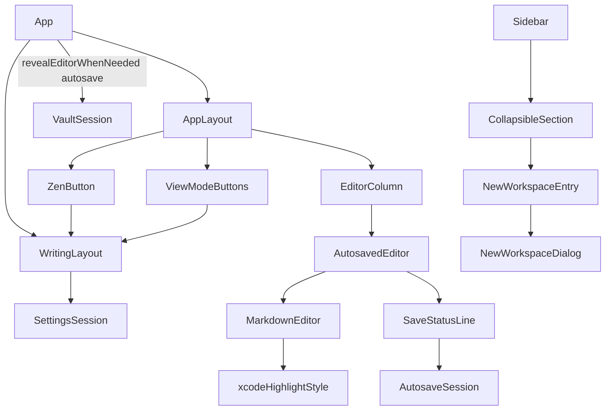

# 寫作介面整理與檢視模式 — Architecture Design

**Status:** Implemented (decided autonomously; the user was away — every judgement call is listed in §8)
**Source PRD:** `.sdd/2026-08-21-editing-surface-and-view-modes/PRD.md`
**Tech context:** Tauri 2 · TypeScript strict + React 19 + CodeMirror 6 · Vitest + happy-dom. This slice is webview-only: no Rust crate, channel or settings-shape change. New frontend dependencies: `lucide-react 1.56.0` (line icons) and `@lezer/highlight 1.2.5` (the highlight tags, already in the tree through CodeMirror; now a direct dependency).

---

## 1. Design Goal & Guiding Principle

- **In one sentence:** replace the text buttons, the sort menu, the always-visible workspace field and the top save bar with quiet line icons; add a bottom statusline (`workspace ❯ file name` + a three-state save indicator); give the writing area an Xcode-style monospaced theme; and add three view modes (editor only / side by side / preview only) plus a non-persistent Zen Mode — without ever rebuilding the editor.
- **Guiding principle:** *one owner for "how the writing area is arranged", and layout changes only hide, never unmount, the editor.* `WritingLayout` is the single source of truth for view mode and Zen (and the only place that knows that "preview only" is remembered as "preview open"); `AppLayout` only reads its snapshot and toggles the `hidden` attribute on regions. Because the editor region is never removed from the tree, CodeMirror's `EditorView` — and with it the text, cursor, undo history and any running composition — survives every switch (US-09) by construction rather than by restoring state.

---

## 2. Change Scope

| Area | Action | What / Why |
| :--- | :--- | :--- |
| `src/features/writingLayout/WritingLayout.ts` | **Add** | Owner of view mode + Zen + "where the controls live" + the preview shortcut rule + revealing the editor when leaving is refused |
| `src/features/writingLayout/useWritingLayout.ts` | **Add** | Binds a `WritingLayout` snapshot to React and installs the preview keyboard shortcut |
| `src/features/writingLayout/WritingControls.tsx` | **Add** | `ZenButton` and `ViewModeButtons` (the four header buttons) |
| `src/features/autosave/SaveStatusLine.tsx` | **Add** (replaces `SaveStatusBar.tsx`) | Bottom statusline: breadcrumb left, `SaveIndicator` right, failure / outside-change warning on the same line |
| `src/features/editor/xcodeTheme.ts` | **Add** | The writing area's Xcode highlight style + monospaced editor theme, colours as CSS tokens |
| `src/features/vault/NewWorkspaceEntry.tsx` + `NewWorkspaceDialog.tsx` | **Add** (replace `NewWorkspaceField.tsx`) | Plus icon in the WORKSPACES header → dialog with name, 建立, 取消 |
| `src/app/AppLayout.tsx` | **Modify** | Takes the layout snapshot and the controls; drops the preview handle and ✕; hides (not unmounts) sidebar/articles in Zen and the editor in preview only |
| `src/app/App.tsx` | **Modify** | Builds one `WritingLayout`; wraps the autosave holder given to `VaultSession` with `revealEditorWhenNeeded`; wires the new entries (app integration commit) |
| `src/features/autosave/AutosaveSession.ts` | **Modify** | `AutosaveStatus` carries `workspace`, `fileName` and `indicator: "saving" \| "saved" \| "failed"` instead of `title` |
| `src/features/autosave/AutosavedEditor.tsx` | **Modify** | Statusline below the editor instead of a bar above |
| `src/features/vault/ArticleColumn.tsx` | **Modify** | No sort select; funnel filter + new-article icon in one always-present row; card metadata line (status → date → tags → markers) left-aligned; pencil top-right, trash bottom-right; empty-workspace guide is text, not a button |
| `src/features/vault/articleArrangement.ts` | **Modify** | `ArticleOrder` retired: always created newest first (no time last, ties title → workspace → file name) |
| `src/features/vault/ArticleFilterField.tsx` | **Modify** | Funnel icon inside the field; placeholder `filter` |
| `src/features/vault/WorkspaceColumn.tsx`, `src/features/sidebar/Sidebar.tsx`, `CollapsibleSection.tsx` | **Modify** | Section header gets an optional `action` (the plus icon); `▸▾` become chevron line icons |
| `src/features/preview/usePreviewPanel.ts` | **Modify** | Keeps only the width (resize / commit); open/close/shortcut move to `WritingLayout` |
| `src/features/editor/MarkdownEditor.tsx` | **Modify** | `defaultHighlightStyle` → the Xcode style |
| `src/shared/icons/IconButton.tsx` | **Add** | The one icon-only button: label read out and shown as tooltip, a `lucide-react` icon drawn `aria-hidden` |
| `src/features/articleMetadata/ChipInput.tsx` | **Modify** | The chip's `×` character becomes a line `X` icon (US-10: no character stands in for an icon) |
| `src/features/interfaceLanguage/SettingsButton.tsx` | **Not touched** | Its gear is already drawn with strokes only (`fill: none`, `stroke: currentColor`) |
| `src/features/interfaceLanguage/messages.ts` | **Modify** | New labels; `🔍`, `＋`, `◀`, `已儲存`, sort labels removed |
| `src/app/app.css` | **Modify** | Tokens `--color-success`, `--color-editor-*` (light/dark); icon, card, statusline, header, Zen styles |
| Rust crates / `src-tauri` / channels / `Settings` shape | **Not touched** | `previewPanel.isOpen` keeps meaning "is the preview on screen"; Zen and "preview only" are not stored |
| Autosave timing (`AutosaveSession` save rules) | **Not touched** | Only what it publishes changes |
| Preview rendering, scroll sync, image paste | **Not touched** | Out of scope |
| Workspace row rename/delete text buttons | **Not touched** | PRD only reworks the article cards |

---

## 3. New Classes / Modules

| Name | Kind | Responsibility (purpose) | Collaborators | Satisfies (PRD scenario) |
| :--- | :--- | :--- | :--- | :--- |
| `WritingLayout` | Session class (subscribe / snapshot, like `VaultSession`) | Decide the arrangement: `snapshot = { viewMode, isZen, controlsLiveIn: "editor" \| "preview" }`. `choose(mode)` (editor only → writes `isOpen=false`; side by side → `isOpen=true`; preview only → `isOpen=true` + transient flag), `toggleZen()`, `togglePreviewFromShortcut()` (preview only → side by side; otherwise flips `isOpen`), `revealEditor()` (preview only → side by side; nothing to write, the settings already say the preview is open), `revealEditorWhenNeeded(holder)` (an `ArticleHolder` that calls `revealEditor` on any non-`switched` answer, and when an opened article asks for the editor's focus, e.g. a newly created one), the transient preview only flag is cleared whenever the settings report the preview closed, `takeControlsFocus()` (true once after a button choice moved the controls to the other header) | `SettingsSession` | US-07 all, US-08 enter/leave/view modes/restart, US-05 "只有預覽時被擋下" |
| `useWritingLayout(layout, settings)` | Hook | `useSyncExternalStore` over the layout; installs the configured preview shortcut (capture phase, `CompositionState.ownsKey` first) → `togglePreviewFromShortcut` | `WritingLayout`, `KeyboardShortcut` | US-07 shortcut scenarios |
| `ZenButton` / `ViewModeButtons` | Components | Zen: `Maximize2` ↔ `Minimize2`, `aria-pressed`. View modes: three `aria-pressed` icon buttons in a `role="group"`; on mount, take the keyboard if `layout.takeControlsFocus()` | `WritingLayout` | US-07, US-08 keyboard path |
| `SaveStatusLine` | Component | `footer` under the editor: `ArticlePath` (`workspace ❯ fileName`; workspace shrinks with an ellipsis, file name never) + `SaveIndicator` (`LoaderCircle` spinning / green `Check` / warning `CircleAlert`, same box size) + failure text + outside-change warning with 覆寫 / 重新載入. Nothing rendered while no article is open | `AutosaveSession` | US-05 all, US-10 colours |
| `xcodeHighlightStyle` / `xcodeEditorTheme` | CodeMirror extensions | Tag → class mapping whose colours come from `--color-editor-*` tokens (light/dark switch in CSS with the system); monospaced font for the editor only; prose (no tag) keeps `--color-editor-text` | `@codemirror/language` | US-06 all |
| `NewWorkspaceEntry` / `NewWorkspaceDialog` | Components | Plus icon → `role="dialog"` with name field (IME-safe Enter), 建立, 取消; closes only on success; Esc / backdrop / 取消 close and drop the typed name (local state unmounts); the rejection shows only after a submit in this dialog | `VaultSession.createWorkspace` (via prop) | US-04 all |

---

## 4. Modified Components

| Component | Current role | Change needed |
| :--- | :--- | :--- |
| `AppLayout` | Four columns, preview open/folded handle, ✕ | Props: `writing: { viewMode, isZen, controlsLiveIn }`, `zenButton`, `viewModeButtons`, `preview: { content, width, onResize, onResizeEnd }`. Sidebar + articles get `hidden={isZen}`; editor region `hidden` in preview only; divider only side by side; preview region only when not editor only, full width in preview only; the controls go into the header named by `controlsLiveIn` (left: Zen, right: three) |
| `AutosaveSession.#publish` | Publishes `title` | Publishes `workspace`, `fileName`, `indicator` (failed beats saving; modified elsewhere counts as saving) |
| `ArticleColumn` / `ArticleRow` | Sort select, text buttons, details joined by `·` | See §2. Order fixed; card meta line `[status][date][tags…][incomplete][open]` |
| `arrangeArticles` | `order` option | Option removed; createdAt newest first |
| `usePreviewPanel` | open/close/shortcut/width | width only |
| `messages.ts` | — | add `zenMode`, `leaveZenMode`, `viewModes{editorOnly,sideBySide,previewOnly}`, `viewModesGroup`, `newWorkspace`, `newWorkspaceHeading`, `saveStatusLine`, `articlePath`, `saving`, `savedIndicator`, `saveFailedIndicator`; remove `openPreview*`, `closePreview`, `sortOrder`, `articleOrders`, `titleBar`, `unsavedChanges`, `saved`, `newWorkspacePlaceholder`; `filterPlaceholder` = `filter`; `leavingRefusals.blockedByUnansweredWarning` points at the statusline |

---

## 5. Component Relationships

---

## 6. Extensibility & Handoff Notes

- **Most likely next requirement:** a keyboard shortcut for Zen / "preview only", remembering Zen, or a fourth arrangement (e.g. preview on the left).
- **Where it lands:** `WritingLayout`. A new mode = one `ViewMode` value + its `choose` branch + one button entry in `VIEW_MODE_BUTTONS`; `AppLayout` reads only `viewMode`/`isZen`/`controlsLiveIn`. A Zen shortcut = one more listener in `useWritingLayout` calling `toggleZen()`.
- **Do not unmount the editor region.** Any new arrangement must hide it (`hidden`), never remove it — that is what keeps text, cursor, undo and composition (US-09).
- **Colours:** editor syntax colours are `--color-editor-*` tokens in `app.css`; a second theme is a token set, not code.
- **Icons:** always `lucide-react`, `strokeWidth` from CSS (`.icon`), `aria-hidden`, label on the button. Only the save indicator's check (success) and alert (warning) carry colour.
- **Known debt:** breadcrumb truncation and the Xcode colours are CSS; happy-dom cannot measure them, so they are covered by structure tests + the manual check list.

---

## 7. Traceability

| PRD Scenario | Fulfilled by |
| :--- | :--- |
| US-01 有狀態、有日期、有標籤的文章 | `ArticleRow` meta line `[status][date][tags]` + `.row-meta` (left aligned) |
| US-01 沒有狀態的文章 | `ArticleRow` uses `statusLabels[statusChoiceOf(status)]` (always a label) |
| US-01 只有狀態可說的文章 | `ArticleRow` meta line with only the status, left aligned |
| US-01 狀態與既有標記同時出現 | `ArticleRow` meta line ends with incomplete / open markers |
| US-02 圖示在卡片的兩個角落 | `ArticleList` card buttons + CSS corners (`.card-action--top` / `--bottom`) |
| US-02 按右上角改 metadata | pencil button → `onEditMetadata` → existing `EditArticleMetadataDialog` |
| US-02 按右下角刪掉 | trash button → `onDelete` → existing `ArticleDeletionDialog` (wording unchanged) |
| US-02 只用鍵盤也走得到那兩個圖示 | buttons always in the DOM after the row button; visible on `:focus-visible` |
| US-03 清單上方那一列的內容 | `ArticleColumn` controls row, `ArticleFilterField` (funnel, `filter`), new-article icon; no select |
| US-03 清單的順序固定 | `arrangeArticles` (created newest first, no `order` option) |
| US-03 範圍裡一篇文章都沒有 | `ArticleColumn` row always rendered; `ArticleList` empty guide as text |
| US-03 在 All Notes 之下按新文章 | `ArticleColumn.createArticle` refusal (unchanged) |
| US-04 側欄不再常駐名稱欄位 | `WorkspaceColumn` without the field; `NewWorkspaceEntry` plus icon in the section header |
| US-04 按圖示才跳視窗 | `NewWorkspaceEntry` → `NewWorkspaceDialog` |
| US-04 填一個沒人用過的名字 | `NewWorkspaceDialog` submit → `onCreate` true → closes |
| US-04 填一個已經存在的名字 | `NewWorkspaceDialog` stays open, shows `workspaceNameRejections[rejection]`, keeps the typed name |
| US-04 放棄一個填到一半的名字 | `NewWorkspaceDialog` 取消 / Esc / backdrop → unmount drops local name; next open is blank |
| US-05 存好的樣子 | `SaveStatusLine` (`ArticlePath` + saved `SaveIndicator`, no text) |
| US-05 開始打字就轉圈 | `AutosaveSession` `indicator: "saving"` from `changeBody` |
| US-05 存完換回綠勾並留著 | `AutosaveSession` `indicator: "saved"` after the save, no timer |
| US-05 沒有打開任何文章 | `SaveStatusLine` renders nothing for `noArticle` |
| US-05 只有預覽時被擋下 | `WritingLayout.revealEditorWhenNeeded` around the autosave holder |
| US-05 麵包屑裝不下 | `ArticlePath` CSS (workspace ellipsis, file name `flex-shrink: 0`) |
| US-05 儲存失敗 | `indicator: "failed"` + failure text on `SaveStatusLine` |
| US-05 檔案在 Rustle 之外被改過 | warning + 覆寫 / 重新載入 on `SaveStatusLine` |
| US-05 畫面最上方那條退場 | `AutosavedEditor` no longer renders a bar above the editor |
| US-06 淺色 / 深色 | `xcodeHighlightStyle`, `xcodeEditorTheme`, `--color-editor-*` light/dark tokens |
| US-06 其他欄位不受影響 | tokens scoped to `.markdown-editor` only |
| US-06 純散文不被上色 | untagged text uses `--color-editor-text` |
| US-07 標題那一條的內容 | `AppLayout` header + `ZenButton` + `ViewModeButtons` |
| US-07 切成只有編輯 / 切成只有預覽 / 從只有預覽切回並排 | `WritingLayout.choose`, `AppLayout`, `ViewModeButtons` focus on move |
| US-07 只有預覽時沒有儲存狀態列 | editor region (with `SaveStatusLine`) hidden in preview only |
| US-07 分隔線的位置被記住 | `previewPanel.widthRatio` untouched by mode changes (`usePreviewPanel`) |
| US-07 舊的兩個入口退場 | `AppLayout` has no handle and no ✕ |
| US-07 預覽的鍵盤快速鍵還在 / 從只有預覽按快速鍵 | `useWritingLayout` → `WritingLayout.togglePreviewFromShortcut` |
| US-08 進入 / 離開 Zen Mode | `WritingLayout.toggleZen`, `AppLayout` `hidden`, `ZenButton` icon |
| US-08 Zen Mode 之下照樣能選檢視模式 | independent `isZen` and `viewMode` in `WritingLayout` |
| US-08 Esc 不會退出 Zen Mode / 鍵盤逃脫路徑 | no Esc binding; hidden columns out of Tab order; header buttons reachable |
| US-08 Zen Mode 不跨重啟 | `isZen` held in memory only |
| US-08 Zen Mode 之下沒有打開任何文章 / 儲存狀態列 | `NoArticleState` unchanged; `SaveStatusLine` inside the visible editor region |
| US-09 切換檢視模式不動內容 / 進出 Zen Mode 不動內容 / 組字中切換排法 | `AppLayout` never unmounts the editor region; single `EditorView` in `MarkdownEditor` |
| US-10 圖示的樣子 / 舊的 emoji 全部退場 | `lucide-react` icons; `messages.ts` without emoji; `.icon` CSS |
| US-10 有顏色的圖示只有兩個 / 存不進去的那個也有顏色 | `SaveIndicator` uses `--color-success` / `--color-warning`; every other icon `currentColor` |

---

## 8. Risks & Open Decisions (decided)

1. **Icon source:** `lucide-react 1.56.0` (ISC, stroke-only, `currentColor`). View modes use `PanelRightClose` (preview closed), `Columns2`, `PanelLeftClose` (editor closed); new article `FilePenLine`; filter `Funnel`.
2. **Green:** new token `--color-success` (`#248a3d` light, `#30d158` dark — Apple system green variants readable on each background).
3. **Xcode colours** (Default Light / Default Dark): heading = keyword `#9b2393` / `#fc5fa3` bold; link text & URL `#0e0eff` / `#5482ff`; inline & fenced code = string `#c41a16` / `#fc6a5d`; quote = comment `#5d6c79` / `#6c7986`; Markdown marks (#, list marks, fences, front matter `---`) = preprocessor `#643820` / `#fd8f3f`; strong/emphasis keep text colour with weight/style; text `#000000` / `#dfdfe0` on `#ffffff` / `#1f1f24`. Font: `"SF Mono", Menlo, Monaco, monospace`.
4. **"No Status" label** follows the interface language (`statusLabels.noStatus`: English `No Status`, Chinese `未標記`) — the interface-language slice post-dates the brief.
5. **Placeholder** is `filter` in both languages, as the PRD names it literally.
6. **Plus icon for workspaces** sits in the WORKSPACES section header (an `action` beside the fold toggle), not inside the list.
7. **Zen hides, not removes,** the sidebar and article column (`hidden`): filter text and fold state come back as they were ("回到進入 Zen Mode 之前的樣子") and hidden controls are out of the Tab order.
8. **Focus after moving the controls:** only a click/key on a view-mode button that moves the controls to the other header hands the keyboard to the chosen button in its new place; the shortcut and Zen never move focus.
9. **Revealing the editor on refusal** covers every leave that goes through the holder (article click, scope change, operations that let the article go). It does not write settings. A newly created article opened in preview only also brings the editor back, since it hands the keyboard to the editor (not covered by the PRD; chosen so the writer can type at once).
10. **Settings gear** stays as it is: it is already a stroke-only line drawing in `currentColor`. The chip remove `×` in the metadata form is the one character-as-icon left, so it becomes a line icon.
11. **Risk:** CSS-only behaviour (corners, ellipsis, colours, spinner animation) is not measurable in happy-dom; tests pin structure/classes and `docs/ime-regression-checklist.md` is unaffected.
12. **One icon button:** `IconButton` (added while improving the slice) is the only way an icon-only button is drawn, so label, tooltip and `aria-hidden` cannot drift apart.
13. **One create request at a time:** the new-workspace dialog ignores a submit while the previous one is still answering, so a quick double Enter cannot leave a stale refusal behind.
