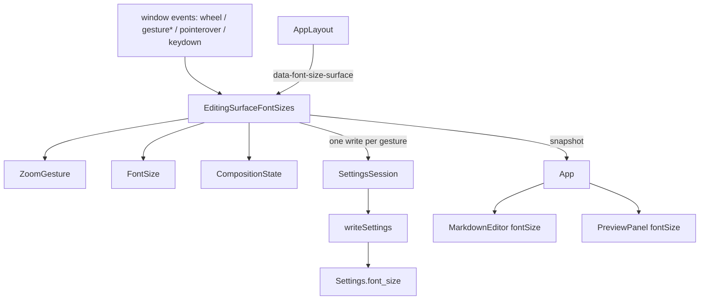

# 寫作區與預覽區各自的字體大小 — Architecture Design

**Status:** Confirmed (decided autonomously; the user was away — every judgement call is listed in §8)
**Source PRD:** `.sdd/2026-08-21-editing-surface-font-size/PRD.md`
**Tech context:** Tauri 2 (WKWebView on macOS) · Rust workspace (`rustle-domain` settings shape only) · TypeScript strict + React 19 + CodeMirror 6 · Vitest + happy-dom. No new dependency, no new channel.

---

## 1. Design Goal & Guiding Principle

- **In one sentence:** let the writer scale the editor's and the preview's font size independently with Cmd/Ctrl + wheel or a trackpad pinch over that surface, reset it with Cmd/Ctrl+0, keep both values in the settings file, and never rebuild the editor while doing it.
- **Guiding principle:** *one value object owns every rule about a font size, one owner holds the two live sizes, and every input device is turned into the same request — "scale by this ratio" — before it reaches either.* `FontSize` is the only place that knows the default (15 px), the range (10–28 px) and the 0.1 px rounding; Rust stores the numbers it is given and never does arithmetic on them, so the two layers cannot disagree about precision (the PRD's "共用的必須是規則" risk). `ZoomGesture` is the only place that knows what a wheel tick or a WebKit pinch is worth. `EditingSurfaceFontSizes` is the only owner of the live sizes and of when they are written.

---

## 2. Change Scope

| Area | Action | What / Why |
| :--- | :--- | :--- |
| `crates/domain/src/settings.rs` (+ `stored_settings.rs`) | **Modify** | New section `fontSize { editor?, preview? }` (`FontSizeSettings`, `Option<f64>` each). A value that is not a number reads as "no opinion" (`None`); the webview's `FontSize` decides what a missing or out-of-range number means |
| `src/ipc/settings.ts` | **Modify** | `fontSize?: { editor?: number; preview?: number }` |
| `src/features/fontSize/FontSize.ts` | **Add** | Value object: default, clamp, scale, round-for-storage |
| `src/features/fontSize/ZoomGesture.ts` | **Add** | Turns wheel events and WebKit gesture events into one ratio |
| `src/features/fontSize/EditingSurfaceFontSizes.ts` | **Add** | Owner of the two live sizes, the hovered surface, Cmd/Ctrl+0 and the one-write-per-gesture rule |
| `src/features/fontSize/useEditingSurfaceFontSizes.ts` | **Add** | Binds the owner to React and installs its window listeners |
| `src/features/editor/MarkdownEditor.tsx` | **Modify** | Optional `fontSize` prop: sets the size on the existing `EditorView` DOM and asks it to re-measure. Never goes through `setState` / the creation path |
| `src/features/autosave/AutosavedEditor.tsx`, `src/features/vault/EditorColumn.tsx` | **Modify** | Pass `fontSize` through |
| `src/features/preview/PreviewPanel.tsx` | **Modify** | Optional `fontSize` prop on the `<article class="preview-content">` |
| `src/app/AppLayout.tsx` | **Modify** | Marks the editor and preview regions with `FONT_SIZE_SURFACE_ATTRIBUTE` so a pointer event knows its surface |
| `src/app/app.css` | **Modify** | Editor size no longer fixed in CSS; preview `h1`–`h6`, `code`, `pre`, `blockquote`, `table` sized in `em` relative to `.preview-content` |
| `src/app/App.tsx` | **Modify** (app integration commit) | Builds one `EditingSurfaceFontSizes`, wires it |
| `SettingsSession` | **Not touched** | Already the single settings owner; already keeps unreadable settings on screen without writing |
| Scroll sync (`ScrollSynchronizer`, panes) | **Not touched** | Line-based; `PreviewScrollPane` re-measures every time, the editor pane reads CodeMirror's measured blocks |
| `src-tauri` window/webview config | **Not touched** | Tauri 2's `zoomHotkeysEnabled` defaults to off and WKWebView magnification is off, so the shell does not zoom the page; the webview still `preventDefault`s every zoom gesture as a second line |
| Sidebar / list / dialogs / status line CSS | **Not touched** | Out of scope (they are interface, not content) |

---

## 3. New Classes / Modules

| Name | Kind | Responsibility (purpose) | Collaborators | Satisfies (PRD scenario) |
| :--- | :--- | :--- | :--- | :--- |
| `FontSize` | Value object | `FontSize.of(pixels?)` (missing / non-finite → default 15; else clamped to 10–28), `scaledBy(ratio)` (clamped, **not rounded**), `forSettings()` (rounded to 0.1 px), `isDefault`, `pixels`. The only clamp and rounding rule in the app | — | US-03 all, US-02 往回／頂到邊界, US-05 settings values |
| `ZoomGesture` | Stateful translator | `ratioForWheel(event)` → `null` without Cmd/Ctrl, else `exp(-deltaPixels × 0.005)` (lines/pages converted to pixels); `startGesture()` / `ratioForGestureScale(scale)` → WebKit's cumulative `scale` turned into wheel-equivalent pixels (`-100 × ln(step)`) and the **same** formula | — | US-02 滑鼠／觸控板／沒按 Cmd |
| `EditingSurfaceFontSizes` | Session class (subscribe / snapshot) | `snapshot = { editor: FontSize, preview: FontSize }` (live value, else the stored setting); `attach(window)` installs the listeners: Cmd/Ctrl wheel and `gesture*` events anywhere are `preventDefault`ed (no page zoom) and scale the surface under the target; `pointerover` tracks the hovered surface; Cmd/Ctrl+0 (not owned by the input method) resets the hovered surface. Writes `fontSize` through `SettingsSession.change` 300 ms after the last scale step (one write per gesture), immediately on reset, and flushes on `dispose` | `SettingsSession`, `CompositionState`, `ZoomGesture`, `FontSize` | US-01, US-02, US-04, US-05, US-07 組字中的手勢 |
| `useEditingSurfaceFontSizes(fontSizes)` | Hook | `useSyncExternalStore` over the snapshot; `attach(window)` in an effect | `EditingSurfaceFontSizes` | wiring |
| `FONT_SIZE_SURFACE_ATTRIBUTE` | Constant | `data-font-size-surface="editor" \| "preview"` — the one way to tell which surface an event landed on | `AppLayout` | US-01 手勢落在別的欄位上 |

---

## 4. Modified Components

| Component | Current role | Change needed |
| :--- | :--- | :--- |
| `Settings` (Rust) | settings shape, tolerant reading | + `font_size: FontSizeSettings { editor: Option<f64>, preview: Option<f64> }`, skipped when `None` |
| `MarkdownEditor` | one `EditorView` for the app's lifetime | effect on `fontSize`: `view.dom.style.fontSize = …px; view.requestMeasure()` |
| `PreviewPanel` | renders the body | `style={{ fontSize }}` on the article |
| `AppLayout` | four columns | surface attribute on the editor / preview regions |
| `app.css` | fixed 15 px editor, UA heading sizes in the preview | editor font size from the inline style; preview children in `em` |

---

## 5. Component Relationships

---

## 6. Extensibility & Handoff Notes

- **Most likely next requirement:** a numeric font size field in the settings dialog (explicitly deferred by the PRD), or a third surface (e.g. the article list).
- **Where it lands:** the settings dialog sets an absolute size → `EditingSurfaceFontSizes.set(surface, FontSize.of(n))`-style method that goes through the same `FontSize.of` clamp (the PRD's "兩種設定大小的方式"). A third surface = one `FontSizeSurface` value, one field in `FontSizeSettings` (Rust + TS), one attribute on its region.
- **How to add it:** never clamp or round outside `FontSize`; never write font sizes outside `EditingSurfaceFontSizes`.
- **Patterns applied & why:** value object for the rule, session class (same shape as `WritingLayout` / `VaultSession`) for the owner, a translator object for device input so devices are an addition to `ZoomGesture` only.
- **Do not hardcode:** sizes in CSS for the editor or the preview root; heading sizes in `px` / `rem` inside `.preview-content`.
- **Known debt / deferred:** the wheel/pinch calibration (0.005 per pixel; pinch as `100 × ln(scale)`) is tuned by reasoning, not on hardware; see §8.

---

## 7. Traceability

| PRD Scenario | Fulfilled by |
| :--- | :--- |
| US-01 放大寫作區 / 放大預覽區 | `EditingSurfaceFontSizes` (surface from `FONT_SIZE_SURFACE_ATTRIBUTE`) |
| US-01 兩塊各自記著自己的大小 | `EditingSurfaceFontSizes` snapshot (two independent values) |
| US-01 手勢落在別的欄位上 | `EditingSurfaceFontSizes` (no surface → `preventDefault` only) |
| US-02 滑鼠滾一格 / 觸控板捏一次 | `ZoomGesture` + `FontSize.scaledBy` (every event applied, no accumulator) |
| US-02 往回做一次就回到原點 | `FontSize.scaledBy` (no rounding mid-session) + live value kept in the owner |
| US-02 頂到邊界之後往回做 | `FontSize.scaledBy` clamps each step (spent travel) |
| US-02 沒按 Cmd 或 Ctrl 就滾滾輪 | `ZoomGesture.ratioForWheel` → `null`, event untouched |
| US-02 整個畫面不跟著縮放 | `preventDefault` in the owner; only the surface's inline font size changes |
| US-03 已經最小 / 已經最大 | `FontSize.scaledBy` clamp |
| US-03 荒謬的大數字 / 不是數字 | Rust `Tolerant<Option<f64>>` → `None` for non-numbers; `FontSize.of` clamp / default |
| US-04 放回預設 / 只放回指標所在 / 已經是預設 | `EditingSurfaceFontSizes` key handler + `pointerover` tracking |
| US-04 組字中的那一次按鍵 | `CompositionState.ownsKey` |
| US-05 跨重啟記住 / 兩塊各自被記住 | `SettingsSession.change` → `fontSize` section; Rust round trip |
| US-05 設定檔讀不到 / 寫不進去 | `SettingsSession` (screen first, write only when read; failures ignored) + live value in the owner |
| US-05 不順手改掉別的偏好 | `change` spreads the latest settings; only `fontSize` replaced |
| US-06 標題 / 引言程式碼表格 / 只有預覽區 | `app.css` `em` sizes under `.preview-content`; size set only on the article |
| US-07 打到一半的東西 / 游標與捲動 | `MarkdownEditor` font size effect (no `setState`, `requestMeasure`) |
| US-07 捲動同步照舊 | untouched line-based `ScrollSynchronizer` |
| US-07 組字中的手勢 | owner never consults composition for wheel/gesture events |

---

## 8. Risks & Open Decisions

- **Decision — where the rule lives:** clamp, default and 0.1 px rounding live only in the webview's `FontSize`. Rust keeps a tolerant `Option<f64>` (non-number → no opinion) and does no arithmetic, unlike the other settings fields whose normalisation lives in Rust. Reason: the gesture runs at event rate in the webview and cannot round-trip to Rust, and two copies of the arithmetic is the exact failure the PRD lists.
- **Decision — WebKit pinch:** WKWebView reports a trackpad pinch as `gesturestart/gesturechange/gestureend` with a cumulative `scale`, not as Ctrl+wheel (that is Chromium). Both are handled; the pinch step is converted to wheel-equivalent pixels as `-100 × ln(step)` (Chromium's own conversion), so one formula serves both devices.
- **Decision — "one write per gesture":** a gesture ends when no scale step arrives for 300 ms; reset writes at once; leaving the app flushes a pending write.
- **Decision — hovered surface for Cmd/Ctrl+0:** tracked with `pointerover` on the window; nothing hovered → nothing happens and the key is left alone.
- **Decision — default 15 px for both surfaces**, range 10–28 px (PRD).
- **Decision — Cmd and Ctrl both count** (PRD "Cmd（或 Ctrl）").
- **Risk:** the calibration was not tuned on a physical trackpad in this run; the release checklist step "pinch once ≈ one quarter larger" covers it.
