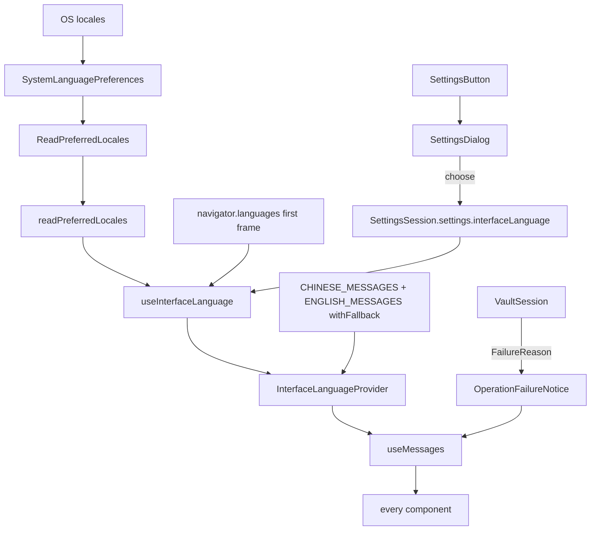

# Interface Language (中文／English) — Architecture Design

**Status:** Confirmed (decided autonomously; the user was away — every judgement call is listed in §8)
**Source PRD:** `.sdd/2026-08-21-interface-language/PRD.md`
**Tech context:** Tauri 2 · Rust Cargo workspace · TypeScript strict + React + CodeMirror 6 · see `.sdd/PROJECT.md`

---

## 1. Design Goal & Guiding Principle

- **In one sentence:** every word Rustle itself shows comes from one typed catalog per language, the language in use is `settings.interfaceLanguage ?? language of the system`, and choosing another one in a new settings dialog re-renders the screen in place without touching the editor or any file.
- **Guiding principle:** *a sentence has exactly one owner — the catalog — and nothing outside the catalog stores a finished sentence.*
  - `Messages` (`src/features/interfaceLanguage/messages.ts`) is the only place a Rustle sentence is written, in both languages. Sentences with a value in them are functions (`deleteArticleLabel(title)`), so the inserted value is never translated or rewritten.
  - State that used to hold a finished Chinese sentence (an operation failure, a leaving refusal, "no workspace selected") now holds **why** (`FailureReason`), and the component turns it into words at render time. A language switch therefore re-words a notice that is already on screen.
  - The Chinese catalog is complete by type; the English one is `Partial<Messages>` and is completed with Chinese (`withFallback`), so a missing English sentence shows Chinese — never a blank, never a key.

---

## 2. Change Scope

| Area | Action | What / Why |
| :--- | :--- | :--- |
| `rustle_domain::Settings` + `stored_settings.rs` | **Modify** | `interface_language: Option<InterfaceLanguage>` (`"zh"` / `"en"` in the file). Anything else, or nothing, reads as `None` = never chosen (B-4). Kept per vault, next to the other settings |
| `rustle_domain::LanguagePreferences` | **Add** | trait: the operating system's preferred locales, most preferred first (`mocks` feature) |
| `rustle_infrastructure::SystemLanguagePreferences` | **Add** | `sys-locale` (`get_locales`) — macOS, Windows, Linux |
| `rustle_application::ReadPreferredLocales` | **Add** | use case → `PreferredLocales { locales }` |
| channel `readPreferredLocales` | **Add** | `channel.rs`, `channels.rs`, `commands/read_preferred_locales.rs`, `src/ipc/channels.ts` |
| `src/features/interfaceLanguage/` | **Add** | `InterfaceLanguage`, `messages.ts`, `InterfaceLanguageContext` (`useMessages`), `useInterfaceLanguage`, `SettingsDialog`, `SettingsButton` |
| every component that shows a Rustle sentence | **Modify** | reads `useMessages()` instead of literals |
| `operationFailure.ts`, `VaultSession`, `ArticleMetadataForm` | **Modify** | `OperationFailure = { operation, reason: FailureReason }`; dialogs get a `FailureReason` back |
| `workspaceNameRejection.ts`, `articleArrangement.ts` labels | **Modify / remove** | the sentences move into the catalog; the module keeps only rules |
| `AppLayout` | **Modify** | region titles and labels from the catalog; workspace region gets a `footer` slot (the gear sits at the bottom of the sidebar, outside the scrolling list) |
| `App` | **Modify** | builds the language provider around everything, renders the gear and the settings dialog |
| `index.html` / `<html lang>` | **Modify** | the provider keeps `document.documentElement.lang` on `zh-Hant` / `en` (screen readers pick the voice) |
| front matter, `CreateArticle`, file names | **Not touched** | nothing written to a file depends on the interface language (D-2) — the request types have no language field |
| backend error texts (`{原因}`) | **Not touched** | they are inserted values, shown as received (see §8) |
| window title | **Not touched** | `Rustle` in `open_main_window` (D-4) |

---

## 3. New Classes / Modules

| Name | Kind | Responsibility | Collaborators | Satisfies |
| :--- | :--- | :--- | :--- | :--- |
| `InterfaceLanguage` (Rust enum) | domain enum | `Chinese` / `English`, serialized `zh` / `en` | `Settings` | US-02 |
| `LanguagePreferences` | domain trait | `preferred_locales() -> Vec<String>` | — | US-02 first use |
| `SystemLanguagePreferences` | infrastructure | asks the OS through `sys-locale` | — | US-02, NFR compatibility |
| `ReadPreferredLocales` | use case | returns `PreferredLocales { locales }` | `LanguagePreferences` | US-02 |
| `InterfaceLanguage` (TS) + `interfaceLanguageOf(locales)` | type + rule | `"zh"` when the most preferred locale's primary subtag is `zh`, else `"en"`; `documentLanguageOf` (`zh-Hant` / `en`) | — | B-2, B-3 |
| `Messages`, `CHINESE_MESSAGES`, `ENGLISH_MESSAGES`, `messagesFor`, `withFallback` | catalog | every Rustle sentence in both languages; English completed with Chinese | — | US-03, US-05, US-06 |
| `InterfaceLanguageProvider` / `useMessages` / `useInterfaceLanguage` | React context + hook | the language in use = chosen ?? system; the messages for it; keeps `<html lang>` | `SettingsSession`, `readPreferredLocales` | US-01, US-02, NFR a11y |
| `SettingsButton` | component | the gear (hub, ring, eight teeth), labelled 設定 / Settings, toggles the dialog | — | A-1, A-4 |
| `SettingsDialog` | component | the settings dialog (dimmed backdrop, same shape as the other dialogs): heading, one "language" item with two options written in their own language; choose = close + change; Esc / backdrop = close; focus to the first option on open, back to the gear on close | `CompositionState` | US-01 |
| `FailureReason` | union type | why something did not happen: `reported` (a text from the backend), `leavingRefused`, `modifiedElsewhere`, `noWorkspaceSelected` | `Messages` | US-03 (failure sentences re-worded on switch) |

---

## 4. Modified Components

| Component | Current role | Change needed |
| :--- | :--- | :--- |
| `Settings` (Rust + TS) | indentation, preview panel, last opened | + `interfaceLanguage` (optional) |
| `SettingsSession` | one copy of settings | unchanged API; the language is changed through `change` |
| `AppLayout` | four regions with English titles | titles/labels from messages; `workspacesFooter` slot |
| `WorkspaceColumn`, `NewWorkspaceField`, `RenameWorkspaceField`, `ArticleColumn`, `ArticleFilterField`, `EditorColumn`, `NoArticleState`, `SaveStatusBar`, `ImagePasteStatusLine`, `PaneDivider`, `PreviewPanel`, `ChipInput`, `ArticleMetadataForm`, `CreateArticleDialog`, `EditArticleMetadataDialog`, `ConfirmDeletionDialog`, `ArticleDeletionDialog`, `WorkspaceDeletionDialog`, `OperationFailureNotice` | literals | `useMessages()` |
| `VaultSession` | stores finished sentences in `operationFailure` | stores `FailureReason` |
| `app.css` | — | gear, settings dialog, Chinese region titles (`:lang(zh)` letter spacing) |

---

## 5. Component Relationships

---

## 6. Extensibility & Handoff Notes

- **Most likely next requirements:** (1) a new screen element with words (status labels, All Notes, view modes, focus mode — the sibling slices); (2) a second settings item (font size, theme); (3) a third language.
- **Where they land:**
  1. One key in `CHINESE_MESSAGES` (required by type) and the same key in `ENGLISH_MESSAGES`; the component reads `useMessages().key`. The catalog test fails if English misses a key, so the gap is visible in CI while the screen still falls back.
  2. One more `<section>` inside `SettingsDialog` (the dialog already has a heading + item layout and is not tied to language).
  3. One member in `InterfaceLanguage`, one catalog, one branch in `interfaceLanguageOf` / `documentLanguageOf`, one Rust enum variant.
- **Do not hardcode:** no literal sentence in a component; no finished sentence in session state (store the reason).
- **Known debt / deferred:** catalog rows for elements this app does not have yet (§8) are added by the slice that builds the element.

---

## 7. Traceability

| PRD Scenario | Fulfilled by |
| :--- | :--- |
| US-01 從齒輪打開設定 | `SettingsButton` + `SettingsDialog` |
| US-01 選了另一種語言，畫面當場改變 | `SettingsDialog.onChoose` → `SettingsSession.change` → `useInterfaceLanguage` → provider re-render |
| US-01 選了已經在用的那一種語言 | same path; equal language → same messages object → no word changes |
| US-01 Esc / 點背後壓暗處 | `SettingsDialog` (`Escape` unless composing, backdrop `onClick` when the target is the backdrop) |
| US-01 兩個選項各自用自己的語言寫 | `LANGUAGE_OPTIONS` (outside the catalog: never translated) |
| US-01 專注模式下沒有齒輪 | `SettingsButton` lives in the `AppLayout` workspaces-region footer; deferred for the rest: there is no focus mode (§8); the gear lives in the sidebar region, so a mode that hides the sidebar hides it |
| US-02 記住上次的選擇 / 與其他設定同住一處 | `Settings.interface_language` in `.rustle/settings.json` via `writeSettings` |
| US-02 第一次使用（中文 / 日文） | `ReadPreferredLocales` + `interfaceLanguageOf` |
| US-02 記住的語言讀不懂 | `StoredSettings` tolerant field → `None` |
| US-03 每一句話都換了語言 | catalog + every component; English catalog completeness test |
| US-03 中文介面下區塊標題一併中文化 | `AppLayout` titles from messages (WORKSPACES identical in both) |
| US-03 中文介面下 All Notes 一併中文化 | deferred: the All Notes entry does not exist on main; the sidebar-sections slice adds it with its catalog key (§8) |
| US-03 中文介面下的五個進度標籤 | deferred: status labels do not exist on main; the sidebar-sections slice adds `statusLabels` to `Messages` (§8) — the catalog is the seam it plugs into |
| US-03 三個領域詞不翻 | catalog wording |
| US-03 給讀螢幕的人聽的說明 | catalog label functions (`deleteArticleLabel(title)`) |
| US-04 正文不變 / 不弄壞正在寫的東西 | provider change only re-renders; `MarkdownEditor` keeps its `EditorView` and ignores an identical body |
| US-04 檔案不因介面語言而不同 | requests carry no language; front matter written in Rust |
| US-04 寫作者自己打的字 / 產品名 | inserted values are function arguments; window title untouched |
| US-05 建立於 / Created / 沒有記錄 | `createdAt(minute)`, `updatedAt(minute)`, `notRecordedInFile` + `minuteAsWritten` unchanged |
| US-06 缺一種語言 | `withFallback(ENGLISH_MESSAGES, CHINESE_MESSAGES)` |

---

## 8. Risks & Open Decisions (decided)

- **§8 rows vs. this app.** The PRD's copy table was written for a later screen. Rule used: a row whose element exists here is used verbatim (both languages). Rows for elements that do not exist on `main` yet — All Notes, STATUS/TAGS sections and the five status labels, "no tags yet", the view-mode buttons, focus mode, title/tag placeholders, the vault-wide empty state, empty-state descriptions — are **not** added (unused copy would be dead code); the slice that builds each element adds its row. Elements that exist here but have no row (sort menu and its three orders, the category field, "unsaved changes", the "open, outside filter" marker, the chip candidate list, the preview handle and its close button, the title-bar label, "modified elsewhere, nothing written", "no workspace selected") keep their Chinese and get English written in the same voice.
- **Workspace article count (deliberate deviation).** The PRD row「{數字} 篇」/「{數字}」is the visible count, and the row shows the bare number in both languages, as the PRD asks. The catalog's `articleCount` is the screen-reader label on that number, which the PRD does not cover; it stays「{n} 篇文章」/「{n} articles」(「1 article」)because a bare number read aloud would not say what it counts.
- **Wording that would be false here.** The leaving-refusal sentence says the external-change notice is in the **title bar** (that is where `SaveStatusBar` shows it), not "below the editor" as §8 says.
- **System language source.** `navigator.languages` inside a Tauri webview reports the app bundle's localization rather than the system's, so the system's preferred locales come from Rust (`sys-locale`). The first frame uses `navigator.languages` (no blank screen, NFR startup); the OS answer and then the remembered choice replace it — at most one visible re-word, the trade-off the PRD accepts.
- **Rule for "Chinese system".** Only the *most* preferred locale counts; its primary subtag `zh` (any script/region) → 中文, everything else → English.
- **Choosing the language already in use** still writes it, so "never chosen" becomes "chosen" — no visible change (A-3).
- **Backend reasons** (`{原因}` in "儲存失敗：{原因}") are shown as the backend wrote them; they are values, not Rustle copy owned by the webview.
- **Clicking the gear again** while the dialog is open hits the dimmed backdrop that covers it, so it closes the dialog (A-4) by the same path.
- **Fallback granularity.** `withFallback` completes per top-level key; a key whose value is a record (the four rejection reasons, the three orders) is provided whole or not at all.
- **Chinese region titles.** Same size as the English small caps, with a smaller letter spacing under `:lang(zh)`; all four regions share the rule.
