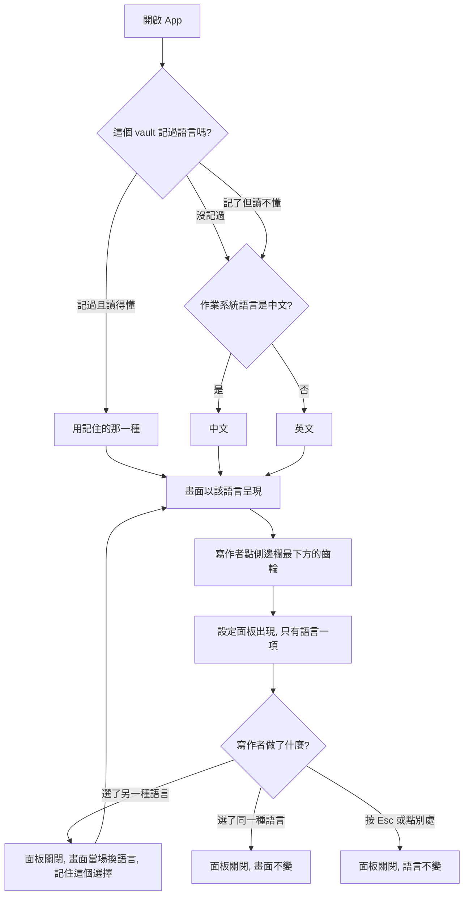

# 介面語言（中文／英文） — Product Requirements Document

**Status:** Draft
**Version:** v1.0
**Owner:** James Hsueh
**Stakeholders:** 產品（本人）、開發（本人）
**Brief:** [BRIEF.md](BRIEF.md)

---

## 1. Background & Goal

### Problem Statement

Rustle 的介面文字全部寫死成中文，而且**中英混雜**：句子與按鈕是中文，區塊標題（WORKSPACES／ARTICLES／EDITOR／PREVIEW）、「All Notes」與四個進度標籤是英文。結果是兩個問題：

1. **只讀英文的人用不了這個 App**——沒有任何地方可以把介面換成英文。
2. **同一個畫面上兩種語言並存**，不是設計，是累積下來的結果。

### Expected Outcome

- 讀者能在**側邊欄最下方的齒輪**打開設定畫面，選擇「中文」或「English」，**畫面當場改變**。
- 選擇被記住，下次開啟沿用；從來沒選過時依作業系統語言決定。
- **Rustle 自己說的每一句話**（含給讀螢幕的人聽的說明文字）在兩種語言下都有說法，畫面上不再出現另一種語言的殘留。
- **寫作者的文章與檔案完全不受影響**：正文、front matter、檔名、寫作者自己打的字，都與介面語言無關。

驗收方式是本文件 §3 的每一條情境；文案的單一來源是 §8 的對照表。

### Out of Scope

- **文章正文的翻譯**：這個切片不提供把文章翻成另一種語言的能力。
- **檔案內容**：front matter 的鍵與值、進度在檔案裡的寫法、檔名、保留的圖片資料夾名稱，一律不因介面語言而不同。
- **寫作者自己打的字**：workspace 名稱、文章標題、標籤，兩種語言下都原樣顯示。
- **中文與英文以外的語言。**
- **語言以外的設定項目**：設定畫面現在只放語言。
- **作業系統選單列**：App 目前沒有選單列，這個切片也不新增。
- **專注模式下換語言**：專注模式把側邊欄整片收起，齒輪也就不在。要換語言先離開專注模式。

---

## 2. User Personas

- **Primary Role:** **寫作者**——Rustle 唯一的使用者角色，在自己的機器上寫文章。這個切片把它分成兩種閱讀習慣：**讀中文的寫作者**與**讀英文的寫作者**，同一個人也可能在兩者之間換。
- **Usage Context:** 本機桌面應用程式，完全離線。語言是**開始寫之前**設定一次的東西，不是寫作途中反覆切換的東西——但切換發生在寫作途中時，不能弄壞正在寫的東西。

---

## 3. User Stories & Acceptance Criteria

### US-01 — 選擇介面語言 [priority: P0]

**As a** 寫作者，**I want** 在一個明顯的地方把介面換成我讀得懂的語言，**so that** 我不必猜按鈕的意思。

```gherkin
Scenario: 從齒輪打開設定
  Given 介面目前是中文
  When 寫作者點側邊欄最下方的齒輪
  Then 一個設定畫面蓋在畫面上，背後壓暗
  And 最上面寫著「設定」
  And 裡面只有「語言」一項，兩個選項並列

Scenario: 選了另一種語言，畫面當場改變
  Given 設定畫面開著，介面目前是中文
  When 寫作者選 English
  Then 設定畫面關閉
  And 整個畫面的每一句話變成英文
  And 沒有要求重新啟動 App

Scenario: 選了已經在用的那一種語言
  Given 設定畫面開著，介面目前是中文
  When 寫作者選「中文」
  Then 設定畫面關閉
  And 畫面上沒有任何一個字改變

Scenario: 按 Esc 離開設定畫面
  Given 設定畫面開著，介面目前是中文
  When 寫作者按 Esc
  Then 設定畫面關閉
  And 介面仍然是中文

Scenario: 點背後壓暗處離開設定畫面
  Given 設定畫面開著，介面目前是中文
  When 寫作者點設定畫面背後被壓暗的地方
  Then 設定畫面關閉
  And 介面仍然是中文

Scenario: 兩個選項各自用自己的語言寫
  Given 介面是英文
  When 寫作者打開設定畫面
  Then 語言那一項的兩個選項寫成「中文」與「English」
  And 中文介面下打開時，兩個選項的字完全相同

Scenario: 專注模式下沒有齒輪
  Given 寫作者在專注模式，側邊欄與文章清單都收起來了
  When 寫作者想換語言
  Then 畫面上沒有齒輪
  And 離開專注模式之後齒輪回到側邊欄最下方
```

### US-02 — App 記住我的語言 [priority: P0]

**As a** 寫作者，**I want** App 記住我選的語言，**so that** 我不必每次開啟都重選一次。

```gherkin
Scenario: 記住上次的選擇
  Given 寫作者上次選了 English
  When 寫作者關掉 App 再重新開啟
  Then 介面是英文

Scenario: 第一次使用，作業系統是中文
  Given 這個 vault 從來沒有人選過語言
  And 作業系統的語言是繁體中文
  When 寫作者第一次開啟 App
  Then 介面是中文

Scenario: 第一次使用，作業系統是我們不支援的語言
  Given 這個 vault 從來沒有人選過語言
  And 作業系統的語言是日文
  When 寫作者開啟 App
  Then 介面是英文

Scenario: 記住的語言讀不懂
  Given 記住的語言被手動改成一個 Rustle 不認得的說法
  And 作業系統的語言是繁體中文
  When 寫作者開啟 App
  Then App 照常啟動，沒有錯誤訊息
  And 介面是中文，與「從來沒選過」的結果相同

Scenario: 語言與其他設定同住一處
  Given 寫作者在這個 vault 選了 English
  When 寫作者關掉 App 再開啟
  Then 介面是英文
  And 縮排、預覽面板寬度、側欄折疊這些設定也都照舊還原
```

### US-03 — 介面上每一句話都跟著語言 [priority: P0]

**As a** 讀英文的寫作者，**I want** 畫面上不再出現我讀不懂的字，**so that** 我能靠自己完成每一件事。

```gherkin
Scenario: 每一句 Rustle 說的話都換了語言
  Given 介面切到英文
  When 寫作者看整個畫面
  Then 按鈕、提示、空狀態、確認訊息、錯誤說明全部是英文
  And 畫面上沒有任何一句中文（寫作者自己打的字除外）

Scenario: 中文介面下區塊標題一併中文化
  Given 介面切到中文
  When 寫作者看四個區塊標題
  Then 文章那一欄的標題是「文章」
  And 編輯那一欄的標題是「編輯」
  And 預覽那一欄的標題是「預覽」
  And workspace 那個區塊的標題仍然是「WORKSPACES」

Scenario: 中文介面下 All Notes 一併中文化
  Given 介面切到中文
  When 寫作者看側邊欄最上面那個入口
  Then 它寫「所有文章」

Scenario: 中文介面下的五個進度標籤
  Given 介面切到中文
  When 寫作者看側邊欄的狀態區與 metadata 表單的狀態欄位
  Then 五個選項寫成「進行中」／「暫停」／「已完成」／「已放棄」／「未標記」
  And 兩處的用字與順序完全相同

Scenario: 三個領域詞在中文介面下不翻
  Given 介面是中文
  When 畫面上出現 vault、workspace、metadata 這三個詞
  Then 它們原樣顯示，例如「讀不到這個 workspace：…」與「metadata 不完整」

Scenario: 給讀螢幕的人聽的說明也換了語言
  Given 介面是英文
  And 有一篇文章的標題是「我的旅行」
  When 讀螢幕的人聽那篇文章的刪除鈕
  Then 說明是英文的「Delete "我的旅行"」
  And 標題「我的旅行」原樣念出，沒有被改寫
```

### US-04 — 我的文章與檔案不受語言影響 [priority: P0]

**As a** 寫作者，**I want** 換介面語言不會動到我的文章或檔案，**so that** 我敢隨時換。

```gherkin
Scenario: 正文一個字都不變
  Given 編輯區開著一篇正文是中文的文章
  When 寫作者把介面切成英文
  Then 正文一個字都沒有變

Scenario: 檔案不因介面語言而長得不同
  Given 介面是中文
  When 寫作者建立一篇文章並把進度選成「進行中」
  And 之後用別的程式打開那個檔案
  Then 檔案裡記的進度與英文介面下建立的檔案完全相同

Scenario: 寫作者自己打的字原樣顯示
  Given 有一個 workspace 叫 Travel，有一個標籤叫「旅行」
  When 寫作者把介面切成中文再切回英文
  Then Travel 與「旅行」兩種語言下都原樣顯示

Scenario: 產品名不翻
  Given 介面是中文
  When 寫作者看視窗標題
  Then 它是 Rustle

Scenario: 切換語言不弄壞正在寫的東西
  Given 編輯區有還沒存起來的變更
  When 寫作者切換介面語言
  Then 那些變更還在，游標位置沒有跳掉
  And 未存的變更照原本的規則被存起來
```

### US-05 — 日期時間讀得懂，而且不被改寫 [priority: P1]

**As a** 寫作者，**I want** 時間的說明文字跟著語言，但數字本身不要被動過，**so that** 我看到的時間就是檔案裡記的時間。

```gherkin
Scenario: 中文介面下的建立時間
  Given 某篇文章的檔案記的建立時間是 2026-08-21 14:30
  And 介面是中文
  When 寫作者打開那篇文章的 metadata 表單
  Then 顯示「建立於 2026-08-21 14:30」

Scenario: 英文介面下的建立時間
  Given 同一篇文章
  And 介面是英文
  When 寫作者打開那篇文章的 metadata 表單
  Then 顯示「Created 2026-08-21 14:30」
  And 數字與中文介面下顯示的完全相同，沒有換時區、沒有改寫月份

Scenario: 檔案沒有記錄時間
  Given 某篇文章的檔案沒有記錄建立時間
  When 寫作者在中文介面打開它的 metadata 表單
  Then 顯示「（檔案沒有記錄）」
  And 在英文介面下顯示「(not recorded in the file)」
  And 兩種語言都不留空白，也不顯示一個編造的日期
```

### US-06 — 缺一種語言的說法時不留空白 [priority: P1]

**As a** 寫作者，**I want** 就算某句話漏了翻譯，畫面也還能用，**so that** 一個漏掉的句子不會讓我卡住。

```gherkin
Scenario: 一句話只有中文，還沒有英文說法
  Given 某一句話只寫了中文，還沒有英文的說法
  When 寫作者在英文介面下走到會出現那句話的畫面
  Then 畫面顯示已經有的那一句中文
  And 畫面上不出現空白
  And 畫面上不出現讀者看不懂的內部代號
```

---

## 4. Business Flow & Logic

### 主要流程



### 核心規則

1. **語言只有兩種**：中文與英文。沒有第三種，也沒有「跟著系統跑」這個持續狀態——系統語言**只在從來沒選過的那一刻被問一次**。
2. **記住的語言讀不懂時，等同從來沒選過**：改由系統語言決定，App 照常啟動。這與既有的「設定被手改壞不該讓 App 打不開」是同一條規則。
3. **語言與其他設定同住一處**，因此**每個 vault 各自記**。不另開第二個設定落地點。
4. **畫面上任何一個字都從同一份對照表拿**（§8），包含給讀螢幕的人聽的說明文字。同一句話不會有第二個主人。
5. **三個領域詞不翻**：vault、workspace、metadata。因此 workspace 那個區塊標題在兩種語言下都是「WORKSPACES」。
6. **時間只換前綴的字，數字不動**：畫面上的時間沿用檔案裡記的那一串到分鐘，不重新解讀、不換時區。
7. **語言不影響任何被寫進檔案的東西**，也不影響寫作者自己打的字。
8. **缺一種語言的說法時交出另一種已有的說法**，永不交出空白、永不交出內部代號。這是缺口的**止血**，不是可接受的狀態。

### 邊界與例外

| 情況 | 行為 |
| :--- | :--- |
| 專注模式（側邊欄收起） | 齒輪不在畫面上。要換語言先離開專注模式——**接受的結果** |
| 切換語言時編輯區有未存的變更 | 變更不丟、游標不跳，未存的變更照既有規則存起來 |
| 切換語言時正在用輸入法組字 | 組字不被打斷 |
| 切換語言時某個對話框開著 | 對話框裡已經填的字不消失，只有 Rustle 自己的字換語言 |
| 記住的語言讀不懂 | 當成從來沒選過，依系統語言決定 |
| 作業系統語言是中文與英文以外的語言 | 英文 |
| 某句話缺一種語言 | 顯示另一種已有的說法 |

---

## 5. UI/UX Design & Interaction

**沒有設計稿**——沿用 App 既有的視覺語言。

| 項目 | 決定 |
| :--- | :--- |
| 入口 | 側邊欄**最下方**一個齒輪。單線畫法，與 App 既有的十四個標記同一種；**要看得出是齒輪**（輪轂、外環、八顆齒），不能像太陽 |
| 形態 | **蓋在畫面上的設定畫面**，背後壓暗——與 App 既有三個對話框完全同一種形狀，不新增第四種樣子。（原定貼著齒輪的小面板，交付後改為此，理由：設定是讀者專程去看的地方，也需要放得下第二項設定） |
| 內容 | 最上面寫「設定」，下面**目前只有「語言」一項**，兩個選項並列 |
| 選項文字 | 「中文」與「English」，**兩種介面語言下都一樣** |
| 關閉方式 | 選了一個語言就關；`Esc` 關；點背後壓暗處關；再按一次齒輪關。後三者不改語言 |
| 鍵盤路徑 | 設定畫面打開時焦點落在**第一個語言選項**，關閉時焦點回到齒輪 |
| 立即性 | 選定當下整個畫面換語言，不重新啟動、不閃一下白畫面 |
| 空狀態／載入狀態 | 這個切片不新增任何空狀態或載入狀態——語言是一個當場就有答案的選擇 |
| 中文區塊標題的樣式 | 既有標題是大寫英文小字距；中文沒有大小寫，**字距與大小的細節留給實作階段決定**，但四欄之間必須一致 |

---

## 6. Non-Functional Requirements

| 面向 | 要求 |
| :--- | :--- |
| **輸入法（產品第三主張）** | 切換語言**不得打斷組字**、不得讓游標附近的畫面被重建。這是全 App 的橫切約束，換語言不是例外 |
| **資料安全** | 切換語言**不得丟失未儲存的變更**，也不得改寫任何檔案 |
| **離線** | 兩種語言的說法**全部內建**，不對外連線取得翻譯。App 完全離線的性質不變 |
| **啟動** | 決定用哪種語言不得讓開啟 App 變慢到看得出來，也不得為此壓住畫面不畫。畫面**起手用系統語言**，讀者記住的語言在設定讀回的那一刻套用——兩者不同時會看到文字換一次。這是刻意的取捨：另一條路是每次啟動都先給一段空白畫面 |
| **一致性** | 同一件事在不同畫面上必須用同一句話（例：側邊欄的進度標籤與 metadata 表單的進度選項） |
| **可及性** | 給讀螢幕的人聽的說明文字**與看得到的字同等對待**，兩種語言都要有。**App 本身也要向輔助技術說出自己是哪一種語言**——讀螢幕的人靠它挑語音，一個中文語音念英文句子跟句子沒翻一樣不能用 |
| **相容性** | 三個桌面平台行為一致；作業系統語言的判斷在三個平台上都要能回答 |
| **追蹤／分析** | 無。App 不收集任何使用資料 |

---

## 7. Dependencies & Risks

### 外部依賴

- **無第三方服務**。翻譯全部內建，不呼叫任何翻譯服務。
- 唯一的外部資訊是**作業系統回報的語言偏好**，而且只在從來沒選過時問一次。

### 已知風險

| 風險 | 說明 | 緩解 |
| :--- | :--- | :--- |
| **文案漏網** | 畫面上的字散落在幾十個地方，其中不少只在失敗時才出現（存不進去、名稱被擋下、讀不到 workspace），人工看畫面看不完 | §8 的對照表是**逐句清單**，實作時逐句對照；只在失敗時出現的句子必須有各自的驗證 |
| **中文標題的視覺** | 既有區塊標題是大寫英文的小字距樣式，中文套上去可能過鬆或過緊 | 四欄一起看、一起調；§5 已把它列為實作階段要決定的事 |
| **英文文案的語氣不一致** | 既有中文文案的語氣是「對寫作者說話」而不是系統公告；英文若寫成系統公告會像另一個 App | §8 的英文欄由同一個人一次寫完，不逐檔臨時翻 |
| **進度標籤中文化牽動既有記錄** | 通用語言地圖原本明文釘死「進度標籤是英文」 | 已在通用語言地圖上更新為雙語，並註明是這個切片的決定 |
| **切換語言重畫整個畫面** | 整片重畫最可能弄壞的就是編輯區與組字 | §6 已列為硬要求；驗證方式沿用既有的輸入法人工檢查清單 |

---

## 8. Appendix — 文案對照表（單一真實來源）

**畫面上每一個字都出自這張表。** 左欄說明「這句話在說什麼」，中間兩欄是兩種語言的說法，`{ }` 裡的東西是當場填進去的值（寫作者自己打的字或數字），**永不翻譯**。

### 8.1 側邊欄與設定

| 說的是什麼 | 中文介面 | 英文介面 |
| :--- | :--- | :--- |
| 側邊欄本身（給讀螢幕的人） | 側邊欄 | Sidebar |
| 跨 workspace 看全部文章的入口 | 所有文章 | All Notes |
| workspace 區塊的標題 | WORKSPACES | WORKSPACES |
| 狀態區塊的標題 | 狀態 | STATUS |
| 標籤區塊的標題 | 標籤 | TAGS |
| 一個標籤都還沒用過 | 還沒有標籤 | No tags yet |
| 設定入口（齒輪） | 設定 | Settings |
| 面板裡那一項的名字 | 語言 | Language |
| 語言選項一 | 中文 | 中文 |
| 語言選項二 | English | English |

### 8.2 五個進度標籤（側邊欄與 metadata 表單共用）

| 說的是什麼 | 中文介面 | 英文介面 |
| :--- | :--- | :--- |
| 正在寫 | 進行中 | Active |
| 暫停 | 暫停 | On Hold |
| 寫完了 | 已完成 | Completed |
| 放棄了 | 已放棄 | Dropped |
| 沒有標記進度 | 未標記 | No Status |

### 8.3 Workspace 清單

| 說的是什麼 | 中文介面 | 英文介面 |
| :--- | :--- | :--- |
| 讀不到 vault | 讀不到 vault：{原因} | Cannot read the vault: {原因} |
| 一個 workspace 都還沒有（標題） | 建立你的第一個 workspace | Create your first workspace |
| 一個 workspace 都還沒有（說明） | Workspace 就是 vault 底下的一個資料夾，用來放一組主題相關的文章。 | A workspace is a folder inside the vault, holding a set of articles on related subjects. |
| 一個 workspace 有幾篇文章 | {數字} 篇 | {數字} |
| 重新命名（按鈕上的字） | 重新命名 | Rename |
| 重新命名（給讀螢幕的人） | 重新命名 {workspace} | Rename "{workspace}" |
| 刪除（按鈕上的字） | 刪除 | Delete |
| 刪除（給讀螢幕的人） | 刪除 {workspace} | Delete "{workspace}" |
| 新增 workspace | 新 workspace | New workspace |
| 改名時的名稱欄位 | {workspace} 的新名稱 | New name for "{workspace}" |

### 8.4 新 workspace 對話框

| 說的是什麼 | 中文介面 | 英文介面 |
| :--- | :--- | :--- |
| 對話框本身 | 新 workspace | New workspace |
| 抬頭 | 新 WORKSPACE | NEW WORKSPACE |
| 名稱欄位 | 新 workspace 名稱 | New workspace name |
| 名稱欄位的提示字 | workspace 名稱 | workspace name |

### 8.5 workspace 名稱被擋下的四個理由

| 說的是什麼 | 中文介面 | 英文介面 |
| :--- | :--- | :--- |
| 一個字都沒填 | 請先輸入 workspace 名稱。 | Enter a workspace name first. |
| 名稱裡有路徑分隔字元 | 名稱不能包含 / 或 \\，一個 workspace 就是一層資料夾。 | A name cannot contain / or \\ — a workspace is one single folder. |
| 撞到保留名稱 | 這是保留名稱（images，或以 . 開頭的名稱），請換一個。 | That name is reserved (images, or any name starting with a dot). Choose another. |
| 名稱已經有人用了 | 這個名稱已經有人用了，請換一個。 | That name is already taken. Choose another. |

### 8.6 刪除 workspace 的二次確認

| 說的是什麼 | 中文介面 | 英文介面 |
| :--- | :--- | :--- |
| 抬頭 | 刪除 workspace「{workspace}」？ | Delete workspace "{workspace}"? |
| 會帶走什麼 | 將刪除 {數字} 篇文章與 {數字} 張圖片。 | This will delete {數字} article(s) and {數字} image(s). |
| 東西會去哪裡 | 整個 {workspace} 資料夾會移到系統垃圾桶，之後還可以從垃圾桶還原。 | The whole {workspace} folder goes to the system trash, where it can still be restored. |
| 確認鈕 | 刪除 workspace | Delete workspace |

### 8.7 文章清單

| 說的是什麼 | 中文介面 | 英文介面 |
| :--- | :--- | :--- |
| 文章清單本身（給讀螢幕的人） | 文章 | Articles |
| 文字篩選欄位 | 篩選文章 | Filter articles |
| 篩選欄位的提示字 | 篩選 | filter |
| 讀不到這個 workspace | 讀不到這個 workspace：{原因} | Cannot read this workspace: {原因} |
| 還沒選 workspace（標題） | 先選一個 workspace | Choose a workspace first |
| 還沒選 workspace（說明） | 左邊選一個 workspace，或選「所有文章」，文章就會列在這裡。 | Choose a workspace on the left, or All Notes, and the articles will be listed here. |
| 這個 workspace 是空的（標題） | 建立第一篇文章 | Create the first article |
| 這個 workspace 是空的（說明） | {workspace} 裡還沒有文章。上面那個圖示就是開始的地方。 | There are no articles in {workspace} yet. The mark above is where to start. |
| 整個 vault 都沒有文章（標題） | vault 裡還沒有文章 | No articles in the vault yet |
| 整個 vault 都沒有文章（說明） | 先選一個 workspace，才能在裡面建立第一篇文章。 | Choose a workspace first, then create the first article inside it. |
| 篩選之後沒有結果 | 沒有符合的文章 | No matching articles |
| 這篇的 metadata 不完整 | metadata 不完整 | incomplete metadata |
| 這篇正開在編輯區 | 開著的 | open |
| 新增文章 | 新文章 | New article |
| 編輯 metadata（給讀螢幕的人） | 編輯 {標題} 的 metadata | Edit metadata for "{標題}" |
| 刪除文章（給讀螢幕的人） | 刪除 {標題} | Delete "{標題}" |

### 8.8 刪除文章的二次確認

| 說的是什麼 | 中文介面 | 英文介面 |
| :--- | :--- | :--- |
| 抬頭 | 刪除「{標題}」？ | Delete "{標題}"? |
| 東西會去哪裡 | 這篇文章會移到系統垃圾桶，之後還可以從垃圾桶還原。 | The article goes to the system trash, where it can still be restored. |
| 圖片不會被刪 | 它用到的圖片一張都不會被刪除——images/ 是整個 workspace 共用的，同一張圖可能還被別篇引用。 | None of its images are deleted — images/ is shared by the whole workspace, and another article may still be using the same picture. |
| 確認鈕 | 刪除文章 | Delete article |

### 8.9 版面與兩個寫作面

| 說的是什麼 | 中文介面 | 英文介面 |
| :--- | :--- | :--- |
| 專注模式 | 專注模式 | Focus mode |
| 只顯示編輯 | 只有編輯 | Editor only |
| 編輯與預覽並排 | 並排 | Side by side |
| 只顯示預覽 | 只有預覽 | Preview only |
| 編輯區本身（給讀螢幕的人） | 編輯區 | Editor |
| 編輯區的標題 | 編輯 | EDITOR |
| 預覽區本身（給讀螢幕的人） | 預覽區 | Preview |
| 預覽區的標題 | 預覽 | PREVIEW |
| 拖曳分隔線 | 調整預覽寬度 | Adjust preview width |
| 還沒選文章（標題） | 還沒有選取文章 | No article open |
| 還沒選文章（說明） | 從中間的清單選一篇文章，選好之後就可以開始寫。 | Choose an article from the list in the middle, and you can start writing. |
| 讀不到這篇文章 | 讀不到這篇文章：{原因} | Cannot read this article: {原因} |

### 8.10 建立文章與編輯 metadata 的表單

| 說的是什麼 | 中文介面 | 英文介面 |
| :--- | :--- | :--- |
| 建立文章對話框本身 | 新文章 | New article |
| 建立文章的抬頭 | 新文章 · {workspace} | New article · {workspace} |
| 編輯 metadata 對話框本身 | 編輯 metadata | Edit metadata |
| 編輯 metadata 的抬頭 | 編輯 metadata · {檔名} | Edit metadata · {檔名} |
| 標題欄位 | 標題 | Title |
| 標題欄位的提示字 | 文章標題 | Article title |
| 狀態欄位 | 狀態 | Status |
| 標籤欄位 | 標籤 | Tags |
| 標籤欄位的提示字 | Enter 或逗號成為一個標籤 | Enter or a comma makes a tag |
| 移掉一個標籤 | 移除 {標籤} | Remove "{標籤}" |
| 建立時間 | 建立於 {時間} | Created {時間} |
| 更新時間 | 更新於 {時間} | Updated {時間} |
| 檔案沒有記錄時間 | （檔案沒有記錄） | (not recorded in the file) |
| 時間由 App 維護（建立時） | 建立時間與更新時間都由 Rustle 自己維護，不必填。 | Rustle keeps both times itself — there is nothing to fill in. |
| 時間由 App 維護（編輯時） | 建立時間與更新時間都由 Rustle 自己維護，不能編輯。檔名也不會因為改標題而改變。 | Rustle keeps both times itself; they cannot be edited. Changing the title does not change the file name either. |
| 還沒填標題（建立） | 請先輸入標題，「建立」才會啟用。 | Enter a title first — then Create becomes available. |
| 還沒填標題（編輯） | 請先輸入標題，「儲存」才會啟用。 | Enter a title first — then Save becomes available. |
| 取消 | 取消 | Cancel |
| 建立 | 建立 | Create |
| 儲存 | 儲存 | Save |

### 8.11 儲存狀態與貼上圖片

| 說的是什麼 | 中文介面 | 英文介面 |
| :--- | :--- | :--- |
| 正在存 | 儲存中 | Saving |
| 存好了 | 已儲存 | Saved |
| 存不進去 | 儲存失敗 | Save failed |
| 存不進去（帶原因） | 儲存失敗：{原因} | Save failed: {原因} |
| 檔案被外部改過 | 這個檔案在 Rustle 之外被改動過 | This file was changed outside Rustle |
| 用我的版本蓋過去 | 覆寫 | Overwrite |
| 放掉我的版本、重讀檔案 | 重新載入 | Reload |
| 圖片正在存 | 圖片儲存中… | Saving image… |
| 圖片存不進去（帶原因） | 圖片存不進去： | Could not save the image: |
| 圖片存不進去（沒有原因可說） | 圖片存不進去。 | Could not save the image. |

### 8.12 操作失敗提示

| 說的是什麼 | 中文介面 | 英文介面 |
| :--- | :--- | :--- |
| 建立文章失敗 | 建立文章失敗 | Could not create the article |
| 更新 metadata 失敗 | 更新 metadata 失敗 | Could not update the metadata |
| 刪除文章失敗 | 刪除文章失敗 | Could not delete the article |
| 重新命名 workspace 失敗 | 重新命名 workspace 失敗 | Could not rename the workspace |
| 刪除 workspace 失敗 | 刪除 workspace 失敗 | Could not delete the workspace |
| 還沒選 workspace 就要建文章 | 請先在左邊選一個 workspace，新文章才知道要建立在哪裡。 | Choose a workspace on the left first, so the new article knows where to go. |
| 外部改動的提示還沒回答 | 請先回答編輯區下方的外部改動提示，再試一次。 | Answer the external-change notice below the editor first, then try again. |
| 上一次儲存失敗 | 上一次儲存失敗。再按一次就會放掉未儲存的變更並繼續。 | The last save failed. Press again to discard the unsaved changes and continue. |
| 關掉這個提示 | 關閉提示 | Dismiss |

### 8.13 兩種語言下都一樣的字

| 說的是什麼 | 兩種語言 | 為什麼 |
| :--- | :--- | :--- |
| 產品名 | Rustle | 產品名不翻 |
| 視窗標題 | Rustle | 同上 |
| workspace 區塊的標題 | WORKSPACES | workspace 這個詞不翻 |
| 語言的兩個選項 | 中文 / English | 各自用自己的語言寫，讀者才看得懂要選哪個 |
| 三個領域詞 | vault / workspace / metadata | 產品自己的詞彙，中文介面下原樣夾在句子裡 |

---

## 9. 相關文件

- [BRIEF.md](BRIEF.md) — 需求共識與確認過的例子（含 Revision）
- 通用語言地圖——這個切片新增 5 個詞彙（介面語言／介面語言設定／系統語言／介面文案／設定面板），並更新 9 列原本把 UI 文案釘為英文的記錄
