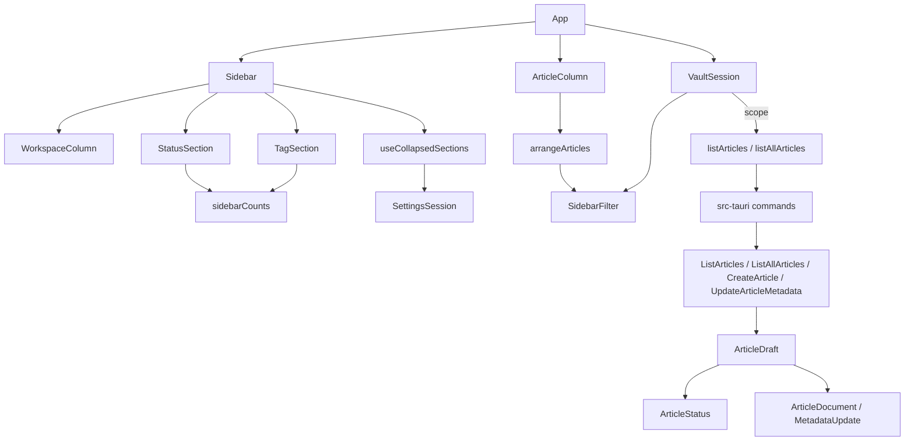

# Sidebar Sections and Status Filtering — Architecture Design

**Status:** Confirmed (decided autonomously; the user was away — every judgement call is listed in §8)
**Source PRD:** `.sdd/2026-08-21-sidebar-sections-and-status-filtering/PRD.md`
**Tech context:** Tauri 2 · Rust Cargo workspace (domain / application / infrastructure / src-tauri) · TypeScript strict + React · see `.sdd/PROJECT.md`

---

## 1. Design Goal & Guiding Principle

- **In one sentence:** an article gets one of four fixed statuses (or none) that the domain reads and writes without ever touching an unrecognised value or the retired category; the left column becomes a sidebar of collapsible sections whose status and tag choices narrow the article list of the current scope (one workspace, or every workspace under All Notes).
- **Guiding principle:** *one owner per rule.*
  - `ArticleStatus` (domain) is the only place that knows the four statuses and how they are spelled in a file; `ArticleDraft::edit` is the only place that decides "write, remove or leave the `status` line alone".
  - `VaultSession` owns the **scope** (workspace or All Notes) and the **sidebar filter** together, so changing scope clears the filter by construction (TC-34/35).
  - `SidebarFilter` (webview) is a value: `toggleStatus`, `toggleTag`, `matches`. `sidebarCounts(articles)` counts the whole scope and never sees the selection, so the numbers cannot become circular (TC-17/24).
  - `arrangeArticles` stays the one door from "the scope's articles" to "the rows column 2 draws": sidebar filter → text filter → keep the open article → sort.

---

## 2. Change Scope

| Area | Action | What / Why |
| :--- | :--- | :--- |
| `crates/domain/src/article_status.rs` | **Add** | `ArticleStatus { Active, OnHold, Completed, Dropped }`: `parse(front matter text) -> Option<Self>`, `as_front_matter_value()`, serde `camelCase` for the wire |
| `crates/domain/src/article_metadata.rs` | **Modify** | drops `category`; gains `status: Option<ArticleStatus>` (unrecognised → `None`) |
| `crates/domain/src/metadata_update.rs` | **Modify** | drops `category`; gains `status(ArticleStatus)` and `without_status()`; new `FieldValue::Removed` |
| `crates/domain/src/article_document/*` | **Modify** | `FieldValue::Removed` removes the key (mapping and text); `ArticleDocument::status()` |
| `crates/domain/src/article_draft.rs` | **Modify** | `new(title, status, tags)`; `to_text` writes the status when chosen; `edit` writes a chosen status, removes only a *recognised* one when "No Status" is chosen, otherwise leaves the line; never touches `category` |
| `crates/domain/src/settings.rs` (+ `stored_settings.rs`) | **Modify** | `sidebar: SidebarSettings { collapsed_sections: Vec<SidebarSection> }`; unknown section names are dropped, repeats removed |
| `crates/application/src/list_articles.rs` | **Modify** | `ArticleSummary` drops `category`, gains `workspace` and `status` |
| `crates/application/src/list_all_articles.rs` | **Add** | `ListAllArticles`: every workspace's articles; an unreadable workspace is skipped |
| `crates/application/src/create_article.rs`, `update_article_metadata.rs` | **Modify** | take `Option<ArticleStatus>` instead of categories |
| `src-tauri` | **Modify** | new channel `listAllArticles`; `create_article` / `update_metadata` take `status` |
| `src/ipc/*` | **Modify / Add** | `ArticleStatus` type, `ArticleSummary` shape, request shapes, `Settings.sidebar`, `channels.listAllArticles` |
| `src/features/sidebar/` | **Add** | `articleStatusLabels.ts`, `SidebarFilter.ts`, `sidebarCounts.ts`, `useCollapsedSections.ts`, `Sidebar.tsx` (All Notes + `CollapsibleSection` ×3), `StatusSection.tsx`, `TagSection.tsx` |
| `src/features/vault/VaultSession.ts` | **Modify** | `showsAllNotes`, `selectAllNotes()`, `sidebarFilter` + `toggleStatusFilter` / `toggleTagFilter`; `selectedArticle` becomes `{ workspace, fileName }`; operations act on the article's own workspace; reload the current scope |
| `src/features/vault/articleArrangement.ts` | **Modify** | text filter no longer reads categories; applies the sidebar filter; open article identified by workspace + file name; ties: title → workspace → file name |
| `src/features/vault/ArticleColumn.tsx` | **Modify** | rows show the workspace under All Notes, no categories; "新文章" under All Notes shows "請先選一個 workspace" instead of the dialog |
| `src/features/vault/WorkspaceColumn.tsx` | **Modify** | no longer the whole column: rendered inside the WORKSPACES section; selection pressed state respects All Notes |
| `src/features/articleMetadata/*`, create / edit dialogs | **Modify** | category chip field replaced by a five-option Status `<select>`; vocabulary is tags only |
| `src/app/AppLayout.tsx`, `App.tsx`, `app.css` | **Modify** | left slot is `sidebar` (sections carry their own headings); App wires the new session methods |
| Infrastructure crate | **Not touched** | `FileSystemSettingsRepository` already merges sections and keeps unknown keys; article I/O unchanged |
| Body autosave (`SaveArticleBody`) | **Not touched** | it only replaces the body, so `status` and `category` lines stay byte for byte (TC-06, TC-50) — covered by a new test, no code change |

---

## 3. New Classes / Modules

| Name | Kind | Responsibility | Collaborators | Satisfies |
| :--- | :--- | :--- | :--- | :--- |
| `ArticleStatus` | domain enum | the four statuses; parse a front matter value (case-insensitive; `on hold` / `on-hold` / `on_hold` / `onhold` all mean On Hold); canonical file spelling `active` / `on-hold` / `completed` / `dropped` | — | TC-01~10 |
| `FieldValue::Removed` | domain variant | "delete this key", distinct from "leave it" (not in the update) | `MappingText`, `FrontMatter` | TC-09 |
| `SidebarSection` / `SidebarSettings` | domain enum / struct | which sections are collapsed, tolerant read | `StoredSettings` | TC-43, TC-45 |
| `ListAllArticles` | application use case | the vault's articles across workspaces, each row knows its workspace | `ListArticles`, `WorkspaceRepository` | TC-31~33, TC-39 |
| `SidebarFilter` | TS value class | at most one status choice (`ArticleStatus` or `"noStatus"`) + a set of tags; `toggleStatus`, `toggleTag`, `matches(article)` (status equal and every tag present) | — | TC-13~16, TC-21~23, TC-25 |
| `sidebarCounts` | TS pure function | five status counts (always present) and tag counts sorted by count desc then name asc, over the whole scope | — | TC-11, TC-12, TC-17~19, TC-24, TC-33 |
| `useCollapsedSections` | React hook | reads/writes `settings.sidebar.collapsedSections` through `SettingsSession` | `SettingsSession` | TC-41~44, TC-46 |
| `Sidebar` | component | All Notes entry + three `CollapsibleSection`s (header button with `aria-expanded`; content unmounted when collapsed) | `WorkspaceColumn`, `StatusSection`, `TagSection` | TC-36, TC-41~44 |
| `StatusSection` / `TagSection` | components | five pressed-able rows with counts / tag rows or "還沒有標籤" | `sidebarCounts`, `SidebarFilter` | TC-11~24 |
| `ARTICLE_STATUS_LABELS` | TS constant | English labels: Active, On Hold, Completed, Dropped, No Status | — | TC-04 |

---

## 4. Modified Components

| Component | Current role | Change needed |
| :--- | :--- | :--- |
| `ArticleDraft` | title + categories + tags | title + optional status + tags; edit decides the status line |
| `ArticleSummary` (Rust + TS) | one row of one workspace | + `workspace`, + `status`, − `category` |
| `VaultSession` | owns workspace / article selection | owns scope (workspace or All Notes) + sidebar filter; article location = workspace + file name |
| `arrangeArticles` | text filter + order | sidebar filter + text filter (title/tags) + order with a workspace tie-break |
| `ArticleMetadataForm` | title + category chips + tag chips | title + Status select + tag chips |
| `AppLayout` | WORKSPACES region | untitled sidebar region (sections own their headings) |

---

## 5. Component Relationships

---

## 6. Extensibility & Handoff Notes

- **Most likely next requirements:** (1) editing status inline under the title; (2) a fifth status or a renamed one; (3) Trash or Templates sections in the sidebar; (4) translated labels (interface-language slice).
- **Where they land:**
  1. Call `VaultSession.updateMetadata(article, { ...draft, status })` — the rule for the status line already lives in `ArticleDraft::edit`.
  2. One `ArticleStatus` variant (Rust: `parse` + `as_front_matter_value`), one TS union member + one `ARTICLE_STATUS_LABELS` entry; `sidebarCounts` iterates the label list, so the section grows by itself.
  3. One `SidebarSection` variant + one `CollapsibleSection` in `Sidebar`.
  4. All visible strings for this slice are in `ARTICLE_STATUS_LABELS` and `Sidebar`/`StatusSection`/`TagSection`.
- **Patterns applied & why:** value objects (`SidebarFilter`, `ArticleStatus`) for rules, tested without DOM or disk; a single scope owner so scope and filter cannot drift apart.
- **Do not hardcode:** status spellings outside `ArticleStatus` / `ARTICLE_STATUS_LABELS`; section names outside `SidebarSection`.
- **Known debt / deferred:** All Notes reads every article file on each scope load (no cache); measured for 5 × 100 articles in the PR. No visual tokens are defined here (the visual-theme branch owns them); new CSS only uses existing `--color-*` variables.

---

## 7. Traceability

| PRD Scenario | Fulfilled by |
| :--- | :--- |
| TC-01, TC-02 (create with / without status) | `ArticleDraft::new` + `to_text`, `CreateArticle`, form Status select |
| TC-03, TC-09 (change / clear status) | `ArticleDraft::edit` + `FieldValue::Removed` |
| TC-04 (five options, no free text) | `ArticleMetadataForm` `<select>` + `ARTICLE_STATUS_LABELS` |
| TC-05 (unrecognised = no status) | `ArticleStatus::parse` via `ArticleMetadata::read` |
| TC-06, TC-50 (body save keeps lines) | `ArticleDocument::with_body` (unchanged) — new tests |
| TC-07, TC-08 (No Status keeps unrecognised; a choice replaces it) | `ArticleDraft::edit` |
| TC-10 (other fields, comments, category, order kept) | `MappingText` rewriting only the `status` entry |
| TC-11, TC-12, TC-17 (five rows, counts, unaffected by selection) | `sidebarCounts` + `StatusSection` |
| TC-13~16 (status selection) | `SidebarFilter.toggleStatus/matches` + `VaultSession.toggleStatusFilter` |
| TC-18~20, TC-24 (tag rows, order, empty, counts) | `sidebarCounts` + `TagSection` |
| TC-21~23, TC-25 (tag selection, all-of) | `SidebarFilter` |
| TC-26 (no match message) | `ArticleColumn` |
| TC-27 (open article kept, marked) | `arrangeArticles` + `ArticleColumn` marker |
| TC-28, TC-29 (stacked with text, no category matching) | `arrangeArticles` (`ArticleFilter` over title/tags) |
| TC-30 (collapsed keeps filter) | filter lives in `VaultSession`, not in the section |
| TC-31, TC-33, TC-39 (All Notes rows/counts) | `ListAllArticles` + `listAllArticles` channel + `VaultSession.selectAllNotes` |
| TC-32 (row shows workspace) | `ArticleColumn` row under All Notes |
| TC-34~36 (scope change clears, exclusive) | `VaultSession` scope + filter reset |
| TC-37 (no create under All Notes) | `ArticleColumn` refusal notice; `VaultSession.createArticle` refuses too |
| TC-38 (open from its workspace) | `VaultSession.selectArticle({ workspace, fileName })` |
| TC-40 (tie order) | `arrangeArticles` tie-break |
| TC-41~44 (collapse, remember, no selection change) | `Sidebar` + `useCollapsedSections` + `SidebarSettings` |
| TC-45 (unknown section names) | `StoredSettings` tolerant `SidebarSection` list |
| TC-46 (unwritable settings) | `SettingsSession.change` (write failures already ignored) |
| TC-47, TC-48 (no category field, status field) | `ArticleMetadataForm` |
| TC-49 (row shows no category) | `ArticleSummary` has no category; `ArticleColumn` |
| TC-51 (category not migrated) | `ArticleMetadata::read` ignores `category` |
| TC-52 (500 articles) | `sidebarCounts` + `arrangeArticles` timed test; number in PR |

---

## 8. Risks & Open Decisions (decided)

- **File spelling of a status.** Written as `active`, `on-hold`, `completed`, `dropped` (lowercase, YAML-plain, stable). Read case-insensitively, with space/`-`/`_`/nothing between "on" and "hold", so a hand-written `Active` or `On Hold` counts. Anything else is "no status" and its line is left alone.
- **Wire spelling.** `"active" | "onHold" | "completed" | "dropped" | null` (serde `camelCase`), matching the rest of the IPC.
- **Recognised status + "No Status"** removes the `status` key (TC-09); an unrecognised one is never removed by "No Status" (TC-07).
- **Category is no longer modelled at all** in Rust or TS; edits never name it, so `MappingText` leaves its entry byte for byte.
- **`ArticleSummary.workspace` everywhere** (not only under All Notes): one row shape, and every operation acts on the row's own workspace (PRD §5: edit and delete work under All Notes).
- **Unreadable workspace under All Notes** is skipped rather than failing the whole list (same spirit as the workspace list's `articleCount: null`).
- **All Notes is not remembered**; `lastOpened` keeps the opened article and its workspace (PRD §5). Starting the app restores that workspace.
- **Selection model.** `selectedWorkspace: string | null` plus `showsAllNotes: boolean` (never both); `selectedArticle: { workspace, fileName } | null`.
- **Sidebar region.** The left region no longer has its own `WORKSPACES` heading; the three section headers are `<h2>` wrapping a button (`aria-expanded`). Collapsed content is not rendered.
- **Status row selection** uses `aria-pressed`; the five rows always render, count 0 included.
- **Create under All Notes** shows an inline notice "請先選一個 workspace" in the article column (no dialog, no channel call).
- **Visual tokens.** Only existing `--color-*` variables are used; the visual-theme branch may restyle.
