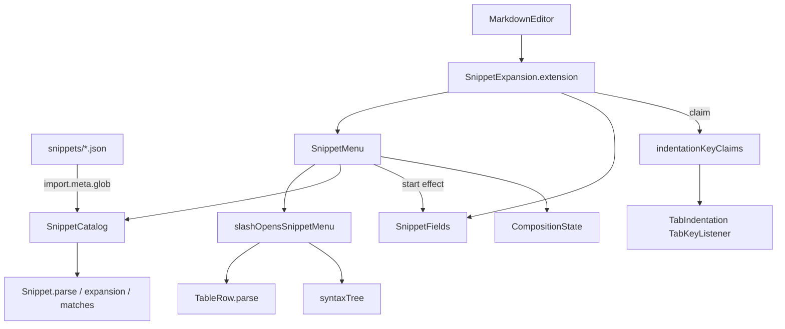

# 片段 — Architecture Design

**Status:** Confirmed (decided autonomously; the user was away — every judgement call is listed in §8)
**Source PRD:** `.sdd/2026-08-22-snippet-templates/PRD.md`
**Tech context:** Tauri 2 · TypeScript strict + React 19 + CodeMirror 6 (`@codemirror/view` tooltips, `@codemirror/state` fields/facets, `@codemirror/language` syntax tree) · Vitest + happy-dom. Webview only: no Rust change, no new channel, no new dependency.

---

## 1. Design Goal & Guiding Principle

- **In one sentence:** typing a half-width `/` after a line start or a blank (outside code and tables, never while composing) opens a nine-row menu of shipped snippets under the cursor; picking one replaces `/query` with the snippet's Markdown in one undo step, and while its empty fields wait, Tab / Shift+Tab move between them and Esc ends them — otherwise Tab and Esc are exactly what `TabIndentation` does today.
- **Guiding principle:** *a snippet is a JSON file, and one module turns any snippet file into text plus field offsets.* `Snippet` is the only place that knows the `{{name}}` syntax; `SnippetCatalog.shipped()` discovers `snippets/*.json` with `import.meta.glob`, exactly like `ThemeCatalog`. Adding a tenth snippet is one more file. Everything else (trigger rule, filtering, Tab's two roles, Esc's three layers, undo) lives outside the snippets in one editor extension, `SnippetExpansion`, so a new snippet never touches a rule.

---

## 2. Change Scope

| Area | Action | What / Why |
| :--- | :--- | :--- |
| `src/features/snippets/snippets/01-h1.json` … `09-table.json` | **Add** | The nine shipped snippets (`{ "name", "template" }`), PRD §8 verbatim. File-name order is menu order |
| `src/features/snippets/snippetTemplate.json` | **Add** | The template to copy for a tenth snippet |
| `src/features/snippets/Snippet.ts` | **Add** | Parse + validate one snippet file; its expansion (text without field names, field offsets); name-prefix match |
| `src/features/snippets/SnippetCatalog.ts` | **Add** | The shipped snippets (glob, file-name order, unusable files left out); `matching(query)` |
| `src/features/snippets/slashTrigger.ts` | **Add** | `slashOpensSnippetMenu(state, position)`: "may a `/` typed here open the menu?" (previous char, indented-code depth, fenced/indented code node, table row). A function, not a class: it has no state and ESLint refuses a static-only class |
| `src/features/snippets/SnippetFields.ts` | **Add** | The one group of waiting fields: a CodeMirror state field mapped through edits, next / previous / end, the thin marker decorations |
| `src/features/snippets/SnippetMenu.ts` | **Add** | The open menu: state field (slash position, query, highlighted row), tooltip DOM (listbox), arrows / Enter / click, expansion |
| `src/features/snippets/SnippetExpansion.ts` | **Add** | The one public entry: `new SnippetExpansion(composition, catalog, menuLabel).extension()` bundling menu + fields + its claim on Tab and Esc |
| `src/features/editor/TabIndentation.ts` | **Modify** | A facet `indentationKeyClaims`: before indenting, Tab asks each claim; before arming the escape route, Esc asks each claim. With no claim (or none claiming) behaviour is today's. The armed escape route now lapses two seconds after Esc (PRD US-05, §8 decision 14) |
| `src/features/editor/MarkdownEditor.tsx` | **Modify** (app integration) | Installs `SnippetExpansion` with the shipped catalog and the interface-language label |
| `src/features/interfaceLanguage/messages.ts` | **Modify** (app integration) | `snippetMenu` (片段 / Snippets): the menu's accessible name |
| `src/app/app.css` | **Modify** (app integration) | `.snippet-menu`, its rows, `.snippet-field-marker`; every colour a theme token |
| `docs/ime-regression-checklist.md` | **Modify** | Manual items for snippets (PRD §6: automated tests cannot summon 注音) |
| `.sdd/PROJECT.md` | **Modify** | The new seams: snippets as files, `indentationKeyClaims` |
| `TableRowContinuation`, `EmphasisShortcuts`, `ExtendSelection` | **Not touched** | The menu's Enter sits at `Prec.highest` (reserved for it in PROJECT.md) and acts only while the menu is open |
| `AutosaveSession`, preview, Rust, channels | **Not touched** | A snippet is ordinary text in the document: autosave and preview see an ordinary edit (US-07) |
| `@codemirror/autocomplete` | **Not added** | It is the autocomplete package the editor deliberately avoids (Tab thief, rebuilds next to the cursor). Our own ~300 lines keep Tab and composition in our hands (PRD §7 risk 1) |
| Old slice docs (`tab-indentation-behavior` PRD's FR-7.2) | **Not touched** | Workflow rule: never edit another slice's documents. This slice's BRIEF/PRD §7 already record the FR-7.2 rewrite as the authoritative text |

---

## 3. New Classes / Modules

| Name | Kind | Responsibility (purpose) | Collaborators | Satisfies (PRD scenario) |
| :--- | :--- | :--- | :--- | :--- |
| `Snippet` | Domain model | `Snippet.parse(file: unknown): Snippet \| null` — `null` unless `name` is a non-blank string and `template` a string whose every `{{` closes with `}}` on the same line around a non-blank name (no stray `{{`/`}}`). `name`; `matches(query)` (case-insensitive name prefix); `expansion` → `{ text, fields: readonly { from, to }[] }` with every `{{name}}` removed (fields empty, in document order, same names independent) | — | US-03 all, US-06 讀不出來的那一份不上架, US-02 篩選 |
| `SnippetCatalog` | Domain model | `snippets` in file-name order, unusable files left out; `matching(query)`; `static shipped()` globs `./snippets/*.json` | `Snippet` | US-01 九列, US-06 all |
| `slashOpensSnippetMenu` | Rule function (`slashTrigger.ts`) | Whether a `/` inserted at `position` of `state` opens the menu: previous char is line start / space / tab; the blank prefix is narrower than 4 columns when the slash starts the line's text; the position is not inside a `FencedCode` / `CodeBlock` node; the line is not a `TableRow` | `syntaxTree`, `TableRow` | US-01 trigger scenarios |
| `SnippetFields` | Editor state (field + effects + decorations) | Holds at most one `WaitingFields { fields, active, span }`; maps it through every change (a field grows as you type in it); ends it when the main cursor leaves the span, on undo/redo, on a new expansion (replaced) or on `end`; `move(view, direction)` selects the next/previous field (last + forward ends and puts the cursor at the snippet's end); marker widgets on empty fields, frozen while the view is composing | `Snippet.expansion` | US-03, US-04 all, US-05 Esc 結束填空 |
| `SnippetMenu` | Editor state + tooltip | Opens through a transaction extender when a single typed `/` (not a composition input, composition idle) passes `slashOpensSnippetMenu`; holds `{ slashAt, highlighted }`; closes when the cursor leaves `slashAt+1…`, the selection is not a cursor, the slash is gone, the query matches nothing, or a composition input arrives; draws a `role="listbox"` tooltip under the cursor (CodeMirror flips it above when there is no room); ↑/↓/Enter at `Prec.highest` (never while the input method owns the key); `mousedown` on a row expands; `expand` replaces `/query` with the expansion in one isolated history event and starts its fields | `SnippetCatalog`, `slashOpensSnippetMenu`, `SnippetFields`, `CompositionState` | US-01, US-02, US-03 一步 undo, US-04 第二份片段 |
| `SnippetExpansion` | Facade (deep module) | The only thing `MarkdownEditor` sees: `extension()` = menu + fields + an `indentationKeyClaims` entry (Tab: fields waiting → move; Esc: menu open → close, else fields waiting → end, else not claimed) | all of the above | R-2, R-3 |
| `indentationKeyClaims` / `IndentationKeyClaim` | Facet in `TabIndentation.ts` | `{ claimTab(view, backward): boolean; claimEscape(view): boolean }` asked by `TabKeyListener` before indenting / arming | `TabIndentation` | US-04 / US-05 Tab & Esc routing, US-07 照舊 |

---

## 4. Modified Components

| Component | Current role | Change needed |
| :--- | :--- | :--- |
| `TabIndentation` (`TabKeyListener`) | Capture-phase owner of Tab/Shift+Tab/Esc-then-Tab | Esc (not composing): if a claim takes it, `preventDefault`, do not arm; otherwise arm as today. Tab (not composing, not armed): if a claim takes it, done; otherwise indent/outdent as today. Composition paths unchanged |
| `MarkdownEditor` | Builds the editor's extensions | + `new SnippetExpansion(composition, SHIPPED_SNIPPETS, () => label).extension()`; the label is read from a ref each time the menu opens, so a language change applies without rebuilding the document |
| `messages.ts` | Catalogs | + `snippetMenu` |
| `app.css` | Stylesheet (tokens only) | + menu / row / marker rules: `--color-panel`, `--color-border`, `--color-text`, `--color-selected` (highlighted and hovered row, same as list selection), `--color-link` (the theme's accent) for the marker, `--color-shade` for the shadow |

---

## 5. Component Relationships

---

## 6. Extensibility & Handoff Notes

- **Most likely next requirement:** more shipped snippets (code block, quote, task list); then snippets the writer keeps in the vault.
- **Where it lands:** a tenth snippet = copy `snippetTemplate.json` to `snippets/10-<name>.json`; no code changes (the glob finds it, file-name order places it). Vault snippets = another `{ fileName: content }` record handed to `SnippetCatalog`'s constructor (probably over a new channel); `shipped()` is only one source.
- **Loosening the table rule** (PRD §7 says it is the most likely to be revisited): one condition in `slashOpensSnippetMenu`; a narrower menu inside tables would be a `matching` variant on the catalog.
- **Another key that must come before indentation** (a future popup wanting Tab or Esc): register one more `indentationKeyClaims` entry; never add a second Tab listener. Esc is now three layers deep — read `SnippetExpansion`'s claim before giving it a fourth job.
- **Patterns applied & why:** data files + one parser (the axis of change is "more snippets"); a facade so the editor installs one thing; a facet as the seam between the generic Tab owner and anything claiming Tab first (keeps `TabIndentation` ignorant of snippets).
- **Do not hardcode:** the snippet list or order, any colour, the field syntax outside `Snippet`.
- **Known debt / deferred:** linked same-name fields and nested field groups are out of scope (PRD); `WaitingFields` holds one group by design (R-4).

---

## 7. Traceability

| PRD Scenario | Fulfilled by |
| :--- | :--- |
| 在空行行首叫出片段選單 | `SnippetMenu` (open) + `slashOpensSnippetMenu` + `SnippetCatalog.shipped()` order |
| 前面是空白字元也叫得出來 | `slashOpensSnippetMenu` (previous char blank) |
| 行首只有縮排空白時照樣叫得出來 | `slashOpensSnippetMenu` (blank prefix < 4 columns) |
| 縮排深到 Markdown 認為那是程式碼，就不觸發 | `slashOpensSnippetMenu` (blank prefix ≥ 4 columns / `CodeBlock`) |
| 打網址時一次都不誤觸 | `slashOpensSnippetMenu` (previous char `:` / `/`) |
| 程式碼區塊裡不觸發 | `slashOpensSnippetMenu` (`FencedCode`) |
| 表格裡不觸發 | `slashOpensSnippetMenu` (`TableRow.parse`) |
| 組字中打斜線什麼都不發生 | `SnippetMenu` opener ignores composition inputs and a composing `CompositionState`; no tooltip is created |
| 全形斜線是標點，不是命令 | `SnippetMenu` opener accepts only `"/"` |
| 畫面底部沒有位置時選單畫在游標上方 | CodeMirror tooltip positioning (flips above); verified manually (no layout in happy-dom) |
| 打一個字母篩掉大部分 / 打到只剩一份 / 大小寫不分 | `SnippetCatalog.matching` + `Snippet.matches` |
| 按 Enter 確認 | `SnippetMenu` Enter → `expand` (§8 decision 1 on the empty field) |
| 用方向鍵選另一份 | `SnippetMenu` ↑/↓ + Enter |
| 用滑鼠點選 | `SnippetMenu` row `mousedown` |
| Tab 不確認選單 | `SnippetMenu` binds no Tab; `TabIndentation` indents (no fields waiting) |
| 打到沒有任何片段符合 | `SnippetMenu` closes when `matching` is empty; text untouched |
| 標題片段落下 / 表格片段落下 / 連結片段落下 | `Snippet.expansion` + `SnippetFields` (cursor on first field, markers) |
| 不填就走，什麼都不留下 | `Snippet.expansion` (fields empty); autosave unchanged |
| 同名的兩個挖空各自獨立 / 表格那兩個同名的內容挖空也各自獨立 | `Snippet.expansion` (one field per occurrence) + `SnippetFields` mapping |
| 一整份片段算一步 undo | `SnippetMenu.expand` (`isolateHistory.of("full")`, one transaction) |
| 有挖空在等的時候 Tab 跳挖空 / Shift+Tab 回上一個挖空 | `SnippetExpansion` claim → `SnippetFields.move` |
| 在最後一個挖空上按 Tab 就結束填空 / 結束之後 Tab 立刻是縮排 | `SnippetFields.move` (ends) + `TabIndentation` |
| 從來沒用過片段的人 Tab 照舊 | `TabIndentation` (no claim taken) |
| 組字中按 Tab 不跳挖空 | `TabKeyListener` composition path runs before any claim |
| 游標移出片段就結束填空 | `SnippetFields` (cursor outside span ends) |
| 換一篇文章就結束填空 | `MarkdownEditor` replaces the `EditorState` → `SnippetFields` starts empty |
| 填空中展開第二份片段，舊的挖空退場 / 不嵌套 | `SnippetFields` start effect replaces the group |
| Esc 收掉選單，打過的字留著 | claim: menu open → close (text kept, not armed) |
| 收掉選單之後再按一次 Esc，逃脫路徑照常 | no claim taken → `TabIndentation` arms |
| Esc 結束填空，但不武裝逃脫路徑 | claim: fields waiting → end |
| 兩層都沒有時，Esc 就是原本那件事 / 武裝之後兩秒內沒按 Tab 就失效 | `TabIndentation` (unchanged; see §8 decision 6) |
| 九份都在選單裡 / 讀不出來的那一份不上架 / 形狀不在九份裡 | `SnippetCatalog` + `Snippet.parse`; no add/edit UI exists |
| 落下來的就是普通 Markdown，預覽照常渲染 | expansion is plain text → `renderPreviewHtml` (unchanged) |
| 照既有規矩自動儲存 | ordinary doc change → `onBodyChange` → `AutosaveSession` (unchanged) |
| 從來沒打過斜線的人一切照舊 | `TabIndentation` regression tests with the extension installed |
| 中英文交錯著用，輸入法不出錯 | composition guards in `SnippetMenu` / `SnippetFields` markers frozen while composing; `docs/ime-regression-checklist.md` manual items |

---

## 8. Risks & Open Decisions

Judgement calls made while the user was away:

1. **Fields are empty (R-5, §8.4, BRIEF's reversal) wins over stale sentences.** A few PRD lines predate the reversal: US-02 「那一行變成『## 標題文字』…四個字被選取著」, US-04 「## [要填的文字](要填的網址)」, US-05 「提示字留在正文裡」 and §7's 「提示字留在正文是刻意的」. Built as R-5: `## ` with the cursor at the field, `## `, and nothing left behind after Esc. Tests assert the R-5 form.
2. **Tab on the last field** ends the group and puts the cursor at the end of the snippet (after `)` for Link, after the last `|` of the table). Shift+Tab on the first field stays there.
3. **"Leaving the snippet"** = the main cursor outside the snippet's span (from its first to its last character, inclusive). Arrowing or clicking inside it keeps the fields; undo/redo also ends them.
4. **The marker** is a thin widget on every *empty* waiting field, coloured `--color-link` (the theme's accent token; no new token). While the view is composing the marker set is frozen and only mapped, so nothing next to the cursor is rebuilt mid-composition; it disappears after the composition ends.
5. **Menu open and Tab:** fields waiting → Tab moves fields (the cursor leaves the query, so the menu closes); no fields → Tab indents and the menu stays as long as the query still sits before the cursor.
6. **Esc while the menu is open and fields wait:** only the menu closes (R-3, top layer first); a second Esc ends the fields; a third arms the escape route.
7. **Indented-code rule:** a slash that starts the line's text after blanks of 4 or more columns (a tab counts to the next multiple of 4) does not open, besides any `CodeBlock`/`FencedCode` node. Inline code is not excluded (PRD names code blocks only).
8. **Query rules:** the query is the text between `/` and the cursor; the menu closes as soon as no name starts with it (a blank therefore closes it with the shipped names), or the cursor moves to or before the `/`. Matching is name prefix, case-insensitive. Nothing else special-cases blanks, so a future name with a space still filters.
9. **Highlighted row** resets to the first row whenever the query changes; ↑/↓ clamp (no wrap), as the finders do. While the fields' cursor moves inside the snippet (arrows, a click), the active field index stays; Tab goes to the field after the last one Tab reached.
10. **Snippet file shape:** `{ "name": string, "template": string }`; template lines are joined with `\n` in JSON. An empty `{{}}` or a stray `{{` / `}}` makes the file unusable (PRD §8.5: no half-parsed engine markup can reach the body). A second snippet with a taken name (case-insensitive) is left out.
11. **FR-7.2** is not rewritten in the tab-indentation slice's PRD (workflow: never edit another slice's documents); this slice's PRD §7 is the record of the new wording.
12. **Accessibility:** the tooltip is a `role="listbox"` named by `messages.snippetMenu` with `role="option"` rows and `aria-selected`; the editor keeps the keyboard (rows are not focusable, `mousedown` is prevented so focus never leaves the editor).
13. **Placement above the cursor** relies on CodeMirror's tooltip flipping, which happy-dom cannot measure; it is a manual check in the IME checklist.
14. **The escape route lapses after two seconds.** PRD US-05 「武裝之後兩秒內沒按 Tab 就失效」 describes it as today's behaviour, but the Tauri editor never had the timer (the next key, a click or leaving the editor disarmed it; those still do). The scenario is the oracle, so `TabKeyListener` now keeps the time it armed and a Tab more than 2000 ms later indents. Nothing else about Esc/Tab changed.
15. **Snippet expansion is not `@codemirror/autocomplete`'s `snippet()`**: our own `SnippetFields` (one state field, ~150 lines) keeps Tab inside `TabIndentation` and keeps the markers frozen while composing — the two things PRD §7 says we must hold ourselves.
