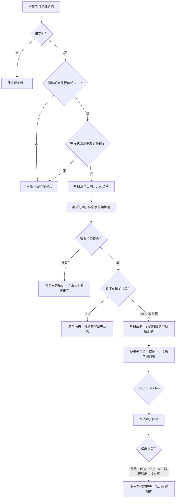

# 片段 — Product Requirements Document

**Status:** Draft
**Version:** v1.0
**Owner:** James Hsueh
**Stakeholders:** 產品（本人）、開發（本人）
**Brief:** [BRIEF.md](BRIEF.md)

---

## 1. Background & Goal

### Problem Statement

Markdown 的每一個結構都得**手打形狀**。三級標題要自己數井字號，一張表要自己排管線符號與那排破折號，連結要自己記「方括號在前、圓括號在後」。這些形狀是固定的、每天重複的，而且打錯了要回頭改——寫作者的注意力被花在**排版符號**上，而這個產品的定位是「寫文章」。

同時，這個 App 至今**刻意沒有任何自動完成**。編輯器是手工組裝而不是拿現成的一套來用，理由記在程式碼裡：自動完成選單既搶 Tab，又會在輸入法組字時於游標旁重建畫面——而中文輸入永遠不出錯是這個產品的核心主張。所以「讓寫作者少打字」這件事，過去一直是被整個放棄的。

這個切片要證明：**這兩件事不衝突**。一張只在明確要求時才出現、只認得九個名字、組字時完全沉默的清單，不是自動完成。

### Expected Outcome

- 寫作者打一個 `/`，**九個常用 Markdown 形狀當場列出來**；挑一份，形狀落進正文，游標已經停在第一個要填的地方，直接打字就是了。
- **Tab 一路填完，填完就變回縮排**，中間不必按任何鍵去切換模式。
- **不用這個功能的人，編輯區的行為一個字都沒有變**——包括 Tab、Shift+Tab、以及 `Esc` 之後那一次 Tab 的無障礙逃脫路徑。
- **加第十份片段只要再寫一份檔案**，不必改動既有的任何一份——這是這個切片真正要交出的能力，九份片段只是它的第一批證明。
- 組字中打 `/` **什麼都不發生**：不出現選單、不動正文、不重建游標旁的畫面。

驗收方式是本文件 §3 的每一條情境；九份片段的形狀與提示字的單一真實來源是 §8。

### Out of Scope

- **寫作者自製片段。** 這個切片只交出「從選單裡挑一份隨 App 出貨的片段」。寫作者自己寫一份放進 vault、或與別人交換片段，是另一個切片。§8.6 的樣板為它鋪路，但「vault 裡的片段會出現在選單裡」不在本切片內。
- **程式碼區塊、引言、待辦清單片段。** 這次出九份（標題六份、連結、圖片、表格）。要加是後面的事，而且加一份不必動既有的任何一份。
- **多種尺寸的表格。** `Table` 只有一份形狀。不夠自己接著打。
- **同名挖空連動。** 同一份片段裡兩個一樣的名字是兩個獨立的挖空。
- **挖空嵌套。** 填空中展開第二份片段時，舊片段剩下的挖空退場，不會填完新的再回到舊的。
- **看游標在哪就給不同的選單。** 選單永遠是同一份九項清單（除了程式碼區塊與表格裡根本不出現）。「在表格裡只給表格相關的片段」這種語法感知不做。
- **語法上色、程式碼摺疊、結構大綱。** 那是「編輯器看懂 Markdown 結構」的另一件事，與本切片無關。
- **`/` 以外的叫法。** 沒有工具列按鈕、沒有右鍵選單、沒有第二組快捷鍵。
- **模糊搜尋與說明文字。** 選單用名字前綴篩選，不做模糊比對、不在每一列旁邊寫解釋。
- **設定項。** 設定面板不多任何一列。要不要用這個功能，由「有沒有打 `/`」決定。
- **提示字跟著介面語言變。** 提示字是正文內容，會被存進 `.md` 檔。
- **貼上圖片。** 已經有自己的功能。`Image` 片段是手打路徑用的，兩者不互相取代。

---

## 2. User Personas

- **Primary Role:** **寫作者**——Rustle 唯一的使用者角色，在自己的機器上寫文章。這個切片沒有新增角色，但多了一個新的身分：**日後要加一份片段的人**（現階段仍是同一個人），他讀的是 §8.6 的樣板而不是畫面。
- **Usage Context:** 本機桌面應用程式，完全離線。片段是**寫作途中**用的東西，不是寫之前調一次的設定——所以它天生與「正在打字」、「正在組字」、「正在自動儲存」同時發生，不能假設畫面是靜止的。中文寫作者的常態是**中英文交錯**：`/` 是半形，打它之前常常剛結束一段注音組字。

---

## 3. User Stories & Acceptance Criteria

### US-01 — 打一個斜線就叫出常用形狀 [priority: P0]

**As a** 寫作者，**I want** 打一個 `/` 就看到常用 Markdown 形狀的清單，**so that** 我不必自己數井字號、排管線符號。

```gherkin
Scenario: 在空行行首叫出片段選單
  Given 游標在一個空行的行首
  When 寫作者打半形斜線
  Then 片段選單出現在游標旁
  And 由上到下列出 H1、H2、H3、H4、H5、H6、Link、Image、Table 九列

Scenario: 前面是空白字元也叫得出來
  Given 游標在「參考這裡 」後面，前一個字元是空白
  When 寫作者打半形斜線
  Then 片段選單出現

Scenario: 行首只有縮排空白時照樣叫得出來
  Given 游標在一行的行首，該行前面只有一級縮排的空白（預設兩個）
  When 寫作者打半形斜線
  Then 片段選單出現

Scenario: 縮排深到 Markdown 認為那是程式碼，就不觸發
  Given 游標在一行的行首，該行前面有四個空白
  When 寫作者打半形斜線
  Then 片段選單沒有出現
  And 正文裡多了一個斜線字元

Scenario: 打網址時一次都不誤觸
  Given 寫作者已經打出「https:」
  When 寫作者連續打兩個半形斜線
  Then 片段選單從頭到尾一次都沒有出現
  And 正文裡是「https://」

Scenario: 程式碼區塊裡不觸發
  Given 游標在以三個反引號圍起來的程式碼區塊內
  When 寫作者打半形斜線
  Then 片段選單沒有出現
  And 正文裡多了一個斜線字元

Scenario: 表格裡不觸發
  Given 游標在一張 Markdown 表格的格子裡
  When 寫作者打半形斜線
  Then 片段選單沒有出現
  And 正文裡多了一個斜線字元

Scenario: 組字中打斜線什麼都不發生
  Given 寫作者正在用注音組字，候選視窗開著
  When 寫作者打斜線
  Then 片段選單沒有出現
  And 正文一個字元都沒有變
  And 游標旁的畫面沒有被重建，候選視窗留在原地

Scenario: 全形斜線是標點，不是命令
  Given 游標在一個空行的行首
  When 寫作者打全形斜線
  Then 片段選單沒有出現
  And 正文裡是一個全形斜線

Scenario: 畫面底部沒有位置時選單畫在游標上方
  Given 游標在寫作區最下緣，下方已經沒有位置容納九列
  When 寫作者打半形斜線
  Then 片段選單出現在游標上方
  And 九列全部看得見
```

### US-02 — 打幾個字就篩到我要的那一份 [priority: P0]

**As a** 寫作者，**I want** 接著打字把清單縮到一份，**so that** 我不必用方向鍵在九列裡找。

```gherkin
Scenario: 打一個字母篩掉大部分
  Given 片段選單開著，九列都在
  When 寫作者接著打「h」
  Then 選單只剩 H1 到 H6 六列

Scenario: 打到只剩一份
  Given 片段選單開著
  When 寫作者接著打「h2」
  Then 選單只剩 H2 一列

Scenario: 大小寫不分
  Given 片段選單開著
  When 寫作者接著打大寫的「H2」
  Then 選單只剩 H2 一列

Scenario: 按 Enter 確認
  Given 片段選單只剩 H2 一列，正文裡是「/h2」
  When 寫作者按 Enter
  Then 正文裡的「/h2」整段消失
  And 那一行變成「## 標題文字」
  And 游標停在「標題文字」上，這四個字被選取著

Scenario: 用方向鍵選另一份
  Given 片段選單開著，九列都在
  When 寫作者用方向鍵把選取移到 Table 那一列，按 Enter
  Then 表格片段落進正文

Scenario: 用滑鼠點選
  Given 片段選單開著
  When 寫作者用滑鼠點 Link 那一列
  Then 連結片段落進正文，與按 Enter 的結果一樣

Scenario: Tab 不確認選單
  Given 片段選單開著，正文裡沒有任何還沒填完的挖空
  When 寫作者按 Tab
  Then 選單裡沒有任何一列被確認，沒有片段落進正文
  And 游標所在那一行縮排一級

Scenario: 打到沒有任何片段符合
  Given 片段選單開著
  When 寫作者接著打「zzz」
  Then 片段選單自己消失
  And 正文裡留著「/zzz」
  And 沒有任何片段落進正文
```

### US-03 — 形狀落下來，游標就在要填的地方 [priority: P0]

**As a** 寫作者，**I want** 片段落下時游標已經停在第一個要填的位置、提示字選取著，**so that** 我可以直接打字而不必先刪掉範例文字。

```gherkin
Scenario: 標題片段落下
  Given 寫作者在選單裡選了 H2
  When 片段落進正文
  Then 那一行是「## 」，大括號連同裡面的字都看不到
  And 游標停在那一行的末尾，畫面上一個細記號標出那裡要填
  When 寫作者打「安裝步驟」
  Then 那一行是「## 安裝步驟」

Scenario: 表格片段落下
  Given 寫作者在選單裡選了 Table
  When 片段落進正文
  Then 正文多出三行：一列表頭、一列破折號、一列內容
  And 表頭與內容共四個挖空，四個都是空的
  And 游標停在第一個表頭挖空上

Scenario: 連結片段落下
  Given 寫作者在選單裡選了 Link
  When 片段落進正文
  Then 正文是「[]()」
  And 游標停在方括號裡

Scenario: 不填就走，什麼都不留下
  Given 寫作者選了 H2，一個字都沒有打
  When 寫作者結束填空
  Then 那一行留著「## 」
  And 自動儲存把「## 」原樣寫進檔案
  And 正文裡沒有任何要清掉的字

Scenario: 同名的兩個挖空各自獨立
  Given 寫作者選了 Link，游標在方括號裡那個挖空上
  When 寫作者打「官方文件」
  Then 正文是「[官方文件]()」
  And 圓括號裡那個挖空仍然是空的

Scenario: 表格那兩個同名的內容挖空也各自獨立
  Given 寫作者選了 Table，兩個內容挖空在片段檔裡都叫「內容」
  When 寫作者跳到第三個挖空並打「甲」
  Then 那一列是「| 甲 |  |」
  And 第四個挖空仍然是空的

Scenario: 一整份片段算一步 undo
  Given 寫作者剛用選單插入了 Table，正文多出三行
  When 寫作者按一次 undo
  Then 那三行一次全部消失
  And 正文回到寫作者打的「/table」那幾個字
```

### US-04 — Tab 一路填完，填完就變回縮排 [priority: P0]

**As a** 寫作者，**I want** 用最熟悉的那顆鍵在挖空之間走，**so that** 我不必為這個功能學一組新按鍵。

```gherkin
Scenario: 有挖空在等的時候 Tab 跳挖空
  Given 表格片段剛落下，游標在第一個挖空，還有三個挖空沒填
  When 寫作者按 Tab
  Then 游標跳到下一個挖空，那一格的提示字被選取著
  And 沒有任何一行被縮排

Scenario: Shift+Tab 回上一個挖空
  Given 游標在第二個挖空
  When 寫作者按 Shift+Tab
  Then 游標回到第一個挖空，提示字被選取著

Scenario: 在最後一個挖空上按 Tab 就結束填空
  Given 游標在最後一個挖空上
  When 寫作者按 Tab
  Then 正文裡不再有任何挖空在等
  And 沒有任何一行被縮排

Scenario: 結束之後 Tab 立刻是縮排
  Given 填空剛剛結束
  When 寫作者按 Tab
  Then 游標所在那一行縮排一級

Scenario: 從來沒用過片段的人 Tab 照舊
  Given 正文裡沒有任何挖空在等
  When 寫作者按 Tab
  Then 游標所在那一行縮排一級，與這個功能上線前一模一樣

Scenario: 組字中按 Tab 不跳挖空
  Given 正文裡有挖空在等，而寫作者正在用注音組字、候選視窗開著
  When 寫作者按 Tab
  Then 游標沒有跳到下一個挖空
  And 沒有任何一行被縮排
  And 那一次按鍵交給輸入法

Scenario: 游標移出片段就結束填空
  Given 正文裡有挖空在等
  When 寫作者用滑鼠點到片段以外的地方
  Then 正文裡不再有任何挖空在等
  When 寫作者按 Tab
  Then 游標所在那一行縮排一級

Scenario: 換一篇文章就結束填空
  Given 正文裡有挖空在等
  When 寫作者從文章清單打開另一篇文章
  Then 沒有任何挖空在等
  When 寫作者回到原來那一篇
  Then 仍然沒有任何挖空在等，正文是離開時的樣子

Scenario: 填空中展開第二份片段，舊的挖空退場
  Given 寫作者選了 H2，游標在「標題文字」上，那是唯一的挖空
  When 寫作者打「/link」並按 Enter
  Then 標題那一行是「## [要填的文字](要填的網址)」
  And 游標停在「要填的文字」上
  And 正文裡在等的挖空只有連結那兩個

Scenario: 不嵌套——填完新的不會回到舊的
  Given 承上，寫作者把連結那兩個挖空都填完了
  When 寫作者按 Tab
  Then 沒有回到標題原本的挖空
  And 游標所在那一行縮排一級
```

### US-05 — Esc 收掉眼前這件事，逃脫路徑照舊 [priority: P0]

**As a** 只用鍵盤的寫作者，**I want** Esc 先收掉眼前的選單或填空、而不是一口氣把我彈出編輯區，**so that** 我不必為了關一張選單而失去游標的位置。

```gherkin
Scenario: Esc 收掉選單，打過的字留著
  Given 片段選單開著，正文裡是「/h2」
  When 寫作者按 Esc
  Then 片段選單消失
  And 正文裡仍然是「/h2」
  When 寫作者按 Tab
  Then 游標所在那一行縮排一級，焦點沒有離開編輯區

Scenario: 收掉選單之後再按一次 Esc，逃脫路徑照常
  Given 片段選單剛被 Esc 收掉，正文裡沒有挖空在等
  When 寫作者按 Esc，接著按 Tab
  Then 焦點離開編輯區

Scenario: Esc 結束填空，但不武裝逃脫路徑
  Given 正文裡有挖空在等
  When 寫作者按 Esc
  Then 沒有任何挖空在等
  And 提示字留在正文裡
  When 寫作者按 Tab
  Then 游標所在那一行縮排一級，焦點沒有離開編輯區

Scenario: 兩層都沒有時，Esc 就是原本那件事
  Given 沒有片段選單，也沒有挖空在等
  When 寫作者按 Esc，接著按 Tab
  Then 焦點離開編輯區

Scenario: 武裝之後兩秒內沒按 Tab 就失效
  Given 沒有片段選單也沒有挖空在等，寫作者按了 Esc
  When 兩秒內沒有按 Tab
  Then 武裝失效
  When 寫作者按 Tab
  Then 游標所在那一行縮排一級
```

### US-06 — 加一份片段不必動既有的任何一份 [priority: P1]

**As a** 日後要加一份片段的人，**I want** 加一份就只是再寫一份檔案，**so that** 這個功能長大時沒有人需要回頭讀既有的九份。

```gherkin
Scenario: 九份都在選單裡
  Given 九份片段都讀得出來
  When 寫作者打半形斜線
  Then 選單由上到下是 H1、H2、H3、H4、H5、H6、Link、Image、Table

Scenario: 讀不出來的那一份不上架
  Given 九份之中有一份讀不出來
  When 寫作者打半形斜線
  Then 那一份不出現在選單裡
  And 其餘八份照常可以選、照常落進正文
  And 沒有任何半段或殘缺的 Markdown 被插進正文

Scenario: 寫作者要的形狀不在九份裡
  Given 寫作者想要一個引言片段
  When 寫作者打半形斜線
  Then 選單裡沒有引言那一項
  And 沒有任何地方可以新增、編輯或重新排序片段
```

### US-07 — 用了它，不弄壞既有的任何一件事 [priority: P0]

**As a** 寫作者，**I want** 這個功能只是多一條路，**so that** 我原本習慣的一切都還在。

```gherkin
Scenario: 落下來的就是普通 Markdown，預覽照常渲染
  Given 寫作者用片段插了一張表並填完四格
  When 寫作者看預覽面板
  Then 預覽把它渲染成一張表格

Scenario: 照既有規矩自動儲存
  Given 寫作者插了一份片段
  When 停手超過自動儲存的等待時間
  Then 檔案裡的正文就是眼前這些字

Scenario: 從來沒打過斜線的人一切照舊
  Given 寫作者從來沒有打過斜線叫出選單
  When 寫作者照常寫作、按 Tab、按 Shift+Tab、按 Esc 之後再按 Tab
  Then 每一個行為都與這個功能上線前一模一樣

Scenario: 中英文交錯著用，輸入法不出錯
  Given 寫作者在同一行裡先用注音打了一段中文，再打斜線叫出選單插入一份片段，接著繼續用注音打中文
  When 全程結束
  Then 沒有任何字被吃掉
  And 候選視窗全程留在游標旁，沒有跑到畫面角落
  And 按一次 undo 只退掉一步，不是整段消失
```

---

## 4. Business Flow & Logic

### 主要流程



### 核心規則

| # | 規則 |
| :--- | :--- |
| R-1 | **片段選單只在明確要求時出現。** 觸發條件三個同時成立：打的是半形斜線、斜線前面是行首或一個空白字元、不在程式碼區塊或表格內。**組字中一律不成立。** |
| R-2 | **Tab 做什麼只看一件事：現在有沒有還沒填完的挖空。** 有就跳挖空，沒有就縮排。這是 FR-7.2 唯一的例外。 |
| R-3 | **Esc 由上而下只做一件事**：有選單→收選單；填空中→結束填空；兩者都沒有→武裝 Tab 逃脫路徑。同一時刻永遠只有一個答案。 |
| R-4 | **同一時刻最多一組挖空在等。** 填空中展開第二份片段，舊片段剩下的挖空退場，提示字留在正文。不嵌套。 |
| R-5 | **挖空是空的。** 片段檔裡雙大括號內的字是那個挖空的名字，寫給讀片段檔的人看，**永遠不進正文**。所以不填就走，正文裡不會留下任何要清掉的字，也沒有任何跟介面語言有關的字。 |
| R-6 | **同一份片段裡同名的挖空各自獨立**，填一個不連動另一個。 |
| R-7 | **一次片段展開在 undo 歷史裡算一步**，不論它有幾行、幾個挖空。 |
| R-8 | **選單依名字前綴篩選，不分大小寫**，不做模糊比對。 |
| R-9 | **讀不出來的片段不上架**，不出現在選單裡；其餘照常可用。永不插入半段的 Markdown。 |
| R-10 | **一份片段不認識另一份。** 加一份不必動既有的任何一份。 |

### 邊界與例外

| 情況 | 行為 |
| :--- | :--- |
| 斜線前面是字母或數字（`https://`、`a/b`） | 選單不出現，那是普通的斜線 |
| 行首有四個以上空白 | 選單不出現。**在 Markdown 裡那一行就是程式碼**（CommonMark 的縮排程式碼區塊），預覽也會把它渲染成程式碼——所以這與「程式碼區塊裡不觸發」是同一條規則，不是它的例外。縮排單位設成四個空白時，一級縮排就落在這裡；這是 Markdown 本身的規矩，不是這個功能的取捨 |
| 打全形斜線 | 選單不出現，那是標點 |
| 組字中打斜線 | 什麼都不發生：不出現選單、不動正文、不重建游標旁的畫面 |
| 組字中按 Tab（有挖空在等） | 不跳挖空、也不縮排，那一次按鍵屬於輸入法 |
| 選單開著時按 Tab | 不確認任何一列；Tab 做它此刻該做的事（沒有挖空在等，所以是縮排） |
| 打到沒有片段符合 | 選單自己消失，打過的字留在正文，什麼都不插入 |
| 按 Esc 關掉選單 | 打過的 `/h2` 留在正文——那是寫作者打的字 |
| 游標在畫面最下緣 | 選單畫在游標上方，九列全部看得見 |
| 填空中換去另一篇文章 | 填空結束；回到原文時沒有挖空在等 |
| 填空中自動儲存發生 | 照既有規矩寫檔，寫的就是眼前的字（含還沒填的提示字） |
| 九份之中有一份讀不出來 | 那一份不上架，其餘八份照常 |
| 九份全部讀不出來 | 選單不出現任何一列——打斜線就只是打斜線，App 照常運作 |

---

## 5. UI/UX Design & Interaction

**沒有設計稿**——沿用 App 既有的視覺語言。

| 項目 | 決定 |
| :--- | :--- |
| 入口 | **只有半形 `/`**。不新增工具列按鈕、不新增右鍵選單、不新增第二組快捷鍵 |
| 選單的形狀 | 游標旁一張小清單，**一列一個片段名字**，不分組、不寫說明、不放圖示、不顯示形狀預覽 |
| 選單的高度 | **九列全列，不滾動**。九項不多，看得完 |
| 選單的位置 | 游標下方；**畫面底部沒有位置時改畫在游標上方**，九列全部看得見 |
| 選單裡的順序 | H1、H2、H3、H4、H5、H6、Link、Image、Table——與 §8 出貨清單同一個順序 |
| 片段的名字 | `H1`～`H6`、`Link`、`Image`、`Table`。**兩種介面語言都不翻**——它們是 Markdown 詞彙，比照 `Workspace` 的處理 |
| 選中的樣子 | 沿用文章清單「選取的那一列」的既有視覺，不另立一套 |
| 挖空的樣子 | **空的**。畫面上只有一個細記號標出「這裡要填」，取當前主題的強調色；一打字它就消失 |
| 選單的顏色 | **全部由當前主題交出**——底、框線、文字、選中那一列、指標下那一列，一個顏色都不自己寫。選中與 hover 沿用文章清單同一組色，因為它們是同一件事 |
| 空狀態／載入狀態 | 這個切片不新增任何空狀態或載入狀態。片段全部內建，打斜線的當下就有答案 |
| 設定面板 | **不多任何一列**。要不要用這個功能，由「有沒有打斜線」決定 |

---

## 6. Non-Functional Requirements

| 面向 | 要求 |
| :--- | :--- |
| **輸入法（產品第一主張）** | **組字中打斜線什麼都不發生**——不出現選單、不動正文、**不在游標旁重建任何畫面**。這一條比其他切片嚴格：其他功能只需要「不打斷組字」，這個功能的本體就是一張畫在游標旁的浮動選單，也就是這個 App 當初拒絕引入自動完成的原因本身。組字中按 Tab 不跳挖空。**輸入法人工回歸檢查清單要新增片段相關項目**，人工驗證涵蓋「中英文交錯著叫片段」 |
| **資料安全** | 片段展開**不得丟失未儲存的變更**，也不得改寫除了當前正文以外的任何內容。落地的是普通 Markdown 文字，脫離 Rustle 仍是同一份檔案 |
| **undo 的完整性** | 一次片段展開算一步 undo；一次挖空之間的跳動**不產生任何 undo 步驟**（游標移動不是編輯） |
| **離線** | 九份片段全部內建，不對外連線取得任何一份。App 完全離線的性質不變 |
| **主題** | 選單的**每一個顏色都由當前主題交出**，一個都不自己寫。它是這個畫面上的一塊面板，沒有理由是唯一不聽主題的那一塊——與「一套主題管這個 App 的每一個顏色」同一條規矩 |
| **反應速度** | 打完斜線到選單出現之間**不得有看得出來的延遲**，篩選同理。九份片段是內建資料，不讀檔案系統、不等任何往返 |
| **可及性** | 選單要能**完全用鍵盤操作**（上下鍵移動、Enter 確認、Esc 收掉），也要說得出自己是什麼與現在選到哪一列。**FR-7.7 的逃脫路徑不得被弱化**：沒有選單也沒有挖空時，`Esc` 之後那一次 `Tab` 照樣把焦點移出編輯區 |
| **不倒退** | 沒有用這個功能的寫作者，編輯區的行為**逐項與上線前相同**：Tab 縮排、Shift+Tab 退縮、退縮對齊到最近的層級、組字中不縮排、Esc 之後的 Tab 逃脫、一次 Tab 算一步 undo |
| **相容性** | 三個桌面平台行為一致。片段是純文字資料，沒有任何平台專屬的能力要求 |
| **追蹤／分析** | 無。App 不收集任何使用資料 |

---

## 7. Dependencies & Risks

### 外部依賴

- **片段展開與挖空跳動的能力**——若借用所用編輯器元件既有的自動完成／片段模組，那正是編輯器當初刻意**避開**的那一類東西；採用時要鎖版本，理由與風險見下表第一列。
- 九份片段全部內建，不連線、不下載。
- 不新增任何檔案操作、不新增任何設定項、不動檔案格式。

### 已知風險

| 風險 | 說明與對策 |
| :--- | :--- |
| **這類能力正是當初被擋在門外的那一種** | 編輯器當初刻意不用現成的整包組合，因為它會把自動完成帶進來，而自動完成「既是 Tab 小偷，又是一個在輸入法組字時於游標旁重建畫面的東西」。本切片要把它請進來，**所以那兩件事都必須由我們自己按住**：Tab 的歸屬由「有沒有挖空在等」決定（§4 R-2），組字中完全沉默（§6 第一列）。**這是本切片最大的技術風險，而且單元測試證明不了它**——合成的組字事件不會叫出注音，人工驗證是唯一的關卡 |
| **與 FR-7.2 的正面衝突（本切片一併改寫）** | 需求文件 FR-7.2 目前寫「Tab **絕不觸發**自動完成、片段展開（snippet）、或任何非縮排行為」，**逐字禁止了這個功能**。與主題切片的 NFR-6 不同——那是描述性的一句話，這是硬性約束。**本切片一併改寫它**，改法：「Tab 絕不觸發自動完成，也絕不移動焦點。**唯一的例外是片段展開留下的挖空**：有還沒填完的挖空時，Tab 跳到下一個挖空；沒有時，Tab 就是縮排。是否有挖空由編輯器自己知道，不由設定決定。」FR-7.1、FR-7.3～FR-7.7 **六條全部維持**，本切片沒有動到它們 |
| **Esc 又多了兩份工作** | 通用語言地圖對 Zen Mode 寫過「**刻意不綁 `Esc`**——`Esc` 在寫作區已經是 Tab 逃脫路徑的第一步，兩件事共用一個鍵會互相搶」。本切片給 Esc 加了兩層，**不違反那條原則的理由是「分層而非共用」**：同一時刻只有一個答案，而且沒有選單也沒有挖空時行為完全不變（§3 US-05）。**但這讓 Esc 成為全 App 語意最重的一顆鍵**——日後任何切片想再給它加一份工作，都必須先讀完這三層 |
| **「不是自動完成」這件事會漂移** | 一旦選單存在，下一個人很容易順手讓它「也補全單字」、「也讀正文猜詞」。**通用語言地圖已把這條列為禁用同義詞**：片段選單只認得出貨的九份片段，不猜字、不補字、不讀正文。FR-7.2 對自動完成的禁止仍然有效 |
| **表格裡不觸發是刻意的取捨** | 在表格格子裡插一個連結是常見需求，而本切片明確不支援（斜線在表格裡就是斜線）。理由是「把一張表插進一張表的格子裡」會同時弄壞兩張，而做「看游標在哪就給不同的選單」屬於另一個切片。**這一條交付後最可能被回頭要求放寬**，放寬時要一併決定選單怎麼收窄 |
| **提示字留在正文是刻意的** | 不填就走，`## 標題文字` 就是檔案裡的字。這比「留一個空格」好在多格的表格看得出哪一格要填什麼，代價是寫作者可能忘了改而發佈出去。**這是接受的結果**，不加任何提醒或標記——那會變成一個需要清理的狀態 |
| **人工驗證是唯一的關卡** | 自動化測試綠燈不代表輸入法沒問題。本切片必須在輸入法人工回歸檢查清單新增項目並**真的用注音跑過一遍**，才算交付 |

---

## 8. Appendix — 九份片段的單一真實來源

一份片段一個檔案，只說兩件事：**名字**與**形狀**。形狀裡用雙大括號框起來的是挖空；**括號裡的字是那個挖空的名字，寫給讀片段檔的人看的，永遠不會進正文**。以下逐字為準。

### 8.1 標題六份

| 名字 | 形狀 |
| :--- | :--- |
| `H1` | `# {{標題文字}}` |
| `H2` | `## {{標題文字}}` |
| `H3` | `### {{標題文字}}` |
| `H4` | `#### {{標題文字}}` |
| `H5` | `##### {{標題文字}}` |
| `H6` | `###### {{標題文字}}` |

六份**各自一個檔案**，不是一份帶「幾級」參數的片段。理由：一份片段只說一個形狀，而「幾級標題」是名字的一部分，不是要填的東西——挖成參數會讓寫作者多按一次 Tab 去填一個他打 `/h2` 時就已經回答過的問題。

### 8.2 連結與圖片

| 名字 | 形狀 |
| :--- | :--- |
| `Link` | `[{{要填的文字}}]({{要填的網址}})` |
| `Image` | `` |

`Image` 是**手打路徑**用的，與貼上圖片那個功能不互相取代：貼上圖片會自己把檔案落到 `images/` 並插好路徑，這一份是給已經有路徑的人用的。

### 8.3 表格

名字 `Table`，形狀三行：

```
| {{欄位一}} | {{欄位二}} |
| --- | --- |
| {{內容}} | {{內容}} |
```

四個挖空，跳動順序是正文裡的先後：`欄位一` → `欄位二` → 第一個 `內容` → 第二個 `內容`。中間那列破折號**不是挖空**。

**兩個挖空刻意同名。** 它們是兩個各自獨立的挖空，填左邊不會連動右邊——這一份片段同時是「同名挖空不連動」這條規則的證明（§4 R-6、§3 US-03）。

### 8.4 落下來實際長什麼樣

挖空是**空的**，所以九份片段落進正文的樣子是：

| 名字 | 落下來的正文 | 游標在哪 |
| :--- | :--- | :--- |
| `H1`～`H6` | `# `～`###### ` | 井字號與空白之後 |
| `Link` | `[]()` | 方括號裡 |
| `Image` | `` | 方括號裡 |
| `Table` | 兩列兩欄的空表加一列破折號 | 第一個表頭格 |

### 8.5 括號裡的字為什麼還是要寫

它不進正文，那還要它做什麼？——**給讀片段檔的人看的。** `{{標題文字}}` 一眼就知道那個位置要填什麼；`{{}}` 是一個沒有人看得懂的檔案。名字留在檔案裡不花任何代價，只要它不跟著進文章。

- 標題那六份共用 `標題文字` 一個名字：六個形狀差別只在井字號的數量，挖空要填的東西是同一件事。
- 名字寫的是**「要填什麼」而不是「範例值」**（`要填的網址` 而不是 `https://example.com`）。讀檔案的人要的是說明，不是一個看起來可以留著的值。
- **名字裡不得有換行。** 挖空引擎逐行讀形狀，跨行的挖空它根本不認得，落進正文的會是引擎自己的記號當成文字——那正是「不上架」要擋掉的東西，所以驗證直接擋在門口。

### 8.6 選單裡的順序

`H1`、`H2`、`H3`、`H4`、`H5`、`H6`、`Link`、`Image`、`Table`。

**不按字母排、不按使用頻率排。** 標題六份是同一族且有自然的順序（一級到六級），連結與圖片是一對，表格自己一個。字母排會把 `H1` 到 `H6` 打散在 `Image` 前後，使用頻率排則需要一份沒有人能維護的數據。

### 8.7 樣板：加第十份片段要做什麼

1. 照樣寫一份片段檔：一個名字、一段形狀，形狀裡要填的地方用雙大括號框起來。
2. 把它加進出貨清單，並決定它在選單裡的位置（§8.6 的順序規則）。
3. **不必動既有的任何一份**，也不必改任何一條規則——Tab 的兩個身分、Esc 的三層、篩選、undo、挖空的行為，全部是片段之外的東西。

「加一份不必動既有的任何一份」是本切片真正要交出的能力（§1 Expected Outcome）；九份片段只是它的第一批證明。若日後加一份片段必須回頭改動這些規則，那是規則的設計不對，修正的地方在規則而不是在那份片段。

---

## 9. 相關文件

| 文件 | 關係 |
| :--- | :--- |
| [BRIEF.md](BRIEF.md) | 本切片的需求共識。§3 的每一條 Gherkin 情境都對應 BRIEF 的一個例子 |
| 通用語言地圖 | 片段、片段選單、挖空、提示字、填空中、Tab 的兩個身分、Esc 的三層等詞彙的權威定義，以及本切片新增的六條禁用同義詞 |
| 需求文件 | §5.2 的 FR-7.1～FR-7.7 是編輯區按鍵的硬性約束。**FR-7.2 由本切片改寫**，其餘六條維持，見 §7 |
| 輸入法人工回歸檢查清單 | 人工執行的輸入法回歸 runbook。**本切片要新增片段相關項目**，見 §6 |
| [.sdd/2026-08-22-theme-and-panel-transparency/PRD.md](../2026-08-22-theme-and-panel-transparency/PRD.md) | 「一份檔案一套資料、讀不出來就不上架、加一套不必動既有的」這個做法的前例。本切片照它的形狀做片段 |
| [.sdd/2026-08-20-tab-indentation-behavior/PRD.md](../2026-08-20-tab-indentation-behavior/PRD.md) | Tab 的既有歸屬與逃脫路徑的來源。本切片在它之上開唯一的例外 |
