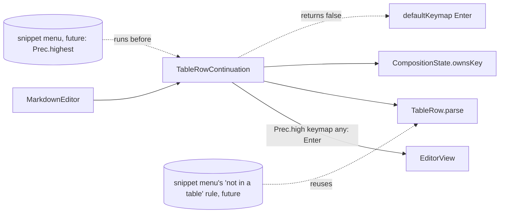

# 表格續列 — Architecture Design

**Status:** Confirmed (decided autonomously; the user was away — every judgement call is listed in §8)
**Source PRD:** `.sdd/2026-08-22-table-row-continuation/PRD.md`
**Tech context:** Tauri 2 · TypeScript strict + React + CodeMirror 6 (`@codemirror/view 6.43.15`, `state 6.7.6`, `commands 6.11.1`) · Vitest + happy-dom. This slice is webview-only: no Rust crate, channel or setting changes.

---

## 1. Design Goal & Guiding Principle

- **In one sentence:** a plain Enter at the end of a Markdown table row inserts the next empty row (same column count, same indentation / quote prefix, cursor in the first cell) as one undo step, and the same Enter on the table's last row, when its every cell is blank, clears that row and leaves the table — never while composing, never above a higher-priority Enter owner (the snippet menu), and never changing any other Enter.
- **Guiding principle:** *the line knows what it is; one owner decides what Enter does with it.* `TableRow` is a value object over one line's text and holds every rule about table rows (recognition, column count, blankness, the shape of the next row). `TableRowContinuation` only owns the key: it asks `TableRow` and dispatches. The next feature that needs "is this a table row?" (the snippet menu's "no menu inside a table") reuses `TableRow.parse`, so R-2's "same judgement as the snippet menu" holds by construction.

---

## 2. Change Scope

| Area | Action | What / Why |
| :--- | :--- | :--- |
| `src/features/editor/TableRow.ts` | **Add** | Value object: recognises a table row from one line's text and decides what Enter does at a column (`enterAt`) |
| `src/features/editor/TableRowContinuation.ts` | **Add** | Owner of the table Enter: `continueRow(view)` and the `extension()` (a `Prec.high` keymap binding) |
| `src/features/editor/MarkdownEditor.tsx` | **Modify** | Installs `TableRowContinuation(composition).extension()` next to the other editor extensions (app integration) |
| `docs/ime-regression-checklist.md` | **Modify** | T-6 (組字中的 Enter) gains the table-row step: the Enter that confirms a candidate at the end of a table row adds no row. The item count stays 12 (pinned by a test) |
| `.sdd/PROJECT.md` | **Modify** | Records the Enter-precedence seam and `TableRow.parse` as the shared "is this a table row" judgement |
| `defaultKeymap` Enter (`insertNewlineAndIndent`) | **Not touched** | Every Enter this slice does not claim falls through to it unchanged (NFR "不倒退") |
| `TabIndentation` | **Not touched** | Tab in tables is out of scope |
| Snippet menu | **Not touched / does not exist yet** | The snippet-templates slice is not on `main`; this slice only reserves the precedence above it (see §6, §8) |
| Preview, autosave | **Not touched** | The inserted text is ordinary Markdown; both already react to any document change |
| Rust crates / `src-tauri` / channels / settings | **Not touched** | PRD §5: no setting, no I/O |

---

## 3. New Classes / Modules

| Name | Kind | Responsibility (purpose) | Collaborators | Satisfies (PRD scenario) |
| :--- | :--- | :--- | :--- | :--- |
| `TableRow` | Value object (`TableRow.parse(lineText): TableRow \| null`, `enterAt(column, lineBelow): TableRowEdit \| null`) | Decide whether a line is a table row — after a prefix of spaces, tabs and `>` the first character is `\|` — and, for one that is, what Enter does at a column: at the line end, insert `\n` + the next empty row (same prefix; one cell per column, cells split on unescaped pipes, a trailing pipe closes the last cell, a lone `\|` is one column; one space per cell like `/table`) with the cursor just after its `\| `; on a blank row (at least one closed cell, every cell whitespace) that is the table's last row (the line below is not a table row, or there is none) anywhere after the first pipe, clear the row down to its prefix; anywhere else `null`. `TableRowEdit` is `{ from, to, insert, cursor }` in offsets from the line start | — | US-01 all; US-02 all |
| `TableRowContinuation` | Key owner (one per editor) | `continueRow(view)`: for one empty selection in an editable, non-composing editor, asks `TableRow.parse(line)?.enterAt(column)` and dispatches the returned edit (shifted by the line start) as one isolated history event (`isolateHistory "full"`, `userEvent "input"`). Returns `false` otherwise so the default Enter runs. `extension()`: `Prec.high(keymap.of([{ any }]))` whose handler claims only a plain `Enter` (no Shift/Ctrl/Alt/Meta) and first asks `CompositionState.ownsKey(event)` | `TableRow`, `CompositionState`, `EditorView` | US-01, US-02, US-03 |

Enter decision table (`TableRowContinuation`):

| Situation | Result |
| :--- | :--- |
| `CompositionState.ownsKey(event)` (composing, `event.isComposing`, keyCode 229) | not claimed — the input method's key; the document is not touched by this slice |
| Modifier held (Shift / Ctrl / Alt / Meta) | not claimed — default behaviour |
| Read-only, several selection ranges, or a non-empty selection | not claimed — default Enter (replaces the selection) |
| Line is not a `TableRow` | not claimed — default Enter |
| Line is a blank `TableRow` with no table row below it, cursor anywhere after its first pipe | row cleared to its prefix, cursor at line end — one undo step |
| Line is a blank `TableRow` with a table row below it | treated like a non-blank row: the table is not split |
| Line is a non-blank `TableRow`, cursor not at the end of the line | not claimed — default Enter splits the line |
| Line is a non-blank `TableRow`, cursor at the end of the line | `\n` + next row inserted, cursor in its first cell — one undo step |

The keymap's `any` handler is used (instead of `run`) because only it receives the `KeyboardEvent`, and the project rule is to ask `CompositionState.ownsKey(event)` before acting on Enter. `any` handlers keep keymap precedence order, so a `Prec.highest` snippet-menu keymap still runs first and the `defaultKeymap` Enter still runs after.

---

## 4. Modified Components

| Component | Current role | Change needed |
| :--- | :--- | :--- |
| `MarkdownEditor` (`editorExtensions`) | Builds the editor's extension list: Tab indentation, history, keymaps, markdown, composition reporting | Adds `new TableRowContinuation(composition).extension()`; nothing else changes |

---

## 5. Component Relationships

---

## 6. Extensibility & Handoff Notes

- **Most likely next requirement:** the snippet menu (already specified) must refuse to open inside a table row, and own Enter while it is open.
- **Where it lands:** `TableRow.parse(line.text) !== null` is the "inside a table" judgement — the menu imports it, no copy of the regex. The menu's keymap goes at `Prec.highest`; this slice's binding is `Prec.high`, the default Enter is `Prec.default` — the order PRD §7 asks for.
- **Next most likely:** continuation for lists / quotes (out of scope today). **How to add it:** another small value object beside `TableRow` (e.g. `ListItem.parse`) and either a second key owner at the same precedence or `TableRowContinuation` generalised into a list of "line continuations"; do not grow `TableRow` into a general line classifier.
- **Column alignment** (out of scope) would live in `TableRow` — the cell texts are already split there.
- **Patterns applied & why:** value object + single key owner, the same split as `IndentUnit` / `TabIndentation`.
- **Do not hardcode:** the cell filler and the cursor placement live only in `TableRow.enterAt`; the precedence only in `TableRowContinuation.extension`.
- **Known debt / deferred:** recognition is textual (CommonMark parser in the editor has no table node; PRD §7 accepts this).

---

## 7. Traceability

| PRD Scenario | Fulfilled by |
| :--- | :--- |
| US-01 兩欄的表格續下一列 | `TableRowContinuation.continueRow` + `TableRow.enterAt` |
| US-01 三欄的表格續下一列 | `TableRow.enterAt` (column count) |
| US-01 破折號那一列也是表格列 | `TableRow.parse` (any cell content); a `---` row is not blank |
| US-01 整列縮排的表格，下一列跟著縮排 | `TableRow.enterAt` (keeps the prefix) |
| US-01 引言裡的表格，下一列保留引言符號 | `TableRow.enterAt` (the prefix accepts `>`) |
| US-01 游標在列中間時 Enter 沒有變 | `TableRow.enterAt` → `null` off the line end → default Enter |
| US-01 一行普通文字的 Enter 沒有變 | `TableRow.parse` → `null` → default Enter |
| US-02 空的表格列上按 Enter 就離開 | `TableRow.enterAt` clear branch |
| US-02 補一列，不填，再按一次就出來了 | both branches in sequence |
| US-02 只有一格空著不算寫完 | `TableRow.enterAt` (blank = every cell) |
| US-03 組字中的 Enter 屬於輸入法 | `CompositionState.ownsKey` guard in the `any` handler (+ IME checklist T-6) |
| US-03 片段選單與表格續列不可能同時發生 | `TableRow.parse` exposed as the shared judgement; enforced by the snippet-menu slice (§8) |
| US-03 片段選單開著時 Enter 仍然屬於選單 | `Prec.high` below a `Prec.highest` menu keymap (§8) |
| US-03 一次補列算一步 undo | `isolateHistory.of("full")` on both branches |
| US-03 補出來的是普通 Markdown | plain text insert; `renderPreviewHtml` renders the table |

---

## 8. Risks & Open Decisions

Decisions taken without the user (also listed in the PR under "Assumptions"):

1. **The snippet menu does not exist on `main` yet.** This slice cannot make the menu refuse to open inside a table, nor test the menu's Enter end to end. It provides the pieces: `TableRow.parse` as the shared judgement and a `Prec.high` binding that a `Prec.highest` menu keymap overrides. The precedence is tested with a stand-in higher-precedence Enter binding in the test editor.
2. **Leaving a blank row keeps the row's prefix** (indentation and `>` markers): the row's cells disappear and the cursor stays on that line, which is now an empty line just below the table (for an unindented table, a truly empty line — exactly B-1 / B-2). Inside a quote, the writer stays inside the quote (`> `), which still ends the table.
3. **A blank row needs at least one closed cell**: a lone `|` (PRD boundary: "treated as a one-column row, add `|  |`") is continued, not removed; `|  |` is removed.
4. **Only a plain Enter** is claimed; Shift+Enter, Ctrl/Cmd/Alt+Enter keep their existing meaning.
5. **Several cursors** (multiple selection ranges) → default Enter; the PRD only speaks of "the cursor".
6. **Escaped pipes** (`\|`) inside a cell do not split cells; the column count follows GFM.
7. **Trailing whitespace after the last pipe** still counts as "at the end of the row".
8. **On a blank last row, Enter leaves the table from anywhere after its first pipe**, not only from the line end. A blank row with table rows below it (for example an unfilled `/table` template) is never cleared, so Enter cannot split a table and strand the rows below without a header. R-1 says "only at the end of the row", but B-2 ("補一列，不填，再按一次就出來了") presses Enter right after a row was added, when the cursor sits in that row's first cell (PRD §5). A blank row has nothing to split, so this reading satisfies both; on a non-blank row R-1 holds strictly (cursor at the line end).
9. **Enter while composing**: CodeMirror itself does not run key bindings during a composition, and this slice additionally refuses through `CompositionState.ownsKey(event)` and `isComposing` in `continueRow`. The tests assert that this slice neither changes the document nor claims the key; the real candidate-window behaviour is the manual IME checklist item T-6 (extended with a table row step).
10. **Markdown's own Enter** (`insertNewlineContinueMarkup`, also `Prec.high`, from `markdown()`) continues quotes and lists. `TableRowContinuation` is listed before `markdown()` so it wins on a table row inside a quote; a test through `MarkdownEditor` pins this.

- **Risks / trade-offs:** a non-table line starting with `|` is treated as a table row (PRD §7 accepts it).
