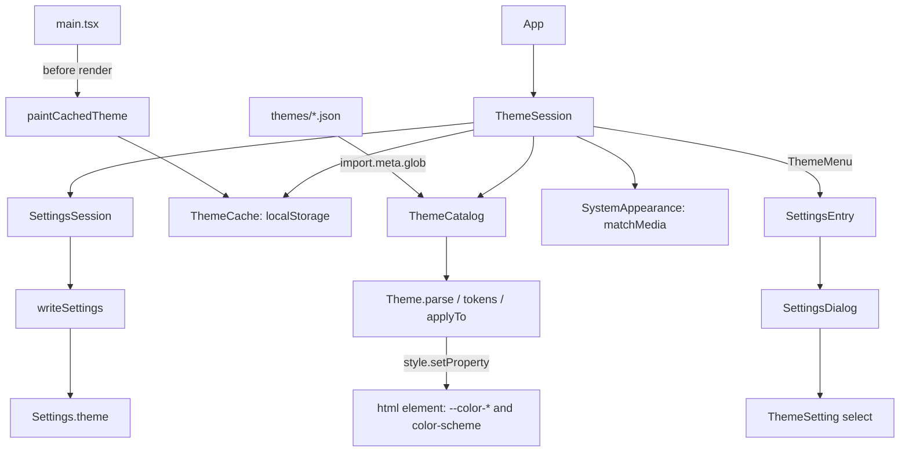

# 主題 — Architecture Design

**Status:** Confirmed (decided autonomously; the user was away — every judgement call is listed in §8)
**Source PRD:** `.sdd/2026-08-22-theme-and-panel-transparency/PRD.md`
**Tech context:** Tauri 2 (WKWebView on macOS) · Rust workspace (`rustle-domain` settings shape only) · TypeScript strict + React 19 + CodeMirror 6 · Vitest + happy-dom. No new dependency, no new channel.

---

## 1. Design Goal & Guiding Principle

- **In one sentence:** the writer picks Follow System, Light, Dark or Forest in the settings dialog; every colour of the app is replaced at once by setting CSS custom properties on `<html>`, the choice is written to the vault's settings (`theme`), and a local cache paints the first frame in the right colours.
- **Guiding principle:** *a theme is a JSON file, and one module turns any theme file into every colour token.* `Theme` is the only place that knows the fourteen base colours, the derivation rules (PRD §8.2) and the token names; a theme file never reaches CSS without going through it. Adding a fifth theme is dropping one file into `src/features/theme/themes/` — no code, no other file changes (`import.meta.glob` discovers it). The stylesheet holds **no palette**: every colour in `app.css` and `xcodeTheme.ts` is a `var(--color-…)`.

---

## 2. Change Scope

| Area | Action | What / Why |
| :--- | :--- | :--- |
| `crates/domain/src/settings.rs` (+ `stored_settings.rs`) | **Modify** | `theme: Option<String>` — the chosen theme id as written, skipped when absent; a non-string reads as absent. Rust never knows the list of themes (the webview owns it, like `fontSize`'s range) |
| `src/ipc/settings.ts` | **Modify** | `theme?: string` |
| `src/features/theme/themes/01-light.json`, `02-dark.json`, `03-forest.json` | **Add** | The three theme files. Light and Dark carry today's every colour as overrides; Forest only its base colours |
| `src/features/theme/themeTemplate.json` | **Add** | The template to copy for a new theme (every base key, empty overrides) |
| `src/features/theme/Theme.ts` | **Add** | Parse + validate a theme file; derive every token; apply to an element |
| `src/features/theme/ThemeCatalog.ts` | **Add** | The shipped themes (glob), the menu options, choice → theme resolution |
| `src/features/theme/ThemeSession.ts` | **Add** | The live choice: settings, cache, system appearance, apply |
| `src/features/theme/browserThemeEnvironment.ts` | **Add** | The two browser boundaries: `localStorage` cache and `matchMedia('(prefers-color-scheme: dark)')` |
| `src/features/theme/useTheme.ts`, `ThemeSetting.tsx` | **Add** | React binding and the settings section (a native `<select>`) |
| `src/features/interfaceLanguage/SettingsDialog.tsx`, `SettingsEntry.tsx` | **Modify** | One more `settings-item` section below the language, fed a `ThemeMenu` |
| `src/features/interfaceLanguage/messages.ts` | **Modify** | `theme` (主題 / Theme), `followSystem` (跟隨系統 / Follow System) |
| `src/app/app.css` | **Modify** | Delete both palettes (`:root` and the dark media query); the hard-coded blacks become `var(--color-shade)`; new tokens `--color-panel` (dialogs, inputs, finder, notices) and `--color-article-list` (the article column's own background) |
| `src/main.tsx` | **Modify** (app integration) | Applies the cached theme before the first render |
| `src/app/App.tsx` | **Modify** (app integration) | Builds one `ThemeSession`, passes its menu to `SettingsEntry` |
| `src/features/editor/xcodeTheme.ts` | **Not touched** | Already reads only `var(--color-editor-*)`; those tokens now come from the theme |
| `SettingsSession` | **Not touched** | Already "screen first, write after", and never writes settings it could not read |
| `src-tauri` | **Not touched** | No new channel, no window transparency (the transparency half is retired, PRD §8.4) |
| `AppLayout` / gear position | **Not touched** | The gear stays at the bottom of the sidebar (PRD US-01 / US-03 scenarios); Zen hides it as today |

---

## 3. New Classes / Modules

| Name | Kind | Responsibility (purpose) | Collaborators | Satisfies (PRD scenario) |
| :--- | :--- | :--- | :--- | :--- |
| `Theme` | Domain model | `Theme.parse(file: unknown): Theme \| null` — `null` unless `id`, `name.zh`, `name.en` and all fourteen base colours (`appearance` + 13 hex colours) are present and well formed; unusable override entries are dropped. `tokens()` → every `ThemeToken` → CSS value (override, else the derivation over the base colours). `applyTo(element)` sets each `--color-*` and `color-scheme`. `nameIn(language)` | — | US-01 all colour scenarios, US-02 少說了基礎色, US-04 只說基礎色 |
| `THEME_TOKENS` / derivation table | Data inside `Theme.ts` | The one derivation rule set (PRD §8.2) — `color-mix(in oklab, …)` expressions over base colours | `Theme` | US-04 |
| `ThemeCatalog` | Domain model | Holds the valid themes in file-name order. `options()` → `[{ choice: "followSystem" }, …themes]`; `resolve(choice, systemIsDark)` → the theme to paint (an unknown/invalid id is Follow System; Follow System is the theme with id `light` or `dark`); `choiceFor(stored)` → a known id or `followSystem`. `ThemeCatalog.shipped()` reads `themes/*.json` | `Theme` | US-01 打開主題選單, US-02 不認得的名字 / 從來沒選過, US-04 選單多出第五列 |
| `ThemeSession` | Session class (subscribe / snapshot) | Owns the live `ThemeChoice`. Starts from the cache (so the first state is the first frame); follows `settings.theme` whenever the settings session notifies; re-applies on a system appearance change only while the choice is Follow System; `choose(choice)` ignores the current choice, otherwise `settings.change(... theme)` (screen first, write after). Every applied choice is written to the cache | `SettingsSession`, `ThemeCatalog`, `ThemeCache`, `SystemAppearance` | US-01 換色 / 再選一次, US-02 跟隨系統 / 選定之後, US-03 all |
| `ThemeCache`, `SystemAppearance` (types) + `browserThemeCache()`, `browserSystemAppearance()` | Boundary | `read()/write(choice)` over `localStorage` (failures swallowed); `isDark()/watch(listener)` over `matchMedia` | browser | US-03 第一帧, US-02 系統切暗色 |
| `useTheme(session)` | Hook | `useSyncExternalStore` over the session's `ThemeMenu` snapshot (`choice`, `options`, `choose`) | `ThemeSession` | wiring |
| `ThemeSetting` | Component | The `<section className="settings-item">` with heading 主題 and a labelled `<select>` whose selected option is the current choice | `useMessages`, `useInterfaceLanguage`'s language | US-01 打開主題選單, NFR 可及性 |
| `paintCachedTheme(environment)` | Function in `ThemeSession.ts` | Resolves the cached choice and applies it synchronously before React renders | `ThemeCatalog`, `ThemeCache`, `SystemAppearance` | US-03 第一帧 |

---

## 4. Modified Components

| Component | Current role | Change needed |
| :--- | :--- | :--- |
| `Settings` (Rust) | settings shape, tolerant reading | + `theme: Option<String>` (skipped when `None`; non-string → `None`) |
| `SettingsDialog` | language radio group | + `theme: ThemeMenu` prop → `<ThemeSetting>` under the language section. Choosing a theme does not close the dialog (only the language does, as before) |
| `SettingsEntry` | gear + dialog | passes `theme` through |
| `app.css` | two hard-coded palettes | palettes removed; `--color-panel`, `--color-article-list`, `--color-shade` used where the panel / list / black were |

---

## 5. Component Relationships

---

## 6. Extensibility & Handoff Notes

- **Most likely next requirement:** a fifth shipped theme; later, themes the reader drops into the vault (PRD out of scope).
- **Where it lands:** a fifth theme = copy `themeTemplate.json` to `themes/04-<id>.json` and fill the values. A reader's themes = another source of `unknown` files handed to `ThemeCatalog` (its constructor already takes a `{ fileName: content }` record; `shipped()` is just one source), probably over a new channel.
- **A new colour token:** one entry in the derivation table in `Theme.ts` (and, if Light/Dark must keep a specific value, one override line in their files); then use `var(--color-<token>)` in CSS. Never put a literal colour in `app.css`.
- **Patterns applied & why:** themes as data + one derivation table (the axis of change is "more themes", so themes must cost nothing in code); session class with subscribe/snapshot, like `EditingSurfaceFontSizes` and `WritingLayout`.
- **Do not hardcode:** colours in CSS or TS; the list of themes; the menu order (file-name order).
- **Known debt / deferred:** status marks and tag colours stay uncoloured as today (the PRD's derived entries for them have no surface to colour yet — adding them is one token each). The 20%/30%/35% strengths of shadows and backdrops stay in CSS; the theme gives the shade colour.

---

## 7. Traceability

| PRD Scenario | Fulfilled by |
| :--- | :--- |
| 打開主題選單 | `ThemeCatalog.options()` + `ThemeSetting` (selected option = current choice) |
| 選了另一套主題，整個畫面當場換色 | `ThemeSession.choose` → `Theme.applyTo(<html>)`; palettes removed from `app.css` |
| 主題管到寫作區的語法上色 | `Theme` tokens `editor-*` (used by `xcodeTheme`) |
| 主題管到預覽區的引言與程式碼區 | `Theme` tokens `muted-text`, `code-background`, `code-*` |
| 主題管到對話框背後那層壓暗 | `Theme` token `shade` + `.dialog-backdrop` |
| 選了目前已經在用的那一套 | `ThemeSession.choose` ignores the current choice |
| 主題只換顏色，不換內容 | only `<html>` style changes; nothing re-renders the editor or lists' text |
| 按 Esc / 點背後離開設定畫面，主題不變 | `SettingsDialog` (unchanged close paths; nothing chosen) |
| 跟隨系統時，系統切暗色畫面就變暗 | `ThemeSession` + `SystemAppearance.watch` + `ThemeCatalog.resolve` |
| 選定一套主題之後，系統的深淡色不再有發言權 | `ThemeCatalog.resolve` ignores the system for a concrete id |
| 從來沒選過主題 | `ThemeCatalog.choiceFor(undefined)` = Follow System; Light/Dark files reproduce today's colours exactly |
| 記住的主題是一套 App 不認得的名字 | `ThemeCatalog.choiceFor` |
| 一套主題少說了必填的基礎色 | `Theme.parse` → `null`; `ThemeCatalog` drops it |
| 主題跨重啟記住（含第一帧） | `Settings.theme` (Rust) + `ThemeCache` + `paintCachedTheme` + `ThemeSession` starting from the cache |
| 設定寫不進去，畫面照樣立刻改變 | `SettingsSession.change` (screen first) |
| 開啟 vault 沒有跑到最後 | `SettingsSession` writes the read settings including `theme` |
| 設定寫不進去，這次調的活不過重啟 | `ThemeSession` follows `settings.theme` once settings are read |
| 專注模式下沒有齒輪 | `AppLayout` (unchanged) |
| 每一套主題各自一份，形狀相同 | `themes/*.json` + `themeTemplate.json` (pinned by a test) |
| 只說基礎色的一套主題就能用 | `Theme.tokens()` derivations (Forest has no overrides) |
| 加一套主題不必改動既有的四套 | `ThemeCatalog.shipped()` glob |

---

## 8. Risks & Open Decisions

Judgement calls made while the user was away:

1. **Follow System is a choice, not a file.** It resolves to the theme files with id `light` / `dark`. The PRD calls it "the one theme with two sets"; making it a fourth file would duplicate both sets and break "no file depends on another". Three files + Follow System gives the four menu rows.
2. **Light and Dark take today's colours, not PRD §8.3's table.** §8.3 says its values were "taken from today's screen" and that the delivered screen must look exactly unchanged; the values in today's `app.css` differ from the table (the PRD predates the Tauri rewrite). Today's screen wins; every token of Light and Dark is pinned to today's value by a test.
3. **No colour library.** PRD §7 asks for Oklab mixing / one-step darkening via a library. CSS `color-mix(in oklab, …)` does exactly that in every target webview (WKWebView ≥ Safari 16.2, WebView2, WebKitGTK), so derivations are CSS expressions and no dependency is added.
4. **Theme names live in the theme file** (`name: { zh, en }`), not in `messages.ts`: a fifth theme must not require editing another file. Follow System and the heading 主題 are in the catalog as usual.
5. **Menu order is file-name order** (`01-light`, `02-dark`, `03-forest`).
6. **Hex only** for base colours and overrides (`#rgb`, `#rrggbb`, `#rrggbbaa`); anything else makes a base colour missing (theme unusable) or drops that override.
7. **The gear stays at the bottom of the sidebar.** PRD §5 mentions a title bar strip holding the gear and window buttons — a by-product of the retired transparency half; the acceptance scenarios place the gear at the sidebar bottom, so no title bar is built.
8. **Shadows / backdrops:** the theme gives `--color-shade` (black for all four); the existing strengths (35 %, 30 %, 20 %) stay in CSS, so the screen is unchanged.
9. **Stored value:** choosing Follow System writes `"theme": "followSystem"`; any id the catalog does not know reads as Follow System.
10. **Cache after a failed write:** the cache follows the applied theme, so after a failed write the next start may paint the cached theme for one frame before the settings answer Follow System. The settings file stays the only source of truth (PRD NFR 啟動).
11. **No transparency.** The whole panel-background half is retired by the PRD (§8.4); nothing is built for it.
