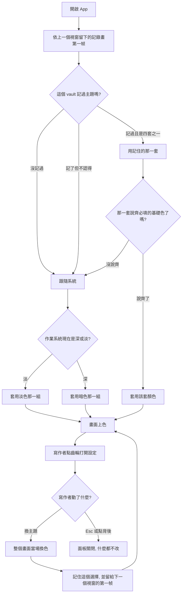

# 主題 — Product Requirements Document

> **原標題為「主題與導覽欄透明背景」。** 透明／霧面那一半在交付過程中整個退場，理由記在 §8.4；本文件其餘部分只談主題。

**Status:** Draft
**Version:** v1.0
**Owner:** James Hsueh
**Stakeholders:** 產品（本人）、開發（本人）
**Brief:** [BRIEF.md](BRIEF.md)

---

## 1. Background & Goal

### Problem Statement

Rustle 的顏色**完全沒有選擇的餘地**。畫面上約六十個顏色寫死成淡色與暗色兩套，跟著作業系統的深淡色走；讀者連「我現在就想固定用暗色」都做不到，更不用說換一套自己喜歡的配色。

同時，四根欄位一律是實色的底。一個整天開著的寫作工具，導覽的那兩根欄位其實可以是氛圍——但現在它們只能是不透明。

### Expected Outcome

- 讀者能在設定裡從下拉選單挑一套主題，**整個 App 的每一個顏色當場換掉**，不需要重新啟動。
- 選單第一項是「跟隨系統」，也是從來沒選過時的答案——**這個功能不改變任何人第一次開 App 看到的樣子**。
- 主題跨重啟記住，而且**第一帧就是對的顏色**——暗色主題的讀者不先被閃一下亮色。
- **新增一套主題只要照樣板再寫一份**，不必改動任何既有的一套——這是這個切片真正要交出的能力，四套主題只是它的第一批證明。

驗收方式是本文件 §3 的每一條情境；四套主題的顏色與推導規則的單一真實來源是 §8。

### Out of Scope

- **讀者自製主題**：這個切片只交出「從選單裡挑一套隨 App 出貨的主題」。讀者自己新增一套、或與別人交換主題，不在裡面。樣板的形狀為此鋪了路，但「讀者放進來的主題會出現在選單裡」是另一個切片。
- **Editor 與 Preview 的透明**：明確排除。那兩根是要專心讀的內容。
- **字體、字級、間距、圓角**：主題只管顏色。字體大小已有自己的切片。
- **透明程度**：明確不做。一根欄位是玻璃或不是，沒有中間的刻度（原本做過一支拉桿，已移除，理由見 §8.4）。
- **主題預覽格**：不做「選之前先看看」。整個畫面當場就變，那本身就是預覽。
- **第三種背景**：明確不做。「完全透明」已移除——那是做不到的東西，不是砍掉的功能（§8.4）。
- **文章內容與檔案**：正文、front matter、檔名、圖片資料夾，一律不因主題或透明設定而不同。
- **從網路取得主題**：App 完全離線，不發出任何網路請求。
- **改動需求文件**：NFR-6 寫的是「支援淺色／深色主題，跟隨系統設定」，這個切片把它降級成選單第一項。需求文件為使用者所有，本切片不修改它——落差記在 §7。

---

## 2. User Personas

- **Primary Role:** **寫作者**——Rustle 唯一的使用者角色，在自己的機器上寫文章。這個切片沒有新增角色，但多了一個新的身分：**日後要新增一套主題的人**（現階段仍是同一個人），他讀的是樣板而不是畫面。
- **Usage Context:** 本機桌面應用程式，完全離線。主題與透明是**開始寫之前調一次**的東西，不是寫作途中反覆切換的——但切換發生在寫作途中時，不能弄壞正在寫的東西。透明只在 App 疊在別的東西前面時才有意義，所以它天生是「視窗不最大化」的使用情境。

---
## 3. User Stories & Acceptance Criteria

### US-01 — 從選單挑一套主題 [priority: P0]

**As a** 寫作者，**I want** 在設定裡挑一套顏色，**so that** 這個我整天看著的畫面是我自己喜歡的樣子。

```gherkin
Scenario: 打開主題選單
  Given 目前用的主題是「跟隨系統」
  When 寫作者點側邊欄最下方的齒輪，展開主題那一列的下拉選單
  Then 選單由上到下是「跟隨系統」、「淡色」、「暗色」、「森林」四列
  And 「跟隨系統」那一列標著它是目前在用的

Scenario: 選了另一套主題，整個畫面當場換色
  Given 主題選單開著，目前用的是「跟隨系統」
  When 寫作者選「森林」
  Then 側邊欄、文章清單、寫作區、預覽區的底全部換成森林那一套的顏色
  And 設定畫面本身的底與邊框也換成森林那一套的顏色
  And 沒有要求重新啟動 App

Scenario: 主題管到寫作區的語法上色
  Given 目前用的是「跟隨系統」，寫作區裡有一個粗體字與一段程式碼
  When 寫作者換成「森林」
  Then 那個粗體字與那段程式碼的顏色換成森林那一套所說的顏色

Scenario: 主題管到預覽區的引言與程式碼區
  Given 預覽區裡有一段引言與一塊程式碼區
  When 寫作者換成「森林」
  Then 引言的字與程式碼區的底換成森林那一套所說的顏色

Scenario: 主題管到對話框背後那層壓暗
  Given 寫作者換成「森林」
  When 寫作者打開刪除文章的二次確認
  Then 對話框背後那層壓暗的顏色是森林那一套所說的顏色

Scenario: 選了目前已經在用的那一套
  Given 主題選單開著，目前用的是「森林」
  When 寫作者再選一次「森林」
  Then 畫面上沒有任何一個顏色改變

Scenario: 主題只換顏色，不換內容
  Given 一篇標題是「我的旅行」的文章開在編輯區，帶著標籤「旅行」
  When 寫作者換成「森林」
  Then 「我的旅行」與「旅行」這幾個字一個都沒有變
  And 正文一個字都沒有變

Scenario: 按 Esc 離開設定畫面，主題不變
  Given 設定畫面開著，目前用的是「跟隨系統」
  When 寫作者按 Esc
  Then 設定畫面關閉
  And 目前用的仍然是「跟隨系統」

Scenario: 點背後壓暗處離開設定畫面，主題不變
  Given 設定畫面開著，目前用的是「跟隨系統」
  When 寫作者點設定畫面背後被壓暗的地方
  Then 設定畫面關閉
  And 目前用的仍然是「跟隨系統」
```

### US-02 — 跟隨系統，或固定一套 [priority: P0]

**As a** 寫作者，**I want** 決定畫面到底要不要跟著作業系統的深淡色走，**so that** 我想固定用暗色的時候不會因為天亮就被切回淡色。

```gherkin
Scenario: 跟隨系統時，系統切暗色畫面就變暗
  Given 目前用的主題是「跟隨系統」，作業系統現在是淡色
  When 寫作者把作業系統切成暗色
  Then 整個畫面換成暗色那一套的顏色

Scenario: 選定一套主題之後，系統的深淡色不再有發言權
  Given 目前用的主題是「森林」，作業系統現在是淡色
  When 寫作者把作業系統切成暗色
  Then 畫面上沒有任何一個顏色改變

Scenario: 從來沒選過主題
  Given 這個 vault 從來沒有記過主題
  When 寫作者開啟 App
  Then 目前用的主題是「跟隨系統」
  And 畫面的顏色與這個功能交付之前完全相同

Scenario: 記住的主題是一套 App 不認得的名字
  Given 這個 vault 記住的主題名字不是那四套之中的任何一套
  When 寫作者開啟 App
  Then App 正常啟動
  And 目前用的主題是「跟隨系統」

Scenario: 一套主題少說了必填的基礎色
  Given 「森林」那一套沒有說出它的分隔線是什麼顏色
  When 寫作者開啟 App
  Then App 正常啟動
  And 「森林」不出現在主題選單裡
  And 目前用的主題是「跟隨系統」
```

### US-03 — 選了當下就看到變化，而且記得住 [priority: P0]

**As a** 寫作者，**I want** 調的當下就看到畫面變成什麼樣，並且下次開啟還是那樣，**so that** 我不必憑想像調，也不必每次開 App 重調一次。

```gherkin
Scenario: 主題跨重啟記住
  Given 寫作者選了「森林」
  When 寫作者關掉 App 再重新開啟
  Then 目前用的主題是「森林」
  And 第一帧就是森林那一套的顏色，沒有先閃過另一套

Scenario: 設定寫不進去，畫面照樣立刻改變
  Given 這個 vault 的設定寫不進去
  When 寫作者選「森林」
  Then 畫面立刻換成森林那一套的顏色
  And 沒有任何一句話說這個選擇失敗了

Scenario: 開啟 vault 沒有跑到最後
  Given 設定裡記著「森林」
  And 這一次開啟時列不出 workspace
  When 寫作者接著做任何會寫設定的事
  Then 設定裡仍然記著「森林」

Scenario: 設定寫不進去，這次調的活不過重啟
  Given 這個 vault 的設定寫不進去，寫作者剛選了「森林」
  When 寫作者關掉 App 再重新開啟
  Then 目前用的主題是「跟隨系統」

Scenario: 專注模式下沒有齒輪
  Given 寫作者在專注模式，側邊欄與文章清單都收起來了
  When 寫作者想換主題
  Then 畫面上沒有齒輪
  And 離開專注模式之後齒輪回到側邊欄最下方
```

> **原本這裡有 US-04（機器畫不出透空時的退路）與 US-05（主題與欄位背景互不干涉）。**
> 兩者都只描述已退場的那一半，**已移除**，不是待實作的驗收標準。經過見 §8.4。

### US-04 — 新增一套主題不必改既有的 [priority: P1]

**As a** 日後要新增一套主題的人，**I want** 照同一份樣板再寫一份就好，**so that** 加第五套主題不必去讀或改動前四套。

```gherkin
Scenario: 每一套主題各自一份，形狀相同
  Given 隨 App 出貨的四套主題
  When 新增主題的人比對這四份
  Then 四份的形狀完全相同：同樣的必填基礎色、同樣的可選覆寫
  And 四份互相之間沒有任何一份依賴另一份的內容

Scenario: 只說基礎色的一套主題就能用
  Given 一套新主題只說了必填的基礎色，一項覆寫都沒有
  When 寫作者在選單裡選它
  Then 整個畫面的每一個顏色都有顏色可用
  And 沒有任何一塊留白或沿用上一套主題的顏色

Scenario: 加一套主題不必改動既有的四套
  Given 有人照樣板寫了第五套主題
  When 這一套被加進 App
  Then 既有四套主題所說的顏色一個字都沒有改動
  And 選單多出第五列
```

---
## 4. Business Flow & Logic

### 主要流程



### 核心規則

1. **主題是唯一的顏色來源。** 這個 App 的每一個顏色都由當前主題交出——側欄、文章清單、寫作區的語法上色、預覽區的引言與程式碼、對話框背後那層壓暗，全部在內。**沒有哪一塊可以自己私藏一套顏色。**
2. **「跟隨系統」是一個持續狀態，不是一次性的問句。** 選著它的時候，讀者每一次切換作業系統的深淡色，畫面都跟著變。**這一點與「系統語言」相反**——系統語言只在「從來沒選過」的那一刻被問一次。兩者不可比照實作。
3. **一套主題必須說齊十四項基礎色**（§8.1）。少任何一項，這一套就不能用：它不出現在選單裡，若它正是記住的那一套，就當成「從來沒選過」，跟隨系統，App 照常啟動。
4. **基礎色以外的每一個顏色都可以逐項覆寫；沒覆寫的由推導規則從基礎色接手**（§8.2）。推導規則**全 App 只有一份**，四套主題共用它。
5. **四根欄位一律不透明。** 讓欄位透出桌面那一半已整個退場，見 §8.4。
6. **畫面先變、設定後寫。** 寫檔是讓選擇活過重啟的手段，不是讓它生效的手段——設定寫不進去時畫面照樣立刻改變，只是活不過重啟。
7. **主題只換顏色，不換內容。** 正文、workspace 名稱、標籤上的字、被寫進檔案的任何東西，一律不受影響。

### 邊界與例外

| 情況 | 行為 |
| :--- | :--- |
| 從來沒選過主題 | 跟隨系統——**與這個功能交付之前完全相同的畫面** |
| 記住的主題名字不認得 | 當成從來沒選過，跟隨系統，App 照常啟動 |
| 某一套主題少說了必填的基礎色 | 那一套不出現在選單裡；若它是記住的那一套，跟隨系統 |
| 選了目前已經在用的那一套主題 | 畫面上沒有任何一個顏色改變 |
| 選著具體主題時系統切換深淡色 | 畫面完全不變 |
| 開啟 vault 的四趟往返沒有跑到最後 | 主題在第一趟之後就套上並記住，所以中途離開不會把它換成沒人選過的值 |
| 設定寫不進去 | 畫面立刻改變，不報告失敗；這次調的活不過重啟 |
| 專注模式 | 側邊欄收起，齒輪不在畫面上。要改設定先離開專注模式——**接受的結果** |
| 換主題時編輯區有未存的變更 | 變更不丟、游標不跳，未存的變更照既有規則存起來 |
| 換主題時正在用輸入法組字 | 組字不被打斷 |
| 換主題時某個對話框開著 | 對話框裡已經填的字不消失，只有顏色換 |

---

## 5. UI/UX Design & Interaction

**沒有設計稿**——沿用 App 既有的視覺語言與既有設定畫面的形狀。

| 項目 | 決定 |
| :--- | :--- |
| 入口 | 沿用側邊欄最下方的齒輪與蓋在畫面上的設定畫面，**不新增第二個入口、不改變面板的形狀** |
| 面板裡的順序 | **語言 → 主題 → 透明**。既有的排在前面，新的往下長 |
| 主題那一項 | 一個下拉選單，一列一套，由上到下：跟隨系統、淡色、暗色、森林。目前在用的那一列標出來 |
| 立即性 | 換主題**畫面在當下就改變**；而且**第一帧就是對的顏色**，不先閃過另一套 |
| 齒輪的位置 | 第一欄最上方那條標題列的右端，與視窗自己的三顆按鈕同住一條 |
| 設定畫面自己 | **永遠不透明**，而且它的顏色也由主題交出。它是讀者專程去讀的東西，不是氛圍 |
| 空狀態／載入狀態 | 這個切片不新增任何空狀態或載入狀態——主題與透明都是當場就有答案的選擇 |
| 主題的名字 | 四套主題的中英文名字見 §8.5，進介面文案對照表 |

---

## 6. Non-Functional Requirements

| 面向 | 要求 |
| :--- | :--- |
| **輸入法（產品第三主張）** | 換主題與換欄位的底**都不得打斷組字**，也不得讓寫作區被重建。這是全 App 的橫切約束，換顏色不是例外 |
| **資料安全** | 這三個設定的任何改動**不得丟失未儲存的變更**，也不得改寫除了設定以外的任何檔案 |
| **離線** | 四套主題**全部內建**，不對外連線取得任何一套。App 完全離線的性質不變 |
| **啟動** | 決定用哪一套主題不得讓開啟 App 變慢到看得出來，**也不得出現明顯的顏色閃動**——一個暗色主題的讀者不該先被閃一下亮色畫面。這比介面語言那個切片的「文字換一次」嚴格：顏色整片閃動遠比一句話換字刺眼。**達成方式**：上一個視窗用過的主題另記一份本地快取，畫出第一帧之前同步套上，畫面狀態也從它開場——那個記錄是快取，設定檔仍然是唯一真實來源 |
| **一致性** | 同一個顏色在不同畫面上必須是同一個值（例：側邊欄的進度記號與文章列上的進度記號）。它們從同一套主題的同一項拿 |
| **可及性** | 主題選單要能用鍵盤操作，也要說得出自己是什麼；每一套主題都不得弄丟任何「給讀螢幕的人聽的說明文字」 |
| **相容性** | 三個桌面平台行為一致。主題是純顏色，沒有任何平台專屬的能力要求 |
| **追蹤／分析** | 無。App 不收集任何使用資料 |

---

## 7. Dependencies & Risks

### 外部依賴

- **顏色運算函式庫**（版本鎖定）——混色、往深推一階、加透明度。**原本寫「無新增的外部依賴」，那是錯的**：手寫 hex 解析與逐通道插值不值得維護，改用一個成熟的、支援感知均勻色彩空間的顏色運算函式庫。混色在 Oklab、推階在 Oklch，兩者都是感知均勻的——量測過本專案自己的顏色，**Oklab 與 sRGB 混出來的 chroma 幾乎一樣**（所以它不是先前那些「偏灰」的原因），真正的差別在亮度：一階往深在任何色相上都是同樣大小的一步。
- 四套主題全部內建，不連線、不下載。
- **「森林」那一套取材自 Everforest 的色盤**（Sainnhe Park 的作品）。我們取的是它的色感，**刻意不叫這個名字**——那是別人的作品名。

### 已知風險

| 風險 | 說明與對策 |
| :--- | :--- |
| ~~啟動時的顏色閃動~~ | **已解決。** 上一個視窗用過的主題另記一份本地快取，畫出第一帧之前同步套上，畫面狀態也從它開場。**兩次都差一步就漏掉**：第一版只寫不讀，於是畫面初次建立時又從「跟隨系統」重畫一次（暗→亮→暗）；那個缺口是「兩個測試各自綠燈、組合起來壞掉」的形狀 |
| **森林那一套的色值要逐項核對** | 本文件 §8.4 的色值是依 Everforest 公開色盤寫下的，**交付前必須逐項核對**，不可直接當成已驗證的值 |
| **視窗的標題列是我們自己的** | 作業系統的標題**列**刻意讓出，三顆按鈕仍然是系統的，第一欄最上面帶一條供它們落座。系統依視窗座標畫那三顆按鈕，**不會跟著欄位收起**——所以專注模式下寫作區的控制列必須讓出等寬空白。那條規則第一版是問「那條列在不在畫面上」，而它是隱藏而非卸載的，所以那個判斷一次都沒有命中；現在改由版面自己回答 |
| **與需求文件的落差** | 需求文件的 NFR-6 寫「支援淺色／深色主題，**跟隨系統設定**」。這個切片把「跟隨系統」降級成選單第一項。需求文件為使用者所有，**本切片不修改它**；待使用者下次改版時併入 |
| **推導規則的品質決定樣板值不值錢** | 若推導出來的顏色不好看，第五套主題會被迫大量逐項覆寫，樣板就退化成「一份四五十項的清單」。**§8.2 是這個切片真正的技術債風險所在**，不是四套主題的色值 |

---
## 8. Appendix — 主題的單一真實來源

一套主題說三件事：**它叫什麼**、**必填的十四項基礎色**、以及**任何它想逐項覆寫的顏色**。
這一節是這三件事的唯一權威；畫面上任何一個顏色都從這裡拿。

### 8.1 必填的十四項基礎色

少任何一項，這一套主題就不能用。

| # | 基礎色 | 它管什麼 |
| :--- | :--- | :--- |
| 1 | **明暗** | 這一套主題是亮的還是暗的。它決定所有推導的方向（往深推還是往淺推），也決定畫面上那些**不由我們上色、由系統或 GUI 元件自己畫**的東西——游標、選取、捲軸、下拉選單——往哪一邊畫 |
| 2 | **寫作區的底** | 寫字那一塊的底，畫面上最亮的一塊（暗色主題裡是最不暗的一塊） |
| 3 | **側邊欄的底** | 最左那一根的底，四個底裡最安靜的一個 |
| 4 | **文章清單的底** | 第二根的底，介於寫作區與側邊欄之間的一階 |
| 5 | **面板與對話框的底** | 設定畫面、四個對話框、提示的底 |
| 6 | **主要文字** | 讀者主要在讀的字 |
| 7 | **次要文字** | 說明、時間、行號、標題列這些退到後面的字 |
| 8 | **分隔線** | 欄與欄、區與區之間那條線，以及輸入框與按鈕的邊 |
| 9 | **強調色** | 連結、時間、選中的那一列、有作用的按鈕——**一套主題的個性主要住在這裡** |
| 10 | **紅** | 警示、已放棄、行內程式碼、其中一種標籤 |
| 11 | **橙** | 暫停、預覽區的數值、其中一種標籤 |
| 12 | **綠** | 存好了、進行中、引言、其中一種標籤 |
| 13 | **藍** | 已完成、連結、預覽區的名稱、其中一種標籤 |
| 14 | **紫** | 預覽區的關鍵字、其中一種標籤 |

> **刻意只有五個色相。** 這個 App 用得到的色相就是這五個——進度記號四個、標籤五個、預覽區的程式碼上色四個，全部落在這五個之內。多給黃或青只是要主題作者回答一個沒有人會問的問題。

### 8.2 沒說的顏色由誰接手（全 App 唯一一份推導規則）

基礎色以外的每一個顏色都可以逐項覆寫。**沒覆寫的一律照下表接手**，四套主題共用這一份。

| 顏色 | 它管什麼 | 沒說時由誰接手 |
| :--- | :--- | :--- |
| 強調色的淡底 | 一列被選中時鋪在它底下的洗色 | 強調色與**那一列所在的底**混合。亮主題混得淺、暗主題混得深 |
| 強調色上的字 | 少數落在強調色之上的字 | 亮主題取寫作區的底；暗主題取比側邊欄的底再深一階 |
| 滑過某一列的底 | 指標經過某一列時的底 | 亮主題是一層極淡的黑、暗主題是一層極淡的白。**刻意是半透明的**——同一個值要用在三種不同的底上，實色只會在其中一種上是對的 |
| 選中某一列的底 | 目前選著的那一列的底 | 強調色與那一列所在的底混合 |
| 行號 | 寫作區左邊那排數字 | 次要文字 |
| 游標所在那一行的底 | 標出寫作者現在在哪一行 | 強調色最淡的一層 |
| 警示色 | 存不進去、名稱被擋下、刪除的按鈕 | 紅 |
| 存好了的顏色 | 存檔指示那個勾勾 | 綠 |
| 進行中 | 進度記號 | 綠 |
| 暫停 | 進度記號 | 橙 |
| 已完成 | 進度記號 | 藍 |
| 已放棄 | 進度記號 | 紅 |
| 未標記 | 進度記號（空心的那一個） | 次要文字 |
| 標籤的五個顏色 | 標籤上的字，五種輪著用 | 依序是藍、綠、紅、紫、橙 |
| 標籤的五個淡底 | 每一種標籤的字所坐的淡底 | 各自的色相與**面板的底**混合 |
| 寫作區的標題／粗體／斜體 | 這三者刻意同色 | 主要文字 |
| 寫作區的連結 | 網址 | 藍 |
| 寫作區的引言 | 別人的話，擺到一邊 | 綠 |
| 寫作區的註解 | 註解 | 次要文字 |
| 寫作區的標點 | 井號、星號、方括號這些骨架 | 次要文字 |
| 寫作區的行內程式碼 | 反引號包起來的字 | 紅 |
| 預覽區的引言 | 渲染後的引言 | 次要文字 |
| 預覽區程式碼區的底 | 程式碼那一塊的底 | 面板的底**往深的方向推一階** |
| 預覽區的程式碼註解 | — | 次要文字 |
| 預覽區的關鍵字 | — | 紫 |
| 預覽區的字串 | — | 綠 |
| 預覽區的數值 | — | 橙 |
| 預覽區的名稱 | 變數、函式的名字 | 藍 |
| 對話框背後那層壓暗 | 蓋在畫面上的東西背後那一層 | 一層黑，**兩種主題同樣的濃度** |
| 面板的陰影 | 讓蓋在畫面上的東西浮起來 | 同上 |
| 滑過或選中的那一列（欄位透出東西時） | 那一列的底 | **先鋪上那一欄自己的底**，再蓋上滑過的洗色 |

> **這張表是這個切片真正的重點。** 四套主題的色值只是它的第一批證明；推導規則若不夠好，第五套主題會被迫大量逐項覆寫，樣板就退化成「一份四十幾項的清單」。

### 8.3 「跟隨系統」、「淡色」、「暗色」三套

**「跟隨系統」是唯一一套說了兩組顏色的主題**：它由淡色與暗色兩組組成，依作業系統當下的深淡色決定用哪一組。另外兩套各說一組，固定不變。

**這三套的基礎色**（取自今天畫面上正在用的值）：

| 基礎色 | 淡色 | 暗色 |
| :--- | :--- | :--- |
| 明暗 | 亮 | 暗 |
| 寫作區的底 | `#ffffff` | `#1c1c1e` |
| 側邊欄的底 | `#e8e9ec` | `#232327` |
| 文章清單的底 | `#f6f6f8` | `#1f1f22` |
| 面板與對話框的底 | `#ffffff` | `#2a2a2f` |
| 主要文字 | `#1c1c1e` | `#ececf0` |
| 次要文字 | `#64646a` | `#a4a4ab` |
| 分隔線 | `#dcdce1` | `#33333a` |
| 強調色 | `#0962c8` | `#5ea7ff` |
| 紅 | `#c3362a` | `#ec8474` |
| 橙 | `#9f5d14` | `#e0a25f` |
| 綠 | `#1b7a42` | `#6cc98a` |
| 藍 | `#0967d0` | `#6fb0ff` |
| 紫 | `#7a4bc4` | `#b590ee` |

**這三套的覆寫**：**逐項照抄今天畫面上的每一個顏色。**

今天的畫面是它們的唯一真實來源，這個切片**不重新調色**——包含寫作區那一整套取自 Xcode 預設主題的語法配色，以及預覽區那一套程式碼上色。這樣做有兩個理由：交付之後畫面**看起來完全沒變**（這是驗收 §3「不改變任何人第一次開 App 看到的樣子」的方式），而且它同時驗證了覆寫機制真的管得住每一個顏色。

> 因此本文件**不重抄那四十幾個值**：抄一遍就是把單一真實來源變成兩份，而兩份一定會漂移。交付時逐項從今天的畫面搬過去，一個都不改。

### 8.4 「森林」——深綠暗系

取材自 Everforest 的色盤（暗色、中等對比那一組）。**刻意不叫這個名字**：那是別人的作品名，我們取的是它的色感。

| 基礎色 | 森林 |
| :--- | :--- |
| 明暗 | 暗 |
| 寫作區的底 | `#2d353b` |
| 側邊欄的底 | `#232a2e` |
| 文章清單的底 | `#272e33` |
| 面板與對話框的底 | `#343f44` |
| 主要文字 | `#d3c6aa` |
| 次要文字 | `#859289` |
| 分隔線 | `#3d484d` |
| 強調色 | `#a7c080` |
| 紅 | `#e67e80` |
| 橙 | `#e69875` |
| 綠 | `#a7c080` |
| 藍 | `#7fbbb3` |
| 紫 | `#d699b6` |

**覆寫：一項都沒有。**

這是刻意的。森林是**推導規則的驗收**——一套只說了基礎色的主題如果好看，§8.2 就成立；如果不好看，該修的是 §8.2 而不是在這裡補覆寫。要補覆寫，得先說明為什麼那一項推不出來。

> **強調色與綠刻意是同一個值**：Everforest 的個性就在那個綠上。這也順帶驗證了「兩項基礎色可以是同一個顏色」不會讓任何推導出問題。
>
> **交付前必須逐項核對這十三個色值**（見 §7 已知風險）。

### 8.4 附記：透明／霧面那一半為什麼整個退場了

**它退場了，而且不是砍需求——是那件事在當時的技術條件下做不到我們想要的樣子。** 交付過程中依序發現：

1. **「完全透明」做不到。** 桌面之所以透得出來，靠的是視窗套的一層材質（macOS 的 vibrancy），而**材質就是模糊**。所以「完全透明」從頭到尾只是「霧面薄一點」，是一個讀者看不出來的差別。
2. **材質要顯示出來，整個視窗必須透空。** 而透空的視窗連原生標題列一起帶走——三顆按鈕、拖動視窗的能力全部消失。那不是代價，那是壞掉。第一版就是這樣交付的。
3. **App 畫面自己的模糊效果補不了這個洞。** 材質與桌面是在 App 畫面**底下**由視窗伺服器合成的，而 App 自己的模糊只能模糊「自己畫過的東西」。用它的結果是零模糊加上一圈深色邊緣。
4. **既有的第三方方案也補不了。** 當時找得到的現成方案不是已停止維護、就是只支援單一平台；系統內建的視窗材質就是目前最好的東西，而它就是第 1 與第 2 點。
5. **開關與滑桿都試過。** 兩個開關（不透明／霧面）在說滑桿兩端已經說過的話；滑桿則因為預設在 0（＝不透明）而讓「選了霧面」看起來毫無作用。
6. **真正的毛玻璃是四樣東西**：模糊、飽和度提升、0.1–0.35 的半透明底、以及一條邊緣高光。我們拿得到的只有第一樣（靠材質），而底色降到 0 時連「玻璃」本身都不存在了。

**使用者裁決：整個移除，四根欄位一律不透明。** 保留下來的是兩件在過程中附帶產生、且與透明無關的東西：第一欄最上面那條放三顆按鈕與齒輪的標題列，以及「蓋在畫面上的面板一律畫在整個視窗的最上層、不畫在任何一根欄位裡」這條規則。

### 8.4a 原本寫的那些（保留為記錄）

原文有三種背景與一支拉桿。實際交付的是**兩種背景、沒有拉桿**。兩個都是移除，理由不同：

**「完全透明」是做不到的東西，不是砍掉的功能。** 桌面之所以透得出來，是因為視窗套了一層材質（見 §7 的平台限制）——而材質就是模糊。所以「完全透明」從頭到尾只是「霧面薄一點」，把它當成第二種，是提供一個讀者看不出來的差別。

**那支拉桿在回答一個沒有人問的問題。** 讀者想說的是這根欄位是不是玻璃；玻璃到什麼程度，是挑其餘顏色的那個人該決定的事。而且它預設在 0，而 0 就是不透明——所以選了霧面玻璃之後畫面**一個像素都沒變**，讀者得先找到拉桿並拖它才有反應。那個預設值在讀者動手之前根本看不到，所以 0 什麼都換不到，只換到「這個功能看起來壞了」。

**設定檔裡若還留著 `fullyTransparent`，讀成霧面玻璃**——選它的讀者要的是桌面透出來，而那現在只有一種說法；答「不透明」等於這次改名默默撤銷了他們的選擇。

### 8.4a 實作階段修正的兩條推導（原文有誤，記在這裡）

| 條目 | 原本寫的 | 改成 | 為什麼 |
| :--- | :--- | :--- | :--- |
| 預覽區程式碼區的底 | 往「離主要文字更遠」的方向推一階 | **往深的方向推一階** | 原文對淡色主題不成立：面板的底是白的、主要文字接近黑的，「離文字更遠」等於比白更亮，沒有地方可去。今天兩套主題**都是**把程式碼區推得比面板深，所以規則就是往深 |
| 對話框背後那層壓暗與陰影 | 暗主題一層較重的黑 | **兩種主題同樣的濃度** | 今天這兩個值在兩種主題下本來就一樣（壓暗 35%、陰影 18%）。「暗主題加重」是沒有根據的改動，而且會違反「交付之後畫面看起來完全沒變」那個承諾 |

### 8.5 四套主題的名字

進介面文案對照表，兩種介面語言各一份。

| 主題 | 中文介面 | 英文介面 |
| :--- | :--- | :--- |
| 跟隨系統 | 跟隨系統 | Follow System |
| 淡色 | 淡色 | Light |
| 暗色 | 暗色 | Dark |
| 森林 | 森林 | Forest |

透明那一段要說的話：

| 說什麼 | 中文介面 | 英文介面 |
| :--- | :--- | :--- |
| 主題那一項的標題 | 主題 | Theme |


> **Workspace 那一個不翻**，與側邊欄那個區塊標題同一條規則（見通用語言地圖 §3 介面語言）。Articles 兩種語言下也一樣，因為它在這裡指的是**那一根欄位**，與區塊標題同一個字。

### 8.6 樣板：新增第五套主題要做什麼

| 項目 | 決定 |
| :--- | :--- |
| 一套一份 | **每一套主題各自是一份獨立的內容**，四份的形狀完全相同，互相之間不依賴 |
| 收在一處 | 四份收在同一個資料夾裡，新增一套就是**在同一處再放一份** |
| 照樣板 | 有一份樣板，說齊十四項基礎色的位置與每一項的意思。新增一套主題就是**複製樣板再改值** |
| 不必改既有的 | 加第五套**不必讀、也不必改動**既有四套的任何一個字 |
| 最小的一套 | **只說十四項基礎色、一項覆寫都不寫，就是一套可用的主題**（森林就是這樣的一套） |

> 這一節只說**形狀**，不說形式。「一份內容」具體長什麼樣、放在哪裡，是 architecture 的題目——使用者已指定方向：一套一份、收在同一個資料夾、照同一份樣板複製新增。

---

## 9. 相關文件

- [BRIEF.md](BRIEF.md) — 這個切片的需求共識與具體例子
- 通用語言地圖——主題與欄位背景的詞彙定義（§3，含兩個已退場的詞），以及禁用的同義詞（§5）
- [../2026-08-21-interface-language/PRD.md](../2026-08-21-interface-language/PRD.md) — 設定畫面的形狀、齒輪、專注模式下的處境；介面文案對照表
- [../2026-08-21-editing-surface-font-size/PRD.md](../2026-08-21-editing-surface-font-size/PRD.md) — 「畫面先變、設定後寫」與夾住範圍只有一個地方在管的先例
- [../2026-08-20-preview-panel/PRD.md](../2026-08-20-preview-panel/PRD.md) — 分隔線拖曳時即時反映、放手才記下來的先例
