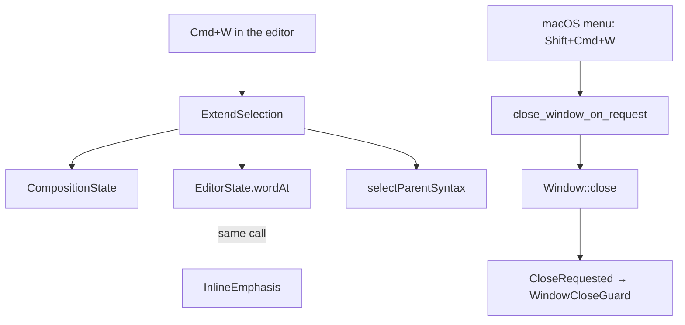

# 逐層擴大選取的快速鍵 — Architecture Design

**Status:** Confirmed (decided autonomously; the user was away — every judgement call is listed in §8)
**Source PRD:** `.sdd/2026-08-25-extend-selection-key/PRD.md`
**Tech context:** Tauri 2.12.5 (`tauri::menu`, muda 0.20) · TypeScript strict + React + CodeMirror 6 (`@codemirror/commands 6.11.1`, `state 6.7.6`, `view 6.43.15`, `lang-markdown 6.5.2`) · Vitest + happy-dom · Rust `src-tauri` tests on Tauri's mock runtime. No crate, channel, setting or capability changes.

---

## 1. Design Goal & Guiding Principle

- **In one sentence:** Cmd+W in the writing surface grows the selection one Markdown structure at a time (word under the main cursor first, then CodeMirror's own `selectParentSyntax`, finally the whole body), never edits the text, never acts while composing, and is nobody's "close window" any more — the app installs its own macOS menu, which is the stock Tauri menu with only the Close Window rows rebound to Shift+Cmd+W.
- **Guiding principle:** *reuse the two answers that already exist, add only the decision between them.* "Which word" is `EditorState.wordAt` (the same call `InlineEmphasis` makes), "what is one layer out" is `selectParentSyntax` (the editor's own walk up the syntax tree). The new class owns exactly one decision: word or grow. The menu is built **from** `Menu::default` and only swaps the close rows, so every stock row stays whatever Tauri ships, even after an upgrade.

---

## 2. Change Scope

| Area | Action | What / Why |
| :--- | :--- | :--- |
| `src/features/editor/ExtendSelection.ts` | **Add** | Key owner for `Mod-w`: refuses while composing; main cursor empty with a word → each empty range takes its word; otherwise `selectParentSyntax`; when that finds nothing larger for a non-empty selection, the whole body |
| `src/features/editor/MarkdownEditor.tsx` | **Modify** | Installs `new ExtendSelection(composition).extension()` next to `EmphasisShortcuts`; the comment about the retired `Mod-i` now says where the behaviour went |
| `src-tauri/src/application_menu.rs` | **Add** | `application_menu(app)`: `Menu::default` with every stock Close Window item replaced, in place, by a `MenuItem` (`close-window`, same text, `Shift+CmdOrCtrl+W`); `close_window_on_request(app, event)` closes the main window through `Window::close` (so the existing `CloseRequested` guard runs exactly as before) |
| `src-tauri/src/lib.rs` | **Modify** | `run` installs the menu and its event handler on macOS only (`#[cfg(target_os = "macos")]`). Not `configure`: native menus build only on the main thread, and every integration test builds a mock app through `configure` on a test thread |
| `docs/ime-regression-checklist.md` | **Modify** | One extra line: Cmd+W while composing must leave the candidate window and the selection alone |
| `.sdd/PROJECT.md` | **Modify** | New seam: the application menu, and the `Mod-w` key owner |
| `InlineEmphasis` / `EmphasisShortcuts` | **Not touched** | They already call `state.wordAt`; sharing the call is sharing the rule |
| Finders, preview, dialogs, sidebar | **Not touched** | Without a menu row on Cmd+W the key does nothing outside the editor — nothing to add there |
| Capabilities, channels, settings, Rust crates | **Not touched** | Menu events are handled in Rust; the webview gets no new permission |

---

## 3. New Classes / Modules

| Name | Kind | Responsibility (purpose) | Collaborators | Satisfies (PRD scenario) |
| :--- | :--- | :--- | :--- | :--- |
| `ExtendSelection` | Key owner (one per editor, `Prec.high` keymap) | Decide "word or one layer out" from the main range and dispatch a selection-only transaction; leave the key to the input method while composing | `CompositionState`, `EditorState.wordAt`, `selectParentSyntax` | US-01, US-02, US-03, US-04 組字中, US-06 |
| `application_menu` (module `application_menu.rs`) | Assembly-root function pair | Build the macOS app menu (stock menu, close rows rebound) and turn the `close-window` menu event into closing the main window | `tauri::menu::{Menu, MenuItem, PredefinedMenuItem}`, `WindowCloseGuard` (indirectly, via `CloseRequested`) | US-04 視窗仍然開著, US-05 all |

`ExtendSelection.extend(view)` decision table:

| Situation | Result |
| :--- | :--- |
| Composing (shared `CompositionState` or `view.composing`) | not handled (`false`): the key stays the input method's |
| Main range empty and `wordAt(main.head)` exists | every empty range becomes its own word (an empty range without one stays put); non-empty ranges stay |
| Otherwise, `selectParentSyntax` grows something | that selection (it already merges ranges that meet) |
| Otherwise, the main range is non-empty and not the whole body | the whole body |
| Otherwise (empty line, whitespace-only line, empty body, already all) | nothing; the key is still taken |

Read-only is deliberately **not** checked: a selection-only transaction is allowed on a read-only state.

---

## 4. Modified Components

| Component | Current role | Change needed |
| :--- | :--- | :--- |
| `MarkdownEditor.editorExtensions` | Installs every editor extension | One more line: `new ExtendSelection(composition).extension()` |
| `run` (`src-tauri/src/lib.rs`) | Production entry: `configure` + main window | On macOS: `.menu(application_menu).on_menu_event(close_window_on_request)` |

---

## 5. Component Relationships

---

## 6. Extensibility & Handoff Notes

- **Most likely next requirement:** the keymap overview (a list of every key the app owns) and, later, "shrink the selection back".
- **Where it lands:** the keymap list reads key names from the owners (`FINDING_SHORTCUTS` already does this); `ExtendSelection` exposes its key as `ExtendSelection.key` for that. Shrinking would need a remembered stack of ranges — it belongs inside `ExtendSelection` as a `StateField`, not a second class.
- **How to add a menu row:** `application_menu` starts from the stock menu, so a new row is one `append`/`insert` on the right submenu there; a rebinding of another stock row is one more entry in the same swap.
- **Do not hardcode:** the stock close row is recognised by the text of a freshly built `PredefinedMenuItem::close_window`, not by a literal "Close Window", so a muda text change keeps working.
- **Known debt / deferred:** the menu text is English (stock); following the interface language is out of scope (PRD). Other platforms keep the stock menu with Ctrl+W.

---

## 7. Traceability

| PRD Scenario | Fulfilled by |
| :--- | :--- |
| US-01 游標在英文字中間，第一下選起整個字 | `ExtendSelection` (word branch, `wordAt`) |
| US-01 游標在中文裡，第一下選起連續的那一整串中文 | `ExtendSelection` + `wordAt`'s CJK grouping |
| US-01 中文那一串到標點就停 | `wordAt` |
| US-01 空行上什麼都不做 | `ExtendSelection` (no word; parent finds only the document; empty range → nothing) |
| US-01 只有空白的一行，同樣什麼都不做 | same path (a blank line belongs to no block) |
| US-01 游標緊鄰標點時，直接往外長一層 | `ExtendSelection` → `selectParentSyntax` (Paragraph) |
| US-01 程式碼區塊裡照常選字 | `ExtendSelection` (no code exception) |
| US-02 從連結文字長成整個連結 | `selectParentSyntax` (Link node) |
| US-02 從整個連結長成整段話 | `selectParentSyntax` (Paragraph) |
| US-02 從清單的一項長成整個清單 | `selectParentSyntax` (BulletList / OrderedList) |
| US-02 長成一段強調時，兩邊的記號一起被選進去 | `selectParentSyntax` (StrongEmphasis includes its marks) |
| US-02 連按三下到得了整段 | word → Link → Paragraph |
| US-02 滑鼠拖出來的選取，直接從那一段往外長 | `ExtendSelection` (non-empty main → grow branch) |
| US-03 全選之後再按，什麼都不做 | `ExtendSelection` (whole body → nothing larger) |
| US-03 短文章連按很多次，停在最外層 | same |
| US-03 用滑鼠點別的地方，層次重新從詞開始 | stateless decision (no remembered layer) |
| US-04 組字中不動作 | `ExtendSelection` composition check |
| US-04 焦點在文章清單／對話框／預覽區時什麼都不做 | keymap is the editor's only; `application_menu` leaves no row on Cmd+W |
| US-06 不能改的文章照樣選得起來 | `ExtendSelection` (no read-only check) |
| US-06 好幾個游標，寫作者所在的那個旁邊有詞 | `ExtendSelection` (word branch over every empty range) |
| US-06 好幾個游標，寫作者所在的那個旁邊沒有詞 | `ExtendSelection` (grow branch for all; ranges merge) |
| US-05 新的關視窗快速鍵有效 | `application_menu` (`close-window` → `Window::close`) |
| US-05 選單上「關閉視窗」那一列標的是新的鍵 | `application_menu` (rows kept in place, accelerator `Shift+CmdOrCtrl+W`) |
| US-05 結束 App 的路徑沒有變 | `application_menu` keeps the stock Quit row |
| US-05 標準的編輯鍵全部照舊 | `application_menu` keeps the stock Edit submenu (Cut / Copy / Paste / Select All) |
| US-05 還原與重做照舊 | `application_menu` keeps the stock Undo / Redo rows |
| US-05 縮放與開發者工具照舊 | `application_menu` keeps the stock Window / View rows; dev tools are not a menu row in the stock menu |

---

## 8. Risks & Open Decisions

Decisions taken without the user (recorded in the PR as Assumptions):

1. **The outermost layer.** `selectParentSyntax` never selects the Document node, so on its own it would stop at a top-level block. The BRIEF's layers end at "整篇文章", so when it finds nothing larger for a **non-empty** selection, `ExtendSelection` selects the whole body. An empty cursor never jumps to the whole body: an empty line belongs to no structure (PRD §4 rule 4).
2. **Both close rows.** The stock macOS menu has Close Window in **File** and in **Window**, both on Cmd+W. Both are rebound (same position, same text), otherwise Cmd+W would still close the window. The PRD's "only this cell" is read as "only the close-window rows".
3. **Closing goes through `Window::close`**, which raises `CloseRequested`, so the autosave close guard runs exactly as with the stock `performClose:`. With no main window the row does nothing.
4. **macOS only.** The menu is installed under `#[cfg(target_os = "macos")]`; the editor binds `Mod-w`, so on other platforms Ctrl+W in the editor also grows the selection while the stock menu keeps Ctrl+W elsewhere (PRD §6: only macOS is guaranteed).
5. **The menu row cannot be exercised by an automated keypress** (the mock runtime has no native menu bar, and its `close` leaves no trace a test can read). `tests/application_menu.rs` (no harness: native menus need the main thread) pins the built menu against `Menu::default` row by row, the ids and the accelerator; the event → close path and pressing the real keys are in `docs/ime-regression-checklist.md`.
6. **Recognising the stock close row**: a freshly built item still reports its mnemonic (`C&lose Window`) while a row read back from a menu does not, so the comparison drops `&`.
- **Risk:** a custom `MenuItem` loses the native "disabled when no key window" state of `performClose:`. Acceptable: with one window, pressing it with no window does nothing.
