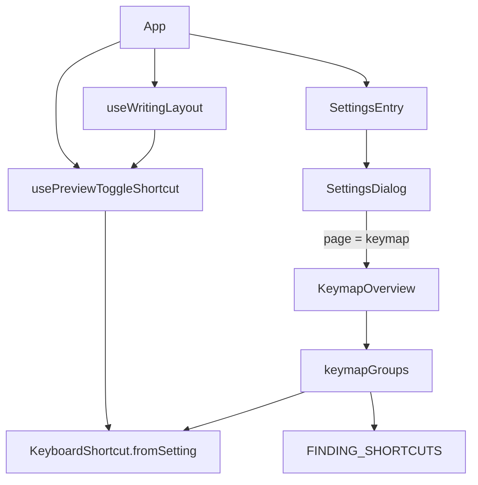

# 快捷鍵總覽 — Architecture Design

**Status:** Confirmed (decided autonomously; the user was away — every judgement call is listed in §8)
**Source PRD:** `.sdd/2026-08-26-keymap-overview/PRD.md`
**Tech context:** Tauri 2 · TypeScript strict + React 19 · Vitest + happy-dom. Webview only: no channel, command, capability, crate or package added.

---

## 1. Design Goal & Guiding Principle

- **In one sentence:** the settings dialog gets a 「快捷鍵」 button that swaps the dialog's content for a read-only list of the keys Rustle teaches — grouped 寫作 / 畫面 / 視窗 (+ the 尋找 group the finding slice already prepared), each row a translated noun and a key name — where the preview toggle row is written from the very `KeyboardShortcut` the window listens for.
- **Guiding principle:** *the list is data, the dialog only draws it.* What rows exist, in which group and order, is one pure function `keymapGroups(previewToggle)` in `src/features/keymap/`. Adding, moving or renaming a key is one line there (and one catalog sentence); no component knows a key.

---

## 2. Change Scope

| Area | Action | What / Why |
| :--- | :--- | :--- |
| `src/features/keymap/keymapGroups.ts` | **Add** | The table: groups in order, rows in order, each `{ keys, action }` where `action` is a catalog key (so the description follows the interface language) and `keys` a fixed key name (never translated) |
| `src/features/keymap/KeymapOverview.tsx` | **Add** | The list page: back button (left arrow `IconButton`) + heading 快捷鍵, then one section per group, each row description left / `<kbd>` right |
| `src/features/preview/KeyboardShortcut.ts` | **Modify** | `label` — the shortcut written the macOS way in key-cap words (`Option+Shift+Cmd+K` order), so the row and the binding come from the same parsed object |
| `src/features/preview/usePreviewToggleShortcut.ts` | **Add** | `usePreviewToggleShortcut(settings)` — the one place that turns `previewPanel.toggleShortcut` into a `KeyboardShortcut` (moved out of `useWritingLayout`, which now calls it) |
| `src/features/writingLayout/useWritingLayout.ts` | **Modify** | Uses `usePreviewToggleShortcut` instead of parsing itself |
| `src/features/interfaceLanguage/SettingsDialog.tsx` | **Modify** | A page state (`settings` / `keymap`, local, so reopening always starts on settings); the 快捷鍵 button under Vim mode; back returns focus to that button; Esc still closes the whole dialog from either page |
| `src/features/interfaceLanguage/SettingsEntry.tsx` | **Modify** | Threads `previewToggleShortcut` to the dialog |
| `src/features/interfaceLanguage/messages.ts` | **Modify** | Button, back, heading, three group titles, eleven row nouns, both languages |
| `src/app/App.tsx`, `src/app/app.css` | **Modify** | Pass the shortcut from `usePreviewToggleShortcut(settings)`; list styles (group title like other panel titles, monospaced keys, the list scrolls inside the dialog) — theme tokens only |
| Rust crates / `src-tauri` | **Not touched** | Nothing is read from disk that the webview does not already hold (`Settings.previewPanel.toggleShortcut` already crosses) |
| Key owners (`ExtendSelection`, `EmphasisShortcuts`, `TabIndentation`, `application_menu.rs`, Vim) | **Not touched** | The list names keys; it does not bind them. Vim keys are deliberately absent |

---

## 3. New Classes / Modules

| Name | Kind | Responsibility (purpose) | Collaborators | Satisfies (PRD scenario) |
| :--- | :--- | :--- | :--- | :--- |
| `keymapGroups(previewToggle)` | Pure value module | Every row Rustle teaches, grouped and ordered; the preview row takes `previewToggle.label` | `KeyboardShortcut`, `FINDING_SHORTCUTS` | US-02 all; US-03 key names; US-04 all |
| `KeymapOverview` | Component | Draws the groups with translated titles/descriptions; back button | `useMessages`, `IconButton` | US-01 list replaces settings, back; US-03 descriptions follow language |
| `usePreviewToggleShortcut` | Hook | Settings → the effective preview shortcut (default when absent or unreadable) | `SettingsSession`, `KeyboardShortcut.fromSetting` | US-04 (same object as the binding) |

---

## 4. Modified Components

| Component | Current role | Change needed |
| :--- | :--- | :--- |
| `KeyboardShortcut` | Parses and matches the preview toggle | `get label(): string` (`[Option+][Shift+]Cmd+<KEY>`); `Cmd` read as another name for `Mod` |
| `SettingsDialog` | Three settings sections | `page` state; 快捷鍵 button; renders `KeymapOverview` instead of the sections on the keymap page |
| `useWritingLayout` | Owns the preview listener and its parsing | Parsing moved to `usePreviewToggleShortcut` |

---

## 5. Component Relationships

---

## 6. Extensibility & Handoff Notes

- **Most likely next requirement:** a new key (the settings key `Cmd+,` is already specified by a later slice), or making another key configurable.
- **Where it lands:** a new row = one entry in `keymapGroups` + one catalog noun in both languages; a new group = one `KeymapGroup` entry + its title. A configurable key = one more `KeyboardShortcut` argument whose `label` the row uses.
- **Patterns applied & why:** table-as-data so the "keys drift from the list" risk (PRD §7) is caught by one unit test over the table, not by DOM tests.
- **Do not hardcode:** the preview row's key (always `previewToggle.label`); the finding rows (always `FINDING_SHORTCUTS`).
- **Known debt / deferred:** the other key names are literals in `keymapGroups` rather than read from their owners (`ExtendSelection.key` is CodeMirror notation `Mod-w`); translating CodeMirror notation for nine fixed rows would add a parser for no behaviour. Revisit if keys become configurable.

---

## 7. Traceability

| PRD Scenario | Fulfilled by |
| :--- | :--- |
| US-01 設定裡有這顆按鈕 | `SettingsDialog` (button after `VimModeSetting`) |
| US-01 按下去,對話框的內容換成清單 | `SettingsDialog` page state + `KeymapOverview` |
| US-01 返回,回到設定而且什麼都沒被改動 | `KeymapOverview` back → `SettingsDialog` page `settings`; no settings write on either path |
| US-01 在清單上按 ESC,整個對話框關閉 | `SettingsDialog` Esc handler on the dialog root (both pages) |
| US-01 關掉再打開,回到設定那一面 | page state lives in `SettingsDialog`, which `SettingsEntry` unmounts on close |
| US-02 被改掉的那個鍵找得到 / 關閉視窗也找得到 | `keymapGroups` (`Cmd+W` 擴大選取, `Shift+Cmd+W` 關閉視窗) |
| US-02 原生的鍵不在清單裡 | `keymapGroups` (no undo / redo rows) |
| US-02 Vim 開著也不會多出任何一列 | `keymapGroups` takes no Vim input |
| US-02 三組,由上到下 | `keymapGroups` order 寫作 → 畫面 → 視窗 (→ 尋找) |
| US-03 說明跟著介面語言 / 鍵名不跟著 | `KeymapOverview` (description via `useMessages`, `keys` literal) |
| US-03 鍵寫成鍵上印的字 | `keymapGroups` (`Tab`, not `⇥`) |
| US-03 每一列只寫那個鍵做什麼 | catalog nouns (no sentence punctuation; pinned by test) |
| US-04 預設值 / 改過的值 / 讀不懂的值 | `usePreviewToggleShortcut` → `KeyboardShortcut.fromSetting` → `label` |

---

## 8. Risks & Open Decisions

Decisions taken autonomously (the user was away):

1. **Key names are words, not symbols.** The BRIEF asked for `⌘B`/`⇥`; the finalized PRD (US-03) overrides it: `Cmd+B`, `Tab`, `Shift+Cmd+P`. The PRD wins.
2. **The 尋找 group is included.** The finding slice (already on `main`) exported `FINDING_SHORTCUTS` and the catalog sentences for this list and specified a fourth group after the three; drawing it is that slice's contract. The PRD's "three groups top to bottom" still holds for the first three.
3. **`Cmd+,` (settings key) is not listed.** That slice is not on `main`; it will add one row.
4. **"設定說開關預覽是 Cmd+Alt+K"** is taken literally. The preview slice's setting format only knew `Mod` (Cmd or Ctrl), so `Cmd+Alt+K` used to be unreadable and fall back to the default. `KeyboardShortcut.parse` now also reads `Cmd` as another name for `Mod` (still matching Cmd or Ctrl), so the window answers to `Option+Cmd+K` and the row says so. No preview-panel scenario names `Cmd` as invalid, so its contract is unchanged.
5. **Modifier order** follows macOS menus: Option, Shift, Cmd (`Mod+Shift+Alt+K` → `Option+Shift+Cmd+K`).
6. **Back control:** a left-arrow `IconButton` with the readable name 返回設定 / "Back to Settings" (PRD §5). On return, focus lands on the 快捷鍵 button; on entering the list, on the back button.
7. **Row nouns** are the PRD §4 table words; the PRD's "逐層擴大選取" in scenarios is the same row as the table's 擴大選取. 字體回預設 does not mention the hovered surface (BRIEF open decision: rows are nouns, PRD rule five).
8. **Esc row** says 退出 / "Leave", true with Vim on or off.

- **Risks / trade-offs:** literal key names can drift from their owners; mitigated by the table test and the PROJECT.md seam note ("changing a key = change `keymapGroups`").
