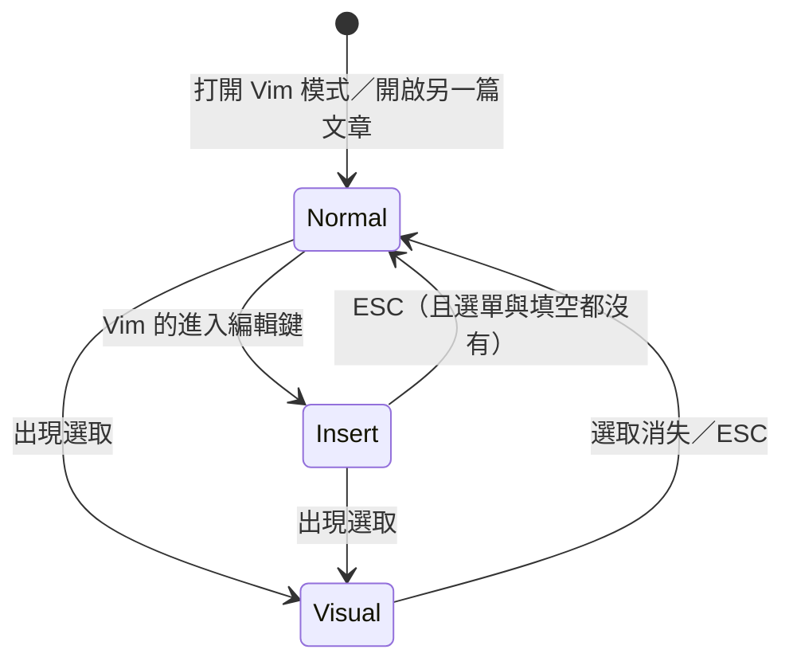

# Vim 模式 — Product Requirements Document

**Status:** Finalized
**Version:** v1.0
**Owner:** James Hsueh
**Stakeholders:** Engineering
**切片：** `feature/vim-mode`　**日期：** 2026-08-26
**上游共識：** [BRIEF.md](BRIEF.md)

---

## 1. Background & Goal

### Problem Statement

Rustle 的寫作區只有一種操作方式：手放在字母區打字，要移動、選取、刪改就得伸手去按方向鍵、Home／End，或改用滑鼠。習慣 Vim 的寫作者每天要為這件事付出無數次「手離開又回來」的成本，而這正是 Rustle 主打的「鍵盤行為可預期」還沒兌現的那一半。

同時，這件事**不能強加給不要它的人**。Vim 的按鍵表對沒學過的人來說是一片天書——一個按 `i` 卻沒有出現 `i` 的編輯器，是壞掉的編輯器。

### Expected Outcome

寫作者可以在設定裡打開一個開關，讓寫作區改用 Vim 的操作方式；打開之後：

1. **三個模式**（Normal／Insert／Visual）齊備，而且**現在在哪一個模式，畫面上看得到**。
2. **今天會的每一個快速鍵，行為一個字都不變。** 這是可驗證的結果，不是感覺。
3. **不打開的人，App 與今天完全相同。**

### Out of Scope

- Vim 的**指令列**（`:w`、`:q` 那一類）。Rustle 自動存檔，`:w` 沒有事情可做；關閉視窗已經有自己的快速鍵。
- Vim 的**搜尋**（`/`、`n`、`N`）。
- 讓寫作者**自訂 Vim 的按鍵對應**。這一版只有「開」與「關」。
- **重做一條走出寫作區的鍵盤路徑**（見 §4 已知取捨）。
- Vim 模式在**預覽面板**裡作用。這個設定只影響寫作區。

---

## 2. User Personas

- **主要角色：寫作者**——Rustle 唯一的使用者角色。本切片把他們分成兩群：
  - **習慣 Vim 的寫作者**：手不離字母區是肌肉記憶，沒有 Vim 的編輯器會讓他們持續按錯。
  - **不用 Vim 的寫作者**：這個切片對他們的承諾是「你不會發現有這件事」。
- **使用情境**：本機桌面 App，長時間連續寫作，中英文夾雜、常用輸入法組字。鍵盤是主要輸入裝置。

---

## 3. User Stories & Acceptance Criteria

### US-01 — 打開與關閉 Vim 模式 [priority: P0]

**As a** 習慣 Vim 的寫作者，**I want** 在設定裡打開 Vim 模式，**so that** 我不必把手離開字母區就能移動與修改文字；而不用它的人不受影響。

```gherkin
Scenario: 從來沒動過這個設定的人，什麼都不會發現
  Given 這個 Vault 從來沒有人動過 Vim 模式的設定
  When 寫作者開啟 App
  Then Vim 模式是關閉的
  And 寫作區底下那條狀態列上沒有模式標籤

Scenario: 打開的當下立刻生效，並且當場進入 Normal
  Given Vim 模式是關閉的
  And 寫作者正開著一篇文章
  When 寫作者在設定裡打開 Vim 模式
  Then 寫作區立刻進入 Normal 模式,不需要重新啟動 App
  And 狀態列中間顯示「NORMAL」

Scenario: 關掉的當下立刻生效
  Given Vim 模式是開啟的,且寫作區在 Normal 模式
  When 寫作者在設定裡關掉 Vim 模式
  Then 狀態列中間的模式標籤消失
  And 寫作區立刻回到「打字就出字」的行為

Scenario: 這個選擇跨重啟被記住
  Given 寫作者已在這個 Vault 打開 Vim 模式
  When 寫作者關閉 App 後再次開啟
  Then Vim 模式仍然是開啟的

Scenario: 每個 Vault 各記一份
  Given 寫作者在 Vault A 打開了 Vim 模式
  And Vault B 從來沒有人動過這個設定
  When 寫作者切換到 Vault B
  Then Vault B 的 Vim 模式是關閉的

Scenario: 設定檔被人手改成看不懂的值
  Given 這個 Vault 的設定裡,Vim 模式那一項寫著一個不是「開」也不是「關」的值
  When 寫作者開啟 App
  Then Vim 模式是關閉的
  And App 正常啟動,不顯示任何錯誤
```

### US-02 — 三個模式，以及「有選取就是 Visual」 [priority: P0]

**As a** 習慣 Vim 的寫作者，**I want** 寫作區隨時處在 Normal／Insert／Visual 三者之一，且模式與畫面上的反白永遠一致，**so that** 我只要看畫面就知道下一個按鍵會做什麼。

```gherkin
Scenario: 從 Normal 進入 Insert
  Given 寫作區在 Normal 模式
  When 寫作者按下 Vim 用來開始打字的那個鍵
  Then 寫作區進入 Insert 模式
  And 狀態列中間顯示「INSERT」

Scenario: 從 Insert 回到 Normal
  Given 寫作區在 Insert 模式
  And 片語選單沒有開著,也不在填空中
  When 寫作者按下 ESC
  Then 寫作區回到 Normal 模式
  And 狀態列中間顯示「NORMAL」

Scenario: 在 Normal 模式下拖出選取,自動進入 Visual
  Given 寫作區在 Normal 模式
  When 寫作者用滑鼠拖出一段選取
  Then 寫作區進入 Visual 模式
  And 狀態列中間顯示「VISUAL」

Scenario: 在 Insert 模式下拖出選取,一樣進入 Visual
  Given 寫作區在 Insert 模式
  When 寫作者用滑鼠拖出一段選取
  Then 寫作區進入 Visual 模式
  And 狀態列中間顯示「VISUAL」

Scenario: 選取消失就離開 Visual
  Given 寫作區在 Visual 模式,畫面上有一段反白
  When 寫作者點一下別處,選取消失
  Then 寫作區回到 Normal 模式
  And 狀態列中間顯示「NORMAL」

Scenario: 方向鍵在 Visual 模式移動選取的那一端,不離開 Visual
  Given 寫作區在 Visual 模式,畫面上有一段反白
  When 寫作者按下方向鍵
  Then 選取的那一端跟著移動
  And 寫作區仍然是 Visual 模式

Scenario: 按 ESC 讓選取消失,就離開 Visual
  Given 寫作區在 Visual 模式,畫面上有一段反白
  When 寫作者按下 ESC
  Then 畫面上的選取消失
  And 寫作區回到 Normal 模式

Scenario: 切換到另一篇文章時回到 Normal
  Given 寫作區在 Insert 模式,寫作者正在打字
  When 寫作者從文章清單打開另一篇文章
  Then 寫作區在新的那一篇是 Normal 模式
  And 狀態列中間顯示「NORMAL」
```

### US-03 — 現在在哪個模式，畫面上看得到 [priority: P0]

**As a** 習慣 Vim 的寫作者，**I want** 模式寫在寫作區底下那條狀態列上，**so that** 我不必按一個鍵去試才知道自己在哪。

```gherkin
Scenario: 模式標籤住在那條線的中間
  Given Vim 模式是開啟的,寫作區在 Insert 模式
  When 寫作者看寫作區底下那條狀態列
  Then 由左到右依序是:文章路徑、「INSERT」、儲存指示

Scenario: 兩種介面語言都不翻譯
  Given Vim 模式是開啟的,介面語言是中文,寫作區在 Normal 模式
  When 寫作者看那條狀態列
  Then 中間顯示的是「NORMAL」,不是任何中文翻譯

Scenario: Vim 關著時那一格整格不存在
  Given Vim 模式是關閉的
  When 寫作者看那條狀態列
  Then 那條線上只有文章路徑與儲存指示
  And 中間沒有任何預留的空位

Scenario: 排法切成「只有預覽」時整條狀態列不畫
  Given Vim 模式是開啟的
  When 寫作者把排法切成「只有預覽」
  Then 寫作區底下那條狀態列整條不在畫面上
  And 模式標籤也不在畫面上

Scenario: 視窗很窄時,先收掉 workspace 那一段
  Given Vim 模式是開啟的,寫作區在 Visual 模式
  And 文章路徑長到那條線裝不下
  When 寫作者看那條狀態列
  Then 「VISUAL」完整顯示
  And 檔名完整顯示
  And 被收掉的是文章路徑裡 workspace 的那一段
```

### US-04 — 既有的快速鍵一個都不讓 [priority: P0]

**As a** 寫作者，**I want** 打開 Vim 模式之後，Rustle 教過我的每一個快速鍵行為都不變，**so that** 我不必為了一個設定重學這個 App。

```gherkin
Scenario: Normal 模式下,逐層擴大選取照常作用並進入 Visual
  Given Vim 模式是開啟的,寫作區在 Normal 模式
  And 游標停在一個詞上
  When 寫作者按下逐層擴大選取的那個鍵
  Then 那個詞被選起來
  And 寫作區進入 Visual 模式

Scenario: Insert 模式下,逐層擴大選取一樣作用
  Given 寫作區在 Insert 模式
  And 游標停在一個詞上
  When 寫作者按下逐層擴大選取的那個鍵
  Then 那個詞被選起來
  And 寫作區進入 Visual 模式

Scenario: Visual 模式下再按一次,選取往外長一層
  Given 寫作區在 Visual 模式,已經選起一個詞
  When 寫作者再按一次逐層擴大選取的那個鍵
  Then 選取長成包住它的下一層結構
  And 寫作區仍然是 Visual 模式

Scenario: Normal 模式下,Tab 仍然是縮排
  Given Vim 模式是開啟的,寫作區在 Normal 模式
  And 游標停在一行文字的行首
  When 寫作者按下 Tab
  Then 那一行往右縮排一個縮排單位

Scenario: Normal 模式下,游標在表格行時 Enter 仍然多一列表格
  Given Vim 模式是開啟的,寫作區在 Normal 模式
  And 游標停在一列表格上
  When 寫作者按下 Enter
  Then 表格下方多出一列空白表格列

Scenario: Normal 模式下,游標不在表格行時 Enter 走 Vim 的行為
  Given Vim 模式是開啟的,寫作區在 Normal 模式
  And 游標停在一行普通文字上
  When 寫作者按下 Enter
  Then 游標移到下一行的行首
  And 文章內容沒有任何改變

Scenario: Normal 模式下,編輯器自己那些會改動文章的鍵一個都不改動文章
  Given Vim 模式是開啟的,寫作區在 Normal 模式
  And 游標停在一行文字上
  When 寫作者按下編輯器預設用來刪掉整行、搬動整行、註解掉整行或多加一個空行的那些組合鍵
  Then 文章內容沒有任何改變

Scenario: Insert 模式下,那些鍵與今天完全相同
  Given Vim 模式是開啟的,寫作區在 Insert 模式
  And 游標停在一行文字上
  When 寫作者按下編輯器預設用來刪掉整行的那個組合鍵
  Then 那一行被刪掉

Scenario: Normal 模式下,退格鍵只把游標往左移
  Given Vim 模式是開啟的,寫作區在 Normal 模式
  And 游標停在一行文字的中間
  When 寫作者按下退格鍵
  Then 游標往左移一個字
  And 文章內容沒有任何改變

Scenario: Normal 模式下,刪除鍵刪掉游標所在的那個字
  Given Vim 模式是開啟的,寫作區在 Normal 模式
  And 游標停在一行文字的中間
  When 寫作者按下刪除鍵
  Then 游標所在的那一個字被刪掉

Scenario: Insert 模式下,這兩個鍵與今天完全相同
  Given Vim 模式是開啟的,寫作區在 Insert 模式
  And 游標停在一行文字的中間
  When 寫作者按下退格鍵
  Then 游標左邊那一個字被刪掉

Scenario: Normal 模式下,粗體與斜體的鍵照常作用
  Given Vim 模式是開啟的,寫作區在 Normal 模式
  And 游標停在一個詞上
  When 寫作者按下加粗體的那個鍵
  Then 那個詞被加上粗體標記

Scenario: Visual 模式下,預覽開關的鍵照常作用
  Given Vim 模式是開啟的,寫作區在 Visual 模式
  When 寫作者按下開關預覽面板的那個鍵
  Then 預覽面板如常開啟或關閉

Scenario: 任何模式下,字體放回預設的鍵照常作用
  Given Vim 模式是開啟的,寫作區在 Normal 模式
  And 寫作區的字體大小不是預設值
  When 寫作者按下把字體放回預設的那個鍵
  Then 寫作區的字體大小回到預設值

Scenario: Vim 關著時,這些鍵與今天完全相同
  Given Vim 模式是關閉的
  When 寫作者按下上述任何一個鍵
  Then 行為與這個切片之前完全相同
```

### US-05 — ESC 是一座從裡到外的梯子 [priority: P0]

**As a** 寫作者，**I want** ESC 每按一次只退一層，**so that** 我每一次按下去都看得到它做了什麼，而不是一次把好幾件事一起做掉。

梯子由上到下：**片語選單 → 填空 → 回到 Normal（僅 Vim 開著時）→ 離開專注模式 → 什麼都不做。**

```gherkin
Scenario: 片語選單開著時,ESC 只關選單
  Given Vim 模式是開啟的,寫作區在 Insert 模式
  And 片語選單正開著
  When 寫作者按下 ESC
  Then 片語選單關閉
  And 寫作區仍然是 Insert 模式

Scenario: 填空中時,ESC 只停止填空
  Given Vim 模式是開啟的,寫作區在 Insert 模式
  And 寫作者正在填一個片語的空格
  When 寫作者按下 ESC
  Then 停止填空
  And 寫作區仍然是 Insert 模式

Scenario: 選單與填空都沒有時,ESC 回到 Normal
  Given Vim 模式是開啟的,寫作區在 Insert 模式
  And 片語選單沒有開著,也不在填空中
  When 寫作者按下 ESC
  Then 寫作區回到 Normal 模式

Scenario: Visual 模式按 ESC 回到 Normal 並取消選取
  Given Vim 模式是開啟的,寫作區在 Visual 模式
  When 寫作者按下 ESC
  Then 寫作區回到 Normal 模式
  And 畫面上的選取被取消

Scenario: 已經在 Normal 且不在專注模式時,ESC 什麼都不做
  Given Vim 模式是開啟的,寫作區在 Normal 模式
  And 寫作者不在專注模式
  And 片語選單沒有開著,也不在填空中
  When 寫作者按下 ESC
  Then 畫面沒有任何改變

Scenario: 已經在 Normal 且在專注模式時,ESC 離開專注模式
  Given Vim 模式是開啟的,寫作區在 Normal 模式
  And 寫作者在專注模式
  When 寫作者按下 ESC
  Then 離開專注模式,側邊欄與文章清單回到畫面上
  And 寫作區仍然是 Normal 模式

Scenario: 三層都有事時,要按三次才走到底
  Given Vim 模式是開啟的,寫作者在專注模式
  And 寫作區在 Insert 模式,片語選單正開著
  When 寫作者連續按下三次 ESC
  Then 第一次關閉片語選單
  And 第二次讓寫作區回到 Normal 模式
  And 第三次離開專注模式

Scenario: Vim 關著時,同一座梯子少了「回到 Normal」那一層
  Given Vim 模式是關閉的
  And 寫作者在專注模式
  And 片語選單沒有開著,也不在填空中
  When 寫作者按下 ESC
  Then 離開專注模式

Scenario: Vim 關著且選單開著時,ESC 仍然先關選單
  Given Vim 模式是關閉的
  And 寫作者在專注模式
  And 片語選單正開著
  When 寫作者按下 ESC
  Then 片語選單關閉
  And 寫作者仍然在專注模式

Scenario: Vim 關著、不在專注模式、什麼都沒開時,ESC 什麼都不做
  Given Vim 模式是關閉的
  And 寫作者不在專注模式
  And 片語選單沒有開著,也不在填空中
  When 寫作者按下 ESC
  Then 畫面沒有任何改變

Scenario: 輸入法組字中按 ESC,那一次按鍵屬於輸入法
  Given Vim 模式是開啟的,寫作區在 Insert 模式
  And 輸入法正在組字,字還沒有定下來
  When 寫作者按下 ESC
  Then 寫作區仍然是 Insert 模式
```

### US-06 — 走出寫作區的那條鍵盤路徑不再存在 [priority: P1]

**As a** 產品，**I want** 把「按 ESC 再按 Tab 走出寫作區」這條路的消失寫成明說的規格，**so that** 將來讀到的人知道它是被決定掉的，不是被漏掉的。

```gherkin
Scenario: ESC 之後按 Tab 不再跳出寫作區
  Given 游標在寫作區裡
  And 寫作者不在專注模式
  And 片語選單沒有開著,也不在填空中
  When 寫作者按下 ESC,接著按下 Tab
  Then 焦點仍然留在寫作區
  And 文章清單沒有取得焦點
```

---

## 4. Business Flow & Logic

### 核心業務規則

**規則一：模式只有三個，且由「有沒有選取」與「有沒有在打字」決定。**



- **「有選取就是 Visual」沒有例外。** 選取從哪裡來都算：滑鼠拖曳、逐層擴大選取、Shift 加方向鍵。**包含原本在 Insert 模式的時候**——這比一般 Vim 更寬，是刻意的：讓寫作者只需要記「畫面上有沒有反白」。
- **反過來也沒有例外**：選取一旦消失，一律回到 Normal。
- **打開另一篇文章一律從 Normal 開始。** 一篇新打開的文章就是一張新的紙，上一篇留下的模式不跟過來。

**規則二：ESC 是一座梯子，每按一次只退一層。**

| 順位 | 條件 | 這一次 ESC 做的事 |
| :--- | :--- | :--- |
| 1 | 片語選單開著 | 關閉選單 |
| 2 | 正在填空 | 停止填空 |
| 3 | Vim 開著，且不在 Normal 模式 | 回到 Normal 模式 |
| 4 | 在專注模式 | 離開專注模式 |
| 5 | 以上皆非 | 什麼都不做 |

- **順位三是 Vim 開著時才存在的那一層。** Vim 關著時，梯子從一直接跳到四——這是兩種情況**唯一**的差別。
- **順位四是這個切片新加的行為。** 在這之前，離開專注模式只能按那顆按鈕；那顆按鈕繼續存在，ESC 是多出來的第二條路。

**規則三：既有快速鍵一律優先於 Vim。**

以下的行為在**任何模式下**都與這個切片之前完全相同：

| 鍵 | 行為 |
| :--- | :--- |
| 逐層擴大選取 | 選取往外長一層（做完之後畫面上有選取，因此依規則一進入 Visual） |
| Tab／Shift+Tab | 縮排／退縮 |
| Enter（游標在表格行時） | 表格下方多一列 |
| 粗體／斜體 | 加上或去掉標記 |
| 字體放回預設 | 字體回到預設值 |
| 預覽面板開關 | 預覽面板開或關 |

**衝突一律由 Vim 讓步。** 理由是這些鍵是 Rustle 教給寫作者的，一個設定不該讓它們失效。

**規則四：Normal 與 Visual 模式下，編輯器自己那張預設按鍵表整張讓開。**

規則三管的是 **Rustle 教給寫作者的鍵**。編輯器自己還有一張出廠的預設按鍵表，那張表不是 Rustle 教的，而它在 Normal 與 Visual 模式下會做一整類「寫作者沒要求就改了文章」的事：刪掉整行、搬動整行、註解掉整行、多加一個空行、往回刪一個詞、調整縮排——**在 macOS 上還有一整排 Ctrl 開頭的組合，其中兩個會直接刪字**。

所以那張表在 Normal 與 Visual 模式下**整張讓開**：每一個按鍵都交給 Vim，Vim 有動作就照 Vim 的做，Vim 沒有動作就**停在那裡**，不會再掉到一個會改動文章的命令上。

| 鍵 | Normal／Visual 模式下 |
| :--- | :--- |
| Enter（**游標在表格行時**） | 仍然多一列表格——那是規則三的承諾，順位在這條之前 |
| Enter（其餘） | 游標移到下一行行首，內容不變 |
| 退格鍵 | 游標往左移一個字，內容不變 |
| 刪除鍵 | 刪掉游標所在的那一個字（Vim 的 `x`） |
| 方向鍵、Home／End、翻頁 | Vim 的移動，與編輯器原本的移動一樣 |
| 刪整行、搬整行、註解、加空行、調縮排 | **什麼都不做** |
| 還原／重做 | **不在此列，永遠照舊**——那兩個鍵在每個模式都是同一件事 |

**這是一條規則，不是一張清單。** 第一版寫的是「只有三個鍵」，而那是錯的：漏掉的比寫下的多，而且清單會隨編輯器升級腐爛。整張讓開沒有這個問題。

**Insert 模式下那張表完全不受影響**——寫作者正在打字，而那正是那張表的用途。

**已知代價**：`Command+A`（全選）在 Normal 與 Visual 模式下不再作用，因為它也在那張表裡而 Vim 沒有對應動作。這是規則的必然結果而不是漏掉的例外；要留它就得開始列例外，而列例外正是這一版推翻掉的做法。Vim 的全選是 `ggVG`。

**規則五：輸入法組字中，Vim 不接任何按鍵。**

寫作者已按下按鍵、但輸入法還沒把字定下來的那段時間，那一次按鍵屬於輸入法。這是 Rustle 既有的一條規則，Vim 沿用，不另立一套。

### 狀態列的擠壓順序

那條線裝不下時的收縮順序（**由先到後**）：

1. 文章路徑裡 **workspace 那一段**先被收掉。
2. **模式標籤與檔名永遠完整。** 模式標籤只有六到七個字元，收掉它省不到什麼，卻讓寫作者失去他要的那一個答案；檔名的理由沿用既有規格。

### 邊界情況

| 情況 | 行為 |
| :--- | :--- |
| 設定檔裡 Vim 那一項是看不懂的值 | 當成「關閉」；App 正常啟動，不顯示錯誤。沿用既有的寬容讀取慣例 |
| 排法是「只有預覽」 | 寫作區與那條狀態列都不在畫面上，模式標籤自然也不在。這是既有規則的結果，不是為 Vim 定的規則 |
| 沒有開啟任何文章 | 那條狀態列本來就整條不畫，模式標籤也不在 |
| 打開 Vim 的當下焦點不在寫作區 | 設定照樣生效；下一次寫作區取得焦點時就是 Normal 模式 |

### 已知取捨

**「按 ESC 再按 Tab 走出寫作區」這條鍵盤路徑消失。** 這是明知且接受的取捨：ESC 現在有更前面的工作要做，而這條路沒有第二個候選鍵。代價是不使用滑鼠的寫作者無法從寫作區回到文章清單。將來若要補回來，需要另開切片指定一個新的鍵。

---

## 5. UI/UX Design & Interaction

**設定畫面**

- 設定對話框多一項「Vim 模式」，與既有的**語言**與**主題**同住一個對話框，排在它們後面。
- 呈現方式與既有兩項一致（同一種列的樣子、同一種標題文案位置）。
- UI 文案：中文介面「Vim 模式」／英文介面「Vim Mode」。開關本身不需要文字說明。

**狀態列**

- 模式標籤在寫作區底下那條狀態列的**中間**，左邊是文章路徑、右邊是儲存指示。
- 文字固定為 `NORMAL`／`INSERT`／`VISUAL`，**兩種介面語言都不翻譯**。
- **Vim 關閉時整格不存在**——不是空字串、不是佔位符，是那一格根本不畫。這樣關著 Vim 的寫作者看到的那條線與今天一模一樣。

**空狀態 / 載入狀態**

- 本功能沒有非同步取得資料的動作，因此沒有載入狀態。
- 「沒有模式可顯示」的唯一情況就是 Vim 關閉，其呈現即上述「整格不存在」。

---

## 6. Non-Functional Requirements

- **反應速度**：模式切換必須在寫作者按鍵後的同一次畫面更新內完成，不得有可察覺的延遲。狀態列的模式標籤更新**不得造成寫作區重畫**——沿用儲存指示既有的做法（狀態用訂閱的，不從正文流下來）。
- **中文輸入不受影響**：本功能不得改變任何組字期間的行為。合併前必須跑完既有的中文輸入回歸清單。
- **相容性**：本功能只在寫作區作用，不影響預覽面板、側邊欄、文章清單與所有對話框。
- **設定檔的寬容**：設定檔可能被人手改過，讀到看不懂的值一律當成「關閉」，不得讓 App 起不來。
- **分析事件**：本專案無分析追蹤，N/A。

---

## 7. Dependencies & Risks

**外部依賴**

- 需要引入一套現成的 Vim 操作實作。若採用第三方實作，專案慣例是**鎖定精確版本、不允許自動升級**，並在升級編輯器核心前跑完中文輸入回歸清單；若找不到合用的現成實作，則需自行實作本切片要求的 Vim 操作子集，這是範圍上的風險。具體選型屬於 `/architecture` 的決定。

**已知風險**

| 風險 | 說明 | 處置 |
| :--- | :--- | :--- |
| 按鍵優先序衝突 | 既有快速鍵與 Vim 都想要同一個鍵，順序錯了就會有鍵失效 | US-04 逐條列出必須不變的鍵，全部要有測試釘住 |
| 中文輸入回歸 | Vim 在 Normal 模式會攔截字元輸入，可能干擾組字 | 規則五明訂組字中不作用；合併前跑中文輸入回歸清單 |
| 無障礙退步 | 走出寫作區的鍵盤路徑消失 | 已在 §4 明說為接受的取捨，US-06 用測試釘住這個新事實 |
| 狀態列擁擠 | 多一格東西，窄視窗下可能擠壓文章路徑 | §4 明訂擠壓順序，US-03 有對應情境 |

---

## 8. Appendix

- 需求共識：[BRIEF.md](BRIEF.md)
- 詞彙權威：通用語言地圖
- 相關切片：`feature/extend-selection-key`（逐層擴大選取）、`feature/snippet-templates`（片語選單與填空）、`feature/editing-surface-and-view-modes`（專注模式與三種排法）、`feature/autosave-and-atomic-write`（狀態列與儲存指示）
