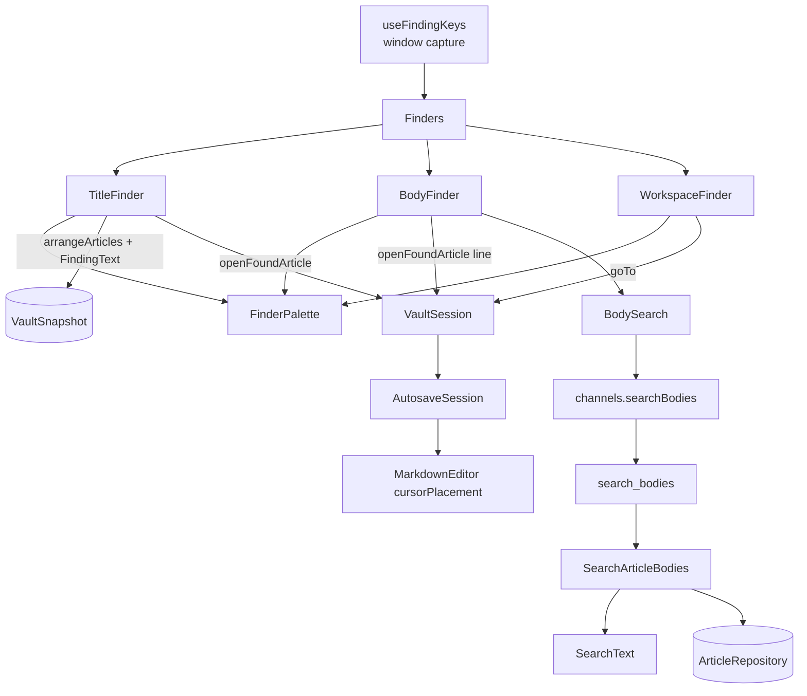

# Find Articles by Title and Body — Architecture Design

**Status:** Confirmed (decided autonomously; the user was away — every judgement call is listed in §8)
**Source PRD:** `.sdd/2026-09-08-find-articles-by-title-and-body/PRD.md`
**Tech context:** Tauri 2 · Rust Cargo workspace (domain / application / infrastructure / src-tauri) · TypeScript strict + React + CodeMirror 6 · see `.sdd/PROJECT.md`

---

## 1. Design Goal & Guiding Principle

- **In one sentence:** three keyboard-opened finders — titles (`Cmd+T`), body lines (`Shift+Cmd+F`) and workspaces (`Cmd+P`) — share one overlay and one set of keys, search only the scope the sidebar shows, and land the writer on the article (and, for a body hit, on the line).
- **Guiding principle:** *one owner per rule, and the finders own none of the vault's rules.*
  - The **match rule** ("one contiguous piece, any case, surrounding blanks mean nothing typed") has one owner per language: `SearchText` in the domain for body lines, `FindingText` in the webview for titles and workspace names. Both are tested with the same cases.
  - The **order** stays in `arrangeArticles`. The finders and "go to the newest article" read the *same* `ArticleOrder` the article column draws with, which is lifted from the column's private state to `App` so there is only one.
  - The **scope** stays in `VaultSession`; the finders read the snapshot and call `VaultSession` to move. Going somewhere (`goTo(scope, order)`) is a new verb next to looking (`selectWorkspace` / `selectAllNotes`), which stay untouched.
  - **Keys** have one owner: `FindingKeys` decides which finder a key event means (Cmd only, never Ctrl) and the listener swallows it in the window's capture phase, so it can never reach the editor whatever the editor's keymap grows into.
  - The **overlay behaviour** (typing, IME, ↑/↓ clamp, Enter, Esc, outside click, scroll into view, selection reset) is written once in `FinderPalette`; each finder only supplies rows, a status sentence and what choosing a row does.

---

## 2. Change Scope

| Area | Action | What / Why |
| :--- | :--- | :--- |
| `crates/domain/src/search_text.rs` | **Add** | `SearchText::parse(&str) -> Option<SearchText>` (blank → `None`), `matching_lines(body) -> impl Iterator<Item = BodyLine>`: one line per hit, numbered from 1 like the editor; `BODY_MATCH_LIMIT = 200` |
| `crates/application/src/search_article_bodies.rs` | **Add** | `SearchArticleBodies::execute(&SearchText, &[ArticleLocation]) -> BodySearchResult`: reads the given articles one by one in the given order (the list's order), strips the front matter with `ArticleDocument`, collects at most 200 hits, says whether there were more, skips an unreadable article |
| `src-tauri` | **Add** | channel `searchBodies` → command `search_bodies(text, articles: [{ workspace, fileName }])`; names parsed into `WorkspaceName` / `ArticleFileName` (outside-vault rejected as everywhere) |
| `src/ipc/` | **Add / Modify** | `bodySearch.ts` (`BodySearchResult`, `BodyMatch`), `channels.searchBodies` |
| `src/features/finding/` | **Add** | `FindingText`, `FindingKeys` (+ `FINDING_SHORTCUTS` for the keymap list), `useFindingKeys`, `FinderPalette`, `TitleFinder`, `BodyFinder` (+ `BodySearch`), `WorkspaceFinder`, `Finders` (which one is open) |
| `src/features/vault/VaultSession.ts` | **Modify** | `goTo(scope, order)` (switch scope, open the first article of the list without taking the keyboard, an empty or unreadable one leaves the editor empty); `openFoundArticle(article, cursorLine?)` (open with the keyboard, put the cursor on the line; the already open article only moves its cursor) |
| `src/features/vault/articleArrangement.ts` | **Modify** | `orderArticles(articles, order)` (every article in the list's order, no filter — what the finders list) and `firstArticleIn(articles, order)` ("newest" is the list's first row) |
| `src/features/vault/ArticleColumn.tsx` | **Modify** | the order becomes a controlled prop (`order`, `onOrderChange`) so `App` owns the one order |
| `src/features/autosave/AutosaveSession.ts`, `AutosavedEditor.tsx` | **Modify** | `OpenedArticle.cursorLine`, `placeCursor(line)`, `cursorPlacement` published next to `document` |
| `src/features/editor/MarkdownEditor.tsx` | **Modify** | `cursorPlacement?: { line, sequence }`: puts the cursor at the start of that body line (clamped to the last line), scrolls it into view, focuses |
| `src/features/interfaceLanguage/messages.ts` | **Modify** | finder labels, empty / too many / failure sentences, the 「尋找 / Finding」 group and its three rows, both catalogs |
| `src/app/App.tsx`, `app.css` | **Modify** | owns `articleOrder`; renders `Finders`; overlay styles |
| Article filter field, sidebar clicks | **Not touched** | the PRD keeps looking (filter, clicking the sidebar) exactly as it is |
| Keymap overview in settings | **Not touched (absent)** | the keymap overview is not on `main` yet; this slice exports `FINDING_SHORTCUTS` and its catalog sentences so that list can add the 「尋找」 group in one line (see §8) |
| `ArticleRepository` / infrastructure | **Not touched** | reading many articles is many `read` calls on the existing repository; vault confinement comes for free |

---

## 3. New Classes / Modules

| Name | Kind | Responsibility (purpose) | Collaborators | Satisfies (PRD scenario) |
| :--- | :--- | :--- | :--- | :--- |
| `SearchText` (domain) | Value type | the body match rule: trimmed, case-insensitive, contiguous; yields each matching body line once with its 1-based number | — | US-03 one row per hit, several hits; US-04 all |
| `BodyLine` (domain) | Value | a line number and the line's text | — | US-03 row shows line + text |
| `ArticleLocation` (application, next to the use case) | Value | which article to search: `WorkspaceName` + `ArticleFileName` (only the search takes a list of them, so it stays with its use case) | — | US-03 scope / order |
| `SearchArticleBodies` (application) | Use case | search the given articles' saved bodies in the given order, cap at 200, report truncation, skip unreadable ones | `ArticleRepository`, `ArticleDocument`, `SearchText` | US-03 limit, exactly 200, unsaved text not found, scope, order; PRD §4 one unreadable article |
| `FindingText` (webview) | Value class | the title / workspace match rule, same as `SearchText` | — | US-02 all; US-05 filter by name |
| `FindingKeys` (webview) | Value module | which finder a key event opens: `Cmd+T`, `Shift+Cmd+F`, `Cmd+P`; never with Ctrl or Alt; `FINDING_SHORTCUTS` names them for the keymap list | — | US-06 Ctrl stays with the machine; US-07 |
| `useFindingKeys` | Hook | window capture-phase listener: swallow a finder key (`preventDefault` + `stopPropagation`) before the editor sees it, then report it; ignores keys the input method owns | `CompositionState`, `FindingKeys` | US-06 key never reaches the editor; Vim |
| `FinderPalette` | Component | the one overlay: field (IME-aware, reports composition), rows, ↑/↓ clamped, Enter chooses (nothing when no rows), Esc / outside click dismisses, selection back to the first row when rows change, selected row scrolled into view | `CompositionState` | US-06 all list keys, IME scenarios |
| `TitleFinder` | Component | rows = `arrangeArticles` of the scope matched by `FindingText` on titles; workspace shown under All Notes; empty-scope / no-match sentences | `FinderPalette`, `FindingText` | US-01, US-02 |
| `BodySearch` | Class | runs `searchBodies` for the latest committed text after a 150 ms composition-aware pause; drops answers to older texts; keeps the previous rows while searching | `channels.searchBodies`, `CompositionAwareDebouncer` | US-03 fast typing, no waiting state |
| `BodyFinder` | Component | rows = body hits (title from the scope's summaries, line number, one-line text); prompt / no-match / too-many / failure sentences | `FinderPalette`, `BodySearch` | US-03 |
| `WorkspaceFinder` | Component | rows = 所有文章 first, then workspaces in sidebar order with article counts, filtered by `FindingText`; empty-vault and no-match sentences | `FinderPalette`, `FindingText` | US-05 |
| `Finders` | Component | which finder is open (at most one); the same key closes it, another key swaps it with an empty field; no scope → title/body do not open; restores focus on dismiss | `useFindingKeys`, `VaultSession` | US-06 toggle, swap, empty again; US-01/03 no scope |

---

## 4. Modified Components

| Component | Current role | Change needed |
| :--- | :--- | :--- |
| `VaultSession` | owns scope, selection, lists | `goTo(scope, order)` reuse `#openScope`, then open `firstArticleIn(articles, order)` without focus; on read failure clear the selection and the body failure so the editor stays empty; `openFoundArticle` opens with `focusEditor` and `cursorLine`, or asks the holder to `placeCursor` when it is already open |
| `ArticleHolder` | `openArticle` / `closeArticle` | adds `placeCursor(line)` |
| `AutosaveSession` | owns the open article and the editor document | `cursorPlacement: { line, sequence } \| null`, set by `openArticle({ cursorLine })` and `placeCursor(line)` |
| `MarkdownEditor` | one `EditorView` | applies a new `cursorPlacement` once the document it belongs to is shown (also after a deferred show during composition) |
| `ArticleColumn` | owns filter text and order | order becomes a prop; filter text stays private |
| `arrangeArticles` module | sorts and filters rows | adds `orderArticles` and `firstArticleIn` |

---

## 5. Component Relationships

---

## 6. Extensibility & Handoff Notes

- **Most likely next requirement:** another finder (headings in the open article, tags, backlinks), or the keymap overview listing these keys.
- **Where it lands:** a new finder = one `FinderKind`, one `FINDING_SHORTCUTS` entry and one component that hands rows to `FinderPalette`. The palette never learns what a row means.
- **Keymap overview:** render `FINDING_SHORTCUTS` under `messages.findingShortcutGroup`; labels are the fixed strings `Cmd+T`, `Shift+Cmd+F`, `Cmd+P` (not in the catalog, the PRD keeps key names out of it).
- **Replacing in results / regex:** belongs to `SearchText` (domain) — callers only see `matching_lines`.
- **Do not hardcode:** the order (always `arrangeArticles` with the app's `ArticleOrder`), the limit (`BODY_MATCH_LIMIT`, read by the webview from `isTruncated`, never re-counted).
- **Known debt:** the body search reads files sequentially per request; fine for the 500-article target. An index is the next step if it becomes slow.

---

## 7. Traceability

| PRD Scenario | Fulfilled by |
| :--- | :--- |
| US-01 打字之後只留下標題對上的文章 / 別的 workspace 的文章不會出現 | `TitleFinder` (scope = `snapshot.articles`) + `FindingText` |
| US-01 選著「所有文章」時整個 vault / 選著某個 workspace 時不標 | `TitleFinder` (`showsAllNotes`) |
| US-01 還沒打字時列出全部，順序與文章清單相同，第一列選著 | `TitleFinder` + `arrangeArticles` with the app order + `FinderPalette` |
| US-01 一篇都對不上 / 範圍是空的 workspace | `TitleFinder` sentences |
| US-01 沒有範圍時清單不開 | `Finders` |
| US-01 選一列就開那篇文章 | `VaultSession.openFoundArticle` |
| US-02 all | `FindingText` |
| US-03 一次命中一列 / 多處各自一列 / 同一行兩次一列 | `SearchText::matching_lines` + `BodyFinder` row |
| US-03 選一列就落在那一行 | `openFoundArticle(article, line)` → `AutosaveSession.cursorPlacement` → `MarkdownEditor` |
| US-03 別的 workspace 不出現 / 所有文章 / 依文章清單順序 | `BodyFinder` passes the scope's articles in `arrangeArticles` order; `SearchArticleBodies` keeps it |
| US-03 還沒打字 / 對不上 / 太多 / 剛好 200 | `BodyFinder` + `SearchArticleBodies` (`is_truncated`) |
| US-03 還沒存進檔案的字搜不到 | `SearchArticleBodies` reads files through `ArticleRepository` |
| US-03 沒有範圍時清單不開 | `Finders` |
| US-04 all | `SearchText` (body only via `ArticleDocument::into_body`) |
| US-05 列出 / 過濾 / 對不上 / 沒有 workspace | `WorkspaceFinder` |
| US-05 選一個就換過去並停在最新那一篇 / 第一列那一篇 / 空 / 讀不出來 / 所有文章 | `VaultSession.goTo(scope, order)` + `firstArticleIn` |
| US-05 點側邊欄仍然只是看 | `selectWorkspace` unchanged |
| US-05 換完之後範圍跟著換 | scope lives in `VaultSession`; finders read the snapshot |
| US-06 上下 / 頭尾 / 打字回第一列 / 離開 / 沒有列按確認 / 組字 | `FinderPalette` |
| US-06 同一個鍵再按 / 換清單 / 換清單與重開時打字框是空的 | `Finders` (remounts the palette per opening) |
| US-06 開啟鍵不傳到寫作區 / 控制鍵留給機器 | `useFindingKeys` + `FindingKeys` |
| US-06 Vim 模式 | `useFindingKeys` capture phase; the field is a plain input (Vim mode is not on `main`, see §8) |
| US-07 all | `FINDING_SHORTCUTS` + catalog sentences (rendering waits for the keymap overview, see §8) |

---

## 8. Risks & Open Decisions

Decisions taken without the user (also listed in the PR):

1. **Scope ignores the sidebar status/tag filter and the article filter text.** The PRD defines the scope as "the workspace or 所有文章 the sidebar has selected"; the filters are ways of *looking* and stay out.
2. **Order:** the article column's order (default 最新建立) is lifted to `App`, so "same order as the list" and "the list's first row" stay true even after the writer changes the order.
3. **Keyboard after choosing:** a title or body row hands the keyboard to the editor (the writer named that article, and the line cursor is useless without focus). The workspace finder never does (PRD). Esc / outside click / the same key again put focus back where it was.
4. **Body search request:** the webview sends the scope's article locations in list order; the backend never lists the scope itself, so the order has one owner and a search can stop after 201 hits.
5. **A body hit in the already open article** only moves the cursor (no reload; unsaved text is kept). Line numbers come from the saved file, so with unsaved edits the cursor can land on a shifted line — accepted, as the PRD defines the search over saved content; a line past the end lands on the last line.
6. **Composition:** the field reports its composition to the shared `CompositionState` (like every text field); the committed text is what the finders read. The body search waits 150 ms after typing (as the filter field does).
7. **Keymap overview and Vim mode are not on `main`.** US-07 rows cannot be drawn yet; the slice ships `FINDING_SHORTCUTS` and the catalog sentences. The Vim scenario is satisfied by construction (capture-phase listener before any editor handler, plain input field) and tested against the plain editor.
8. **Ctrl:** only `metaKey && !ctrlKey && !altKey` count.
9. **Whole search failure** ("這次找不動") is shown when the `searchBodies` channel fails; the title finder never fails (its data is already on screen), so it does not show that sentence.
10. **Enter on an empty list** reaches the finder with an index past the rows; each finder ignores an index it has no row for, so the palette needs no second guard.
