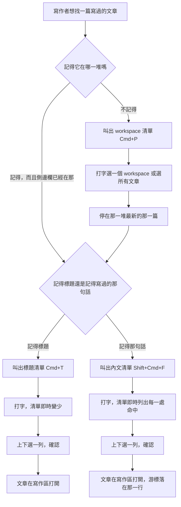

# 用標題找、用內文找 — Product Requirements Document

- **切片**：`feature/find-articles-by-title-and-body`
- **日期**：2026-09-08
- **上游**：[BRIEF.md](BRIEF.md)
- **狀態**：驗收標準已定案，可進 `/architecture`

---

## 1. Background & Goal

### Problem Statement

寫作者今天沒有辦法把寫過的東西找回來。

1. **正文完全找不回來。** 文章清單上方的篩選框只比對標題與標籤。寫在正文裡的那句話——那句寫作者記得自己寫過、卻記不得寫在哪一篇的話——今天沒有任何入口。
2. **找之前得先知道答案。** 篩選框只narrow 眼前那一份清單，所以寫作者必須先在側邊欄點對那個 workspace。要是記不得那篇文章屬於哪一堆，就只能一個一個 workspace 點過去。
3. **換那一堆文章只能用滑鼠。** 側邊欄的 workspace 列表只有點得到，沒有鍵盤走的路。這個產品主張鍵盤行為可預期，而每天最常做的一個切換卻要求手離開鍵盤。

### Expected Outcome

- 寫作者按一個鍵就能**用標題找到文章**，按另一個鍵就能**用正文的一句話找到那一行**。
- 找到的內文，**選下去就落在那一行**，不是把文章丟在寫作者面前叫他自己找。
- **換到另一堆文章不必碰滑鼠**，因此「找的範圍」是寫作者隨時控制得住的事。
- 這三個鍵**在設定裡查得到**，所以寫作者不必靠記憶。
- **既有的鍵一個都不動**：擴大選取仍是 `Cmd+W`，關閉視窗仍是 `Shift+Cmd+W`，篩選框照舊。

### Out of Scope

- 取代文章清單上方的篩選框。它繼續比對標題與標籤，narrow 眼前那份清單。
- 在搜尋結果裡取代文字。只找，不改。
- 正規表示式、萬用字元、大小寫敏感開關。比對規則只有一條。
- 字母打散也算的比對方式。
- 記住最近搜過什麼，或把常去的文章排前面。
- 搜圖片、搜檔名、搜檔頭那些設定欄位。
- 一次搜多個 vault。這個產品只有一個 vault。
- 在換 workspace 的清單裡順便建立新的 workspace。
- 讓這三個鍵在設定檔裡改成別的鍵。
- 雙向連結與 backlink。

---

## 2. User Personas

| Persona | 描述 | 這個切片對他的意義 |
| :--- | :--- | :--- |
| **累積了幾百篇的寫作者** | 寫了兩三年，記得寫過那句話，記不得寫在哪 | 第一次有辦法從一句話回到那一行 |
| **同時經營幾個題目的人** | vault 底下五六個 workspace，一天換好幾次 | 換那一堆文章不必碰滑鼠，換完立刻就能找 |
| **開著 Vim 的長文寫作者** | 手幾乎不離開主鍵盤區 | 三個鍵都在鍵盤上；打字框裡是普通打字，Vim 不干擾 |
| **用中文寫作的人** | 幾乎每一句都經過輸入法 | 選字中清單不動；比對規則是整串連續，不是字母打散（後者對中文無用） |

---

## 3. User Stories & Acceptance Criteria

### US-01 — 用標題找文章 [priority: P0]

> 身為寫作者，我想按一個鍵叫出一份可以打字過濾的標題清單，這樣我想到標題就能立刻回到那篇文章。

```gherkin
Scenario: 打字之後只留下標題對上的文章
  Given 側邊欄選著「日記」
    And 「日記」裡有〈今天很累〉與〈昨天下雨〉
  When 寫作者叫出標題清單並打「累」
  Then 清單上只有〈今天很累〉一列

Scenario: 別的 workspace 的文章不會出現
  Given 側邊欄選著「日記」，裡面有〈今天很累〉
    And 另一個 workspace「工作」裡有〈很累的會議〉
  When 寫作者叫出標題清單並打「累」
  Then 清單上只有〈今天很累〉一列
    And 〈很累的會議〉不在清單上

Scenario: 選著「所有文章」時整個 vault 都在範圍內
  Given 側邊欄選著「所有文章」
    And 「日記」裡有〈今天很累〉，「工作」裡有〈很累的會議〉
  When 寫作者叫出標題清單並打「累」
  Then 兩篇都在清單上
    And 每一列都標明它來自哪個 workspace

Scenario: 選著某個 workspace 時每一列不標 workspace
  Given 側邊欄選著「日記」，裡面有〈今天很累〉
  When 寫作者叫出標題清單並打「累」
  Then 〈今天很累〉那一列不標任何 workspace 名稱

Scenario: 還沒打字時列出範圍內全部文章
  Given 側邊欄選著「日記」，裡面有 3 篇文章
  When 寫作者叫出標題清單，還沒打任何字
  Then 3 篇全部在清單上
    And 順序與文章清單相同，最新建立的在最上面
    And 第一列是選著的那一列

Scenario: 一篇都對不上時說出來
  Given 側邊欄選著「日記」，裡面 3 篇標題都沒有「貓」
  When 寫作者叫出標題清單並打「貓」
  Then 清單上一列都沒有
    And 畫面顯示「沒有符合的文章」

Scenario: 沒有範圍時清單不開
  Given 側邊欄還沒選任何 workspace，也沒有選「所有文章」
  When 寫作者按下叫出標題清單的鍵
  Then 標題清單沒有出現

Scenario: 範圍是空的 workspace
  Given 側邊欄選著「日記」，裡面一篇文章都沒有
  When 寫作者叫出標題清單，還沒打任何字
  Then 清單上一列都沒有
    And 畫面顯示「這個 workspace 還沒有文章」

Scenario: 選一列就開那篇文章
  Given 標題清單上選著〈今天很累〉
  When 寫作者按下確認
  Then 〈今天很累〉在寫作區打開
    And 標題清單關閉
```

### US-02 — 標題怎麼算對上 [priority: P0]

> 身為寫作者，我想只要打出標題裡連續的一小段就找到那篇文章，而且不必管大小寫，這樣我不必記得標題的完整寫法。

```gherkin
Scenario: 不分大小寫
  Given 範圍內有一篇〈Input Method 筆記〉
  When 寫作者在標題清單打「input」
  Then 〈Input Method 筆記〉在清單上

Scenario: 打散的字母不算對上
  Given 範圍內有一篇〈Input Method 筆記〉
  When 寫作者在標題清單打「inpmet」
  Then 清單上一列都沒有

Scenario: 只比標題，不比標籤
  Given 範圍內有一篇〈Input Method 筆記〉，它沒有任何標籤
    And 範圍內另有一篇〈組字紀錄〉，它的標籤是「input」
  When 寫作者在標題清單打「input」
  Then 清單上只有〈Input Method 筆記〉一列

Scenario: 只打空白等於沒打字
  Given 側邊欄選著「日記」，裡面有 3 篇文章
  When 寫作者在標題清單打三個空白
  Then 3 篇全部在清單上

Scenario: 中間的空白照樣比對
  Given 範圍內有一篇〈Input Method 筆記〉
  When 寫作者在標題清單打「input method」
  Then 〈Input Method 筆記〉在清單上
```

### US-03 — 用正文找到那一行 [priority: P0]

> 身為寫作者，我想按一個鍵叫出一份可以打字搜正文的清單，並且選下去就落在那一行，這樣我記得寫過的那句話就找得回來。

```gherkin
Scenario: 一次命中就是一列，說得出哪一篇第幾行
  Given 側邊欄選著「日記」
    And 「日記」裡〈今天很累〉的第 3 行寫著「今天加班到很晚」
  When 寫作者叫出內文清單並打「加班」
  Then 清單上有一列
    And 那一列寫著〈今天很累〉、第 3 行、以及「今天加班到很晚」這行文字

Scenario: 同一篇的多處各自一列
  Given 「日記」裡〈今天很累〉的第 3、7、12 行都寫著「加班」
  When 寫作者叫出內文清單並打「加班」
  Then 清單上有三列
    And 三列分別標第 3 行、第 7 行、第 12 行
    And 三列由上到下依行號遞增

Scenario: 選一列就落在那一行
  Given 內文清單上選著〈今天很累〉第 7 行那一列
  When 寫作者按下確認
  Then 〈今天很累〉在寫作區打開
    And 游標落在第 7 行
    And 內文清單關閉

Scenario: 別的 workspace 的正文不會出現
  Given 側邊欄選著「日記」，裡面有一篇正文寫著「加班」
    And 另一個 workspace「工作」裡也有一篇正文寫著「加班」
  When 寫作者叫出內文清單並打「加班」
  Then 清單上只有「日記」那一篇的那一列

Scenario: 選著「所有文章」時整個 vault 都在範圍內
  Given 側邊欄選著「所有文章」
    And 「日記」與「工作」各有一篇正文寫著「加班」
  When 寫作者叫出內文清單並打「加班」
  Then 兩處都在清單上
    And 每一列都標明它來自哪個 workspace

Scenario: 還沒打字時一列都不列
  Given 側邊欄選著「日記」，裡面有 3 篇文章
  When 寫作者叫出內文清單，還沒打任何字
  Then 清單上一列都沒有
    And 畫面顯示「打字開始搜尋正文」

Scenario: 一處都對不上時說出來
  Given 範圍內沒有任何正文寫著「貓」
  When 寫作者叫出內文清單並打「貓」
  Then 清單上一列都沒有
    And 畫面顯示「沒有符合的內容」

Scenario: 符合的太多時只列前面一批並且說出來
  Given 範圍內有 500 處寫著「的」
  When 寫作者叫出內文清單並打「的」
  Then 清單上有 200 列
    And 畫面顯示「符合的內容太多，請再多打幾個字」

Scenario: 剛好等於上限時不說太多
  Given 範圍內有 200 處寫著「的」
  When 寫作者叫出內文清單並打「的」
  Then 清單上有 200 列
    And 畫面沒有顯示「符合的內容太多」

Scenario: 還沒存進檔案的字搜不到
  Given 寫作者剛在〈今天很累〉打了「加班」，這篇還沒存進檔案
    And 「日記」裡沒有任何檔案寫著「加班」
  When 寫作者叫出內文清單並打「加班」
  Then 清單上一列都沒有

Scenario: 沒有範圍時清單不開
  Given 側邊欄還沒選任何 workspace，也沒有選「所有文章」
  When 寫作者按下叫出內文清單的鍵
  Then 內文清單沒有出現

Scenario: 多篇命中時依文章清單的順序
  Given 「日記」裡〈昨天下雨〉比〈今天很累〉早建立
    And 兩篇的正文都寫著「加班」
  When 寫作者叫出內文清單並打「加班」
  Then 〈今天很累〉那一列排在〈昨天下雨〉那一列之前
```

### US-04 — 正文怎麼算對上 [priority: P0]

> 身為寫作者，我想用和標題一樣的比對規則搜正文，並且確定它只搜我寫的那些字、不搜檔頭那些設定，這樣我只要學一套規則。

```gherkin
Scenario: 不分大小寫
  Given 範圍內某篇文章的正文有一行寫著「使用 Input Method」
  When 寫作者在內文清單打「input method」
  Then 那一行在清單上

Scenario: 打散的字母不算對上
  Given 範圍內某篇文章的正文有一行寫著「使用 Input Method」
  When 寫作者在內文清單打「inpmet」
  Then 清單上一列都沒有

Scenario: 檔頭那些設定不搜
  Given 範圍內某篇文章的標題寫著「加班」
    And 這篇文章的正文一個「加班」都沒有
  When 寫作者在內文清單打「加班」
  Then 清單上一列都沒有

Scenario: 只打空白等於沒打字
  Given 範圍內有文章
  When 寫作者在內文清單打三個空白
  Then 清單上一列都沒有

Scenario: 同一行出現兩次只算一列
  Given 範圍內某篇文章的第 4 行寫著「加班又加班」
  When 寫作者在內文清單打「加班」
  Then 清單上只有一列，標的是第 4 行
```

### US-05 — 換 workspace [priority: P0]

> 身為寫作者，我想按一個鍵叫出 workspace 清單並打字選一個，這樣我要換另一堆文章來找的時候手不必離開鍵盤。

```gherkin
Scenario: 列出所有 workspace 與「所有文章」
  Given vault 底下有「日記」「工作」「食譜」
  When 寫作者叫出 workspace 清單，還沒打任何字
  Then 清單上有「日記」「工作」「食譜」
    And 清單上另有「所有文章」一列

Scenario: 打字過濾 workspace 名稱
  Given vault 底下有「日記」「工作」「食譜」
  When 寫作者叫出 workspace 清單並打「工」
  Then 清單上只有「工作」一列

Scenario: 選一個就換過去，並停在那一堆最新的那一篇
  Given workspace 清單上選著「工作」
    And 「工作」裡最新的一篇是〈很累的會議〉
  When 寫作者按下確認
  Then 側邊欄選著「工作」
    And 文章清單換成「工作」的文章
    And 〈很累的會議〉在寫作區打開
    And workspace 清單關閉

Scenario: 停的那一篇就是文章清單第一列那一篇
  Given 「工作」裡有〈很累的會議〉（最新）與兩篇更早建立的
  When 寫作者用 workspace 清單選「工作」
  Then 寫作區打開的是〈很累的會議〉

Scenario: 那一堆一篇文章都沒有
  Given 「食譜」裡一篇文章都沒有
  When 寫作者用 workspace 清單選「食譜」
  Then 側邊欄選著「食譜」
    And 寫作區沒有任何文章

Scenario: 最新那一篇讀不出來
  Given 「工作」裡最新那一篇的檔案讀不出來
  When 寫作者用 workspace 清單選「工作」
  Then 側邊欄仍然選著「工作」
    And 寫作區沒有任何文章

Scenario: 點側邊欄的 workspace 仍然只是看
  Given 側邊欄上有「工作」這一列
  When 寫作者用滑鼠點它
  Then 文章清單換成「工作」的文章
    And 寫作區沒有任何文章

Scenario: 換完之後找的範圍跟著換
  Given 寫作者剛用 workspace 清單換到「工作」
  When 寫作者叫出標題清單並打字
  Then 只有「工作」的文章會出現

Scenario: 選「所有文章」就跨整個 vault，並停在整個 vault 最新的那一篇
  Given workspace 清單上選著「所有文章」
    And 整個 vault 裡最新的一篇是「工作」的〈很累的會議〉
  When 寫作者按下確認
  Then 側邊欄選著「所有文章」
    And 〈很累的會議〉在寫作區打開
    And 之後叫出的標題清單與內文清單都涵蓋整個 vault

Scenario: vault 裡一個 workspace 都沒有
  Given vault 底下一個 workspace 都沒有
  When 寫作者叫出 workspace 清單
  Then 清單上只有「所有文章」一列
    And 畫面顯示「還沒有 workspace」

Scenario: 名稱一個都對不上
  Given vault 底下有「日記」「工作」「食譜」
  When 寫作者叫出 workspace 清單並打「貓」
  Then 清單上一列都沒有
    And 畫面顯示「沒有符合的 workspace」
```

### US-06 — 三個清單一套操作 [priority: P0]

> 身為寫作者，我想這三個清單的操作方式完全一樣，這樣我只要學一次。

```gherkin
Scenario: 上下移動選取
  Given 清單上有 5 列，選著第 1 列
  When 寫作者按下兩次「往下」
  Then 選著第 3 列

Scenario: 選取停在最後一列
  Given 清單上有 5 列，選著第 5 列
  When 寫作者按下「往下」
  Then 仍然選著第 5 列

Scenario: 選取停在第一列
  Given 清單上有 5 列，選著第 1 列
  When 寫作者按下「往上」
  Then 仍然選著第 1 列

Scenario: 打字之後選取回到第一列
  Given 清單上有 5 列，選著第 4 列
  When 寫作者多打一個字，清單剩下 3 列
  Then 選著第 1 列

Scenario: 離開不改變任何東西
  Given 標題清單開著，打字框裡有「累」
    And 寫作區開著〈昨天下雨〉
  When 寫作者按下離開
  Then 標題清單關閉
    And 寫作區仍然開著〈昨天下雨〉
    And 側邊欄選的東西沒有改變

Scenario: 同一個鍵再按一次就關閉
  Given 標題清單開著
  When 寫作者再按一次叫出標題清單的鍵
  Then 標題清單關閉

Scenario: 打開另一個清單會換掉現在這個
  Given 標題清單開著
  When 寫作者按下叫出內文清單的鍵
  Then 內文清單開著
    And 標題清單不在畫面上

Scenario: 換清單時打字框是空的
  Given 標題清單開著，打字框裡有「累」
  When 寫作者按下叫出內文清單的鍵
  Then 內文清單的打字框是空的

Scenario: 重新打開時打字框是空的
  Given 寫作者剛在標題清單打了「累」並離開
  When 寫作者再叫出標題清單
  Then 打字框是空的
    And 範圍內全部文章都在清單上

Scenario: 輸入法選字中清單不動
  Given 內文清單開著，清單上有 2 列
    And 寫作者正在用輸入法打「加班」，還在選字
  When 選字還沒結束
  Then 清單仍然是那 2 列

Scenario: 選完字清單才更新
  Given 內文清單開著
    And 寫作者用輸入法打「加班」
  When 寫作者選完字
  Then 清單換成「加班」的結果

Scenario: 一列都沒有的時候按確認什麼都不發生
  Given 標題清單開著，清單上一列都沒有
  When 寫作者按下確認
  Then 標題清單仍然開著
    And 寫作區開的還是原來那篇文章

Scenario: 按下開啟鍵時寫作區不會跟著動作
  Given 寫作區開著〈今天很累〉，游標在寫作區
  When 寫作者按下叫出 workspace 清單的鍵
  Then workspace 清單開著
    And 這次按鍵完全沒有傳到寫作區
    And 〈今天很累〉的內容一個字都沒有改變

Scenario: 按著控制鍵的同一個字母留給這台機器
  Given 寫作區開著〈今天很累〉，游標在寫作區
    And 這台機器上「控制鍵加 P」是「上一行」，寫作區也實作了它
  When 寫作者按下「控制鍵加 P」
  Then 沒有任何清單開啟
    And 這次按鍵照樣傳到寫作區

Scenario: Vim 模式下照樣打開，打字框裡是普通打字
  Given Vim 模式開著
    And 游標在寫作區，處於常態模式
  When 寫作者按下叫出標題清單的鍵並打「累」
  Then 標題清單開著
    And 打字框裡有「累」這個字
    And 寫作區的內容沒有被改動
```

### US-07 — 這三個鍵查得到 [priority: P1]

> 身為寫作者，我想在設定裡查得到這三個鍵，這樣我忘記的時候有地方問。

```gherkin
Scenario: 三個鍵都在快捷鍵清單上
  Given 設定裡的快捷鍵清單開著
  When 寫作者看畫面
  Then 有一列說明「用標題找文章」，鍵寫成「Cmd+T」
    And 有一列說明「用內文找文章」，鍵寫成「Shift+Cmd+F」
    And 有一列說明「切換 workspace」，鍵寫成「Cmd+P」

Scenario: 三列在同一組底下
  Given 設定裡的快捷鍵清單開著
  When 寫作者看分組
  Then 有一組叫「尋找」
    And 那三列都在這一組底下

Scenario: 既有的列一個都沒變
  Given 設定裡的快捷鍵清單開著
  When 寫作者找「逐層擴大選取」與「關閉視窗」
  Then 「逐層擴大選取」的鍵仍然是「Cmd+W」
    And 「關閉視窗」的鍵仍然是「Shift+Cmd+W」
```

---

## 4. Business Flow & Logic

### 主流程



### 核心規則

| 規則 | 內容 |
| :--- | :--- |
| **範圍規則** | 找的範圍永遠等於側邊欄現在選的那一個。選著某個 workspace 就只找它；選著「所有文章」就找整個 vault；什麼都沒選就不開清單 |
| **選一堆就停在最新那一篇規則** | 從 workspace 清單選一列（含「所有文章」），**那一堆裡最新的那一篇就打開**。「最新」不另訂，就是文章清單第一列那一篇——順序只有一個住所。那一堆是空的、或那一篇讀不出來，就只換範圍、寫作區留白。**這一步不主動要鍵盤**：寫作者選的是一個地方，那篇文章是這個 App 的建議 |
| **點側邊欄仍然只是看** | 用滑鼠點側邊欄的 workspace 或「所有文章」，**行為一個字都不改**：換清單、清空寫作區。點是「看那一堆」，從清單選是「去那一堆」，兩者結果本就該不同 |
| **來源標示規則** | 只有在範圍是整個 vault 的時候，每一列才標明它來自哪個 workspace。範圍只有一個 workspace 時標出來是多餘的雜訊 |
| **比對規則** | 整串連續、不分大小寫。標題與正文同一套。前後空白視為沒打字，字串中間的空白照樣比對 |
| **正文範圍規則** | 只比對正文。檔頭那些設定欄位（標題、標籤、狀態、時間）一律不比對 |
| **一行一列規則** | 內文清單的一列等於「一篇文章的一行」。同一行出現幾次都只算一列；不同行各自一列 |
| **行號規則** | 行號從正文的第一行算起，第一行是第 1 行。這與寫作區看到的行號是同一套算法 |
| **順序規則** | 標題清單依文章清單的順序（最新建立的在最上面）。內文清單先依同一個文章順序，同一篇之內依行號遞增。workspace 清單依側邊欄的順序，「所有文章」永遠在最上面 |
| **上限規則** | 內文清單最多列 200 列。**超過**才顯示「太多了」；剛好 200 不顯示 |
| **新鮮度規則** | 正文搜的是檔案裡現在存著的內容。剛打下去、還沒存進檔案的字搜不到 |
| **選取重置規則** | 打字讓清單改變時，選取回到第一列 |
| **狀態不留規則** | 清單關閉就把打字框清空。下一次打開一律是空的 |
| **獨佔規則** | 三個清單同時最多只有一個在畫面上。打開一個會關掉另一個 |
| **組字規則** | 輸入法選字中清單不動，選完字才更新 |
| **不動既有鍵規則** | `Cmd+W`（逐層擴大選取）、`Shift+Cmd+W`（關閉視窗）、以及其他既有快捷鍵，一個字都不改 |
| **按鍵到此為止規則** | 三個開啟鍵**在寫作區之前就被答掉，按下去不會再落到寫作區**。定鍵過程中曾經選過 `Shift+Cmd+K`，而寫作區用那個組合刪掉整行——一次按鍵會同時叫出清單並刪掉一行字。那個鍵換掉了，規則留著：寫作區的按鍵表將來會長 |
| **只認命令鍵規則** | 按著**控制鍵**的同一個字母**不算**這三個鍵。這台機器上控制鍵不是空的（`Ctrl+P` 上一行、`Ctrl+T` 兩字互換、`Ctrl+A`／`Ctrl+E` 行首行尾），寫作者是帶著這些來的，寫作區也實作了它們；而被宣告的按鍵會整個被攔掉，所以「兩個鍵都算」等於默默把那些習慣拿走 |

### 邊界與失敗

| 情況 | 行為 |
| :--- | :--- |
| 範圍裡一篇文章都沒有 | 標題清單顯示「這個 workspace 還沒有文章」；內文清單照舊請寫作者打字 |
| vault 裡一個 workspace 都沒有 | workspace 清單只列「所有文章」，並顯示「還沒有 workspace」 |
| 某篇文章讀不出來（檔案在搜的當下被刪、權限不足） | **跳過那一篇，其餘照樣列出。** 一篇讀不出來不該讓整次搜尋沒有答案 |
| 整次搜尋失敗 | 清單上一列都沒有，畫面顯示「這次找不動，請再試一次」 |
| 選中的文章在確認的那一刻已經不在了 | 照現有「打開一篇不存在的文章」的行為處理，這個切片不另立規則 |
| 內文清單選中的行號已經超出現在的正文長度（檔案在清單開著時被改短） | 打開那篇文章，游標落在最後一行 |
| 寫作者打字很快 | 清單跟著最後打完的那個字，不會被較早的一次搜尋蓋掉 |

---

## 5. UI/UX Design & Interaction

沒有設計稿。以下是這個切片必須成立的互動與畫面狀態。

### 版面

三個清單共用同一種形狀：**蓋在整個畫面上的一層**，內容置中偏上（讓清單往下長的時候不會撐到畫面底）。上面一個打字框，下面一份結果清單。清單長過可視高度時自己捲動，選取移動時捲到看得見。

清單以外的地方按下去就關閉。

### 每一種清單的一列長什麼樣

| 清單 | 一列顯示 |
| :--- | :--- |
| 標題 | 文章標題；範圍是整個 vault 時另標 workspace 名稱 |
| 內文 | 文章標題、行號、那一行的文字；範圍是整個 vault 時另標 workspace 名稱 |
| workspace | workspace 名稱與文章數；「所有文章」那一列顯示整個 vault 的文章數 |

選一列之後，**那一堆最新的那一篇會出現在寫作區**（見 §4 的規則）。點側邊欄則不會。

內文清單那一列的文字**只顯示一行**，過長的一行在尾端截斷（不換行）——一列變成三行會讓清單沒辦法掃。

### 畫面狀態

| 狀態 | 標題清單 | 內文清單 | workspace 清單 |
| :--- | :--- | :--- | :--- |
| 還沒打字 | 列出範圍內全部文章 | 「打字開始搜尋正文」 | 列出全部 workspace 與「所有文章」 |
| 正在找 | （即時，不顯示等待） | 上一次的結果留在畫面上，直到新結果到達 | （即時，不顯示等待） |
| 一列都沒有 | 「沒有符合的文章」 | 「沒有符合的內容」 | 「沒有符合的 workspace」 |
| 範圍是空的 | 「這個 workspace 還沒有文章」 | （照舊請寫作者打字） | 「還沒有 workspace」 |
| 太多了 | — | 「符合的內容太多，請再多打幾個字」 | — |
| 找不動 | 「這次找不動，請再試一次」 | 同左 | — |

**內文清單刻意不顯示轉圈的等待狀態。** 讀幾百個檔案要時間，但每打一個字就閃一次等待畫面，比看到上一次的結果多留一瞬更擾人。

### 按鍵

| 按鍵 | 行為 |
| :--- | :--- |
| `Cmd+T` | 開／關標題清單 |
| `Shift+Cmd+F` | 開／關內文清單 |
| `Cmd+P` | 開／關 workspace 清單 |
| 往下／往上 | 移動選取，停在頭尾 |
| `Enter` | 執行選著的那一列 |
| `Esc` | 關閉，什麼都不改變 |

三個開啟鍵在**任何時候**都成立，包含游標在寫作區、開著 Vim 模式、以及專注模式底下。打字框裡一律是普通打字。

**按下這三個鍵時，按鍵到此為止**——不會再落到寫作區。這是正確性而非效率，理由見 §4 的兩條規則。

**按著控制鍵的同一個字母不是這三個鍵**，留給這台機器自己的編輯習慣。

**清單開著時，`Esc` 只做「關閉清單」這一件事**，不往下傳給寫作區的任何一層（否則按一次 `Esc` 會同時關掉清單又讓 Vim 退回常態模式）。

### 兩種介面語言

新增的文案兩種語言都要有。**「workspace」這個詞兩種語言都不翻**，沿用既有規矩。鍵名（`Cmd+T` 這些）兩種語言完全相同，不進介面文案表。

### 快捷鍵清單

多一組「尋找」／「Finding」，底下三列。放在既有三組之後。**既有三組與其中每一列一個字都不動。**

理由：現有三組是「寫作」「畫面」「視窗」。這三個鍵都不是在寫字、不是在改畫面排法、也不是在管視窗——硬塞進任一組會讓那一組的名字變成謊。多一組是最小的誠實做法。

---

## 6. Non-Functional Requirements

| 面向 | 要求 |
| :--- | :--- |
| **標題與 workspace 的反應** | 即時，無感延遲。這兩份資料畫面上早就有了 |
| **正文搜尋的反應** | 在一個有 500 篇文章的範圍裡，從打完字到看到結果**在一秒之內** |
| **打字期間** | 打字**永遠不卡**。搜尋不得讓打字框漏字或延遲 |
| **記憶體** | 不把整個 vault 的正文長期留在記憶體裡。一次搜尋讀完就放掉 |
| **重複的搜尋** | 寫作者連續打字時，較早那次的結果不得蓋掉較晚那次的 |
| **安全** | 搜尋範圍不得逸出 vault。沿用既有的路徑範圍守門規矩，不另開一條路 |
| **輸入法** | 選字中一律不觸發搜尋。這是這個產品的核心主張 |
| **相容性** | 只出 macOS，沿用既有目標 |
| **埋點** | 無。這個 App 不收任何遙測 |

---

## 7. Dependencies & Risks

### 依賴

- **側邊欄現在選的是什麼**：範圍規則完全建立在它之上。這是既有能力。
- **文章清單的順序**：兩份清單的順序都沿用它，不自己另訂一套。
- **輸入法選字狀態**：既有的共用狀態，三個清單都要問它。
- **讀出一篇文章的正文（檔頭已剝離）**：既有能力。正文搜尋要的是「一次讀很多篇」，這是這個切片要新增的部分。
- **快捷鍵清單**：既有的資料，這個切片往裡面加一組。

### 風險

| 風險 | 影響 | 對策 |
| :--- | :--- | :--- |
| **大 vault 的正文搜尋很慢** | 打「的」的時候畫面卡住 | 上限規則（200 列）；一篇讀不出來就跳過不讓整次失敗；打字期間不阻塞 |
| **新增的三個鍵和既有的鍵撞到** | 寫作者練成的肌肉記憶失效 | 三個鍵都事先確認這個 App 沒有教過；既有鍵一個都不動，並以驗收情境釘住 |
| **新增的鍵撞到寫作區自己的按鍵表** | 一次按鍵同時叫出清單並改了文章——「寫作者沒要求就改了文章」 | 「按鍵到此為止規則」。**測試斷言的是「按鍵完全沒有傳到寫作區」**，而不是「今天那張表剛好不答這個組合」——後者是關於一個依賴的事實，而它在這個切片裡已經變過一次（見 §8.6） |
| **新增的鍵吃掉這台機器的編輯習慣** | `Ctrl+P` 不再是上一行，而寫作者說不出為什麼 | 「只認命令鍵規則」，以驗收情境釘住 |
| **`Esc` 又多了一個工作** | 開著 Vim 的寫作者按 `Esc` 時行為變得不可預期 | 清單開著時 `Esc` 只關清單、不往下傳；清單關著時 `Esc` 的行為與這個切片之前完全相同 |
| **「還沒存進檔案的搜不到」被當成 bug** | 寫作者不理解為什麼剛打的字搜不到 | 這是明說的規則，寫在 PRD 與地圖上。自動儲存的空窗很短 |
| **內文清單的行號與寫作區對不上** | 選了一列卻落在錯的行 | 行號一律從正文第一行算起，與寫作區同一套；並以驗收情境釘住 |

---

## 8. Appendix

### 8.1 這個切片使需求文件的哪一條過期

需求文件現行條文說篩選框比對標題／狀態／標籤，並明說「本版不做全文搜尋」；另一條把全文搜尋列為未決問題，形容成「新定位下最先會痛的缺口」，建議排在同步與雙向連結之前。

**這個切片就是那個問題的答案。** 需求文件為使用者所有，本切片不修改它；此處記錄，待使用者下次改版時併入。

篩選框那一條**沒有過期**——篩選框繼續存在、繼續只比對標題與標籤。過期的是「本版不做全文搜尋」。

### 8.2 換 workspace 那個鍵的來回

使用者最初以為 `Cmd+W` 是切換 workspace，退而提議 `Shift+Cmd+W`。兩個都已經有主人：`Cmd+W` 是逐層擴大選取（已交付並列進快捷鍵清單），`Shift+Cmd+W` 是關閉視窗（也已列進清單，而且是最多人打開那張表的理由）。搶走任一個都是「為了新功能去改一個寫作者已經練成的鍵」。

這個鍵**改過兩次**：`Cmd+K` → `Shift+Cmd+K` → `Cmd+P`。兩次都不是換一個字，兩次都揭出一個會出貨的缺陷。

- **`Shift+Cmd+K`**：寫作區用那個組合刪掉整行，而三個開啟鍵原本在冒泡階段被答——寫作區會先答完。於是生出「按鍵到此為止規則」。
- **`Cmd+P`**：三個鍵原本宣告成「控制鍵或命令鍵都算」，而這台機器上 `Ctrl+P` 是「上一行」。配上前一條規則（被宣告的按鍵整個被攔掉），那等於默默把系統的編輯習慣拿走。於是生出「只認命令鍵規則」。

**這才是兩次改鍵真正的產出**：不是換了組合，而是釘住兩條這個產品本來就該有的規則——這個 App 教的鍵，寫作區不得再答一次；而這個 App 沒打算教的鍵，一個都不要碰。

### 8.3 為什麼「模糊」收斂成整串連續

原始需求同時提到兩種比對方式：字母打散也算（telescope 那一種），以及整串連續（ripgrep 那一種）。使用者選定後者。

理由不只是偏好：**字母打散對中文幾乎沒有意義**。中文沒有可以打散的字母序列，「加班」拆開之後就是兩個獨立的字，任何含這兩個字的行都會對上，噪音遠大於幫助。而這是一個以中文寫作為核心主張的產品。

### 8.4 為什麼內文搜尋不含未存檔的內容

把編輯區的內容和檔案的內容混在一起搜，會讓同一個字有時搜得到、有時搜不到，而寫作者說不出為什麼——因為那取決於他有沒有剛好在自動儲存的空窗裡。

另一條路是「按下搜尋鍵時先存檔再搜」。否決的理由是：那讓一個「找東西」的動作變成一個「改檔案」的動作。找東西不該有副作用。

自動儲存的空窗很短，所以代價很小。這是**明知且接受的取捨**。

### 8.5 為什麼上限是 200 而且要說出來

200 大到日常搜尋碰不到（打三個字幾乎不可能超過），小到畫面不會卡。

**默默截斷是最糟的選項**：寫作者會以為那就是全部，然後相信一個不完整的答案。說出來的成本是一行字，換來的是那份清單值得相信。

### 8.6 那條規則的測試斷言的是什麼

**斷言「按鍵完全沒有傳到寫作區」，而不是「文章剛好沒被改動」。**

後者是關於一個依賴的事實——哪些組合被寫作區的按鍵表回答，是那份表說的，而它在這個切片裡已經變過一次（`Shift+Cmd+K` 會刪行，`Cmd+P` 不會）。以「文章沒變」當判準的測試，會在鍵一改就變成永遠綠的，而它守的正是「寫作者沒要求就改了文章」。

「按鍵沒有傳到」是這個產品自己的承諾，與那份表怎麼長無關。反面那條情境也用同一個判準：控制鍵那一種**照樣傳到**寫作區。

### 8.7 為什麼從清單換過去會開檔，點側邊欄不會

同一個目的地，兩種抵達方式，結果刻意不同。

- **點側邊欄的 workspace 是「看那一堆」。** 看不該替寫作者開檔——他可能只是想瞄一眼有幾篇。
- **用 `Cmd+P` 選一個是「去那一堆」。** 那個鍵存在的理由就是「換到另一堆文章來找」，而換過去之後眼前一片空白，等於還要再點一次才開始。

停在最新那一篇是最省的一步，而且那幾乎總是寫作者要回去的那一篇。

**「最新」刻意不另訂**：就是文章清單第一列那一篇。開了第二列、或開了一篇不是清單頂端的，都是這個部分對「第一」持第二種意見。

**這一步不主動要鍵盤。** 寫作者選的是一個地方，那篇文章是這個 App 的建議；替一篇沒人指名的文章要一個游標，離「寫作者沒要求就改了文章」只差一個按鍵。（編輯區在**第一次出現**時本來就會拿走焦點，那是既有行為，點文章清單的列也一樣——這一步管的是「從一篇換到另一篇」時要不要要。）
