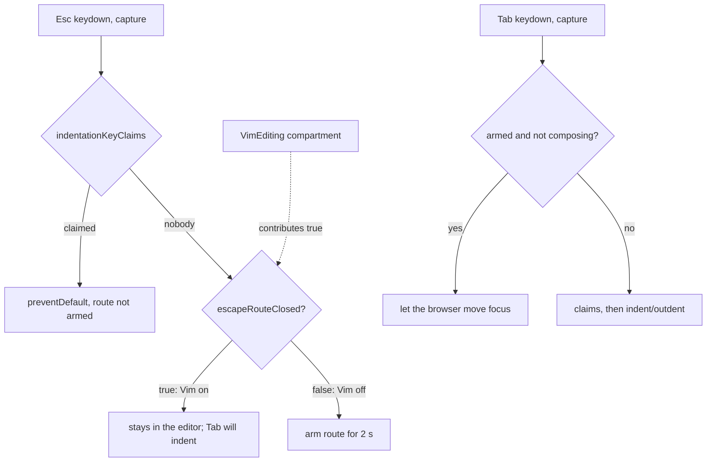

# Vim 模式下 Tab 永遠是縮排 — Architecture Design

**Status:** Confirmed (decided autonomously; the user was away — see §8)
**Source PRD:** `.sdd/2026-09-08-tab-always-indents-in-vim-mode/PRD.md`
**Tech context:** Tauri 2 · TypeScript strict + React + CodeMirror 6 (`@codemirror/view 6.43.15`, `state 6.7.6`) + `@replit/codemirror-vim 6.4.0` · Vitest + happy-dom. Webview only: no Rust, no channel, no setting, no dependency.

---

## 1. Design Goal & Guiding Principle

- **In one sentence:** with Vim off, an Esc nothing claimed arms "the next Tab within two seconds lets the focus leave the editor" (one key wide); with Vim on, that Esc stays in the editor, so Tab always indents.
- **Guiding principle:** *one owner for the Tab key, one switch for the way out.* `TabIndentation` stays the only Tab listener and owns the whole escape route (arming, lapse, disarming). Whether the route is open is a CodeMirror facet, `escapeRouteClosed`, that anything in the editor can contribute to; Vim contributes `true` from inside its existing compartment, so the layer comes and goes with Vim on/off without rebuilding the editor (NFR-01) and without any Vim code inside `TabIndentation`.

### Starting point in this codebase (differs from the PRD's background)

The PRD was written against the Electron app, where the escape route was alive with Vim off *and* in Vim's Normal mode. In this Tauri port the Vim slice removed the route outright (Tab always indents, Vim on or off). So, measured against today's code:

- US-01 (Vim on → Tab always indents) is already true; this slice pins it with tests and keeps it true once the route returns.
- US-02 (Vim off → Esc then Tab moves focus; another key in between disarms) is **missing** and is restored, with the behaviour the route had before it was removed (two-second lapse, one key wide, bare modifiers do not disarm, a mouse press in the editor or focus loss disarms, Esc while composing never arms, Shift+Tab escapes backwards, the escaping Tab is handed past every other Tab binding).
- US-03 (Esc's other rungs unchanged) is already true and pinned.

The later PRD wins over the Vim slice's "the route no longer exists" (its US-06) for Vim off; for Vim on both agree.

---

## 2. Change Scope

| Area | Action | What / Why |
| :--- | :--- | :--- |
| `src/features/editor/TabIndentation.ts` | **Modify** | Restore the escape route in `TabKeyListener`; add the exported facet `escapeRouteClosed` it consults before arming |
| `src/features/vim/VimEditing.ts` | **Modify** | `#vimBand()` contributes `escapeRouteClosed.of(true)`, so it lives in the Vim compartment |
| `src/features/snippets/SnippetExpansion.ts` | **Modify (doc comment only)** | Its comment says an unclaimed Esc is "left to whatever comes next"; it again arms the way out when the route is open |
| `docs/ime-regression-checklist.md` | **Modify** | Snippet item 5 and the Vim steps describe Esc then Tab per Vim on/off |
| `.sdd/PROJECT.md` | **Modify** | "Tab and Esc before indentation" paragraph: the route is back with Vim off; the facet is the seam |
| Keymap overview (`keymapGroups`) | **Not touched** | The route is a keyboard-access affordance, not a key Rustle teaches; the overview never listed it |
| `SnippetExpansion` claims, `VimEditing` Esc handling, `WritingLayout`, dialogs | **Not touched** | US-03 and BR-04: Esc gains no job; a claimed Esc never arms the route (claims run first) |
| Settings / Rust | **Not touched** | NFR-03: no new setting |

---

## 3. New Classes / Modules

| Name | Kind | Responsibility (purpose) | Collaborators | Satisfies (PRD scenario) |
| :--- | :--- | :--- | :--- | :--- |
| `escapeRouteClosed` | CodeMirror `Facet<boolean, boolean>` (combine: any `true`) in `TabIndentation.ts` | Says whether an unclaimed Esc may arm the way out of the editor | `TabKeyListener` reads it; `VimEditing` contributes `true` | US-01 all three; US-02 (absent → open) |

No new class: the route is state of the one Tab listener, and the switch is one facet value.

---

## 4. Modified Components

| Component | Current role | Change needed |
| :--- | :--- | :--- |
| `TabKeyListener` (private to `TabIndentation.ts`) | Tab/Shift+Tab indent/outdent, Esc → claims | An Esc no claim took, not composing, with the route open, arms the route (timestamp). Any other non-modifier key, a mouse press in the editor or focus leaving disarms it. A Tab (or Shift+Tab) within 2000 ms of arming, not composing, is `stopPropagation`ed but not `preventDefault`ed, and uses the route up |
| `VimEditing.#vimBand()` | Vim engine, mode reports, typing scope | Adds `escapeRouteClosed.of(true)` |

---

## 5. Component Relationships

---

## 6. Extensibility & Handoff Notes

- **Most likely next requirement:** a way out of the editor while Vim is on (the PRD names it "another slice, another key"), or another editor mode that also wants Tab to always indent.
- **Where it lands:** another mode contributes `escapeRouteClosed.of(true)` from its own extension — add-only. A dedicated "leave the editor" key is a new `keymap.of` binding (band 1 beats Vim) that calls the browser focus move; it does not touch the route.
- **Patterns applied & why:** a facet instead of a constructor flag, because Vim is switched in place through a compartment; `TabIndentation` is rebuilt only on indentation changes and must not learn about Vim.
- **Do not hardcode:** do not check Vim state (`getCM`, `VimModeSession`) inside `TabIndentation`.
- **Known debt / deferred:** with Vim on, a keyboard-only writer has no Tab way out (accepted by the PRD).

---

## 7. Traceability

| PRD Scenario | Fulfilled by |
| :--- | :--- |
| US-01 常態模式按過 Esc 之後，Tab 仍然縮排 | `VimEditing` contributes `escapeRouteClosed` → `TabKeyListener` never arms |
| US-01 從輸入模式退出來之後，Tab 仍然縮排 | same (route closed regardless of which mode the Esc came from) |
| US-01 沒按過 Esc 時，Tab 照樣縮排 | `TabKeyListener` → `TabIndentation.indent` |
| US-02 沒人要的 Esc 之後，Tab 移動焦點 | `TabKeyListener` escape route (facet absent) |
| US-02 中間按了別的鍵就解除 | `TabKeyListener` disarms on any non-modifier key |
| US-03 片語選單照樣關得掉 | `SnippetExpansion` claim (unchanged) |
| US-03 填空照樣停得掉 | `SnippetExpansion` claim (unchanged) |
| US-03 專注模式照樣不受 Esc 影響 | no Esc listener in `WritingLayout` (unchanged) |
| US-03 輸入模式照樣退得回常態模式 | Vim's own Esc (unchanged; capture listener does not prevent it) |
| Edge: Vim on ↔ off | the facet lives in the Vim compartment, so `switchTo` opens/closes the route immediately |
| Edge: Esc while composing | `CompositionState.ownsKey` → never arms (BR-05) |

---

## 8. Risks & Open Decisions

- **Decisions taken without the user:**
  1. The route restored for Vim off is the one this codebase had before the Vim slice removed it (two-second window, mouse/focus disarm), because the PRD's background describes exactly that ("兩秒內、只有一次按鍵的寬度") and US-02 asks for it "照舊".
  2. "Esc stays in the editor" (BR-01) is realised as "the route is not armed", not as `preventDefault` on Esc: nothing outside the editor listens for an unclaimed Esc any more, and not preventing it keeps BR-04 (Esc does nothing new) and lets Vim/CodeMirror see the key exactly as today.
  3. The arming check reads the facet at Esc time. Switching Vim needs the settings dialog, which takes the focus and so disarms any armed route anyway.
- **Risks / trade-offs:** focus actually moving cannot be observed in happy-dom; tests assert the escaping Tab is not `preventDefault`ed and the text is unchanged (as the original route's tests did). Real focus movement is a manual item in the IME checklist.
