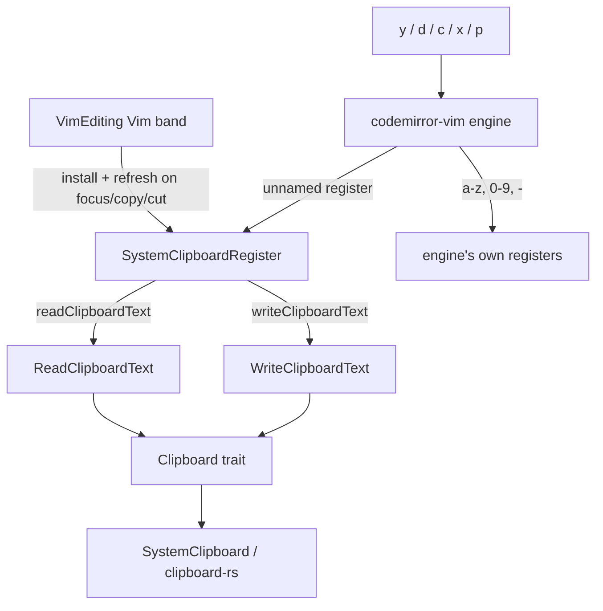

# Vim 與系統剪貼簿相通 — Architecture Design

**Status:** Confirmed (decided autonomously; the user was away — every judgement call is listed in §8)
**Source PRD:** `.sdd/2026-09-08-vim-shares-the-system-clipboard/PRD.md`
**Tech context:** Tauri 2 · Rust workspace (`rustle-domain` trait, `rustle-application` use cases, `rustle-infrastructure` over the existing `clipboard-rs 0.3.5`) · TypeScript strict + CodeMirror 6 + `@replit/codemirror-vim 6.4.0` (engine `@replit/codemirror-vim-core 0.1.0`) · Vitest + happy-dom. Two new channels, no new crate, no new dependency, no capability.

---

## 1. Design Goal & Guiding Principle

- **In one sentence:** while Vim is on, Vim's **unnamed register** (`"`, the one every yank/delete/change lands in and the one a plain `p` reads) is replaced by a `SystemClipboardRegister` that writes every non-empty text it receives through to the operating system's clipboard and answers `p` from a **local copy of the system clipboard's text** that is refreshed whenever the clipboard may have changed behind the editor's back (the window regains focus, a native copy/cut happens, Vim starts).
- **Guiding principle:** *one register, one owner.* The engine already funnels every "text taken" (yank, delete, change, named register — it copies a named register into `"` too) and every plain paste through the unnamed register; the black hole register `_` returns before touching it. Replacing that one object gives BR-1/BR-2/BR-3 for free and keeps every rule of "what goes in and out of the system clipboard" in one class. The webview never touches `navigator.clipboard` (WebKit shows a paste prompt for programmatic reads); the backend reads and writes text through the existing `Clipboard` trait.

The NFR "paste never waits" and the PRD risk "fast but stale vs fresh but slow" are resolved together: `p` is synchronous over the local copy (never an IPC round trip), a Vim write updates the local copy *before* the IPC write is sent (so `y` then `p` is exact), and every event that can bring in another app's text (window focus, native copy/cut) refreshes the local copy; a refresh that started before a newer Vim write is discarded (so a late answer never overwrites the writer's own newer yank).

---

## 2. Change Scope

| Area | Action | What / Why |
| :--- | :--- | :--- |
| `crates/domain/src/clipboard.rs` | **Modify** | `Clipboard` gains `text() -> Result<Option<String>, ClipboardError>` (`None` when the clipboard holds no text, e.g. only a picture) and `set_text(&str)`; `ClipboardError::Unwritable` |
| `crates/application/src/read_clipboard_text.rs` | **Add** | `ReadClipboardText` → `ClipboardText { text: Option<String> }`; an empty string is "no text" |
| `crates/application/src/write_clipboard_text.rs` | **Add** | `WriteClipboardText::execute(text)` |
| `crates/infrastructure/src/system_clipboard.rs` | **Modify** | `text` (`has(Text)` then `get_text`), `set_text` via `clipboard-rs` |
| `src-tauri` (`channel.rs`, `channels.rs`, `commands.rs`, `commands/read_clipboard_text.rs`, `commands/write_clipboard_text.rs`, `command_error.rs`) | **Add/Modify** | Channels `readClipboardText` / `writeClipboardText`; `From<ClipboardError> for CommandError` (unexpected) |
| `src/ipc/channels.ts`, `src/ipc/clipboardText.ts` | **Modify/Add** | Typed wrappers; `ClipboardText = { text: string \| null }` |
| `src/features/vim/SystemClipboardRegister.ts` | **Add** | The unnamed register backed by the system clipboard (§3) |
| `src/features/vim/VimEditing.ts` | **Modify** | While Vim is on: installs the register into the engine and refreshes it on window focus / document copy & cut; nothing while off |
| `src/features/editor/MarkdownEditor.tsx`, `src/features/autosave/AutosavedEditor.tsx`, `src/features/vault/EditorColumn.tsx`, `src/app/App.tsx` | **Modify** | App builds one `SystemClipboardRegister(channels)`; threaded as an optional `vimRegister` prop to `VimEditing` (absent = today's in-memory register, which tests and Vim-off keep) |
| `ImagePaste`, standard copy/cut/paste, settings dialog, keymap overview, status line | **Not touched** | PRD US-03 / §5: no screen, no setting; image paste is the native `paste` event, which Vim's `p` never fires |
| Named registers, `"0`, `"-`, numbered registers, `"+` | **Not touched** | Stay the engine's own in-memory registers (BR-1: named registers never read the system clipboard) |

---

## 3. New Classes / Modules

| Name | Kind | Responsibility (purpose) | Collaborators | Satisfies (PRD scenario) |
| :--- | :--- | :--- | :--- | :--- |
| `Clipboard::text` / `set_text` | Domain trait methods | The system clipboard's plain text in and out | `SystemClipboard` (infra), `MockClipboard` | US-01, US-02 |
| `ReadClipboardText` | Use case | The clipboard's text, empty counted as none | `Clipboard` | US-02 空的／只有圖片 |
| `WriteClipboardText` | Use case | Replace the clipboard's contents with text | `Clipboard` | US-01 all |
| `SystemClipboardRegister` | Frontend model (the engine's register shape) | Vim's unnamed register: `setText` keeps the text, linewise and blockwise as the engine gave them and writes non-empty text through; `pushText` appends and writes the result; `clear` empties the local copy only and an empty `setText` is ignored — neither writes; `toString` / `linewise` / `blockwise` answer the latest known clipboard content — the writer's own (with its exact kind, so a block comes back a block) while the clipboard still holds what this register last wrote, otherwise the outside text with `linewise = endsWith("\n")`, `blockwise = false`, and nothing when there is no text; `refresh()` reads the clipboard and ignores an answer older than the latest write; a failed read counts as no text, a failed write is ignored | `channels.readClipboardText` / `writeClipboardText` | US-01 all, US-02 all, BR-1…BR-6b |

`SystemClipboardRegister` decisions:

| Situation | Behaviour |
| :--- | :--- |
| `y`, `yy`, `dd`, `x`, `c…` (no register) | engine → `setText(text, linewise, blockwise)` → local content = that; write sent |
| `"ay` | engine sets register a, then `unnamed.setText(a's text)` → same as above (BR-1 out) |
| `"ap` | engine reads register a directly; this register is not asked (BR-1 in) |
| `"_dd` | engine returns before any register; nothing written (BR-2) |
| `clear()` (macro recording into `"` starts) / `setText("")` (an empty delete) | nothing written (BR-6b); `clear()` empties only the local copy so a macro records from scratch (`keyBuffer` is the local text, which the engine replays) |
| `p` after another app copied (focus refreshed) | outside text, kind from its last character (BR-4, BR-5) |
| `p` right after `y` | the writer's own content (set synchronously) |
| A refresh answer equal to what this register last wrote | keeps the writer's own content, so linewise/blockwise survive the round trip (BR-6a) |
| Clipboard empty / picture only / read failed | `toString()` is `""` → the engine's paste returns early, no edit (BR-6) |

---

## 4. Modified Components

| Component | Current role | Change needed |
| :--- | :--- | :--- |
| `VimEditing` | Installs Vim in three bands | Takes an optional `SystemClipboardRegister`; the Vim band gains a plugin that, while Vim is on, puts it in the engine's register controller (`"` and `unnamedRegister`), refreshes it once, and listens to `window` `focus` and `document` `copy`/`cut` (a copy/cut refreshes on the next macrotask, after the browser wrote the clipboard). Removed with the band when Vim turns off |
| `MarkdownEditor` / `AutosavedEditor` / `EditorColumn` | Thread `vimModes` | + optional `vimRegister` |
| `App` | Builds sessions | Builds one `SystemClipboardRegister(channels)` |
| `Clipboard` / `SystemClipboard` | Image candidates | + `text`, `set_text` |

---

## 5. Component Relationships

---

## 6. Extensibility & Handoff Notes

- **Most likely next requirement:** cross-app block paste, or "also share `"+`/`"*`", or an option to keep Vim's registers private.
- **Where it lands:** `SystemClipboardRegister` alone decides what goes out and comes in; another register backed by the clipboard is one more `install` line in `VimEditing`. A private-registers option is one condition where `VimEditing` installs the register.
- **Patterns applied & why:** the engine's own extension point (a register object with `setText/pushText/clear/toString`) instead of patching actions; a local copy plus event-driven refresh so the synchronous `p` stays synchronous.
- **Do not hardcode:** the linewise rule lives only in `SystemClipboardRegister` (one place to change BR-5).
- **Known debt / deferred:** another clipboard change while Rustle keeps focus (a clipboard manager writing in the background) is only seen at the next focus or copy; no polling (NFR: no ongoing work).

---

## 7. Traceability

| PRD Scenario | Fulfilled by |
| :--- | :--- |
| US-01 複製一段文字，其他 App 貼得到 | `SystemClipboardRegister.setText` → `writeClipboardText` → `WriteClipboardText` → `SystemClipboard::set_text` |
| US-01 複製一整行，換行一起帶走 | engine appends `\n` for linewise; register writes it as is |
| US-01 刪掉一整行也算剪下 | engine `delete` → unnamed register |
| US-01 刪掉單一個字元也算剪下 | same (`x`) |
| US-01 改寫一段文字，被換掉的原文帶得走 | engine `change` → unnamed register |
| US-01 存進具名暫存格的文字也送出去 | engine copies named into unnamed → register writes |
| US-01 垃圾桶暫存格什麼都不留 | engine returns before any register for `_` |
| US-01 Vim 內部歸零暫存格時，系統剪貼簿原封不動 | `clear()` / empty `setText` never write |
| US-01 Vim 模式關著時本規則不適用 | register only installed by the Vim band; Backspace is not Vim |
| US-02 其他 App 複製的文字貼得進來 | focus refresh → `toString()` returns outside text |
| US-02 最後一次複製的贏 | refresh replaces the writer's content when the clipboard text differs |
| US-02 具名暫存格不讀系統剪貼簿 | engine reads named registers directly |
| US-02 以換行結尾 → 整行 | `linewise = endsWith("\n")` |
| US-02 不以換行結尾 → 一段 | same, false |
| US-02 空的 → 什麼都不做 | `ReadClipboardText` (`None`) → `toString() === ""` → engine paste returns |
| US-02 只有圖片 → 什麼都不做 | `SystemClipboard::text` checks `has(Text)` → `None` |
| US-02 方塊貼回仍是方塊 | refresh equal to last write keeps the writer's blockwise content |
| US-02 其他 App 的多行文字不是方塊 | outside content `blockwise = false` |
| US-02 剛自己複製的東西立刻貼得回來 | `setText` updates the local content synchronously; stale refresh discarded |
| US-03 標準的複製、剪下、貼上照舊 | no keymap/event handler changed; copy/cut listeners only read |
| US-03 Vim 關著貼上圖片照舊 | `ImagePaste` untouched |
| US-03 Vim 開著貼上圖片照舊 | `ImagePaste` untouched; `p` never fires a `paste` event |
| US-03 設定畫面沒有多出任何一項 | no settings change |
| US-04 開著 Vim 的 Vault 裡相通 | Vim band installs the register |
| US-04 當場關掉 Vim，相通消失 | band removed → listeners gone; Backspace edits are not register writes |
| US-04 當場打開 Vim，相通生效 | `switchTo(true)` rebuilds the band → install + refresh |

---

## 8. Risks & Open Decisions

- **Decided (user away):** clipboard I/O goes through the Rust backend, not `navigator.clipboard` (WebKit would show a paste prompt on every `p`, and the webview has no clipboard permission). Two channels instead of one "sync" channel: read and write are independent operations.
- **Decided:** a read or write failure is reported by the backend as an ordinary `unexpected` failure; the register treats a failed read as "no text" and ignores a failed write (PRD Edge Cases).
- **Decided:** the refresh triggers are window `focus`, document `copy`/`cut`, and Vim starting. Rationale: these are the only moments the clipboard can change from outside the editor's own register while the writer is in Rustle. A background clipboard writer while Rustle keeps focus is not observed until the next trigger.
- **Decided:** "the clipboard still holds what this register last wrote" is judged by text equality; if another app copies exactly the same text, Rustle keeps its own kind (linewise/blockwise) — indistinguishable and harmless.
- **Risk:** the register object is the engine's module-global state; `VimEditing` re-installs it every time the Vim band starts so a test or a reset of the engine cannot leave the old one in place.
