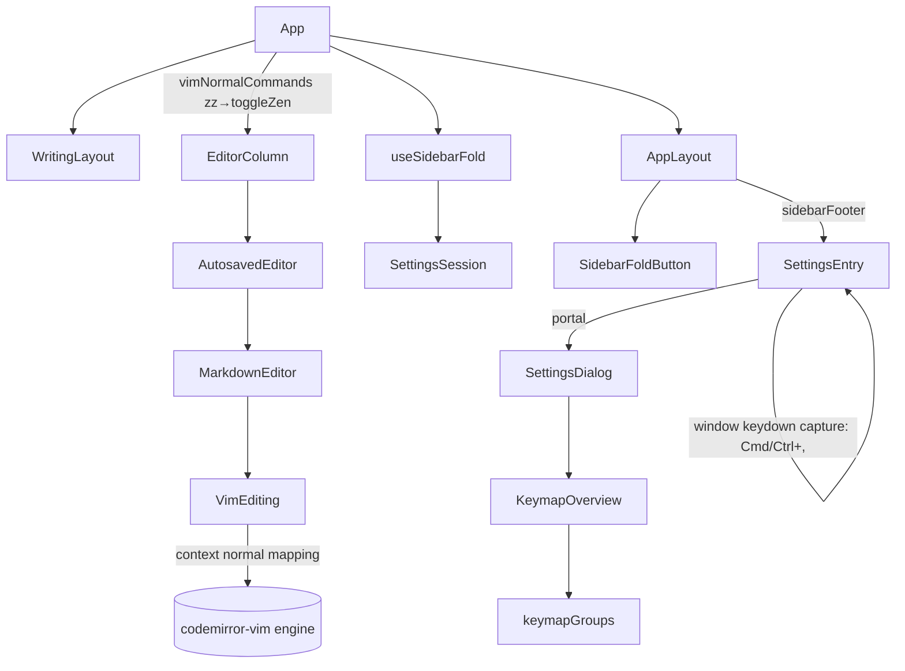

# 專注模式的鍵、側邊欄的摺疊、設定的鍵 — Architecture Design

**Status:** Confirmed (decided autonomously; the user was away — every judgement call is listed in §8)
**Source PRD:** `.sdd/2026-09-08-zen-key-sidebar-fold-and-settings-key/PRD.md`
**Tech context:** Tauri 2 · Rust workspace (`rustle-domain` settings only) · TypeScript strict + React + CodeMirror 6 + `@replit/codemirror-vim 6.4.0` (engine `@replit/codemirror-vim-core 0.1.0`) · Vitest + happy-dom. No channel, no crate, no dependency, no capability.

---

## 1. Design Goal & Guiding Principle

- **In one sentence:** give Zen Mode a Vim Normal-mode key (`zz`) through the Vim engine's own key language, take Zen Mode away from `Esc`, let the sidebar (column 1) fold as a remembered preference independent of Zen Mode, and let `Cmd+,`/`Ctrl+,` toggle the settings dialog from anywhere — without rebuilding the editor.
- **Guiding principle:** *each key has exactly one owner, and the owner sits next to the state it changes.* `zz` is a Vim key, so it is parsed by the Vim engine (its sequence buffer gives "one `z` does nothing" and "Visual keeps Vim's own `zz`" for free) and only *delivered* to the app through one generic seam (`VimNormalCommand`). `Cmd+,` lives inside `SettingsEntry`, the component that already owns "is the settings dialog open". The fold lives in the settings like the section folding next to it.

---

## 2. Change Scope

| Area | Action | What / Why |
| :--- | :--- | :--- |
| `crates/domain/src/settings.rs`, `settings/stored_settings.rs`, `settings/tests.rs` | **Modify** | `SidebarSettings.is_folded: bool` (`sidebar.isFolded`), tolerant read (anything but `true` is unfolded), written only while folded (BR-05, PRD §5 decision 2) |
| `src/ipc/settings.ts`, `SettingsSession.DEFAULT_SETTINGS` | **Modify** | `sidebar: { collapsedSections, isFolded? }` |
| `src/features/sidebar/useCollapsedSections.ts` | **Modify** | Spread the existing `sidebar` so folding a section never drops `isFolded` |
| `src/features/sidebar/useSidebarFold.ts` | **Add** | `{ isFolded, toggle }` over `SettingsSession` (screen first, then write — NFR-03 is `SettingsSession.change`'s existing contract) |
| `src/features/sidebar/SidebarFoldButton.tsx` | **Add** | The real `<button>` (`IconButton`, `aria-expanded`), placed at the head of the article column |
| `src/app/AppLayout.tsx` | **Modify** | `sidebarFold = { isFolded, button }`: the sidebar is hidden when Zen **or** folded; the button sits at the start of the article column's header (hidden with that column in Zen Mode) |
| `src/features/writingLayout/useWritingLayout.ts`, `WritingLayout.ts` | **Modify** | Remove the window Esc listener and `leaveZen` (BR-03/BR-04) |
| `src/features/vim/VimEditing.ts` | **Modify** | Accept `VimNormalCommand[]`; install each as a Normal-mode-only engine mapping whose action runs the command of *this* editor, never while composing |
| `src/features/vim/VimNormalCommand.ts` | **Add** | The seam type `{ keys, run }` |
| `MarkdownEditor`, `AutosavedEditor`, `EditorColumn` | **Modify** | Thread an optional `vimNormalCommands` prop (same path as `vimRegister`) |
| `src/features/interfaceLanguage/SettingsEntry.tsx` | **Modify** | Owns the `Cmd+,`/`Ctrl+,` listener; the dialog is portalled to `document.body` so it shows while the sidebar is hidden; focus returns to where it came from |
| `src/features/keymap/keymapGroups.ts`, `messages.ts` | **Modify** | `Cmd+,` → 設定 row in the window group; `Esc` row stays; no `zz` row (BR-12) |
| `src/app/App.tsx` | **Modify** | Build the `zz` command (`layout.toggleZen`), the fold, and pass them on |
| Zen button, view modes, preview shortcut, article column folding, `TabIndentation`, snippet Esc claims, dialogs' own Esc | **Not touched** | PRD Out of Scope; their Esc handling is "the floating thing's own close" and stays |
| `src-tauri` window chrome | **Not touched** | The window keeps its native title bar, so the traffic lights never overlap the webview (see §8) |

---

## 3. New Classes / Modules

| Name | Kind | Responsibility (purpose) | Collaborators | Satisfies (PRD scenario) |
| :--- | :--- | :--- | :--- | :--- |
| `VimNormalCommand` | Type (seam) | An app action bound to a key sequence in Vim's Normal mode | `VimEditing` | US-01 all |
| `useSidebarFold(settings)` | Hook | Whether column 1 is folded and the toggle that remembers it | `SettingsSession`, `useSettings` | US-03 收起/叫回/記住/不改選擇 |
| `SidebarFoldButton` | Component | The keyboard-reachable button that folds / unfolds column 1 | `IconButton`, `useMessages` | US-03 收起來之後仍然叫得回來 |

> The settings key rule (`Cmd`/`Ctrl` + the physical comma, no Shift/Alt) has one reader, so it lives inline in `SettingsEntry`'s listener rather than in its own module (decided during implementation; see §8).

---

## 4. Modified Components

| Component | Current role | Change needed |
| :--- | :--- | :--- |
| `VimEditing` | Vim band, typing keys, register | Constructor takes `normalCommands`; `#vimBand` adds a facet with this editor's commands (wrapped to do nothing while composing). Each distinct `keys` is mapped once, globally, with `context: "normal"` to an engine action that looks the command up through `cm.cm6.state.facet(...)`. The engine `unshift`s user mappings, so in Normal mode it beats the stock `zz`; in Visual/Insert the context filter skips it and the stock behaviour stays. |
| `useWritingLayout` / `WritingLayout` | Preview shortcut + Esc leaves Zen | Esc listener and `leaveZen` removed |
| `SettingsEntry` | Gear + dialog | + window capture listener for the settings key (ignored while composing, `preventDefault`); dialog via `createPortal(document.body)`; `close` returns focus to the gear when the gear opened it, else to the element that had focus when the key opened it |
| `AppLayout` | Four columns | `sidebarFold` prop; sidebar `hidden={isZen \|\| isFolded}`; `LayoutRegion` gets a `leadingControl` slot used by the article column |
| `keymapGroups` | Taught keys | One row `Cmd+,` → `toggleSettings` (開關設定) in the window group |
| `SidebarSettings` (Rust) | Folded sections | `is_folded` |

---

## 5. Component Relationships

---

## 6. Extensibility & Handoff Notes

- **Most likely next requirement:** another app action on a Vim key (e.g. a preview toggle on `zp`), or a keyboard shortcut for the sidebar fold.
- **Where it lands:** `VimNormalCommand` — one more `{ keys, run }` in the list `App` builds; no change to `VimEditing`. A fold shortcut is one window listener next to `useSidebarFold` (and one keymap row).
- **Patterns applied & why:** a facet carries the commands per editor because engine mappings are global while editors are not; the action looks up the command of the editor the key arrived in.
- **Do not hardcode:** Zen logic inside `VimEditing` (it knows only "keys → run").
- **Known debt / deferred:** no unified key arbitration (the PRD-accepted `Mod+,` vs custom preview shortcut collision remains).
- **Settings key over another dialog (post-review decision, not covered by the PRD):** `Cmd+,`/`Ctrl+,` does nothing while another modal dialog (`aria-modal="true"`) is open, so two modals never stack; it still closes the settings dialog itself. Auto-repeat of a held key is ignored so holding the keys does not flip the dialog.

---

## 7. Traceability

| PRD Scenario | Fulfilled by |
| :--- | :--- |
| US-01 常態模式下 zz 進入／離開專注模式 | `VimEditing` normal command → `WritingLayout.toggleZen`; `AppLayout` hides columns |
| US-01 輸入模式下的 zz 是兩個字母 | engine context filter (`insert` skips `normal` mappings) |
| US-01 Vim 模式關著時 zz 是兩個字母 | `VimEditing` installs nothing while off |
| US-01 選取模式下的 zz 不碰專注模式 | `context: "normal"` mapping; stock `zz` stays for Visual |
| US-01 只按一個 z 什麼都不做 | engine partial-match buffering |
| US-02 專注模式下按 Esc 畫面不變（Vim 開／關） | `useWritingLayout` without the Esc listener |
| US-02 Esc 仍然帶寫作者退回常態模式 | unchanged `VimEditing` |
| US-02 Esc 仍然關得掉片語選單／停得掉填空 | unchanged `SnippetExpansion` claims |
| US-03 收起／叫回最左欄 | `SidebarFoldButton` + `useSidebarFold` + `AppLayout` |
| US-03 收起來之後仍然叫得回來 | `SidebarFoldButton` in the article column header |
| US-03 摺疊不改變任何選擇 | fold touches only `settings.sidebar.isFolded`; `VaultSession` untouched |
| US-03 摺疊會被記住 | `SidebarSettings.is_folded` (Rust) + `useSidebarFold` |
| US-03 專注模式蓋過摺疊但不改變它／攤開的最左欄在專注模式裡照樣收掉 | `AppLayout` `hidden={isZen \|\| isFolded}`; Zen never writes the fold |
| US-03 最左欄不在時視窗按鈕有地方站 | native title bar (§8); the article column header is the top row |
| US-04 Cmd+, 打開／再按一次關掉／最左欄收起／專注模式／Ctrl+, | `SettingsEntry` listener + portal |
| US-04 輸入法選字中不作用 | `composition.ownsKey` in the listener |
| US-05 清單有 Cmd+,／沒有 zz／Esc 那一列還在 | `keymapGroups` |

---

## 8. Risks & Open Decisions

- **Window buttons (BR-08):** the Electron spec assumed a hidden title bar with traffic lights over column 1. Rustle's Tauri window uses the native title bar (`WebviewWindowBuilder` without `title_bar_style`), so the buttons never overlap the webview in any arrangement. Satisfied by construction; no padding is added.
- **`Ctrl+,` on macOS** also opens the settings (one rule for every platform, like the preview shortcut's `Mod`).
- **IME in Normal mode:** the `zz` command does nothing while `CompositionState.isComposing`; in Insert mode the engine never sees composing keys already.
- **Engine mapping is global:** mapped once per `keys` per page; an editor without that command (or with Vim off) gets nothing because the action looks the command up in that editor's facet.
- **The settings key rule is inline** in `SettingsEntry` (one reader; no `SettingsShortcut` module was needed).
- **A mapped key is global to the engine:** once `zz` is mapped, an editor without a `zz` command (none exists in the app today) does nothing on `zz` in Normal mode instead of Vim's scroll-to-centre.
- **Esc then Tab:** unchanged from today (`TabIndentation` always indents); the BRIEF's accepted cost was later overruled by the tab-always-indents slice.
