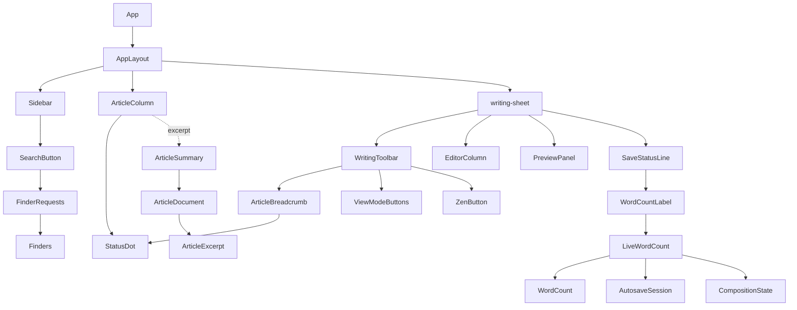

# 寫作紙張：整體畫面改版 — Architecture Design

**Status:** Confirmed（使用者授權以最佳實務自行決定）
**Source PRD:** `.sdd/2026-11-02-writing-sheet-visual-refresh/PRD.md`
**Tech context:** Tauri 2 · Rust workspace（domain / application / infrastructure / src-tauri）· React 19 + CodeMirror 6 · 主題 token（`src/features/theme/`）

---

## 1. Design Goal & Guiding Principle

- **In one sentence:** 把 `AppLayout` 的寫作區改成「工具列 + 編輯／預覽 + 狀態列」疊在一張紙上，文章卡片多一行由 domain 算出來的摘要，狀態列多一個不受選字干擾的即時字數，側欄多一個打開標題搜尋的按鈕；外觀全部改在 `app.css`，只用既有主題 token。
- **Guiding principle:** **規則各住在一個深模組裡，畫面只負責擺。** 摘要的取法只存在 `rustle_domain::ArticleExcerpt`；字數的算法只存在 `WordCount`；狀態對顏色只存在 `StatusDot`（一個 class 名對一個 token）。之後改摘要長度、改字數規則、改狀態色，都只動一個檔。

---

## 2. Change Scope

| Area | Action | What / Why |
| :--- | :--- | :--- |
| `crates/domain` | **Add** `ArticleExcerpt` | 摘要的唯一規則（跳過標題／圖片／程式碼區塊、拿掉排版記號、120 字截斷） |
| `crates/domain::ArticleDocument` | **Modify** | 新增 `excerpt()`，回傳 `Option<ArticleExcerpt>` |
| `crates/application::ArticleSummary` | **Modify** | 新增 `excerpt: Option<String>`；建構改吃 `&ArticleDocument`（`from_document`），讀不出來的檔案走 `unreadable`。`ListArticles`／`CreateArticle`／`UpdateArticleMetadata` 跟著改呼叫 |
| `src/ipc/articleSummary.ts` | **Modify** | `excerpt: string \| null` |
| `src/app/AppLayout.tsx` | **Modify** | 拿掉 `LayoutRegion` 的標題；寫作區變成 `.writing-sheet`：`toolbar` slot、編輯／預覽、`statusLine` slot |
| `src/features/writingLayout/WritingLayout.ts` | **Modify (shrink)** | 工具列不再搬家：刪除 `controlsLiveIn`、`ControlsRegion`、`takeControlsFocus` 與 `choose` 裡的焦點旗標 |
| `src/features/writingLayout/WritingControls.tsx` | **Modify** | `ViewModeButtons` 變成有字有圖示的分段按鈕，刪掉焦點搬家的 effect |
| `src/features/writingLayout/WritingToolbar.tsx` | **Add** | 紙頂端那一條：左邊麵包屑、右邊控制項 |
| `src/features/vault/ArticleBreadcrumb.tsx` | **Add** | `workspace / 標題` + 狀態膠囊，資料取自 `VaultSnapshot` 裡打開的那張卡 |
| `src/features/vault/ArticleColumn.tsx` | **Modify** | 卡片：色點＋標題、摘要、細節列 |
| `src/features/sidebar/StatusDot.tsx` | **Add** | 狀態 → 色點（`noStatus` 不畫） |
| `src/features/sidebar/StatusSection.tsx` / `SidebarRow.tsx` | **Modify** | 列前可放一個 `leading`（色點、資料夾圖示、`#`） |
| `src/features/vault/WorkspaceColumn.tsx`、`TagSection.tsx` | **Modify** | 傳入資料夾圖示／`#` |
| `src/features/wordCount/` | **Add** | `WordCount`（算法＋顯示）、`LiveWordCount`（跟著正文、選字中不動）、`WordCountLabel` |
| `src/features/autosave/AutosavedEditor.tsx` | **Modify** | 不再自己畫 `SaveStatusLine`；狀態列搬到紙的底部，由 `App` 組裝 |
| `src/features/autosave/SaveStatusLine.tsx` | **Modify** | 多一個 `wordCount` slot，順序：模式標籤、位置、字數、提示、記號 |
| `src/features/finding/FinderRequests.ts` | **Add** | 讓畫面上的按鈕也能「按下 ⌘P」 |
| `src/features/finding/Finders.tsx` | **Modify** | 同時聽按鍵與 `FinderRequests` |
| `src/features/finding/SearchButton.tsx` | **Add** | 側欄頂端的搜尋按鈕 |
| `src/features/sidebar/Sidebar.tsx` | **Modify** | 頂端放 `searchButton` slot |
| `src/features/interfaceLanguage/messages.ts` | **Modify** | 刪掉 `articlesTitle`／`editorTitle`／`previewTitle`；新增 `wordCount(n)`、`search`、`viewModeNames` |
| `src/app/app.css` | **Modify (largest)** | 紙、卡片、工具列、分段按鈕、狀態列、色點、字型、對話框與搜尋面板外觀；只用 `var(--color-*)` |
| `src/app/App.tsx` | **Modify** | 組裝：工具列、狀態列、字數、搜尋按鈕（獨立一顆 commit） |
| 主題 JSON／`Theme.ts` | **Not touched** | 色點借用 `link`／`warning`／`success`／`muted-text`；紙外用 `sidebar`；不增加任何 token，自訂主題不必改 |
| 編輯器（`MarkdownEditor`、Vim、快捷鍵） | **Not touched** | PRD 明確排除 |
| `ListAllArticles` | **Not touched** | 它走 `ListArticles`，自動帶摘要 |
| src-tauri 的 command | **Not touched** | 回傳型別序列化自動帶出新欄位 |

---

## 3. New Classes / Modules

| Name | Kind | Responsibility (purpose) | Collaborators | Satisfies |
| :--- | :--- | :--- | :--- | :--- |
| `rustle_domain::ArticleExcerpt` | Value type (newtype) | 由正文算出摘要：`from_body(&str) -> Option<Self>`、`as_str()`；取法全藏在私有方法 | — | US-03 全部 |
| `WordCount` (`src/features/wordCount/WordCount.ts`) | Value class | `WordCount.of(body)` 依規則計數；`value` | — | US-06 計數類 |
| `LiveWordCount` | Session class | 跟著 `AutosaveSession` 的正文重算；選字中保留上一次；`count`（`null` 表示沒打開文章）、`subscribe` | `AutosaveSession`、`CompositionState`、`WordCount` | 「選字中不算」「即時更新」 |
| `WordCountLabel` | Component | 用 `messages.wordCount(n)` 畫出「1,284 字／1,284 words／1 word」 | `LiveWordCount` | US-06 顯示類 |
| `WritingToolbar` | Component | 紙頂端：`leading`（麵包屑）＋ `controls` | — | US-05 位置類 |
| `ArticleBreadcrumb` | Component | `workspace / 標題` ＋ 狀態膠囊；沒打開文章時空白 | `VaultSnapshot`、`StatusDot` | 麵包屑、膠囊 |
| `StatusDot` | Component | `StatusChoice` → `status-dot status-dot--{choice}`；`noStatus` 不畫 | — | 色點類 |
| `FinderRequests` | Event source | `request(kind)`／`subscribe(listener)`，與按鍵走同一條開面板的路 | `Finders` | US-07 搜尋 |
| `SearchButton` | Component | 「搜尋 ⌘P」按鈕，按下 `requests.request("title")` | `FinderRequests` | US-07 搜尋 |

---

## 4. Modified Components

| Component | Current role | Change needed |
| :--- | :--- | :--- |
| `ArticleDocument` | 前言／正文切分 | `excerpt()` = `ArticleExcerpt::from_body(self.body())` |
| `ArticleSummary` | 清單一列 | 加 `excerpt`；`new(workspace, file_name, metadata)` 改成 `from_document(workspace, file_name, &document)` 與 `unreadable(workspace, file_name)`，呼叫端不必自己拼 metadata 與摘要 |
| `AppLayout` | 四欄＋每欄標題 | 無標題；`writing-sheet` 內含 toolbar／panes／statusLine；`controls` 參數改成 `toolbar: ReactNode`、新增 `statusLine: ReactNode` |
| `WritingLayout` | 看法＋專注＋工具列落點 | 刪除工具列落點與焦點搬家 |
| `ViewModeButtons` | 三顆圖示鈕 | 分段按鈕：圖示＋字，`aria-pressed` 照舊 |
| `ArticleColumn` | 文字列 | 卡片三段；`row-status` 文字換成 `StatusDot`（膠囊／側欄仍有文字） |
| `SidebarRow` | 標題＋數量 | 加 `leading?: ReactNode` |
| `AutosavedEditor` | 圖片列＋編輯器＋狀態列 | 拿掉狀態列 |
| `SaveStatusLine` | 位置、模式、提示、記號 | 順序改為模式、位置、字數、提示、記號；加 `wordCount?: ReactNode` |
| `Finders` | 按鍵開面板 | 另外 subscribe `FinderRequests`，與按鍵共用 `onFinderKey` |

---

## 5. Component Relationships

---

## 6. Extensibility & Handoff Notes

- **Most likely next requirement:** 卡片依「本週／更早」分組；打字時即時更新摘要；字數改成「字元數」或加上閱讀時間；搜尋面板加分頁。
- **Where it lands:**
  - 分組 → `arrangeArticles`（已是清單排序的唯一入口）回傳分組，`ArticleList` 只負責畫。
  - 即時摘要 → 摘要規則在 Rust；若要前端即時，把同一份規則做成 command（不要在 TS 複製一份）。
  - 字數規則 → 只改 `WordCount.of`；閱讀時間是 `WordCount` 上的新方法。
  - 搜尋分頁 → `FinderRequests` 已能指名 kind，面板只要畫分頁並 `request` 另一個 kind。
- **Patterns applied & why:** newtype（摘要一定合規）、slot 組裝（`AppLayout` 不認得具體元件，沿用既有寫法）、event source（`FinderRequests`，讓開面板的入口可以再加而不改 `Finders`）。
- **Do not hardcode:** 任何顏色（一律 `var(--color-*)`，`appStyles.test.ts` 會擋）；摘要長度只在 `ArticleExcerpt` 一個常數。
- **Known debt / deferred:** 摘要只在清單重讀時更新（PRD 刻意）；字數每次輸入全文重算，萬字以內是亞毫秒級，若之後支援超長文件再改成增量。

---

## 7. Traceability

| PRD Scenario | Fulfilled by |
| :--- | :--- |
| 淡色主題下紙是白的、紙外是側欄的底色 | `app.css`（`.writing-area` 用 `--color-sidebar`、`.writing-sheet` 用 `--color-editor-background`）＋ `AppLayout` |
| 深色主題下紙與紙外各用主題的深色 | 同上（token 隨主題變） |
| 只填了基本色的自訂主題也完整 | 只用既有 token（`Theme.ts` 由基本色推出全部 token），`appStyles.test.ts` 擋寫死顏色 |
| 欄位頂端不再有大寫小標 | `AppLayout`（拿掉 `region-title`，保留 `aria-label`）、`CollapsibleSection` 不動 |
| 卡片由上到下是色點與標題、摘要、細節列 | `ArticleColumn`、`StatusDot`、`ArticleSummary.excerpt` |
| 暫停的文章是警示色的點 | `StatusDot` + `.status-dot--onHold` → `--color-warning` |
| 已完成的文章是成功色的點 | `StatusDot` + `.status-dot--completed` → `--color-success` |
| 已放棄的文章是次要文字色的點 | `StatusDot` + `.status-dot--dropped` → `--color-muted-text` |
| 沒有狀態的文章沒有點 | `StatusDot`（`noStatus` 回傳 `null`） |
| 在所有文章裡看得到它屬於哪個 workspace | `ArticleColumn`（`row-workspace` 移入細節列） |
| 選中的卡片浮起來 | `app.css` `.article-row[aria-pressed="true"]` |
| 標題太長以刪節號截掉 | `app.css` `.row-title` ellipsis |
| 跳過標題行並拿掉粗體記號 | `ArticleExcerpt::from_body` |
| 拿掉引言與清單記號，多行以空白接起來 | `ArticleExcerpt::from_body` |
| 連結只留文字、反引號拿掉 | `ArticleExcerpt::from_body` |
| 剛好 120 個字不截 | `ArticleExcerpt::from_body` |
| 121 個字截成 120 個字加刪節號 | `ArticleExcerpt::from_body` |
| 正文是空的就沒有摘要那一行 | `ArticleExcerpt::from_body` → `None`；`ArticleColumn` 不畫 |
| 只有標題與圖片也沒有摘要那一行 | 同上 |
| 跳過開頭的程式碼區塊 | `ArticleExcerpt::from_body` |
| 讀不出來的檔案沒有摘要 | `ArticleSummary::unreadable` |
| 打字存檔時摘要不變 | 存檔不重讀清單（`AutosaveSession` 不碰 `VaultSession`），不改 |
| 清單重讀時摘要更新 | `ListArticles` → `ArticleSummary::from_document` |
| 新增只有標題的文章沒有摘要 | `CreateArticle` → `ArticleSummary::from_document` |
| 並排時工具列橫跨紙的頂端 | `AppLayout` `writing-sheet` + `WritingToolbar` |
| 只看編輯時工具列在同一個位置 | 同上（工具列不屬於任何一欄） |
| 只看預覽時工具列在同一個位置 | 同上 |
| 分段按鈕每一顆都有圖示與字 | `ViewModeButtons`、`messages.viewModeNames` |
| 麵包屑與狀態膠囊 | `ArticleBreadcrumb` |
| 沒有狀態就沒有膠囊 | `ArticleBreadcrumb` |
| 專注模式中工具列仍在 | `AppLayout`（專注模式只藏前兩欄） |
| 沒有打開文章時工具列仍可用 | `ArticleBreadcrumb` 空白、`WritingToolbar` 照畫 |
| 中文字一字一算，英文一串算一字 | `WordCount.of` |
| 英文介面以 words 計 | `messages.wordCount`（en） |
| 空的正文是零字 | `WordCount.of`、`messages.wordCount` |
| 英文單數 | `messages.wordCount`（en） |
| 千位加逗號 | `messages.wordCount`（`toLocaleString("en-US")`） |
| 排版記號不算 | `WordCount.of` |
| 選字中的拼音不算 | `LiveWordCount`（`CompositionState`） |
| 打字時即時更新 | `LiveWordCount`（訂閱 `AutosaveSession`，無延遲） |
| 狀態列由左到右的內容 | `SaveStatusLine` 排序、`App` 組裝 |
| 沒有打開文章時沒有狀態列 | `SaveStatusLine`（`noArticle` 回傳 `null`，不變） |
| 按搜尋按鈕等於按 ⌘P | `SearchButton` → `FinderRequests` → `Finders` |
| 側欄不在時看不到搜尋按鈕但 ⌘P 照樣可用 | 按鈕在側欄內隨側欄隱藏；`useFindingKeys` 不變 |
| 側欄的狀態各有色點 | `StatusSection` + `StatusDot` |
| 被選中的列有圓角底色 | `app.css` `.column-row[aria-pressed="true"]` |
| 預覽用襯線字 | `app.css` `.preview-content` font-family |
| 不從網路載入字型 | `app.css` 只用系統字型；CSP 不變 |
